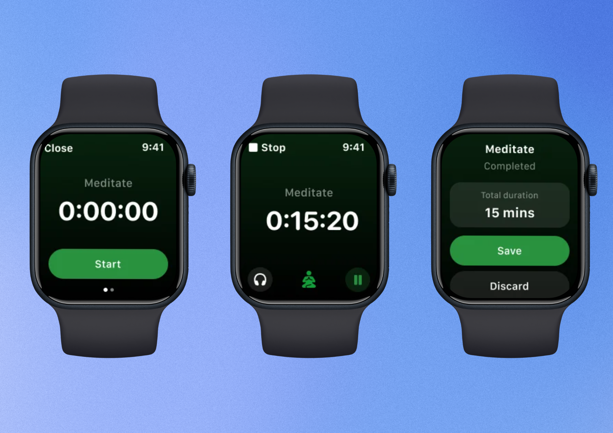

The Habitify app for Apple Watch lets you see your habits, log progress, run a timer, and skip or fail a habit from your wrist, without taking out your phone. It syncs with the Habitify app on your iPhone, so your habits, check-in history, and settings are already there when you open it.

This article covers every feature of the watchOS app.

## Logging into Habitify on your Watch

**Before you start, check that:**

- Habitify is installed on your iPhone and you’re signed in.
- Your Apple Watch **is paired with** that iPhone.
- Both devices **use the same Apple ID, with iCloud Keychain turned on**. The watch gets its sign-in from your iPhone through iCloud Keychain.
- **Bluetooth is on**, on your iPhone.

**Open the app for the first time**

1. Install Habitify on your Apple Watch.
2. **Keep your iPhone near your watch**, and **keep the Habitify app open** on your iPhone.
3. Open Habitify on your watch.
4. Wait while the app syncs with your iPhone. It pulls in your habits, check-in history, and settings.

## Seeing habit lists on your Watch

The first screen is titled **Today**. It shows three groups of lists:

1. **All Habits:** all your habits for today.
2. **Time of day:** one list for each time of day, such as Morning, Afternoon, and Evening. The current one is marked **Now**. The others show their time range, for example 18:00 – 00:00.
3. **Areas:** one list for each of your custom areas.

Each list shows how many habits you’ve completed out of the total for today, for example 0/4.

Tap a list to see the habits in it. Each list has two view modes: **Today** and **Last 7 days**.

###  Today view

Today view opens first. The list name, such as **All Habits**, is at the top, with a back button at the top-left.

Each row shows the habit name, your progress against the goal (for example 10/20 min, 0/1 time, or 12.8/40 km), and a button on the right. A ring around the button fills as you get closer to the goal.

Habits appear in the order you set in the iOS app, grouped by goal type and status. For example, habits with a weekly goal appear under a **This week** heading.

Next to each habit is a button that changes with the habit’s goal:

<table>
  <colgroup>
    <col width="241" />
    <col width="149" />
    <col width="345" />
  </colgroup>
  <thead>
    <tr>
      <th>Habit goal</th>
      <th>Button</th>
      <th>What it does</th>
    </tr>
  </thead>
  <tbody>
    <tr>
      <td>Duration (minutes or hours)</td>
      <td>Timer</td>
      <td>Starts a countdown session</td>
    </tr>
    <tr>
      <td>“time” unit</td>
      <td>Plus (+)</td>
      <td>Adds to the habit’s progress</td>
    </tr>
    <tr>
      <td>Any other unit</td>
      <td>Log</td>
      <td>Lets you enter a value</td>
    </tr>
  </tbody>
</table>

### Last 7 days view

To access the view of last 7 days, from Today view, swipe left. 

In this view, you can see your habit list with the progress of the last 7 days for each habit. Read the view from top to bottom:

1. A row of weekday letters at the top shows the last 7 days. Today is the circled letter on the right.
2. Under it, each habit shows its name and one square per day, in the habit’s color, lined up under the weekday letters.
3. A habit with a weekly, monthly, or yearly goal shows one bar for the current period instead of seven squares.

Here, habits is sorted regardless of goal type and status.

## Seeing a habit progress view

Tap any habit to open its progress view. Scroll down to see it in order:

1. **Habit name and progress:** Your progress against the goal for the current period, for example 2/3 times this week. A ring on the right shows the habit’s status. Your current streak shows as a flame badge with the number of days, for example 0d.
2. **Checklist**, if the habit has one. Completed items are checked and crossed out.
3. **History:** What it shows depends on the habit’s goal type (see below).
4. **Today Notes:** The text notes you added today.

#### What the history shows

<table>
  <colgroup>
    <col width="100" />
    <col width="597" />
  </colgroup>
  <thead>
    <tr>
      <th>Habit goal</th>
      <th>History</th>
    </tr>
  </thead>
  <tbody>
    <tr>
      <td>Daily</td>
      <td>**Last 4 weeks:** a grid with one column for each weekday (M to S) and one row for each of the last 4 weeks. Brighter squares are days you completed the habit. Darker squares are days you didn’t.</td>
    </tr>
    <tr>
      <td>Weekly</td>
      <td>**Last 4 weeks:** one bar per week, labeled This week, Last week, then date ranges such as Jul 11 – Jul 18.</td>
    </tr>
    <tr>
      <td>Monthly</td>
      <td>**Last 3 months:** one bar per month, labeled with the month and year.</td>
    </tr>
    <tr>
      <td>Yearly</td>
      <td>No history. The view shows the checklist and notes only.</td>
    </tr>
  </tbody>
</table>

On the bars, the filled part shows how much of the goal you completed in that period.

## Checking in your habit progress

### How to log progress

There are 2 ways to log progress for a habit on Apple Watch:

- In the **Day view** of your habit list, use the smart buttons next to the habit.

- Open the **habit's progress view**, and tap the button to log value in the bottom right corner.

### **How to** Skip or Fail a habit for today

1. Open the habit’s progress view.
2. Tap the **3-dot** button.
3. Choose **Skip Today** or **Mark as Failed**.

## Adding a note for your habit

1. Open the habit’s progress view.
2. Tap the **3-dot** button.
3. Choose **Text Note** and add your note.

## Running a Timer session

### How to start a session

1. In Today view, tap the **timer** button next to the habit.
2. Access the default **Countdown**: tap the **minutes** or **seconds** to select them, then turn the Digital Crown to set the time. 
3. Access the **Stopwatch**: swipe left the screen of Countdown.
4. Tap **Start**.

### Controlling a running session

The watch shows a live countdown with three controls:

- **Pause and resume:** Tap the pause button (||) in the bottom-right corner. It changes to a play icon (▶). Tap it to resume.
- **Background sounds:** Tap the headphone icon in the middle to turn ambient background sounds on or off.
- **Stop and save:** Tap the **X** in the top-left corner to stop the timer. Habitify asks whether to save the elapsed time to the habit’s progress for the day. For example, if your goal is 30 minutes and you stop at 15, you can save 15 minutes or discard them.

## FAQs

<AccordionGroup>
  <Accordion title="**Why are my habits not showing on the watch?**">
    1. On your iPhone, open Habitify and pull down from the top of the habit list to refresh it. Then open Habitify on your watch again.
    2. Check that Bluetooth is on and your watch is connected to your iPhone.
    3. Restart both your iPhone and your Apple Watch.
  </Accordion>

  <Accordion title="**The app is stuck on “Waiting for authentication.” What do I do?**">
    This happens when iCloud Keychain is off on either device, or when the watch and iPhone use different Apple IDs.

    1.  On your iPhone, open **Settings**.
    2. Tap **[your name],** then **iCloud**.
    3. Tap **Passwords**, then turn on **Sync this iPhone**.
    4. Make sure your Apple Watch is signed in to the same Apple ID as your iPhone. If your watchOS settings have a Keychain option, make sure it’s on.
    5. Keep your iPhone near your watch, with Habitify open on the iPhone, for 2 to 5 minutes.
    6. Open Habitify on your watch again.

    If it’s still stuck, restart both devices, open Habitify on your iPhone first and then on your watch, or reinstall the watch app. If the problem continues, contact us with your iPhone model, Apple Watch model, watchOS version, and a short video of the issue.
  </Accordion>

  <Accordion title="**Why can’t I see the timer button on a habit?**">
    The timer button only appears on habits with a goal in minutes or hours. It doesn’t appear on yes/no habits or habits in other units. Check the habit’s goal on your iPhone and make sure it uses a duration unit.
  </Accordion>

  <Accordion title="**Why do my habits look different in Today view and Last 7 days view?**">
    Both views keep the habit order from the iOS app. Today view also groups habits by goal type and status. Last 7 days view doesn’t, so it shows the same order regardless of goal type and status.
  </Accordion>

  <Accordion title="**Which complications are available for Habitify?**">
    Habitify has three complications:

    1. **Round:** Tap to Track.
    2. **Corner:** Tap to Track.
    3. **Middle:** a regtangle one to show one of these following: today’s list, the current time of day list, or a block map of a habit’s progress.

    Which ones you can add depends on the slots your watch face has
  </Accordion>

  <Accordion title="**I marked a habit as failed or skipped by mistake. How do I undo it?**">
    Open the habit and tap **Reset** in the bottom-right corner of the progress view.
  </Accordion>

  <Accordion title="**Can I see all the notes I’ve ever logged on the watch?**">
    No. The watch shows only today’s notes, under **Today Notes** in a habit’s progress view. Notes from earlier days aren’t shown on the watch.

    To read older notes, use Habitify on your iPhone:

    1. **Notes for one habit:** In Journal, tap the habit, then open the **Note** tab.
    2. **Notes across all habits:** In Journal, pull down the list to open Reflection. It shows your notes and mood logs in one place.
  </Accordion>
</AccordionGroup>
