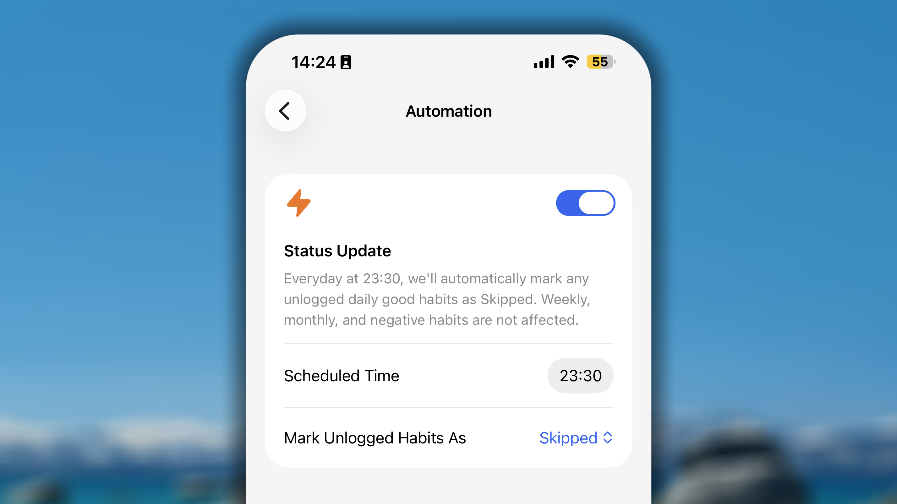
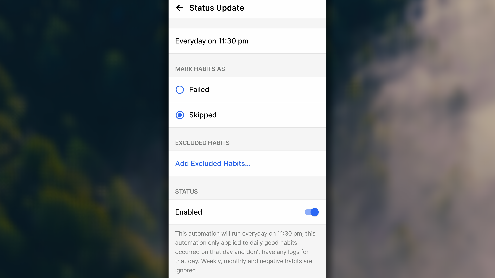

An manchen Tagen läuft alles anders als geplant. Eine Gewohnheit, die du tatsächlich nicht ausgeführt hast, kann dann ohne Status bleiben, sofern du nicht daran denkst, die App zu öffnen und sie selbst zu markieren.

Die **automatische Statusaktualisierung** schließt diese Lücke: Zu einem von dir festgelegten Zeitpunkt prüft Habitify, welche Gewohnheiten keinen protokollierten Fortschritt haben, und markiert sie automatisch. So bleibt deine Aufzeichnung auch an Tagen ehrlich, an denen du den Check-in vergisst.

## Wichtige Hinweise

Damit die Automatisierung wie erwartet funktioniert, solltest du einige Einschränkungen kennen:

- **Sie wird nur für den aktuellen Tag ausgeführt.** Lege die Auslösezeit nicht nach 23:59 Uhr fest. Wenn die Ausführung über Mitternacht hinausgeht, könnten stattdessen die Gewohnheiten des nächsten Tages geprüft werden.
- **Sie gilt nur für gute Gewohnheiten mit täglicher Wiederholung.** Wöchentliche und monatliche Gewohnheiten sowie schlechte Gewohnheiten werden derzeit nicht berücksichtigt.
- **Sie betrifft nur Gewohnheiten, deren heutiger Fortschritt noch 0 ist.** Gewohnheiten, für die du bereits etwas protokolliert hast, bleiben unverändert.
- **Wenn sich die Zeitzone deines Geräts manuell oder automatisch auf einer Reise ändert,** öffne die Einstellung zur Statusaktualisierung und aktualisiere sie, indem du sie aus- und wieder einschaltest. So bleibt die Auslösezeit korrekt.
- **Sie ist eine Unterstützung, kein Ersatz.** Du kannst den Status einer Gewohnheit weiterhin jederzeit manuell aktualisieren. Die Automatisierung erfasst lediglich, wozu du nicht gekommen bist.

## Automatisierung aktivieren

<Tabs>
  <Tab title=" iOS">
    

    1. Öffne in Habitify die **Einstellungen**.
    2. Öffne unter **Integration** den Bereich **Automatisierung**.
    3. Aktiviere auf der Einstellungsseite der Automatisierung den Schalter.
    4. Tippe unter **Geplante Zeit** auf die Uhrzeit und stelle die gewünschte Zeit ein.
    5. Wähle unter **Nicht protokollierte Gewohnheiten markieren als**, welchen Status nicht protokollierte Gewohnheiten erhalten sollen:
       - **Übersprungen:** Du hast dich aus einem triftigen Grund bewusst dagegen entschieden.
       - **Nicht geschafft:** Du hast die Gewohnheit ohne triftigen Grund nicht abgeschlossen.
    6. Wenn alles eingerichtet ist, tippe oben rechts auf く, um zu speichern und zurückzukehren.
  </Tab>
  <Tab title="🤖 Android">
    

    1. Öffne in Habitify die **Einstellungen**.
    2. Öffne unter **Automatisierung** die **Statusaktualisierung**.
    3. Auf der Einstellungsseite der Statusaktualisierung:
       - Tippe auf **Täglich um [Uhrzeit]** und stelle die Uhrzeit ein, zu der die Automatisierung täglich ausgeführt werden soll.
    4. Wähle unter **Gewohnheit markieren als**, welchen Status nicht protokollierte Gewohnheiten erhalten sollen:
       - **Überspringen:** Du hast dich aus einem triftigen Grund bewusst dagegen entschieden.
       - **Fehlgeschlagen:** Du hast die Gewohnheit ohne triftigen Grund nicht abgeschlossen.
    5. Tippe unter Ausgeschlossene Gewohnheiten auf **Ausgeschlossene Gewohnheiten hinzufügen...** und wähle die Gewohnheiten aus, die von der Automatisierung ausgeschlossen werden sollen.
    6. Aktiviere unter Status den Schalter **Aktiviert**.
    7. Wenn alles eingerichtet ist, tippe oben rechts auf **←**, um zu speichern und zurückzukehren.
  </Tab>
</Tabs>
