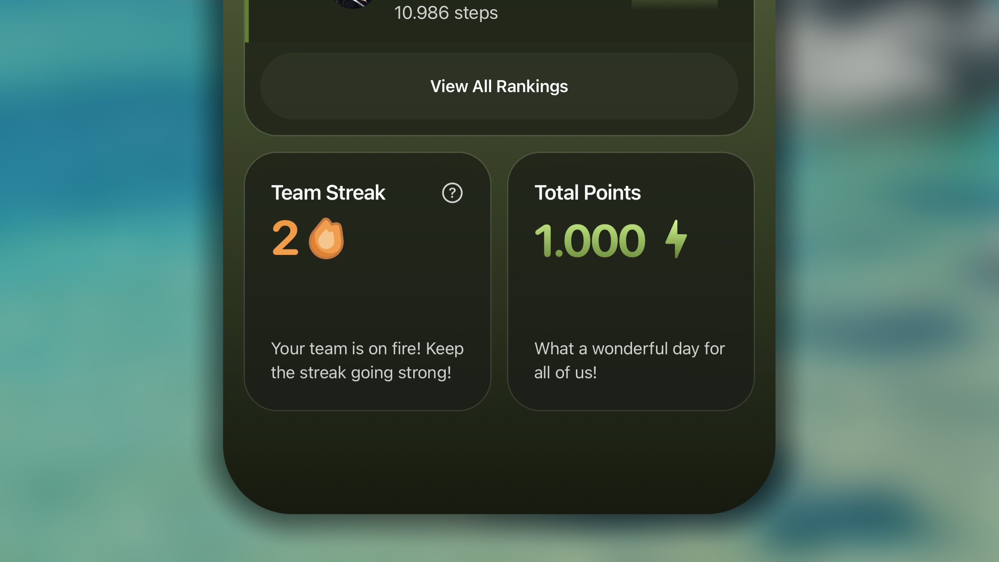
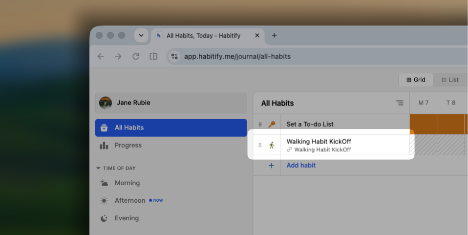

Eine Challenge ist eine zeitlich begrenzte Möglichkeit, gemeinsam mit einer Gruppe eine Gewohnheit aufzubauen. Statt eine Gewohnheit allein zu verfolgen, verpflichtest du dich zusammen mit anderen für einen festgelegten Zeitraum dazu und arbeitest im Wettbewerb – oder einfach gemeinsam – auf dasselbe Ziel hin.

Dieser Artikel enthält alle Einzelheiten, damit du mit anderen Personen eine Challenge starten kannst.

## Challenge und Kreis vergleichen

|  | **Challenge** | **Kreis** |
| :-- | :-- | :-- |
| **Dauer** | Zeitlich begrenzt; läuft von einem festgelegten Start- bis zu einem Enddatum | Fortlaufend – ohne Enddatum; bleibt bestehen, bis der Eigentümer ihn archiviert oder löscht |
| **Verfolgte Gewohnheiten** | Ein gemeinsames Gewohnheitsziel pro Challenge | Mehrere geteilte Gewohnheiten gleichzeitig; die Gewohnheiten werden von jedem Mitglied angepasst. |
| **Statistikelement** | <ul><li>Die **Serienrangliste** ordnet die Punkte der Teilnehmer für jeden abgeschlossenen Tag; für versäumte Tage können optional Punkte abgezogen werden.</li><li>Die **Teamserie** erhöht sich, wenn alle Mitglieder die Gewohnheit der Challenge für den aktuellen Tag abschließen.</li></ul> | <ul><li>Die **Einheitsserie** erhöht sich, wenn jedes Mitglied mindestens eine geteilte tägliche Gewohnheit abgeschlossen hat, die für den aktuellen Tag geplant ist.</li><li>Die **Momentum-Punktzahl** erhöht sich, wenn eine geteilte Gewohnheit abgeschlossen wird; optional kann eine Rangliste der Momentum-Punkte der Mitglieder angezeigt werden.</li></ul> |
| **Fortschritt bearbeiten** | Nach dem Protokollieren für den aktuellen Tag gesperrt; vergangene Tage können weder nachgetragen noch geändert werden. Begrenzt überspringbar; Abwesenheitsmodus wird unterstützt. | Spiegelt den Fortschritt deiner Gewohnheit aus der Tagebuchansicht einschließlich späterer Änderungen wider. Unbegrenzt überspringbar; Abwesenheitsmodus wird unterstützt. |
| **Gruppengröße** | Unbegrenzt | Unbegrenzt |
| **Soziale Interaktion** | Aktivitäten-Tab: Reaktionen, Kommentare, @-Erwähnungen und fortlaufende Unterhaltungen | Aktivitäten-Tab: Reaktionen, Kommentare, @-Erwähnungen und fortlaufende Unterhaltungen |
| **Verfügbare Plattformen** | iOS, Android | iOS, Android |

<Tabs>
  <Tab title="iOS & Android">
    ## Eine Challenge veranstalten

    ### Eine neue Challenge erstellen

    1. Gehe in der Habitify-App zum Tab **Freunde**.
    2. Tippe auf **+** und wähle **Challenge**.
    3. Passe die Details deiner Challenge an:
       
       1. Tippe auf **Hintergrund auswählen** und wähle ein inspirierendes Titelbild aus **Vorschläge** (unsere eigene Sammlung), **Unsplash** oder **Fotos** (deine eigene Fotomediathek).
       2. Tippe auf das Eingabefeld **Name der Challenge** und gib einen klaren, motivierenden Titel ein (z. B. „30 Tage Achtsamkeit“ oder „Club der Frühaufsteher“).
       3. Wähle unter dem Namen der Challenge eine Farbe, die auf die Schaltflächen und interaktiven Elemente in deinem Challenge-Bereich angewendet wird.
       4. Tippe auf **+ Kurzbeschreibung hinzufügen**, um eine Einführung oder Erklärung der Challenge hinzuzufügen. So erfahren die Teilnehmer, was sie erwartet und warum sie teilnehmen sollten.
    4. Lege die Regeln deiner Challenge fest:
       
       - **Dauer:** Tippe auf das Feld und wähle eine _Voreinstellung_ wie 7, 14, 21, 30, 45, 60 oder 90 Tage oder wähle **Benutzerdefiniert**, um einen eigenen Zeitraum festzulegen.
       - **Mindestziel:** Tippe auf das Feld und konfiguriere die zulässige Protokollierungsmethode sowie den Mindestwert, zu dem sich jedes Mitglied verpflichten muss.
         - **Zulässige Protokollierungsmethoden**: Dazu gehören die manuelle Protokollierung und die automatische Protokollierung aus Gesundheits- und Wellness-Apps (Apple Health, Fitbit, Strava und Health Connect).
           
         - **Zielaktivität**: Abhängig von den ausgewählten Methoden werden darunter die verfügbaren Aktivitäten aufgelistet, aus denen du wählen kannst.
           
         - **Tägliches Mindestziel festlegen:** In diesem Schritt legst du die Grundanforderung fest, zu der sich jedes Mitglied verpflichten muss. Welche Einheit zur Verfolgung des Ziels unterstützt wird, hängt ebenfalls von den ausgewählten Protokollierungsmethoden ab.
           
       - **Schwierigkeitsgrad:** Tippe auf das Feld und lege fest, wie streng der Wettbewerb sein soll. Diese Stufen bestimmen die Punkteberechnung:
         
         - **Freundlich**: + 100 für Abgeschlossen, + 0 für Übersprungen, − 0 für Nicht geschafft
         - **Wettbewerb**: + 100 für Abgeschlossen, + 0 für Übersprungen, − 50 für Nicht geschafft
         - **Hardcore**: + 100 für Abgeschlossen, + 0 für Übersprungen, − 150 für Nicht geschafft
       - **Überspringen erlaubt:** Tippe auf das Feld und lege fest, wie oft ein Benutzer einen Tag als **Übersprungen** markieren und seine Serie einfrieren darf.
    5. Tippe abschließend oben rechts auf **Fertig**, um deine Challenge zu speichern.

    ### Dich zu deiner Challenge verpflichten

    

    Da du der Gastgeber bist, solltest du als erste Person beitreten und dich zur Challenge verpflichten:

    1. Öffne im Tab **Freunde** die soeben erstellte Challenge.
    2. Scrolle nach unten und tippe auf **Zu meinen Tageszielen verpflichten**.
    3. Gib dein persönliches Tagesziel ein, das mindestens dem Mindestziel der Challenge entsprechen muss.
    4. Unterschreibe und schiebe die Schaltfläche, um deine Verpflichtung offiziell zu bestätigen.

    ### Personen zu deiner Challenge einladen

    Eine Challenge benötigt mindestens 2 Mitglieder (einschließlich dir als Eigentümer), die sich zu ihren Zielen verpflichtet haben, bevor sie offiziell starten kann.

    

    So lädst du andere Personen zu deiner Challenge ein:

    1. Öffne deine Challenge und tippe auf **+ Mitglieder einladen**.
    2. Ein Freigabedialog mit verschiedenen Möglichkeiten zum Teilen deiner Challenge erscheint:
       - **Nachrichten:** Sende sie direkt über die Nachrichten-App.
       - **Link teilen:** Verwende die Systemfreigabe, um sie direkt an einen Kontakt zu senden, in sozialen Medien zu posten, über eine E-Mail-App zu versenden usw.
       - **Link kopieren:** Kopiere die URL in die Zwischenablage und füge sie an einer beliebigen Stelle ein.\
    3. Als Gastgeber bestimmst du mit dem Schalter **Automatisch genehmigen**, wer deiner Challenge beitreten darf:
       - **Aktiviert**: Personen können ohne deine Genehmigung sofort beitreten.
       - **Deaktiviert**: Du entscheidest, wer beitreten darf und wer nicht.

    ### Personen in deiner Challenge verwalten

    Wenn du **Automatisch genehmigen** deaktivierst, muss jede Person, die auf deinen Link tippt, eine Beitrittsanfrage senden. Du kannst alle Anfragen folgendermaßen anzeigen:

    - Tippe auf die Benachrichtigung über neue Anfragen oder
    - tippe in deiner Challenge auf das Banner, das auf eine ausstehende Genehmigung hinweist.

    

    Unter den Freigabeoptionen im Abschnitt _Wartet auf Genehmigung_:

    - Tippe auf **Genehmigen**, wenn du die Anfrage annimmst.
    - Tippe auf **Ablehnen**, wenn die Person nicht beitreten soll.

    

    ### Deine Challenge starten

    Als Eigentümer der Challenge hast du die Ehre, den Startschuss zu geben.

    1. Öffne die von dir erstellte, noch nicht gestartete Challenge.
    2. Tippe direkt unter dem Namen und der Beschreibung der Challenge auf **Challenge starten**.

    

    Die Challenge beginnt sofort und läuft bis **23:59:59 Uhr** am Enddatum, das sich aus deiner Dauereinstellung ergibt.

    Sobald du auf Start tippst, erhalten alle Mitglieder eine Push-Benachrichtigung darüber, dass der Wettbewerb begonnen hat.

    <Note>
      Eine Challenge benötigt mindestens 2 Mitglieder, die bereits beigetreten sind und sich verpflichtet haben, bevor sie beginnen kann.
    </Note>

    ## Einer Challenge beitreten

    Du hast einen Einladungslink zu einer Habitify-Challenge erhalten? Mit diesen einfachen Schritten nimmst du die Einladung an und legst los.

    1. Installiere die Habitify-App und melde dich bei deinem Habitify-Konto an.
    2. Tippe auf den erhaltenen Einladungslink. Er öffnet die Challenge direkt in der App.
    3. Nimm dir einen Moment Zeit, um die Regeln der Challenge zu prüfen:
       
       - **Name und Beschreibung der Challenge:** Erfahre, worum es in der Challenge geht und was der Gastgeber von den Teilnehmern erwartet.
       - **Challenge-Regeln:**
         - **Dauer:** wie lange die Challenge dauert (z. B. 30 Tage).
         - **Mindestziel:** das Tagesziel, das du erreichen musst (z. B. „20 Seiten lesen“).
         - **Überspringen erlaubt:** wie viele „freie Tage“ während der Challenge zulässig sind.
       - **Mitglieder:** Sieh, wer der Gruppe bereits beigetreten ist.
    4. Tippe direkt unter dem Namen und der Beschreibung der Challenge auf **Verpflichten und beitreten** und führe dann Folgendes aus:
       
       - **Tagesziel festlegen:** Du musst dich zu einem persönlichen Tagesziel verpflichten, das **mindestens dem vom Gastgeber festgelegten Mindestziel entspricht**.
       - **Verpflichtung unterschreiben:** Unterschreibe unten auf dem Bildschirm mit deinem Namen.
       - **Zum Bestätigen schieben:** Schiebe die Schaltfläche über den Bildschirm, um deine Verpflichtung offiziell festzuhalten.

    Nun ist alles eingerichtet. Als Nächstes wartest du darauf, dass der Gastgeber die Challenge startet. Du erhältst eine Push-Benachrichtigung, wenn die Challenge beginnt.

    ## Eine mit der Challenge verbundene Gewohnheit hinzufügen

    Sobald die Challenge aktiv ist, muss jeder Teilnehmer einschließlich des Gastgebers eine mit der Challenge verknüpfte Gewohnheit zur täglichen Liste im Tagebuch hinzufügen. So kann jedes Mitglied leichter daran denken, auf Kurs bleiben und den Fortschritt der Challenge protokollieren.

    1. Öffne die App und rufe die Challenge auf.
    2. Tippe in der Challenge unter **Bereit mitzumachen?** auf **Gewohnheit erstellen**.
       
    3. Du gelangst zum Bildschirm zur Gewohnheitserstellung und kannst eine neue Gewohnheit speziell für diese Challenge konfigurieren.
       1. Tippe auf **Ziel** und wähle deine bevorzugte Protokollierungsmethode. Die verfügbaren Optionen richten sich nach den Einstellungen des Challenge-Gastgebers.
          
       2. Tippe auf **Speichern**, um die Gewohnheit zu speichern.

    <Note>
      Für die Challenge-Gewohnheit gilt standardmäßig:

      - **Wiederholen** steht auf täglich; **Startdatum** und **Endbedingung** entsprechen der Dauer der Challenge.
      - Das **Ziel** kann geändert werden, muss jedoch weiterhin mindestens dem Mindestziel der Challenge entsprechen.
    </Note>

    ## Fortschritt einer Challenge protokollieren

    Es gibt zwei bequeme Möglichkeiten, den Fortschritt einer Challenge-Gewohnheit zu erfassen.

    ### **Über die Liste im Tagebuch**

    Challenge-Gewohnheiten erscheinen neben deinen persönlichen Gewohnheiten in der Hauptliste des **Tagebuchs**. Du kannst sie genau wie jede andere Gewohnheit verfolgen.

    1. Suche deine Challenge-Gewohnheit im **Tagebuch**.
       
    2. Wenn du die _manuelle Protokollierung_ gewählt hast, kannst du den Fortschritt mit deiner bevorzugten Methode erfassen:
       - **Nach rechts wischen**, um die Gewohnheit als abgeschlossen zu markieren oder zu protokollieren.
       - **Nach links wischen**, um sie als übersprungen oder nicht geschafft zu markieren.
       - Die **intelligente Schaltfläche** neben der Gewohnheit verwenden.
    3. Wenn du die Synchronisierung aus einer anderen App gewählt hast, wird der Gewohnheitsfortschritt automatisch mit den von deiner Gesundheits-App erfassten Daten aktualisiert.

    ### **Über die Statistiken der Challenge**

    Wenn du dich bereits in der Challenge befindest, kannst du deinen Fortschritt im Tab **Statistiken** protokollieren.

    - Suche im Tab **Statistiken** unter **Heutige Zusammenfassung** die Schaltfläche **Meinen Fortschritt protokollieren** und tippe darauf.
      
    - Gib deinen Fortschrittswert ein oder wähle eine der beiden anderen Optionen **Überspringen** und **Nicht geschafft**.
    - Schiebe abschließend die Schaltfläche, um dein Protokoll zu speichern.

    ## Statistiken der Challenge ansehen

    Bei einer Habitify-Challenge geht es nicht nur um die eigene Leistung, sondern auch darum, zu sehen, wie sich die gesamte Gruppe gemeinsam entwickelt. Der Tab _Statistiken_ bietet ein Challenge-Dashboard, in dem du alle Einzelheiten von der Teamserie bis zur Wettbewerbsrangliste verfolgen kannst.

    ### **Fortschritt der Dauer**

    Zuerst siehst du einen Fortschrittsbalken. Er veranschaulicht den zeitlichen Verlauf deines Weges und zeigt den aktuellen Tag im Verhältnis zur Gesamtdauer der Challenge.

    Am 15. Tag einer 30-tägigen Challenge wird beispielsweise „Tag 15 von 30“ sowie das genaue Enddatum (z. B. 1. Jan. 2026) angezeigt. So weißt du genau, wie viel Zeit dir zur Erreichung deiner Ziele bleibt.

    ### **Heutige Zusammenfassung**

    Dieser Abschnitt bietet eine Echtzeitübersicht über die Gruppenaktivitäten des aktuellen Tages. Er zeigt die Anzahl der Mitglieder, die:

    - ihr Tagesziel **abgeschlossen** haben;
    - den Tag **übersprungen** haben (eine Überspringmöglichkeit genutzt haben);
    - **pausieren** (derzeit den Abwesenheitsmodus nutzen);
    - das Ziel **noch nicht abgeschlossen** haben (einschließlich Mitgliedern mit dem Status „In Bearbeitung“ oder „Nicht geschafft“).

    ### **Rangliste**

    In der Rangliste findet der freundschaftliche Wettbewerb statt. Die Mitglieder werden anhand ihrer Leistung entweder für „Heute“ oder „Gesamt“ eingestuft.

    In der Ansicht **Heute**:

    - **Aktueller Fortschritt:** Sieh genau, wie viel jedes Mitglied am aktuellen Tag protokolliert hat (z. B. „15/30 Min.“).

    - **Persönliche Serie:** Sieh die aktuelle persönliche Serie jedes Mitglieds und erkenne, wer gerade besonders erfolgreich ist.

    

    In der Ansicht **Gesamt**:

    - **Gesamtpunktzahl:** die seit Tag 1 der Challenge gesammelte Punktzahl.

    - **Gesamter protokollierter Wert:** die Summe aller seit Tag 1 erfassten Aktivitäten (z. B. „Gesamt: 450 Min.“).
    - **Voraussichtliche Medaille:** Sieh, welche Medaille (Gold, Silber oder Bronze) ein Mitglied aufgrund seiner Gesamtleistung derzeit voraussichtlich erhält.

    

    **Für die Rangfolge der Leistungen aller Mitglieder einer Challenge** verwenden wir ein faires System, das den ersten Platz bestimmt:

    1. **Hauptfaktor – Gesamtpunktzahl.** Das Mitglied mit der höchsten Punktzahl belegt den ersten Platz.
    2. **Erstes Entscheidungskriterium bei Gleichstand – gesamter protokollierter Wert.** Bei gleicher Punktzahl wird die Person höher eingestuft, die insgesamt einen höheren Wert erfasst hat (z. B. mehr Minuten oder Seiten).
    3. **Zweites Entscheidungskriterium bei Gleichstand – Zeitpunkt des letzten Protokolls.** Wenn Punktzahl und protokollierter Wert weiterhin gleich sind, gewinnt die Person, die ihre Gewohnheit früher abgeschlossen hat.

    Die Medaillen in der Gesamtrangliste würdigen die Anstrengungen der Mitglieder, die bei der Challenge Fortschritte erzielt haben.

    .png "Challenge und Kreis im Vergleich (2)")

    Die Medaillen werden nach folgenden Regeln vergeben:

    - 🥇 **Goldmedaille:** Für das Mitglied auf Platz 1.
    - 🥈 **Silbermedaille:** Für die nächsten 40 % der Mitglieder mit der besten Leistung.
    - 🥉 **Bronzemedaille:** Für die übrigen Mitglieder.

    ### **Teamserie**

    

    Dies ist das wichtigste Maß für die gemeinsame Beständigkeit deiner Gruppe. Die _Teamserie_ zählt, an wie vielen aufeinanderfolgenden Tagen die gesamte Gruppe erfolgreich war.

    **Die Teamserie erhöht sich um 1 Tag, wenn:**

    - **Alle abschließen:** Jedes einzelne Mitglied schließt am aktuellen Tag sein zugesagtes Tagesziel ab und markiert die Challenge-Gewohnheit für den aktuellen Tag als abgeschlossen.
    - **Teilweiser Abschluss (keine Fehlschläge):** Einige Mitglieder schließen das Ziel ab, während andere „Überspringen“ oder den „Abwesenheitsmodus“ verwenden, und niemand lässt die Gewohnheit für den Tag unvollständig oder markiert sie als nicht geschafft.

    **Die Serie wird auf 0 zurückgesetzt, wenn:**

    - **Nur eine Person scheitert:** Wenn auch nur ein Mitglied sein Ziel nicht abschließt (und weder Überspringen noch Abwesenheitsmodus verwendet), wird die gesamte Teamserie auf null zurückgesetzt.

    ### **Gesamtpunktzahl**

    Dies ist die Summe aller Punkte, die alle Mitglieder in der Challenge gesammelt haben. Sie stellt die gemeinsame Gesamtanstrengung und den Erfolg deiner gesamten Gruppe dar.

    Wie Punkte berechnet werden, wird über den Schwierigkeitsgrad der Challenge festgelegt.

    ## Fortschritt eines Mitglieds ansehen

    Transparenz trägt dazu bei, dass der Wettbewerb fair und motivierend bleibt. Daher kannst du in einer Habitify-Challenge den detaillierten Fortschritt jedes Teilnehmers ansehen, einschließlich aktuellem Stand, Serienverlauf und Tagesprotokollen.

    So siehst du die Einzelheiten eines Teilnehmers:

    1. Öffne in einer Challenge den Tab **Statistiken**.
    2. Scrolle zur **Rangliste** und tippe auf den Namen des gewünschten Mitglieds.

    Nach dem Tippen auf ein Mitglied siehst du dessen persönliche Fortschrittsansicht für die Challenge. Sie ist in drei Abschnitte unterteilt: **Heute**, **Gesamtleistung** und **Fortschrittsverlauf**.

    ### Heute

    

    Ganz oben siehst du, wie sich das Mitglied aktuell schlägt.

    - **Heutiger Fortschritt:** Der Fortschrittsbalken zeigt die Protokolle des aktuellen Tages im Vergleich zur täglichen Verpflichtung (z. B. „5.000 / 10.000 m“).
    - **Aktuelle Serie:** Das Flammensymbol zeigt die aktuelle Serie des Mitglieds für diese konkrete Challenge-Gewohnheit.

    ### **Gesamtleistung**

    Unter „Heute“ findest du eine übergeordnete Zusammenfassung der Stellung des Mitglieds in der Challenge:

    - **Gesamtpunktzahl:** die anhand der Abschlüsse und Abzüge gesammelte Punktzahl.
    - **Rang:** die aktuelle Position in der Rangliste.
    - **Gesamtprotokoll:** der Gesamtumfang oder die Wiederholungen, die das Mitglied seit Beginn der Challenge beigetragen hat.

    ### **Fortschritt**

    

    Der Abschnitt _Fortschritt_ bietet einen detaillierten Einblick in die Beständigkeit jedes Monats seit dem Startdatum der Challenge.

    - **Zusammenfassung:** Du siehst eine Gesamtzahl für drei Status:
      - **Erfolgreich:** Tage, an denen das Ziel vollständig erreicht wurde.
      - **Übersprungen:** als übersprungen markierte Tage.
      - **Nicht geschafft:** Tage, an denen das Ziel verfehlt wurde.
    - **Blockkarte:** Das visuelle Raster stellt den Verlauf Monat für Monat dar.
      - **Ausgefülltes Quadrat:** erfolgreicher Abschluss.
      - **Roter Kreis mit x:** nicht geschaffter Tag.
      - **Pfeilsymbol (→):** übersprungener Tag.
      - **Abwesenheitssymbol:** zeigt an, dass der Benutzer an diesem Tag den [<u>„Abwesenheitsmodus“</u>](https://intercom.help/habitify-app/en/articles/6095980-welcome-to-habitify-the-introduction) verwendet hat.

    ## Aktivitäten der Challenge ansehen

    Eine Challenge ist nicht nur ein Wettbewerb, sondern auch eine lebendige Gemeinschaft. Das Herzstück dieser Gemeinschaft ist der Tab **Aktivitäten** – betrachte ihn als privaten sozialen Feed nur für dich und die anderen Challenge-Mitglieder.

    

    ### Auf dem Laufenden bleiben

    Der Tab _Aktivitäten_ wird automatisch mit den wichtigen Momenten deiner Challenge aktualisiert. Bei wichtigen Ereignissen erstellt das System Beiträge für dich:

    - Ein neues Mitglied tritt der Challenge bei.
    - Ein Mitglied schließt sein Tagesziel ab und verlängert seine aktuelle Serie.

    ### Deine Gedanken teilen

    Neben den automatischen Beiträgen kannst du deine eigenen Gedanken, Gefühle und Neuigkeiten mit der Gruppe teilen.

    1. Tippe im Tab _Aktivitäten_ unten rechts auf **+**.
    2. Im Bereich zum Erstellen des Beitrags kannst du:
       1. etwas schreiben, das du teilen möchtest;
       2. auf 🏞️ tippen, um ein Bild hochzuladen, oder auf 📷, um schnell eines mit der Kamera deines Smartphones aufzunehmen.
    3. Tippe abschließend oben rechts auf **Posten**, um den Beitrag im Feed zu teilen.

    ### Mit anderen interagieren

    Bei jedem Beitrag im Aktivitäten-Feed – unabhängig davon, ob er automatisch oder von einem Mitglied geteilt wurde – kannst du:

    - **eine Reaktion senden**: Tippe auf die Reaktionsschaltfläche und wähle ein Emoji, das deine Unterstützung, Wertschätzung oder Begeisterung für den Beitrag ausdrückt;
    - **einen Kommentar hinterlassen:** Tippe auf den Beitrag und anschließend auf das Eingabefeld _„Antwort hinzufügen“_, schreibe deine Nachricht und tippe auf ↑, um deinen Kommentar unter dem Beitrag zu veröffentlichen;
    - **andere mit @ erwähnen:** In deinem Kommentar kannst du _@jemanden_ erwähnen, der ebenfalls mit dir in der Challenge ist, um die Aufmerksamkeit der Person zu gewinnen oder ihr direkt zu antworten.

    ## Häufig gestellte Fragen

    <Accordion title="**Wie protokolliere ich den Fortschritt vergangener Tage für die Challenge-Gewohnheit?**">
      Du kannst bei deiner Challenge-Gewohnheit genauso frei einchecken wie bei deinen normalen Gewohnheiten.

      Damit deine Leistung jedoch für deinen Rang und die Gesamtleistung in der Challenge zählt, musst du den Gewohnheitsfortschritt unbedingt vor Ende des jeweiligen Tages eintragen.
    </Accordion>

    <Accordion title="**Was passiert, wenn die Challenge-Gewohnheit gelöscht wird?**">
      Wenn deine Challenge-Gewohnheit gelöscht wird, wird der gesamte Fortschritt dauerhaft entfernt und kann nicht wiederhergestellt werden. Wenn du die Challenge fortsetzen möchtest, musst du eine neue Challenge-Gewohnheit erstellen. Dein Fortschritt wird ab dem Tag des Neustarts gezählt.
    </Accordion>

    <Accordion title="**Wie bearbeite ich eine Challenge?**">
      **Wenn die Challenge noch nicht begonnen hat**, kannst du ihre Details und Regeln ändern:

      - Öffne die Challenge und tippe oben rechts auf 🖊.
      - Nimm unter _Challenge bearbeiten_ Änderungen an Name, Farbe, Beschreibung, Hintergrund und Regeln vor.
      - Tippe abschließend auf **Fertig**, um deine Änderungen zu speichern.

      **Wenn die Challenge bereits begonnen hat**, kannst du nur noch ihre Details bearbeiten:

      - Öffne die Challenge und wechsle zum Tab **Info**.
      - Scrolle nach unten und tippe auf **Challenge bearbeiten**.
      - Nimm unter _Challenge bearbeiten_ Änderungen an Name, Farbe, Beschreibung und Hintergrund vor.
      - Tippe abschließend auf **Fertig**, um deine Änderungen zu speichern.
    </Accordion>

    <Accordion title="**Wie entferne ich jemanden aus einer Challenge?**">
      Derzeit gibt es keine Möglichkeit, jemanden aus einer Challenge zu entfernen. Überlege daher genau, ob du „Automatisch genehmigen“ aktivieren möchtest, bevor du den Einladungslink privat oder öffentlich teilst.
    </Accordion>
  </Tab>
  <Tab title="Website & Desktop">
    Die Einrichtung und der Beitritt zu einer Challenge müssen zwar in der Smartphone-App erfolgen, du kannst deine mit der Challenge verknüpfte Gewohnheit jedoch bequem in der Website- und Desktop-App verfolgen.

    Wenn deine Gewohnheit mit einer Challenge verknüpft ist, wird der Name der Challenge in der Gewohnheitsliste unter dem Namen der Gewohnheit angezeigt.

    

    Wenn deine Gewohnheit mit einer anderen Gesundheits-App verknüpft ist, wird der Fortschritt automatisch aktualisiert. Eine manuelle Protokollierung ist nicht erforderlich.

    Wenn für deine Gewohnheit die manuelle Protokollierung konfiguriert ist, kannst du ihren Fortschritt oder Status wie bei einer normalen Gewohnheit aktualisieren:

    - **In der Rasteransicht:**
      - Wähle die Zelle des heutigen Tages und in der unteren Aktionsleiste „Abgeschlossen“, „Übersprungen“ oder „Nicht geschafft“.
      - Klicke mit der rechten Maustaste auf die Zelle des heutigen Tages und wähle eine Aktion aus dem Menü.
    - **In der Listenansicht:**
      - Wähle die mit der Challenge verknüpfte Gewohnheit und in der unteren Aktionsleiste „Abgeschlossen“, „Übersprungen“ oder „Nicht geschafft“.
      - Klicke mit der rechten Maustaste auf die mit der Challenge verknüpfte Gewohnheit und wähle eine Aktion aus dem Menü.

    <Note>
      Nur Fortschritts- oder Statusaktualisierungen für den aktuellen Tag werden für den Challenge-Erfolg berücksichtigt.
    </Note>
  </Tab>
</Tabs>

<Accordion title="**Wo kann ich auf Website und Desktop auf meine Challenge zugreifen?**">
  Der Challenge-Bereich ist derzeit in den Smartphone- und Tablet-Apps verfügbar.

  Du kannst den Fortschritt deiner mit der Challenge verknüpften Gewohnheit jedoch weiterhin überall eintragen.
</Accordion>
