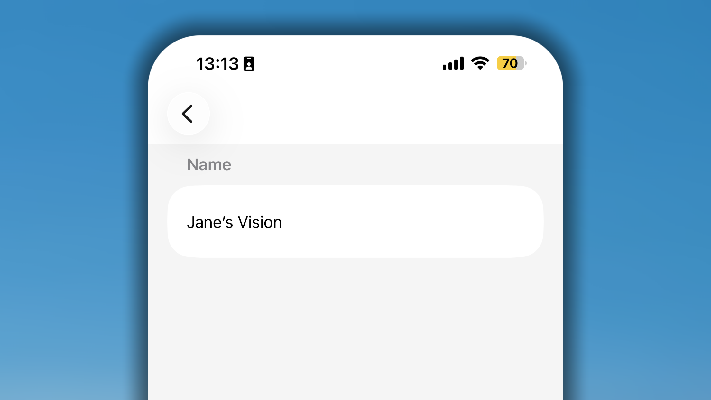
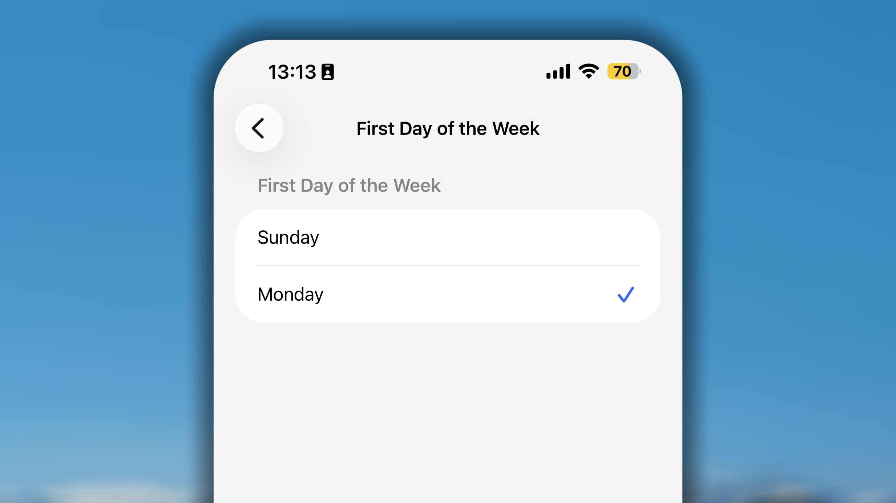
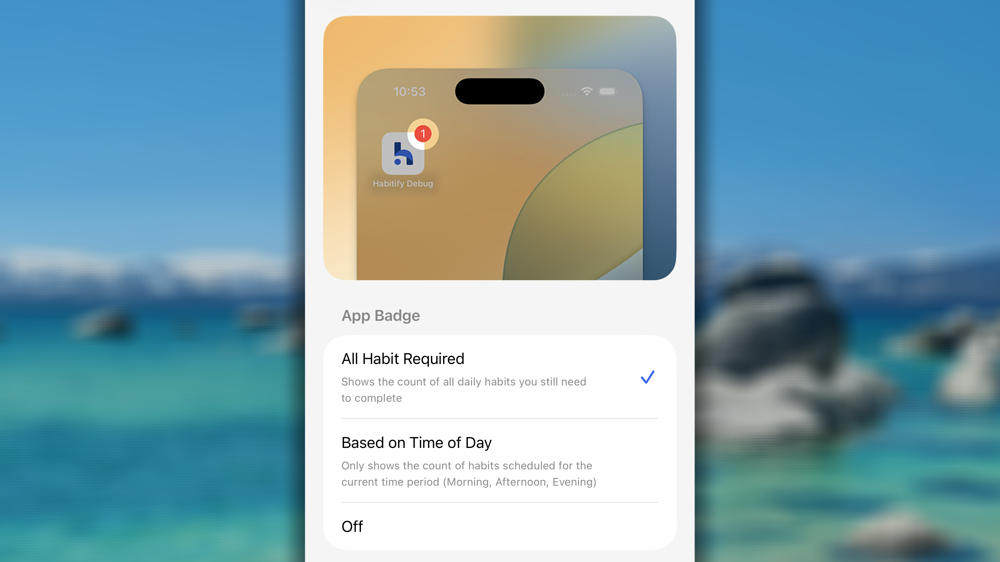
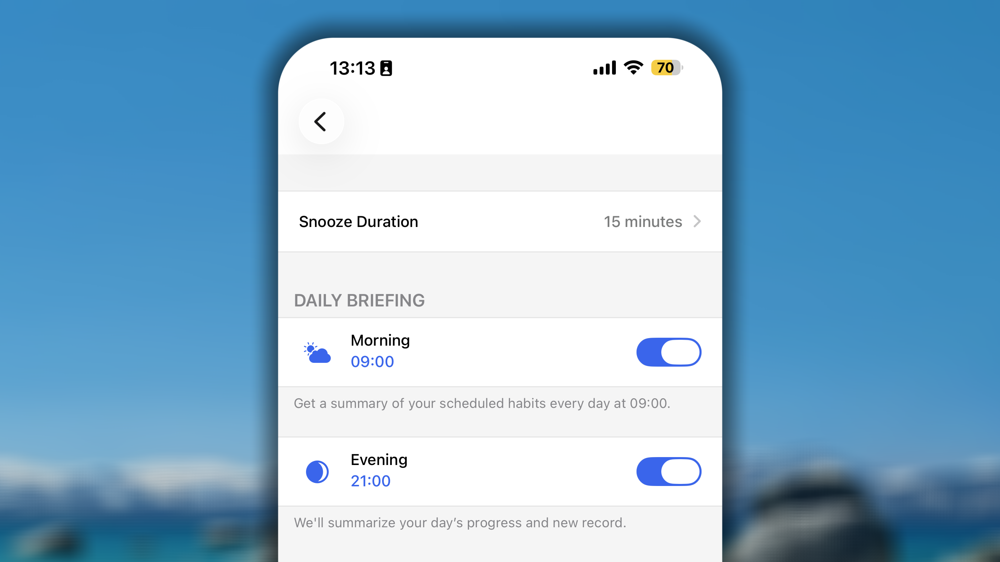
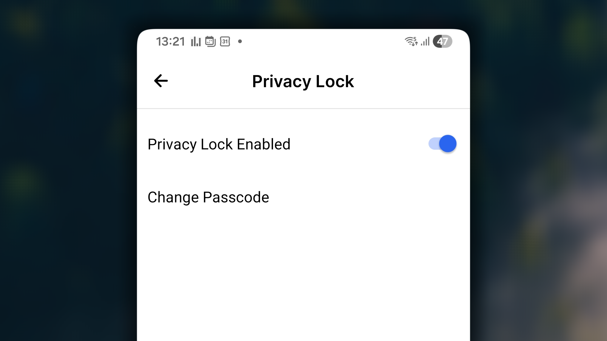
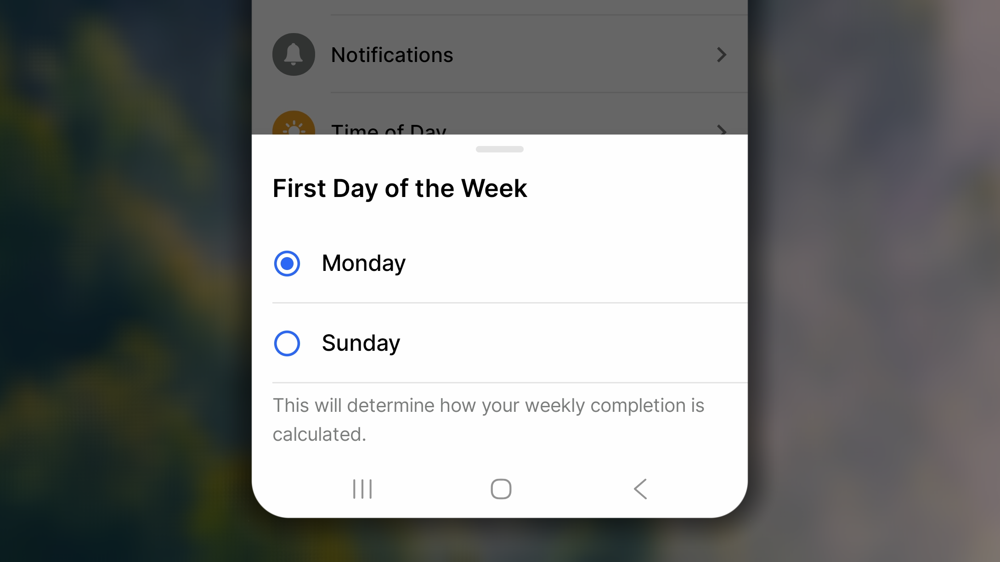
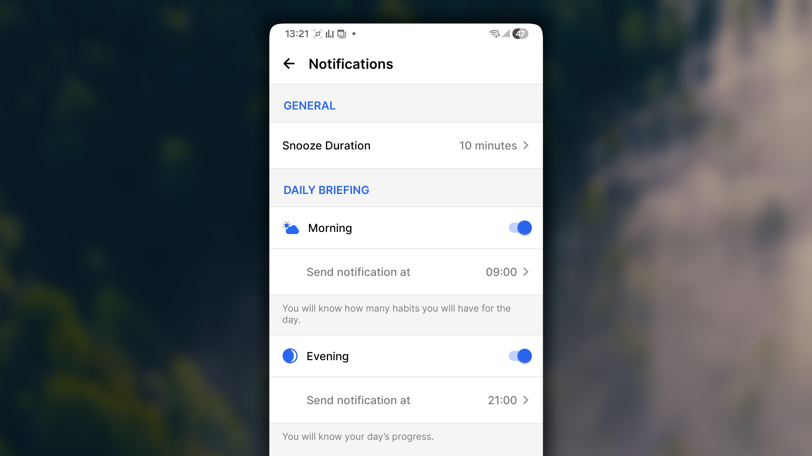
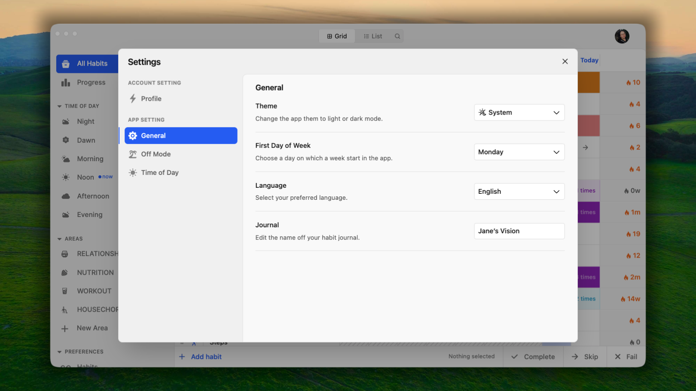

Además de los propios hábitos, Habitify ofrece una serie de ajustes generales que determinan cómo se comporta la aplicación cada día: cuándo te avisa, cómo se organiza tu semana y qué ves y oyes al registrar tu progreso.

Este artículo explica cada uno de ellos. Todos se encuentran en **Ajustes**.

<Tabs>
  <Tab title=" iOS">
    ## **Diario**

    

    Puedes asignar a la vista Diario un nombre personalizado que sustituya la etiqueta genérica «Diario». Puede ser algo personal, como «La visión de Jane», un mantra o cualquier enfoque que te mantenga motivado cada vez que lo abras.

    Se trata únicamente de una preferencia de nombre; no cambia el funcionamiento del Diario, sino solo la etiqueta que se muestra.

    ## Primer día de la semana

    

    En Habitify, la semana puede comenzar el **domingo** o el **lunes**.

    Para configurar el primer día de tu semana habitual en la aplicación:

    1. En la aplicación Habitify, ve a **Ajustes**.
    2. En **Comportamiento de la aplicación**, toca **Primer día de la semana**.
    3. Elige entre **Domingo** o **Lunes**.
    4. Toca **❮** en la esquina superior izquierda para guardar y volver al menú.

    Al seleccionar el día de inicio que prefieras, los hábitos semanales se reiniciarán y comenzarán de nuevo según el ciclo semanal elegido. Por ejemplo, si eliges el lunes como primer día, el progreso de los hábitos semanales respecto a su objetivo se reiniciará cada lunes.

    En la vista de progreso individual, el calendario también se adapta al día de inicio elegido y muestra visualmente el progreso de tus hábitos dentro de tu estructura semanal preferida.

    ## Insignia de la aplicación

    

    La insignia de la aplicación es el número que aparece en el icono de Habitify e indica cuántos hábitos te quedan por completar.

    Para configurarla:

    1. En la aplicación Habitify, ve a **Ajustes**.
    2. En Comportamiento de la aplicación, toca **Insignia de la aplicación**.
    3. Elige entre:
       1. **Todos los hábitos pendientes**: muestra el número total de hábitos en curso que aún no se han completado en la lista «Todos los hábitos».
       2. **Según el momento del día**: muestra solo los hábitos en curso correspondientes al Momento del día actual.
       3. **Desactivada**: desactiva la insignia de la aplicación.
    4. Toca ❮ en la esquina superior izquierda para guardar y volver al menú.

    ## Notificaciones

    

    En Notificaciones puedes controlar las notificaciones de resumen que enmarcan tu día: un aviso por la mañana y un repaso al final de la tarde.

    Para configurarlas:

    1. En la aplicación Habitify, ve a **Ajustes**.
    2. En **Comportamiento de la aplicación**, toca **Notificaciones**.
    3. Configura los detalles:
       1. **Duración de Posponer**.
       2. En **Resumen diario** hay 2 ajustes, **Mañana** y **Tarde**:
          1. Activa el interruptor de la notificación que quieras recibir.
          2. Vuelve a tocarla y, después, toca la hora situada debajo del interruptor para ajustar cuándo quieres recibir las notificaciones de resumen.
    4. Toca ❮ en la esquina superior izquierda para guardar y volver al menú.

    ## Momento del día

    <iframe src="https://drive.google.com/file/d/1Z5ghdzaL-DicVDK7FaDQgGK8zj5dBcD3/preview" width="640" height="360" />

    En este ajuste puedes dividir el día en distintos bloques horarios, como Mañana, Tarde y Noche. Aquí también controlas las opciones disponibles en el ajuste «Momento del día» de los hábitos.

    Después, en Diario, según la hora actual, el área «Momento del día» cambiará al bloque correspondiente en función del intervalo que hayas configurado y filtrará los hábitos.

    ### Editar un bloque horario existente

    1. En Habitify, ve a **Ajustes**.
    2. En **Comportamiento de la aplicación**, toca **Momento del día**.
    3. En la lista de bloques horarios existentes, toca el que quieras editar.
    4. En los detalles del bloque horario puedes configurar:
       1. **Icono y nombre**: estos datos aparecerán como el icono y el nombre de la lista «Momento del día» mientras te encuentres dentro del intervalo definido para el bloque.
       2. En **Horario**, ajusta las horas de **Inicio** y **Fin** como hora inicial y final del bloque.
       3. En **Incluir**, puedes tocar el botón ➖ situado delante de un hábito para quitarlo del bloque. También puedes mantener pulsado ☰ junto al hábito incluido y arrastrarlo hacia arriba o hacia abajo para administrar el orden.
       4. En **Excluir**, puedes tocar el botón ➕ situado delante de un hábito para añadirlo al bloque.
    5. Toca **✓** en la esquina superior derecha para guardar los cambios del bloque editado.
    6. Vuelve a tocar **✓** en la esquina superior derecha para guardar todos los cambios realizados en el ajuste Momento del día.

    ### Añadir un bloque horario nuevo

    1. En Habitify, ve a **Ajustes**.
    2. En **Comportamiento de la aplicación**, toca **Momento del día**.
    3. Debajo de la lista de bloques horarios existentes, toca **\+ Añadir más...**.
    4. En los detalles del bloque horario nuevo puedes configurar:
       1. Icono y nombre: estos datos aparecerán como el icono y el nombre de la lista «Momento del día» mientras te encuentres dentro del intervalo definido para el bloque.
       2. En **Horario**, establece las horas de **Inicio** y **Fin** como hora inicial y final del bloque.
       3. Opcionalmente, en **Excluir**, puedes tocar el botón ➕ situado delante de un hábito para añadirlo al bloque.
    5. Toca **✓** en la esquina superior derecha para guardar el bloque recién creado.
    6. Vuelve a tocar **✓** en la esquina superior derecha para guardar todos los cambios realizados en el ajuste Momento del día.

    <Note>
      **Habitify siempre coloca en primer lugar el bloque que contiene las 0:00 —medianoche—.**

      - Si tu bloque «Noche» va de las **23:00 a las 05:00**, abarca el cambio entre hoy y mañana.
      - Como contiene el inicio del nuevo día —0:00—, aparece en la parte superior de la lista. Esto **no** afecta al modo en que aparecen los hábitos en el Diario; seguirán mostrándose de forma natural.
    </Note>

    <Note>
      **La regla de las 24 horas**

      Habitify no permite que haya «huecos» en el día. Cada minuto de las 24 horas debe pertenecer a un bloque.

      - Si acortas «Mañana», el bloque «Tarde» debe ampliarse automáticamente para cubrir el hueco.
      - Si intentas definir un intervalo que deje un hueco —por ejemplo, que Mañana termine a las 10:00 cuando Tarde no empieza hasta las 12:00—, la aplicación impedirá el cambio.
    </Note>

    <Note>
      Para personalizar por completo tu horario sin errores, te recomendamos crear primero todos los bloques y ajustar después sus intervalos.

      Empieza a ajustar desde el principio del día —por ejemplo, Mañana— y continúa hacia abajo. De este modo, el tiempo «sobrante» pasa al bloque siguiente hasta que el horario quede perfecto.
    </Note>

    ### Eliminar un bloque horario

    Puedes eliminar cualquier bloque horario que ya no necesites, incluidos los predeterminados —Mañana, Tarde y Noche—.

    1. En **Ajustes** → **Momento del día**, busca el bloque que quieras eliminar y deslízalo hacia la derecha.
    2. Toca **Eliminar**.
    3. Toca **✓** en la esquina superior derecha para guardar los cambios.
    4. Vuelve a tocar **✓** en la esquina superior derecha para guardar todos los cambios realizados en el ajuste Momento del día.

    <Note>
      La aplicación exige que siempre tengas **al menos un bloque de Momento del día**. No permitirá eliminar el último bloque restante.
    </Note>

    <Note>
      **Los bloques horarios de Momento del día sirven únicamente para filtrar y organizar la lista.** Este ajuste no cambia cuándo se reinician tus hábitos para el nuevo día. La lista y el objetivo de sus hábitos siempre se actualizarán a las 0:00 del nuevo día, semana, año o mes, según el tipo de objetivo.
    </Note>

    <Note>
      **Con independencia del intervalo de los bloques horarios que define tu Mañana o Noche,** los Registros de progreso y las Notas siempre guardarán la fecha y hora reales y exactas del reloj del dispositivo en el momento en que los añadas. Así, tu historial conserva un registro preciso y objetivo del momento en que realizaste una acción.
    </Note>

    ## Sonido en la aplicación

    Habitify acompaña tus acciones de seguimiento de hábitos con pequeños sonidos en la aplicación, que añaden una respuesta sonora a las indicaciones visuales que ya recibes al marcar un hábito como completado.

    Para controlar el sonido en la aplicación:

    1. En la aplicación Habitify, ve a **Ajustes**.
    2. En **Comportamiento de la aplicación**, busca **Notificaciones** y:
       1. Activa el interruptor: habilita el sonido en la aplicación.
       2. Desactiva el interruptor: deshabilita el sonido en la aplicación.

    ## Tema de la aplicación

    Para cambiar entre el modo claro y el modo oscuro, cambia el tema del dispositivo y la aplicación lo seguirá.

    De este modo, el tema de la aplicación será coherente con la apariencia general del dispositivo, lo que garantiza una experiencia fluida entre el dispositivo y la aplicación.

    ## Idioma de la aplicación

    Actualmente, Habitify está disponible en los siguientes idiomas:

    - **Principal:** inglés —Estados Unidos—.
    - **Idiomas de países europeos**: catalán, checo, danés, neerlandés, finés, francés, alemán, húngaro, italiano, noruego, polaco, portugués —Portugal—, portugués —Brasil—, rumano, ruso, eslovaco, español, sueco y ucraniano.
    - **Idiomas de países asiáticos**: chino —simplificado—, chino —tradicional—, hindi, coreano, japonés, vietnamita y turco.

    Para cambiar el idioma de Habitify en tu iPhone o iPad, debes descargar en el dispositivo al menos un paquete de idioma nuevo además del idioma actual. Después podrás elegir entre los distintos idiomas compatibles con Habitify.

    Estos son los pasos:

    <Steps>
      <Step title="Añade un idioma nuevo al dispositivo">
        - Toca la aplicación **Ajustes** en la pantalla de inicio.
        - Selecciona **General**.
        - Elige **Idioma y región**.
        - Toca **Otros idiomas**.
        - Elige en la lista otro idioma para descargarlo.
        - Selecciona **Conservar \[tu idioma actual\]** en la ventana emergente.
      </Step>
      <Step title="Cambia el idioma de la aplicación Habitify">
        - Toca la aplicación **Ajustes** en la pantalla de inicio.
        - Desplázate hacia abajo y busca Habitify.
        - Selecciona **Idioma** en Idioma preferido.
        - Elige el **idioma** que quieras utilizar.
      </Step>
    </Steps>

    ## Agitar para deshacer

    Agitar para deshacer es un atajo físico que te permite revertir al instante tus errores más recientes en la aplicación.

    ### **Cómo funciona**

    Cuando cometas un error inmediato —por ejemplo, tocar sin querer el botón de verificación—, solo tienes que agitar rápidamente el teléfono.

    - Aparecerá una ventana emergente que te preguntará si quieres «Deshacer» la última acción.
    - Toca **Deshacer** y el último registro o anotación se revertirá al instante.

    **Orden inverso de ejecución:** uno de los aspectos más útiles de esta función es que recuerda varias acciones y las deshace una por una en el orden inverso al que se realizaron. Empieza por la última acción que ejecutaste.

    - Por ejemplo, si marcas «Hábito A» y, a continuación, marcas «Hábito B», la primera vez que agites el teléfono solo se deshará el registro de «Hábito B».
    - Si vuelves a agitar el teléfono, se deshará «Hábito A».

    ### **Limitaciones**

    Aunque Agitar para deshacer es muy rápido, es importante conocer sus límites:

    - **Es temporal:** el estado de «deshacer» solo se conserva temporalmente.
    - **Se restablece:** si cierras la aplicación Habitify, navegas a otra pantalla o cierras sesión en tu cuenta, la opción «deshacer» dejará de funcionar para esas acciones anteriores.

    <Note>
      Si pierdes la posibilidad de agitar porque has cambiado de pantalla, tendrás que eliminar manualmente el error del Historial de registros.
    </Note>

    ### Activar o desactivar

    1. Abre la aplicación **Ajustes** del dispositivo.
    2. Desplázate hacia abajo y toca **Accesibilidad**.
    3. En la sección Motricidad, toca **Tocar**.
    4. Desplázate hacia abajo hasta encontrar **Agitar para deshacer**.
       - **Para desactivarlo:** toca el interruptor para que se vuelva gris.
       - **Para activarlo:** toca el interruptor para que se vuelva verde.

    <Note>
      Al desactivar este ajuste, Agitar para deshacer se deshabilitará en todas las aplicaciones del teléfono, no solo en Habitify.
    </Note>
  </Tab>
  <Tab title="🤖 Android">
    ## Bloqueo de privacidad

    

    Bloqueo de privacidad añade un código de acceso a la propia aplicación Habitify para que los datos de tus hábitos sigan siendo privados aunque otra persona coja tu teléfono. Una vez configurado, la aplicación solicita el código cada vez que se abre.

    Para configurarlo:

    1. En la aplicación Habitify, ve a **Ajustes**.
    2. En Comportamiento de la aplicación, toca **Bloqueo de privacidad**.
    3. En la pantalla Privacidad, activa el interruptor **Bloqueo de privacidad activado**.
    4. Introduce el código de 4 dígitos. El código se guarda automáticamente.
    5. Toca **←** en la esquina superior izquierda para guardar y volver al menú.

    Más adelante, en el mismo lugar, podrás:

    - **Desactivar Bloqueo de privacidad:** desactiva el interruptor e introduce el código actual.
    - **Obtener un código nuevo:** toca **Cambiar código** e introduce otro código.

    ## Primer día de la semana

    

    En Habitify, la semana puede comenzar el **domingo** o el **lunes**. Para configurar el primer día de tu semana habitual en la aplicación:

    1. En la aplicación Habitify, ve a **Ajustes**.
    2. En Comportamiento de la aplicación, toca **Primer día de la semana**.
    3. Elige entre **Domingo** o **Lunes**.

    Al seleccionar el día de inicio que prefieras, los hábitos semanales se reiniciarán y comenzarán de nuevo según el ciclo semanal elegido. Por ejemplo, si eliges el lunes como primer día, el progreso de los hábitos semanales respecto a su objetivo se reiniciará cada lunes.

    En la vista de progreso individual, el calendario también se adapta al día de inicio elegido y muestra visualmente el progreso de tus hábitos dentro de tu estructura semanal preferida.

    ## Notificaciones

    

    En Notificaciones puedes controlar las notificaciones de resumen que enmarcan tu día: un aviso por la mañana y un repaso al final de la tarde.

    Para configurarlas:

    1. En la aplicación Habitify, ve a **Ajustes**.
    2. En **Comportamiento de la aplicación**, toca **Notificaciones**.
    3. En la pantalla **Notificaciones**, configura los detalles:
       1. Duración de Posponer.
       2. En **Resumen diario** hay 2 ajustes, **Mañana** y **Tarde**:
          1. Activa el interruptor de la notificación que quieras recibir.
          2. En **Enviar notificación a las**, toca la hora y ajústala al momento en que quieras recibir las notificaciones de resumen.
    4. Toca **el botón ←** de la esquina superior izquierda para guardar y volver al menú.

    ## **Momento del día**

    <iframe src="https://drive.google.com/file/d/1lEggXoVdb6FhW2YDqtq1X_uf7JCSrflQ/preview" width="640" height="360" />

    En este ajuste puedes dividir el día en distintos bloques horarios, como Mañana, Tarde y Noche. Aquí también controlas las opciones disponibles en el ajuste «Momento del día» de los hábitos.

    Después, en Diario, según la hora actual, el área «Momento del día» cambiará al bloque correspondiente en función del intervalo que hayas configurado y filtrará los hábitos.

    ### Editar un bloque horario existente

    1. En Habitify, ve a **Ajustes**.
    2. En **Comportamiento de la aplicación**, toca **Momento del día**.
    3. En la lista de bloques horarios existentes, toca el que quieras editar.
    4. En la pantalla **Editar Momento del día** puedes configurar:
       1. **Icono y nombre**: estos datos aparecerán como el icono y el nombre de la lista «Momento del día» mientras te encuentres dentro del intervalo definido para el bloque.
       2. En **Horario**, ajusta las horas de **Inicio** y **Fin** como hora inicial y final del bloque.
       3. En **Incluir**, puedes tocar el botón × junto al nombre del hábito para quitarlo del bloque.  También puedes mantener pulsado ⚌ delante del nombre del hábito y arrastrarlo hacia arriba o hacia abajo para administrar el orden.
       4. En **Excluir**, puedes tocar ➕ junto al nombre de un hábito para añadirlo al bloque.
    5. Toca **Guardar** en la esquina superior derecha para guardar los cambios del bloque editado.
    6. Vuelve a tocar **←** en la esquina superior derecha para guardar todos los cambios realizados en el ajuste Momento del día.

    ### Añadir un bloque horario nuevo

    1. En Habitify, ve a **Ajustes**.
    2. En Comportamiento de la aplicación, toca **Momento del día**.
    3. Debajo de la lista de bloques horarios existentes, toca **\+ Añadir nuevo**.
    4. En los detalles del bloque horario nuevo puedes configurar:
       1. **Icono y nombre**: estos datos aparecerán como el icono y el nombre de la lista «Momento del día» mientras te encuentres dentro del intervalo definido para el bloque.
       2. En **Horario**, establece las horas de **Inicio** y **Fin** como hora inicial y final del bloque.
       3. Opcionalmente, en **Excluir**, puedes tocar el botón ➕ junto al nombre de un hábito para añadirlo al bloque.
    5. Toca **Guardar** en la esquina superior derecha para guardar el bloque recién creado.
    6. Vuelve a tocar **←** en la esquina superior derecha para guardar todos los cambios realizados en el ajuste Momento del día.

    <Note>
      **Habitify siempre coloca en primer lugar el bloque que contiene las 0:00 —medianoche—.**

      - Si tu bloque «Noche» va de las **23:00 a las 05:00**, abarca el cambio entre hoy y mañana.
      - Como contiene el inicio del nuevo día —0:00—, aparece en la parte superior de la lista. Esto **no** afecta al modo en que aparecen los hábitos en el Diario; seguirán mostrándose de forma natural.
    </Note>

    <Note>
      **La regla de las 24 horas**

      Habitify no permite que haya «huecos» en el día. Cada minuto de las 24 horas debe pertenecer a un bloque.

      - **Si acortas «Mañana»,** el bloque «Tarde» debe ampliarse automáticamente para cubrir el hueco.
      - **Si intentas definir un intervalo que deje un hueco** —por ejemplo, que Mañana termine a las 10:00 cuando Tarde no empieza hasta las 12:00—, la aplicación impedirá el cambio.
    </Note>

    <Note>
      Para personalizar por completo tu horario sin errores, te recomendamos **crear primero todos los bloques y ajustar después sus intervalos.**

      Empieza a ajustar desde el principio del día —por ejemplo, Mañana— y continúa hacia abajo. De este modo, el tiempo «sobrante» pasa al bloque siguiente hasta que el horario quede perfecto.
    </Note>

    ### Eliminar un bloque horario

    Puedes eliminar cualquier bloque horario que ya no necesites, incluidos los predeterminados —Mañana, Tarde y Noche—.

    1. En **Ajustes** → **Momento del día**, busca el bloque que quieras eliminar y tócalo.
    2. En la pantalla **Editar Momento del día**, desplázate hasta el final y toca **Eliminar**.
    3. Para confirmar, vuelve a tocar **Eliminar**.
    4. De vuelta en la pantalla Momento del día, toca ← en la esquina superior derecha para guardar todos los cambios realizados en el ajuste Momento del día.

    <Note>
      **La aplicación exige que siempre tengas al menos un bloque de Momento del día**. No permitirá eliminar el último bloque restante.
    </Note>

    <Note>
      **Los bloques horarios de Momento del día sirven únicamente para filtrar y organizar la lista.** Este ajuste no cambia cuándo se reinician tus hábitos para el nuevo día. La lista y el objetivo de sus hábitos siempre se actualizarán a las 0:00 del nuevo día, semana, año o mes, según el tipo de objetivo.
    </Note>

    <Note>
      **Con independencia del intervalo de los bloques horarios que define tu Mañana o Noche,** los Registros de progreso y las Notas siempre guardarán la fecha y hora reales y exactas del reloj del dispositivo en el momento en que los añadas. Así, tu historial conserva un registro preciso y objetivo del momento en que realizaste una acción.
    </Note>

    ## Sonido en la aplicación

    Habitify acompaña tus acciones de seguimiento de hábitos con pequeños sonidos en la aplicación, que añaden una respuesta sonora a las indicaciones visuales que ya recibes al marcar un hábito como completado.

    Para controlar el sonido en la aplicación:

    1. En la aplicación Habitify, ve a **Ajustes**.
    2. En **Comportamiento de la aplicación**, busca **Notificaciones** y:
       1. Activa el interruptor: habilita el sonido en la aplicación.
       2. Desactiva el interruptor: deshabilita el sonido en la aplicación.

    ## Tema de la aplicación

    Para cambiar entre el modo claro y el modo oscuro, cambia el tema del dispositivo y la aplicación lo seguirá. De este modo, el tema de la aplicación será coherente con la apariencia general del dispositivo.

    Esto garantiza una experiencia fluida entre el dispositivo y la aplicación.

    ## Idioma de la aplicación

    En dispositivos Android, Habitify está diseñado para utilizar de forma predeterminada el primer idioma compatible de la lista de idiomas del teléfono.

    Actualmente, Habitify está disponible en los siguientes idiomas:

    - **Principal**: inglés —Estados Unidos—.
    - **Idiomas de países europeos:** catalán, checo, danés, neerlandés, finés, francés, alemán, húngaro, italiano, noruego, polaco, portugués —Portugal—, portugués —Brasil—, rumano, ruso, eslovaco, español, sueco y ucraniano.
    - **Idiomas de países asiáticos:** chino —simplificado—, chino —tradicional—, hindi, coreano, japonés, vietnamita y turco.

    ## Agitar para deshacer

    Agitar para deshacer es un atajo físico que te permite revertir al instante tus errores más recientes en la aplicación. **Es una función predeterminada integrada en la aplicación Habitify para Android.**

    ### **Cómo funciona**

    Cuando cometas un error inmediato, como tocar sin querer el botón de verificación, solo tienes que agitar rápidamente el teléfono.

    - Aparecerá una ventana emergente que te preguntará si quieres «Deshacer» la última acción.
    - Toca **Deshacer** y el último registro o anotación se revertirá al instante.

    **Orden inverso de ejecución:** uno de los aspectos más útiles de esta función es que recuerda varias acciones y las deshace una por una en el orden inverso al que se realizaron. Empieza por la última acción que ejecutaste.

    - Por ejemplo, si marcas «Hábito A» y, a continuación, marcas «Hábito B», la primera vez que agites el teléfono solo se deshará el registro de «Hábito B».
    - Si vuelves a agitar el teléfono, se deshará «Hábito A».

    ### **Limitaciones**

    Aunque Agitar para deshacer es muy rápido, es importante conocer sus límites:

    - **Es temporal:** el estado de «deshacer» solo se conserva temporalmente.
    - **Se restablece:** si cierras la aplicación Habitify, navegas a otra pantalla o cierras sesión en tu cuenta, la opción «deshacer» dejará de funcionar para esas acciones anteriores.

    <Note>
      Si pierdes la posibilidad de agitar porque has cambiado de pantalla, tendrás que eliminar manualmente el error del Historial de registros.
    </Note>
  </Tab>
  <Tab title="🖥️ Sitio web y escritorio">
    En el sitio web y la aplicación de escritorio, los ajustes generales de la aplicación se encuentran en **Preferencias → Ajustes de la aplicación → General**, opción a la que puedes acceder desde la barra lateral izquierda.

    

    ## Tema

    Cambia la apariencia de la aplicación entre:

    - **Claro** para que la aplicación utilice siempre un tema claro y luminoso.
    - **Oscuro** para que la aplicación utilice siempre un tema oscuro con fondo negro.
    - **Sistema** para que la aplicación coincida automáticamente con el ajuste de tema del dispositivo y Habitify siga la configuración actual del ordenador.

    ## Primer día de la semana

    Elige qué día empieza la semana en la aplicación: **domingo** o **lunes**.

    Debe coincidir con tu forma natural de concebir la semana. No es un cambio meramente estético: determina cuándo se reinician los hábitos semanales y reorganiza todas las vistas basadas en semanas de la pantalla Progreso para que coincidan con el día de inicio elegido.

    ## Idioma

    Haz clic y selecciona en el menú desplegable Idioma el idioma que prefieras para la interfaz de la aplicación.

    Actualmente, Habitify está disponible en los siguientes idiomas:

    - **Principal:** inglés —Estados Unidos—.
    - **Idiomas de países europeos**: catalán, checo, danés, neerlandés, finés, francés, alemán, húngaro, italiano, noruego, polaco, portugués —Portugal—, portugués —Brasil—, rumano, ruso, eslovaco, español, sueco y ucraniano.
    - **Idiomas de países asiáticos**: chino —simplificado—, hindi, coreano, japonés, vietnamita y turco.

    ## Diario

    Puedes asignar al diario de hábitos un nombre personalizado que sustituya la etiqueta genérica «Diario». Puede ser algo personal, como «La visión de Jane», un mantra o cualquier enfoque que te mantenga motivado cada vez que lo abras.

    Se trata únicamente de una preferencia de nombre; no cambia el funcionamiento del Diario, sino solo la etiqueta que se muestra.
  </Tab>
</Tabs>
