Un Desafío es una forma de crear un hábito junto a un grupo durante un periodo limitado. En lugar de seguir un hábito en solitario, te comprometes con otras personas durante un plazo definido y competís —o simplemente participáis juntos— para alcanzar el mismo objetivo compartido.

Este artículo te ofrece todos los detalles necesarios para iniciar un desafío con otras personas.

## Comparación entre Desafío y Círculo

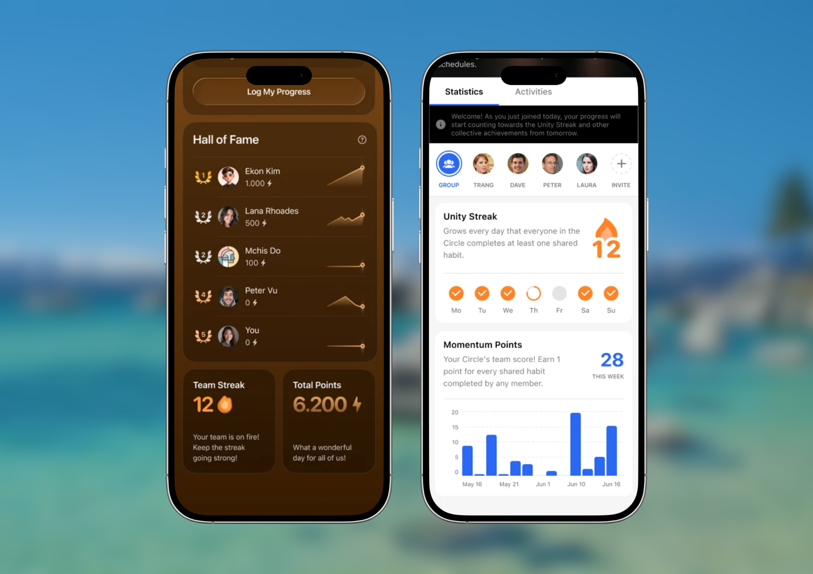

|  | **Desafío** | **Círculo** |
| :-- | :-- | :-- |
| **Duración** | Limitada en el tiempo: se desarrolla entre unas fechas de inicio y finalización definidas. | Continuada: no tiene fecha de finalización y permanece hasta que el propietario lo archiva o elimina. |
| **Hábitos seguidos** | Un objetivo de hábito compartido por desafío. | Varios hábitos compartidos a la vez, personalizados por cada miembro. |
| **Elemento estadístico** | <ul><li>La **Clasificación de rachas** ordena los puntos de los participantes por cada día completado, con penalizaciones opcionales por los días perdidos.</li><li>La **Racha de equipo** aumenta cuando todos los miembros completan el hábito del desafío del día actual.</li></ul> | <ul><li>La **Racha de unidad** aumenta cuando todos los miembros completan al menos 1 hábito diario compartido programado para el día actual.</li><li>Los **Puntos de impulso** aumentan cuando se completa un hábito compartido; opcionalmente, puede verse la clasificación según los puntos de impulso de cada miembro.</li></ul> |
| **Edición del progreso** | Se bloquea una vez registrado para el día actual; no se pueden añadir ni modificar datos de días anteriores. Omisiones limitadas y compatibilidad con Modo descanso. | Refleja el progreso del hábito desde la vista Diario, incluso los cambios posteriores. Omisiones ilimitadas y compatibilidad con Modo descanso. |
| **Tamaño del grupo** | Ilimitado | Ilimitado |
| **Interacción social** | Pestaña Actividad: reacciones, comentarios, menciones con @ y conversación continua. | Pestaña Actividad: reacciones, comentarios, menciones con @ y conversación continua. |
| **Disponibilidad por plataforma** | iOS y Android | iOS y Android |

<Tabs>
  <Tab title="iOS y Android">
    ## Organizar un desafío

    ### Crear un desafío nuevo

    1. En la aplicación Habitify, ve a la pestaña **Amigos**.
    2. Toca el botón **\+** y selecciona **Desafío**.
    3. Personaliza los datos del desafío: 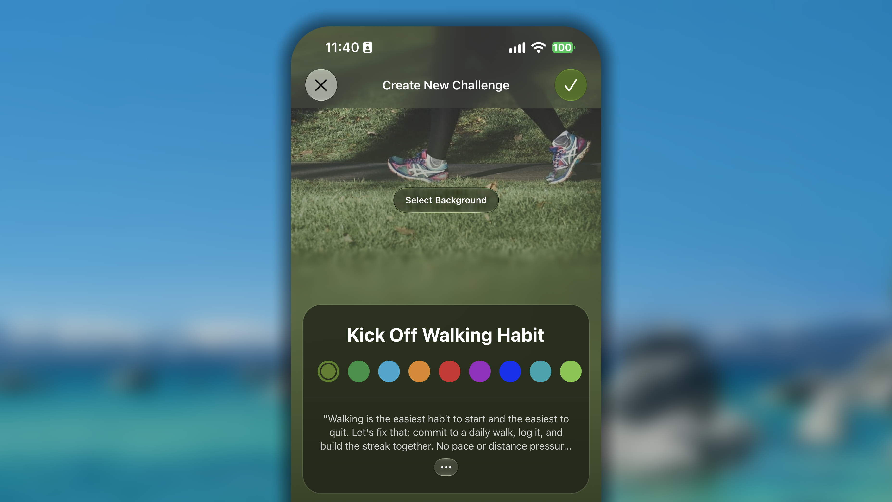
       1. Toca el botón **Seleccionar fondo** y elige una imagen de portada inspiradora entre **Sugerencias** —nuestra propia colección—, **Unsplash** o **Fotos** —tu fototeca—.
       2. Toca el campo **Nombre del desafío** y escribe un título claro y motivador —por ejemplo, «30 días de atención plena» o «Club de madrugadores»—.
       3. Elige debajo del nombre del desafío un color que se aplicará a los botones y elementos interactivos de su espacio.
       4. Toca **\+ Añadir descripción breve** para explicar en qué consiste el desafío y que los participantes sepan qué esperar y por qué deberían unirse.
    4. Define las reglas del desafío: 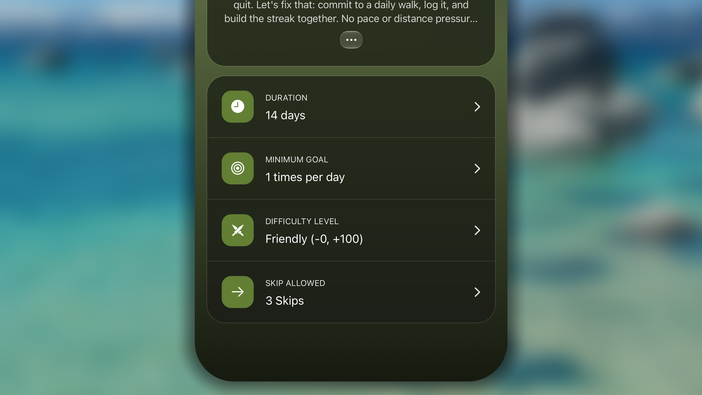
       - **Duración:** toca el campo y elige una de las opciones _predefinidas_, como 7, 14, 21, 30, 45, 60 o 90 días, o selecciona **Personalizada** para establecer tu propio periodo.
       - **Objetivo mínimo:** toca el campo y configura el método de registro permitido y el valor mínimo al que debe comprometerse cada miembro.
         - **Métodos de registro permitidos**: incluyen el registro manual y el registro automático desde aplicaciones de salud y bienestar —Apple Health, Fitbit, Strava y Health Connect—. 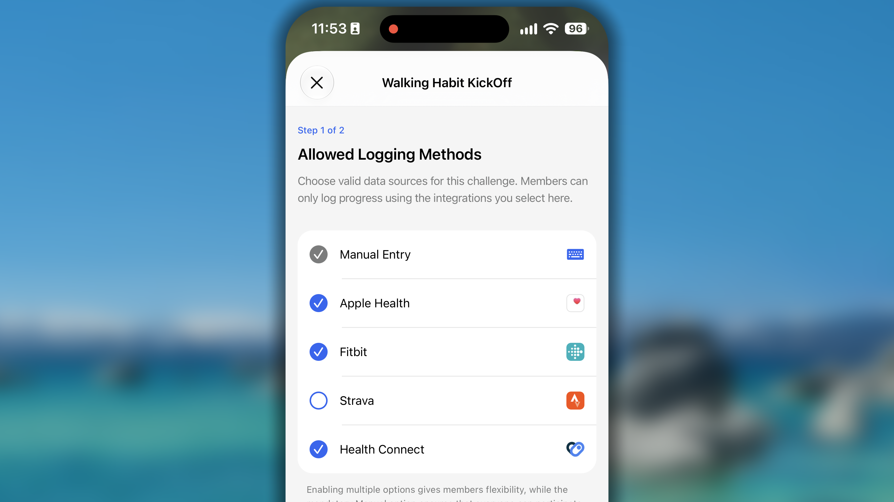
         - **Actividad objetivo**: según los métodos seleccionados, debajo aparecerán las actividades disponibles que puedes elegir. 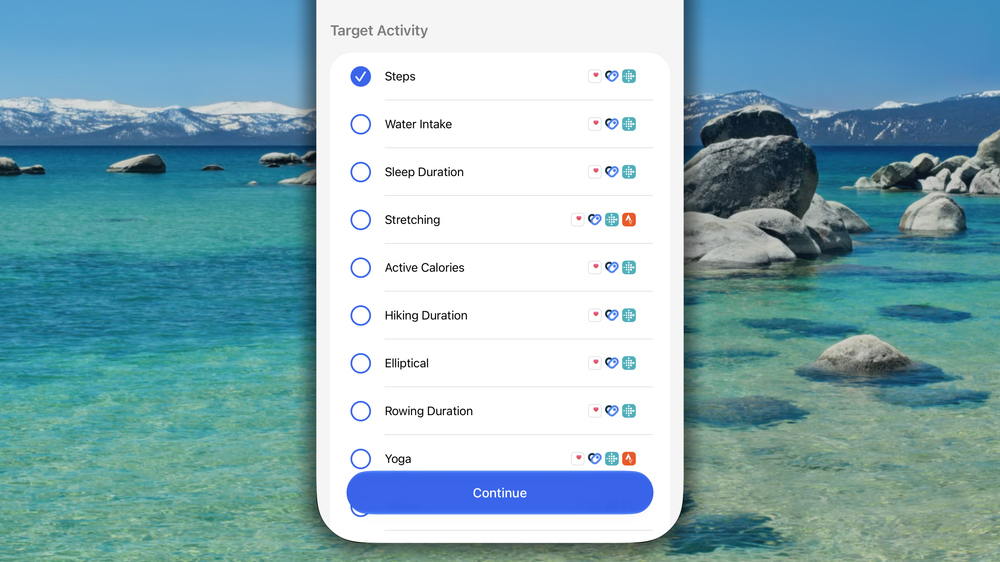
         - **Definir objetivo diario mínimo:** en este paso estableces el requisito básico al que debe comprometerse cada miembro. La unidad admitida para seguir el objetivo también depende de los métodos de registro elegidos. 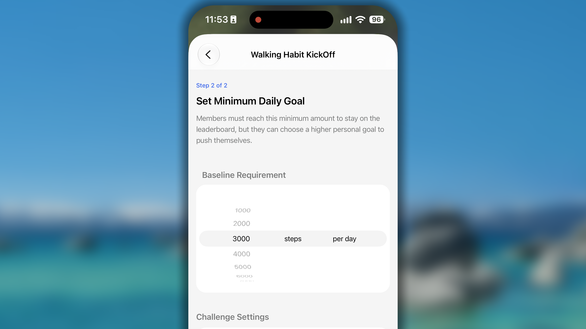
       - **Nivel de dificultad:** toca el campo y define lo estricta que será la competición. Los niveles determinan cómo se calculan los puntos: 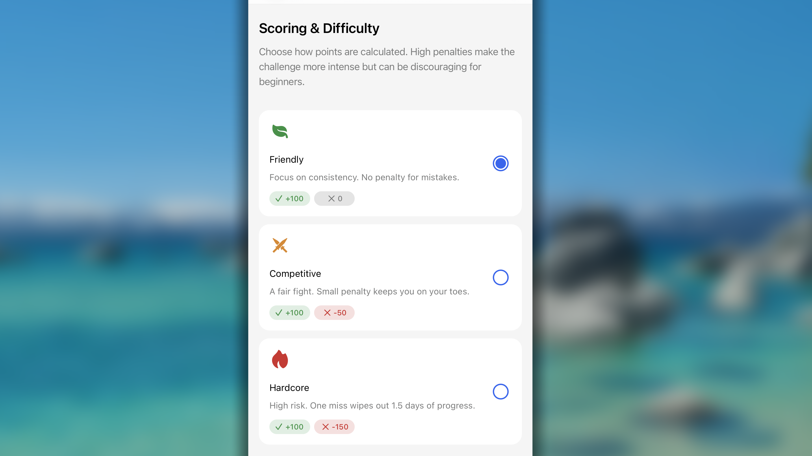
         - **Amistoso**: +100 por Completar, +0 por Omitir y −0 por Fallar.
         - **Competitivo**: +100 por Completar, +0 por Omitir y −50 por Fallar.
         - **Extremo**: +100 por Completar, +0 por Omitir y −150 por Fallar.
       - **Omisiones permitidas:** toca el campo y decide cuántas veces puede un usuario marcar un día como **Omitido** y congelar su racha.
    5. Por último, toca el botón **Listo** en la esquina superior derecha para guardar el desafío.

    ### Comprometerte con tu desafío

    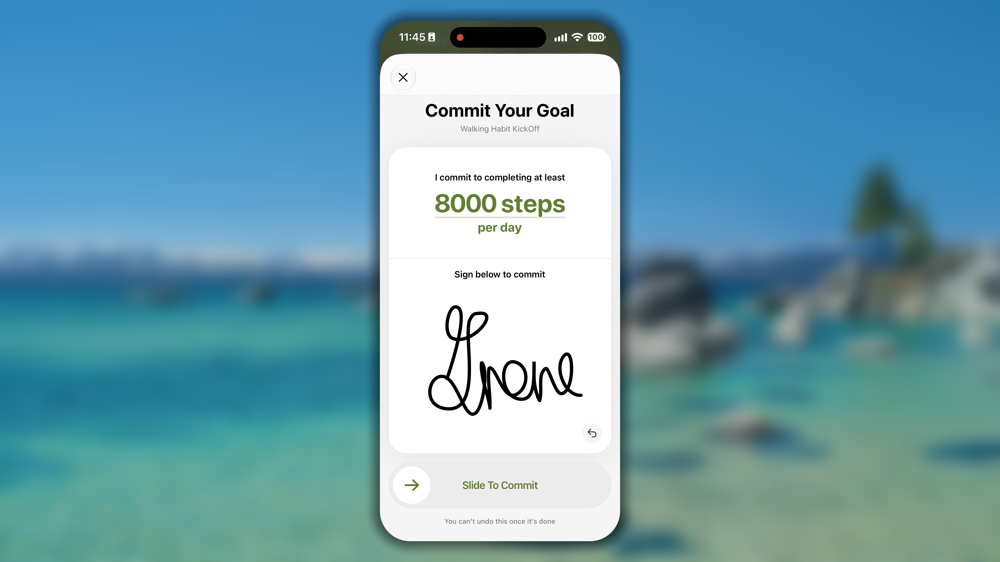

    Como anfitrión, sé la primera persona en unirse y comprometerse con el desafío:

    1. En la pestaña **Amigos**, abre el desafío que acabas de crear.
    2. Desplázate hacia abajo, busca el botón **Comprometerme con mis objetivos diarios** y tócalo.
    3. Introduce tu objetivo diario personal, que debe ser igual o superior al Objetivo mínimo del desafío.
    4. Firma y desliza el botón para confirmar oficialmente tu compromiso.

    ### Invitar a personas al desafío

    Para que un desafío pueda comenzar oficialmente, necesita al menos 2 miembros —incluido tú, el propietario— que ya se hayan comprometido con sus objetivos.

    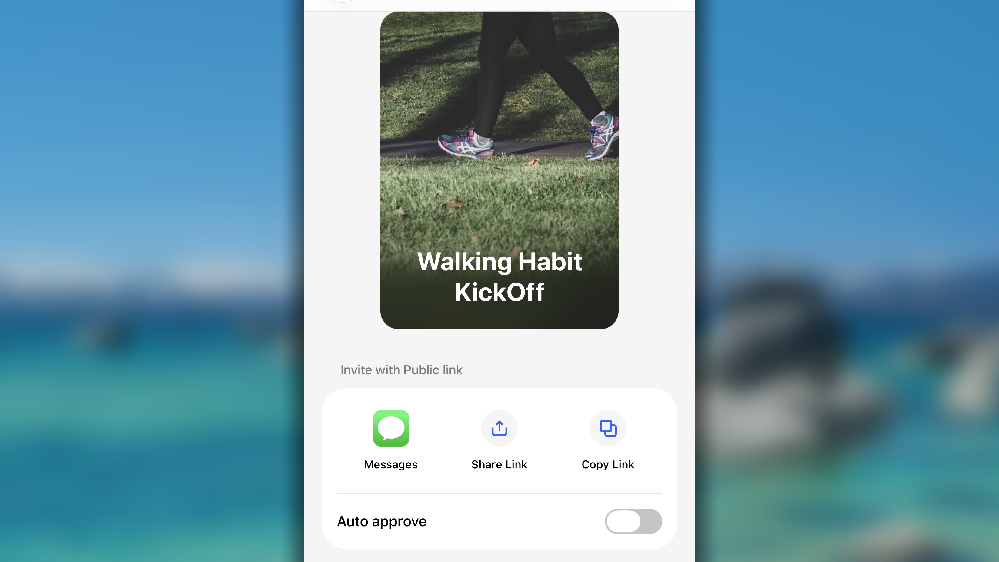

    Para invitar a otras personas a participar contigo:

    1. Abre tu desafío y toca el botón **\+ Invitar miembros**.
    2. Aparecerá una ventana con opciones para compartirlo:
       - **Mensajes:** envíalo directamente mediante la aplicación Mensajes.
       - **Compartir enlace:** utiliza el menú del sistema para enviarlo directamente a un contacto, publicarlo en redes sociales, enviarlo por correo electrónico, etc.
       - **Copiar enlace:** copia la URL al portapapeles y pégala donde quieras.\
    3. Como anfitrión, el interruptor **Aprobación automática** te permite controlar quién entra en el desafío:
       - **Activado**: las personas pueden unirse de inmediato sin tu aprobación.
       - **Desactivado**: tú decides quién puede unirse y quién no.

    ### Administrar a las personas del desafío

    Si desactivas **Aprobación automática**, todas las personas que abran el enlace deberán enviar una solicitud para unirse. Puedes ver todas las solicitudes de estas formas:

    - Toca la notificación de solicitudes nuevas; o
    - dentro del desafío, toca el aviso que indica que hay alguien esperando tu aprobación.

    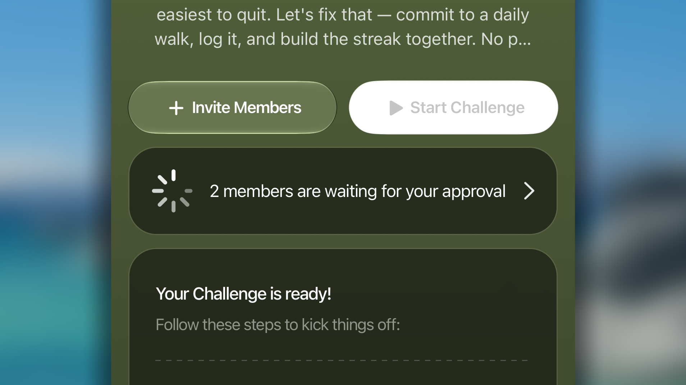

    A continuación, debajo de las opciones para compartir, en la sección _En espera de aprobación_:

    - Toca **Aprobar** si aceptas la solicitud.
    - Toca **Rechazar** si no quieres que la persona se una.

    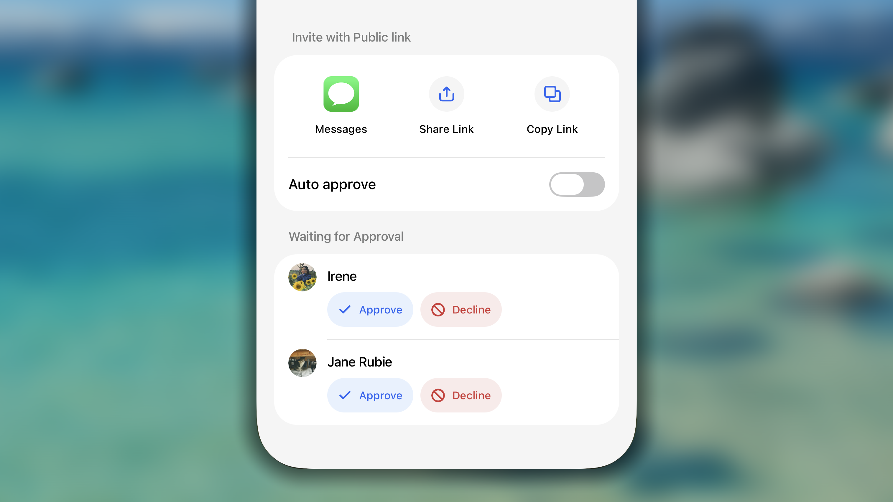

    ### Iniciar el desafío

    Como propietario del desafío, tienes el honor de dar la señal de salida.

    1. Abre el desafío que has creado y que todavía no ha comenzado.
    2. Toca el botón **Iniciar desafío**, situado justo debajo del nombre y la descripción.

    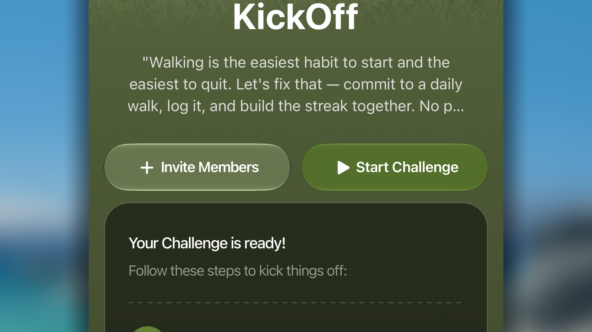

    El desafío comenzará de inmediato y continuará hasta las **23:59:59** de la fecha de finalización determinada por el ajuste de duración.

    En cuanto toques Iniciar, se enviará una notificación push a todos los miembros para informarles de que el desafío ha comenzado.

    <Note>
      Para que un desafío pueda comenzar, necesita al menos 2 miembros que ya se hayan unido y comprometido.
    </Note>

    ## Unirse a un desafío

    ¿Has recibido un enlace de invitación para unirte a un Desafío de Habitify? Estos son los sencillos pasos para aceptar la invitación y empezar.

    1. Instala la aplicación Habitify e inicia sesión en tu cuenta de Habitify.
    2. Toca el enlace de invitación recibido; el enlace abrirá el desafío directamente en la aplicación.
    3. Dedica un momento a revisar las reglas del desafío: 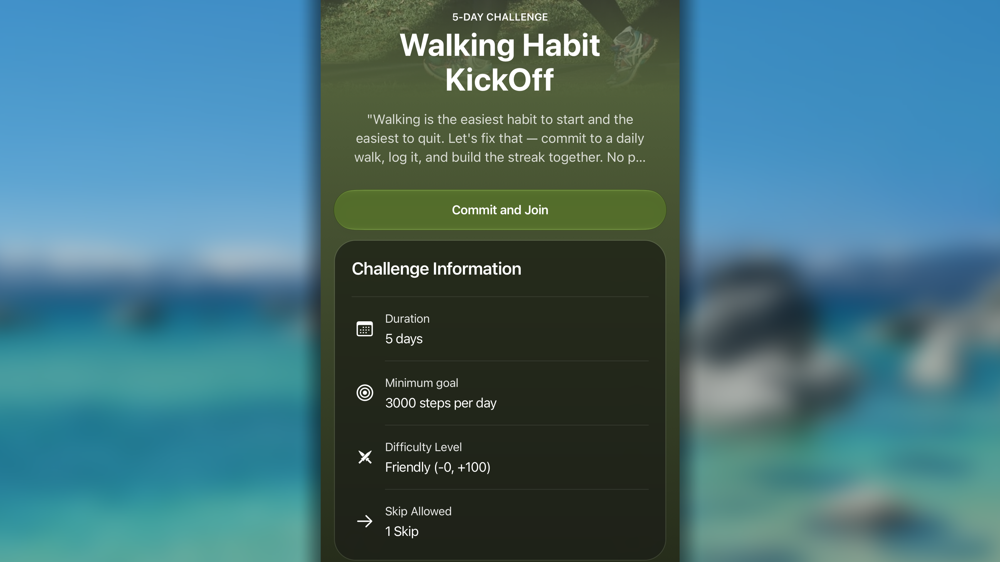
       - **Nombre y descripción del desafío:** descubre en qué consiste y qué espera el anfitrión de los participantes.
       - **Reglas del desafío:**
         - **Duración:** cuánto durará el desafío —por ejemplo, 30 días—.
         - **Objetivo mínimo:** el objetivo diario que debes alcanzar —por ejemplo, «Leer 20 páginas»—.
         - **Omisiones permitidas:** cuántos «días libres» se permiten durante el desafío.
       - **Miembros:** consulta quién más se ha unido ya al grupo.
    4. Toca el botón **Comprometerme y unirme**, situado justo debajo del nombre y la descripción del desafío, y después: 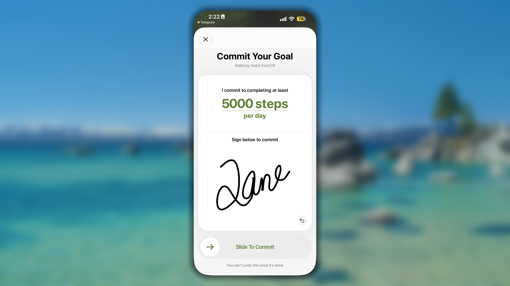
       - **Define tu objetivo diario:** debes comprometerte con un objetivo diario personal que **sea igual o superior al Objetivo mínimo** definido por el anfitrión.
       - **Firma tu compromiso:** firma con tu nombre en la parte inferior de la pantalla.
       - **Desliza para confirmar:** desliza el botón por la pantalla para formalizar tu compromiso.

    Ya está todo listo. El paso siguiente es esperar a que el anfitrión inicie el desafío. Recibirás una notificación push cuando comience.

    ## Añadir un hábito vinculado al desafío

    Una vez iniciado el desafío, todos los participantes, incluido el anfitrión, deben añadir a su lista diaria del Diario un hábito vinculado al desafío. Así todos pueden recordarlo, mantener el rumbo y registrar fácilmente su progreso.

    1. Abre la aplicación y accede al desafío.
    2. Dentro del desafío, debajo de **¿Listo para participar?**, toca el botón **Crear hábito**. 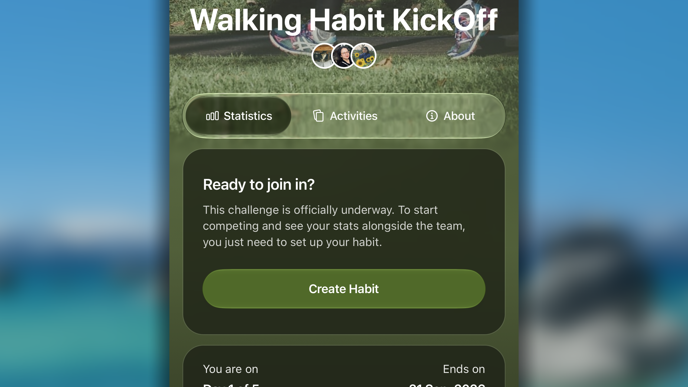
    3. Accederás a la pantalla de creación para configurar un hábito nuevo específico del desafío:
       1. Toca **Objetivo** y elige el método de registro que prefieras. Las opciones disponibles dependen de los ajustes del anfitrión del desafío. 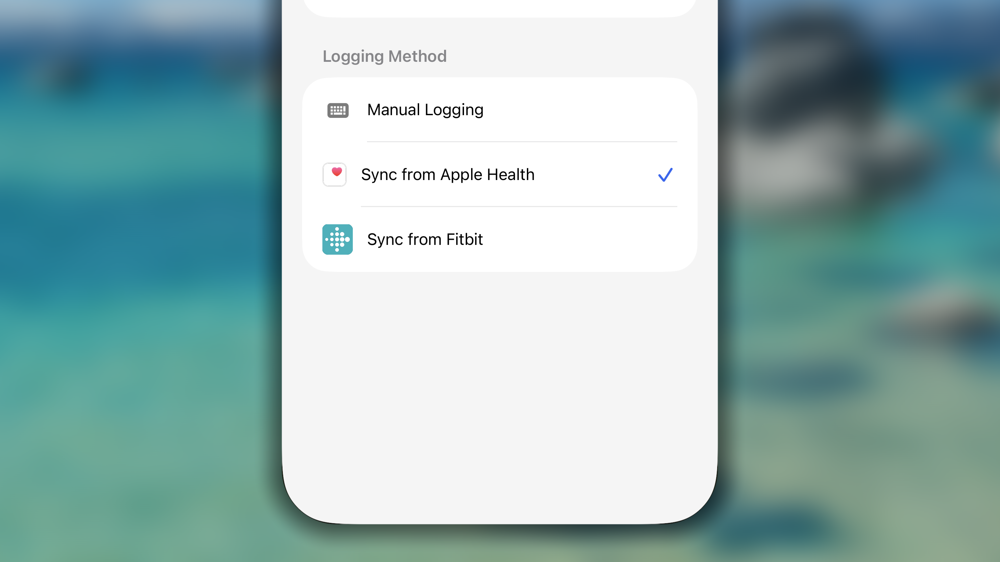
       2. Toca el botón **Guardar** para guardar el hábito.

    <Note>
      En el hábito del desafío:

      - De forma predeterminada, **Repetir** tiene el valor Diario, y la **Fecha de inicio** y la **Condición de finalización** siguen la duración del desafío.
      - El **Objetivo** puede cambiarse, pero debe seguir siendo igual o superior al Objetivo mínimo del desafío.
    </Note>

    ## Registrar el progreso del desafío

    Hay dos formas prácticas de registrar el progreso de un hábito del desafío.

    ### **Desde la lista del Diario**

    Los hábitos de los desafíos aparecen en la lista principal del **Diario** junto a tus hábitos personales. Puedes seguirlos exactamente igual que cualquier otro hábito.

    1. En **Diario**, busca el hábito del desafío. 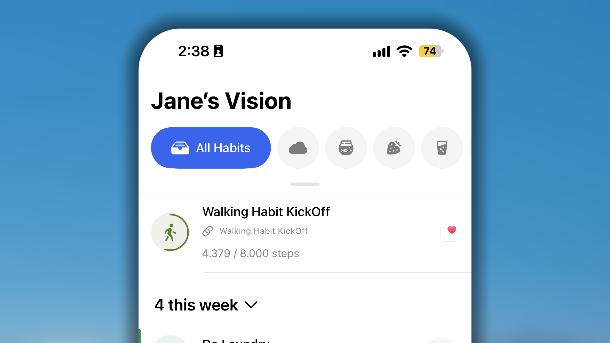
    2. Si has elegido el método de _registro manual_, puedes registrar el progreso con el método que prefieras:
       - **Desliza hacia la derecha** para marcar como Completado o Registrar.
       - **Desliza hacia la izquierda** para marcar como Omitido o Fallido.
       - **Utiliza el botón inteligente** situado junto al hábito.
    3. Si has elegido sincronizar desde otra aplicación, el progreso del hábito se actualiza automáticamente con los datos registrados por tu aplicación de salud.

    ### **Desde Estadísticas del desafío**

    Si ya te encuentras dentro del desafío, puedes registrar el progreso en la pestaña **Estadísticas**.

    - En la pestaña **Estadísticas**, debajo de **Resumen de hoy**, busca el botón **Registrar mi progreso** y tócalo. 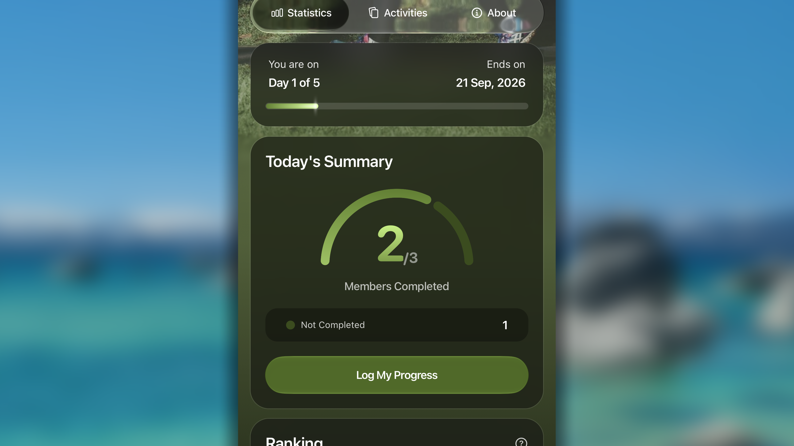
    - Introduce el valor de progreso o elige entre las otras 2 opciones: **Omitir** y **Fallar**.
    - Por último, desliza para guardar el registro.

    ## Consultar las estadísticas del desafío

    Un Desafío de Habitify no consiste únicamente en el esfuerzo individual, sino también en observar cómo avanza todo el grupo. La pestaña _Estadísticas_ ofrece un panel del desafío que permite seguir todos los detalles, desde la racha del equipo hasta una clasificación competitiva.

    ### **Progreso de la duración**

    En primer lugar verás una barra de progreso. Esta representa la cronología de tu recorrido y la posición del día actual dentro de la duración total del desafío.

    Por ejemplo, el día 15 de un desafío de 30 días mostrará «Día 15 de 30» y la fecha de finalización concreta —por ejemplo, 1 de enero de 2026—, para que sepas exactamente cuánto tiempo queda para alcanzar tus objetivos.

    ### **Resumen de hoy**

    Esta sección ofrece una instantánea en tiempo real de la actividad del grupo durante el día actual. Muestra el número de miembros que han:

    - **Completado** su objetivo diario.
    - **Omitido** el día —han usado una omisión permitida—.
    - **En descanso** —están usando Modo descanso—.
    - **No completado** todavía el objetivo —incluye a los miembros «En curso» o «Fallidos»—.

    ### **Clasificación**

    La Clasificación es donde se desarrolla la competición amistosa. Los miembros se ordenan según su rendimiento, ya sea de «Hoy» o «General».

    En la vista **Hoy**:

    - **Progreso actual:** consulta exactamente cuánto ha registrado cada miembro durante el día actual —por ejemplo, «15/30 min»—.

    - **Racha personal:** consulta la racha personal actual de cada miembro y descubre quién mantiene el ritmo.

    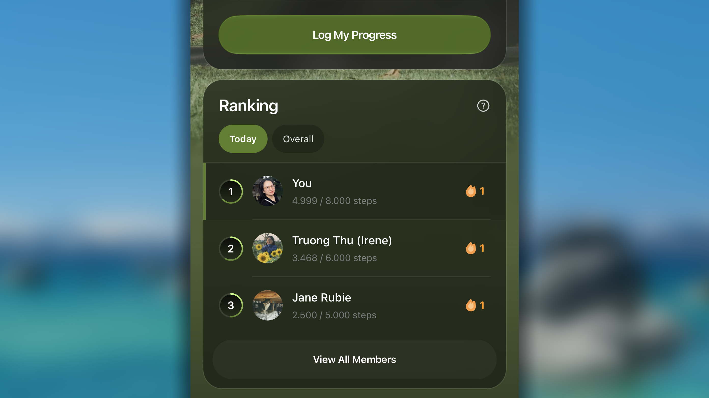

    En la vista **General**:

    - **Puntos totales:** la puntuación acumulada desde el Día 1 del desafío.

    - **Valor total registrado:** el total de toda la actividad registrada desde el Día 1 —por ejemplo, «Total: 450 min»—.
    - **Medalla prevista:** consulta qué medalla —oro, plata o bronce— va camino de conseguir un miembro según su rendimiento total.

    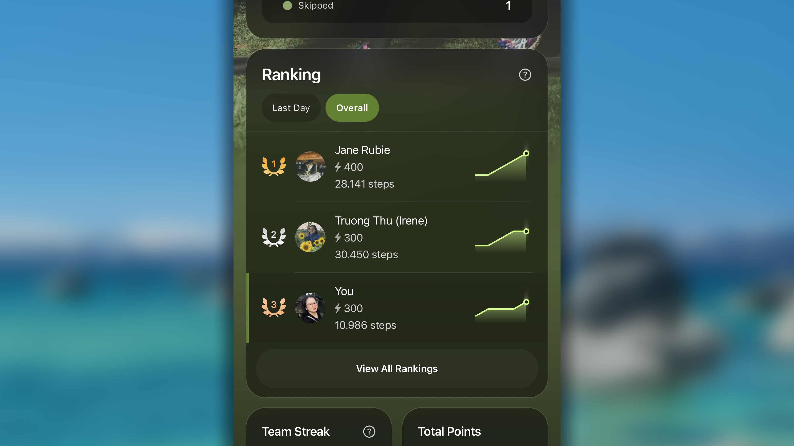

    **Para clasificar el rendimiento de todos los miembros de un desafío**, utilizamos un sistema justo que determina quién ocupa el primer puesto:

    1. **Factor principal: puntos totales.** El miembro con la puntuación más alta ocupa el primer puesto.
    2. **Primer criterio de desempate: valor total registrado.** Si los puntos son iguales, ocupa una posición superior quien haya registrado una cantidad total mayor —por ejemplo, más minutos o más páginas—.
    3. **Segundo criterio de desempate: hora del último registro.** Si los puntos y los valores registrados siguen siendo iguales, gana quien haya terminado el hábito antes.

    Las medallas de la clasificación «General» reconocen el esfuerzo de los miembros que han avanzado en el desafío.

    .png "Desafío frente a Círculo (2)")

    Las medallas se conceden según estas reglas:

    - 🥇 **Medalla de oro:** reservada para el miembro número 1.
    - 🥈 **Medalla de plata:** se concede al siguiente 40 % de miembros con mejor rendimiento.
    - 🥉 **Medalla de bronce:** se concede a los miembros restantes.

    ### **Racha de equipo**

    

    Es la medida definitiva de la constancia colectiva del grupo. La _Racha de equipo_ cuenta cuántos días seguidos ha tenido éxito todo el grupo.

    **La Racha de equipo aumenta 1 día cuando:**

    - **Todos completan:** cada miembro alcanza su objetivo diario comprometido y marca el hábito del desafío como completado para el día actual y durante el propio día actual.
    - **Finalización parcial —sin fallos—:** algunos miembros completan el objetivo, mientras que otros utilizan una «Omisión» o están en «Modo descanso», y nadie deja el hábito incompleto ni lo marca como fallido ese día.

    **La Racha se reinicia a 0 cuando:**

    - **Un solo fallo:** si incluso un único miembro no completa el objetivo —y no utiliza una Omisión ni el Modo descanso—, toda la Racha de equipo se reinicia a cero.

    ### **Puntos totales**

    Es la suma de todos los puntos obtenidos por cada miembro del desafío. Representa el esfuerzo y el éxito totales de todo el grupo.

    La forma de calcular los puntos se define mediante el Nivel de dificultad del desafío.

    ## Consultar el progreso de un miembro

    La transparencia ayuda a que la competición sea justa y motivadora. Por eso, en un desafío de Habitify puedes consultar el progreso detallado de cualquier participante para ver su posición actual, su historial de rachas y sus registros diarios.

    Para ver los detalles de un participante:

    1. Dentro de un desafío, abre la pestaña **Estadísticas**.
    2. Desplázate hasta la **Clasificación** y toca el nombre del miembro que quieras consultar.

    Al tocar un miembro verás su vista de progreso personal del desafío, dividida en tres secciones: **Hoy**, **Rendimiento general** e **Historial de progreso**.

    ### Hoy

    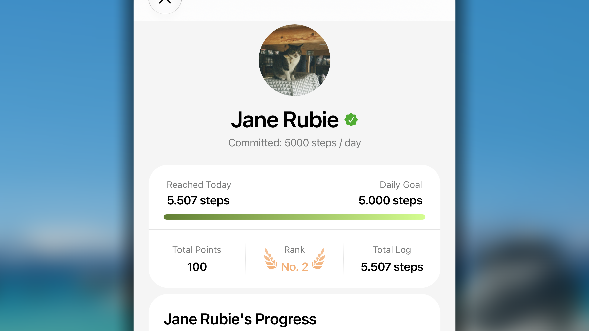

    En la parte superior puedes ver cómo le va al miembro en este momento.

    - **Progreso de hoy:** la barra de progreso muestra sus registros del día actual en comparación con su compromiso diario —por ejemplo, «5.000/10.000 m»—.
    - **Racha actual:** el icono de fuego muestra su racha actual de este hábito concreto del desafío.

    ### **Rendimiento general**

    Debajo de «Hoy» aparece un resumen general de su situación en el desafío:

    - **Puntos totales:** la puntuación acumulada a partir de sus finalizaciones y penalizaciones.
    - **Posición:** su puesto actual en la Clasificación.
    - **Registro total:** el volumen total o las repeticiones que ha aportado desde el inicio del desafío.

    ### **Progreso**

    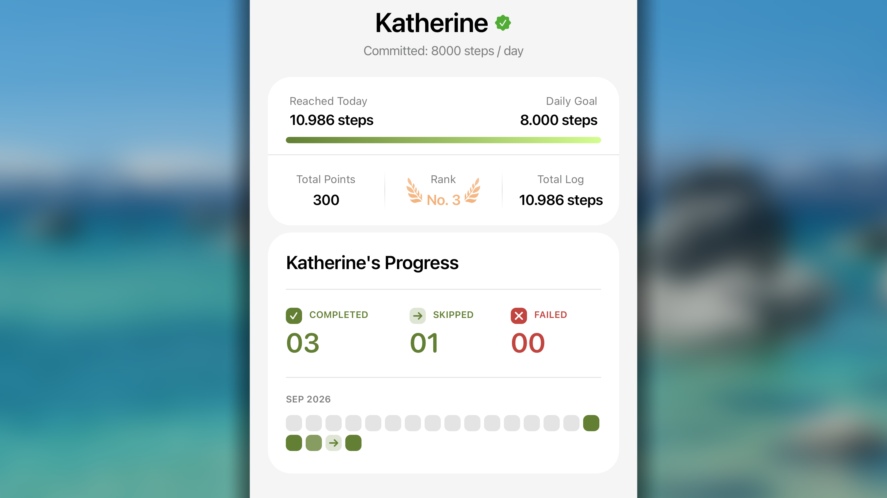

    La sección _Progreso_ permite examinar a fondo su constancia en cada mes desde la fecha de inicio del desafío.

    - **Resumen:** verás el recuento total de tres estados:
      - **Éxito:** días en los que se alcanzó por completo el objetivo.
      - **Omitido:** días marcados como omitidos.
      - **Fallido:** días en los que no se alcanzó el objetivo.
    - **Mapa de bloques:** la cuadrícula visual representa su historial mes a mes.
      - **Cuadrado sólido:** finalización satisfactoria.
      - **Círculo rojo con una x:** día fallido.
      - **Icono de flecha —→—:** día omitido.
      - **Icono de descanso:** indica que el usuario estuvo en «[<u>Modo descanso</u>](https://intercom.help/habitify-app/en/articles/6095980-welcome-to-habitify-the-introduction)» ese día.

    ## Consultar la actividad del desafío

    Un desafío no es solo una competición, sino también una comunidad viva. El auténtico centro de esa comunidad es la pestaña **Actividad**, que funciona como un canal social privado para ti y los demás miembros del desafío.

    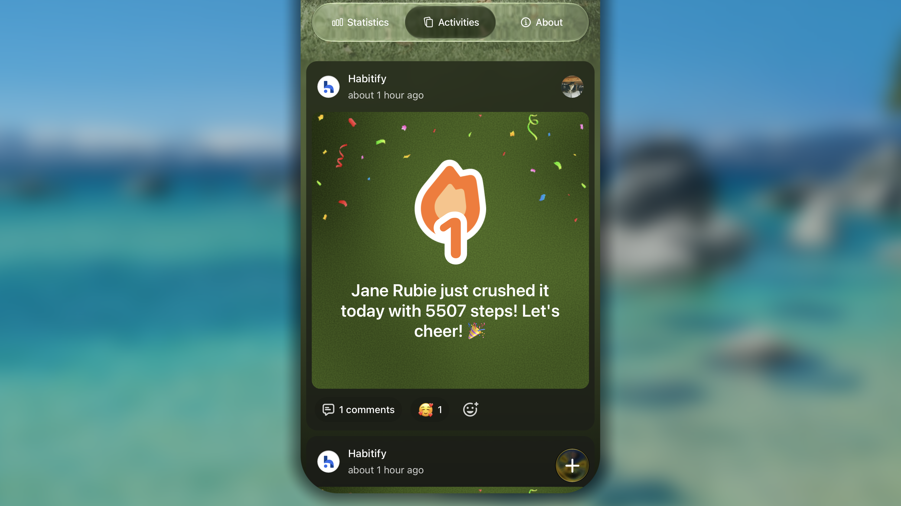

    ### Mantenerte al día

    La pestaña _Actividad_ se actualiza automáticamente con los momentos importantes del desafío. El sistema crea publicaciones cuando se producen acontecimientos clave:

    - Se incorpora un miembro nuevo al desafío.
    - Un miembro completa su objetivo de hoy y aumenta su racha actual.

    ### Compartir tus ideas

    Además de las publicaciones automáticas, puedes compartir con el grupo tus propios pensamientos, emociones y novedades.

    1. En la pestaña _Actividad_, toca **el botón +** de la esquina inferior derecha.
    2. En el espacio para crear la publicación, puedes:
       1. Escribir lo que quieras compartir.
       2. Tocar 🏞️ para subir una imagen o 📷 para hacer una rápidamente con la cámara del teléfono.
    3. Por último, toca el botón **Publicar** en la esquina superior derecha para compartirla en el canal.

    ### Interactuar con otras personas

    En todas las publicaciones del canal Actividad, ya sean automáticas o de un miembro, puedes:

    - **Enviar una reacción**: toca el botón de reacción y elige el emoji que refleje tu apoyo, agradecimiento o entusiasmo por la publicación.
    - **Dejar un comentario:** toca la publicación y, a continuación, el campo _«Añade tu respuesta»_; escribe el mensaje y toca ↑ para publicar el comentario debajo de la publicación.
    - **Mencionar a otras personas con @:** en el comentario puedes escribir _@alguien_ que también forme parte del desafío para llamar su atención o responderle directamente.

    ## Preguntas frecuentes

    <Accordion title="**¿Cómo puedo registrar el progreso de fechas anteriores para el hábito del desafío?**">
      Puedes registrar el hábito del desafío libremente del mismo modo que registras tus hábitos normales.

      Sin embargo, es obligatorio registrar el progreso antes de que termine el día para que el esfuerzo cuente en tu puesto de la Clasificación y en el rendimiento general del desafío.
    </Accordion>

    <Accordion title="**¿Qué ocurre si se elimina el hábito del desafío?**">
      Cuando se elimina el hábito del desafío, todo el progreso se borra permanentemente y no se puede restaurar. Si quieres continuar el desafío, tendrás que crear otro hábito del desafío. El progreso empezará a contar desde el día en que reinicies.
    </Accordion>

    <Accordion title="**¿Cómo se edita un desafío?**">
      **Si el desafío todavía no ha comenzado**, puedes cambiar sus datos y reglas:

      - Abre el desafío y toca el botón 🖊 de la esquina superior derecha.
      - En _Editar desafío_, cambia el nombre, el color, la descripción, el fondo y las reglas.
      - Por último, toca el botón **Listo** para guardar los cambios.

      **Si el desafío ya ha comenzado**, solo puedes editar sus datos:

      - Abre el desafío y cambia a la pestaña **Información**.
      - Desplázate hasta el final y toca **Editar desafío**.
      - En _Editar desafío_, cambia el nombre, el color, la descripción y el fondo.
      - Por último, toca el botón **Listo** para guardar los cambios.
    </Accordion>

    <Accordion title="**¿Cómo se elimina a alguien de un desafío?**">
      Actualmente, no es posible eliminar a una persona de un desafío. Por tanto, revisa atentamente el permiso «Aprobación automática» antes de compartir el enlace de invitación con otras personas o de forma pública.
    </Accordion>
  </Tab>
  <Tab title="Sitio web y escritorio">
    Aunque los pasos para configurar un desafío y unirse a él deben realizarse en las aplicaciones para teléfono, puedes seguir cómodamente el hábito vinculado al desafío desde las aplicaciones web y de escritorio.

    Si tu hábito está vinculado a un desafío, el nombre del desafío aparecerá debajo del nombre del hábito en la lista.

    

    Si tu hábito está vinculado a otra aplicación de salud, el progreso se actualiza automáticamente. No es necesario registrarlo manualmente.

    Si el hábito está configurado con el método de registro manual, puedes registrar el progreso o actualizar su estado como haces con un hábito normal:

    - **En el diseño de cuadrícula:**
      - Selecciona la celda de hoy y elige Completar, Omitir o Fallar en la barra de acciones inferior.
      - Haz clic con el botón derecho en la celda de hoy y elige una acción en el menú.
    - **En el diseño de lista:**
      - Selecciona el hábito vinculado al desafío y elige Completar, Omitir o Fallar en la barra de acciones inferior.
      - Haz clic con el botón derecho en el hábito vinculado al desafío y elige una acción en el menú.

    <Note>
      Solo cuenta para los logros del desafío el progreso o la actualización de estado del día actual.
    </Note>
  </Tab>
</Tabs>

<Accordion title="**¿Dónde puedo acceder a mi desafío en las aplicaciones web y de escritorio?**">
  Actualmente, el espacio Desafío está disponible en las aplicaciones para teléfono y tableta.

  No obstante, puedes registrar desde cualquier lugar tu progreso en el hábito vinculado al desafío.
</Accordion>
