Habit Gate bloquea las aplicaciones y sitios web que elijas hasta que completes un hábito. Los sitios web se bloquean en Chrome, Firefox y el navegador del teléfono. Para desbloquearlos, debes verificar el hábito mediante una foto, una ubicación, el tiempo de pantalla de una aplicación, datos de salud o una etiqueta NFC. Cada puerta está asociada a un hábito.

## Configuración rápida

Para configurar Habit Gate en un hábito:

- En la pantalla _New Habit_ o _Edit Habit_, pulsa **Habit Gate**.
- Actívalo eligiendo **Block apps & websites**.
- En _Apps & Websites_, añade las aplicaciones o sitios web que quieras bloquear.
- Elige el método con el que verificarás la finalización del hábito y desbloquearás las aplicaciones o sitios web.
- En _Bypass Policy_, elige el grado de rigor del bloqueo y la verificación.
- En _After Verification_, elige qué debe hacer la aplicación después de una verificación correcta.
- Cuando termines, pulsa **←** para guardar la configuración y volver a los ajustes del hábito.

## Métodos de verificación

### Verificar por ubicación

**Cómo configurarlo**

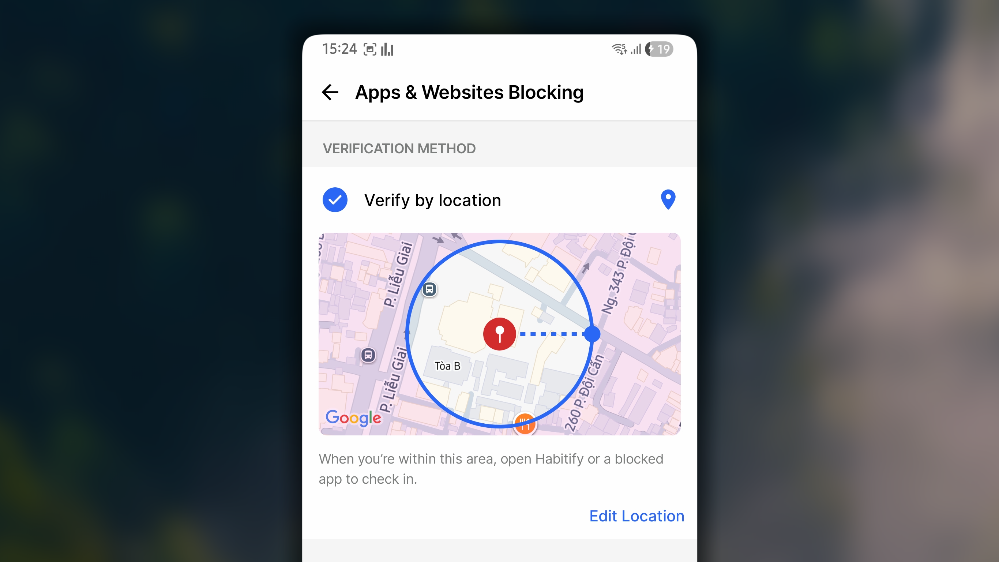

1. En _Habit Gate_, bajo _Verification Method_, selecciona **Verify by Location**.
2. Pulsa **Pick a location**.
3. Selecciona **Current Location** o **busca el lugar** que deba considerarse válido para la verificación, como tu gimnasio o una biblioteca.
4. Define la distancia: indica lo cerca que debes estar para que el hábito cuente.
5. Pulsa ← para guardar y volver.

**Cómo verificarlo**

1. Ve al lugar marcado; debes encontrarte dentro de la distancia configurada.
2. Abre una aplicación o un sitio web bloqueados para mostrar la pantalla de bloqueo y pulsa **Verify**.
3. Si estás dentro del área válida, podrás pulsar **Verify** en esa pantalla.  De lo contrario, el botón estará desactivado y se mostrará la distancia entre tu ubicación y el área requerida.

<Frame>
  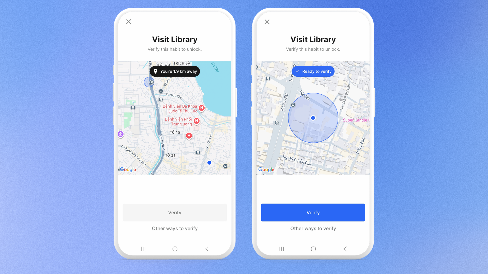
</Frame>

### Verificar mediante una foto

**Cómo configurarlo**

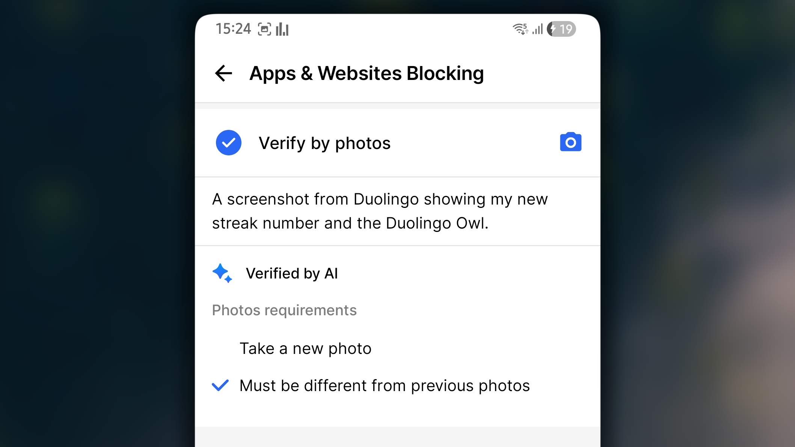

1. En _Habit Gate_, bajo _Verification Method_, selecciona **Verify by Photo**.
2. Describe lo que debe mostrar la foto. Sé específico: «Mis zapatillas de correr en la puerta» funciona mejor que «prueba de que corrí».
3. Si lo deseas, activa estas reglas:
   1. Hacer una foto nueva.
   2. Debe ser distinta de las fotos anteriores.
4. Pulsa ← para guardar y volver.

**Cómo verificarlo**

1. Abre una aplicación o un sitio web bloqueados para mostrar la pantalla de bloqueo y pulsa **Verify**.
3. Haz una foto que coincida con tu descripción.
4. Espera a que la IA de Habitify compare la foto con la descripción:
   1. Si la foto no cumple los requisitos, se mostrará el motivo. Pulsa **Take another photo** para intentarlo de nuevo.
   2. Si la foto es válida, verás una marca verde ✔️ y podrás pulsar **Continue with [the blocked app/web]** para usar la aplicación o el sitio web.

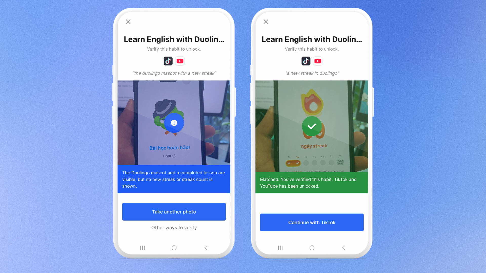

### Verificar por tiempo de pantalla

**Cómo configurarlo**

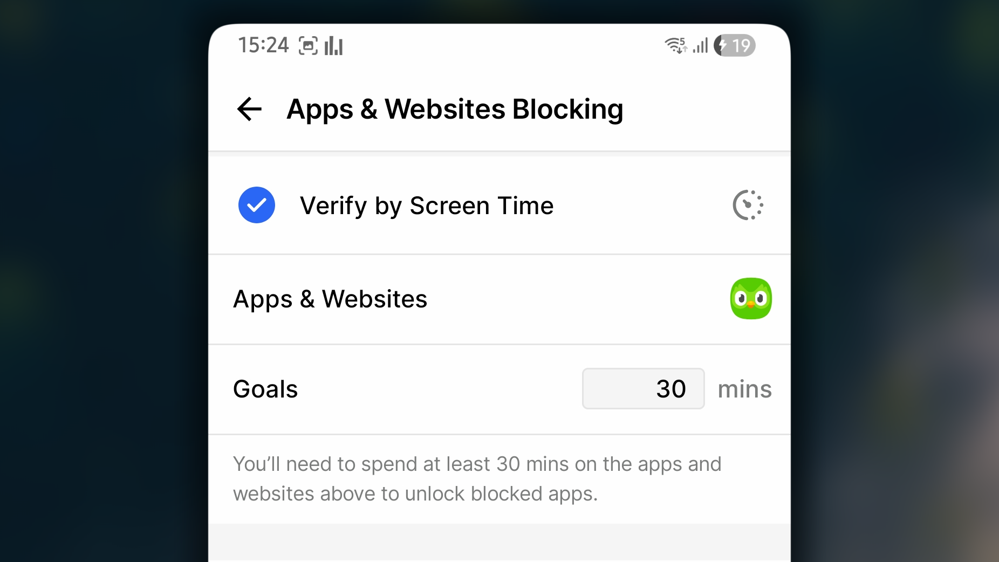

1. En _Habit Gate_, bajo _Verification Method_, selecciona **Verify by Screen Time**.
2. Elige la aplicación que utilizarás, como Duolingo.
3. Define el tiempo objetivo, por ejemplo 30 minutos.
4. Pulsa ← para guardar y volver.

**Cómo verificarlo**

1. Abre la aplicación elegida y utilízala hasta alcanzar el tiempo objetivo.
2. Abre una aplicación o un sitio web bloqueados para mostrar la pantalla de bloqueo y pulsa **Verify**.
3. Si el tiempo de pantalla cumple el requisito, podrás pulsar **Verify**. De lo contrario, el botón estará desactivado.

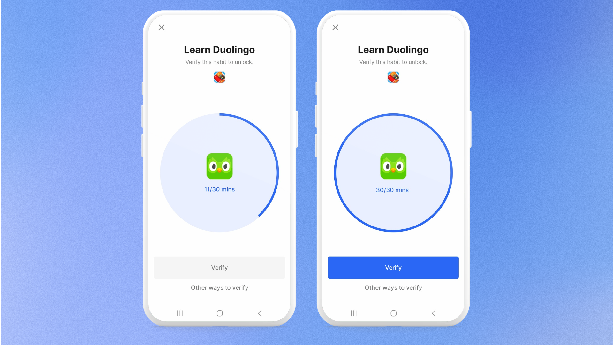

### Verificar mediante Health Connect

**Cómo configurarlo**

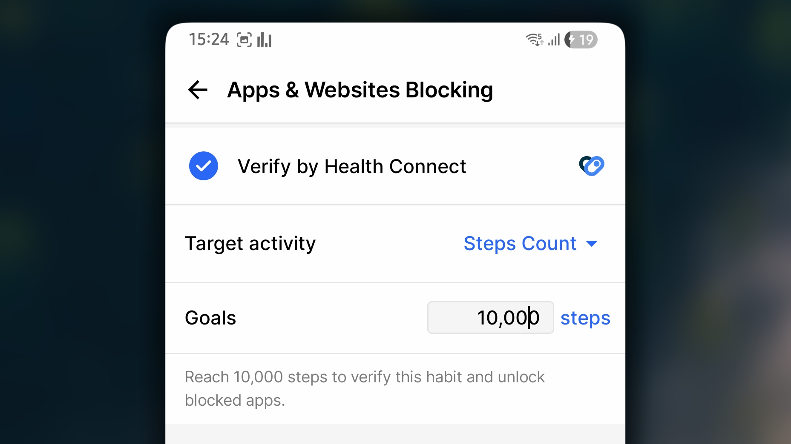

1. En _Habit Gate_, bajo _Verification Method_, selecciona **Verify by Health Connect**.
2. En _Target activity_, elige la actividad que quieras registrar, como Steps o Calories Burned.
3. En _Goals_, define el valor que debes alcanzar, como 10 000 pasos u 800 kcal.
4. Pulsa ← para guardar y volver.

**Cómo verificarlo**

1. Realiza la actividad hasta alcanzar el objetivo. Los datos proceden de tu aplicación de salud.
2. Abre una aplicación o un sitio web bloqueados para mostrar la pantalla de bloqueo y pulsa **Verify**.
4. Podrás comprobar rápidamente cuánto llevas. La primera vez, es posible que debas conceder permiso de acceso a Health Connect.
5. Si has alcanzado el objetivo, podrás pulsar **Verify**. De lo contrario, el botón estará desactivado.

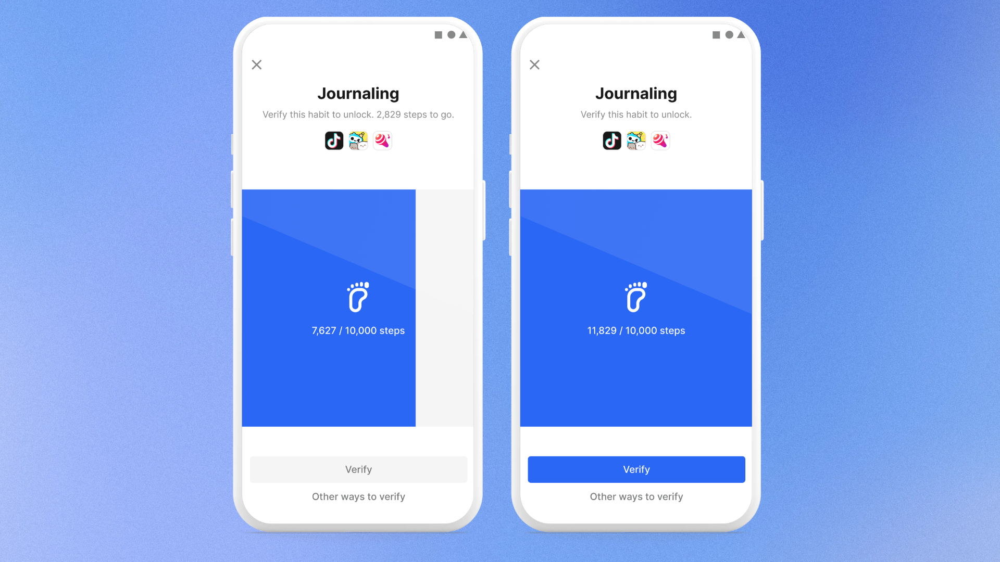

### Verificar mediante NFC

**Cómo configurarlo**

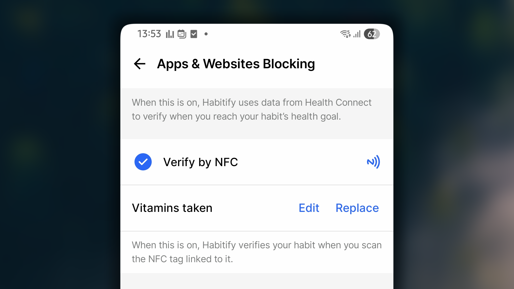

1. En _Habit Gate_, bajo _Verification Method_, selecciona **Verify by NFC**.
2. Pulsa **Scan a Tag to link...**.
3. Escanea la etiqueta NFC que quieras vincular con el hábito y deja un mensaje breve para la pantalla de bloqueo que te ayude a recordar qué debes hacer para eliminarlo.
4. Pulsa ← para guardar y volver.

**Cómo verificarlo**

1. Abre una aplicación o un sitio web bloqueados para mostrar la pantalla de bloqueo.
2. Pulsa **Verify** y elige **NFC**.
3. Acerca el teléfono a la etiqueta vinculada.

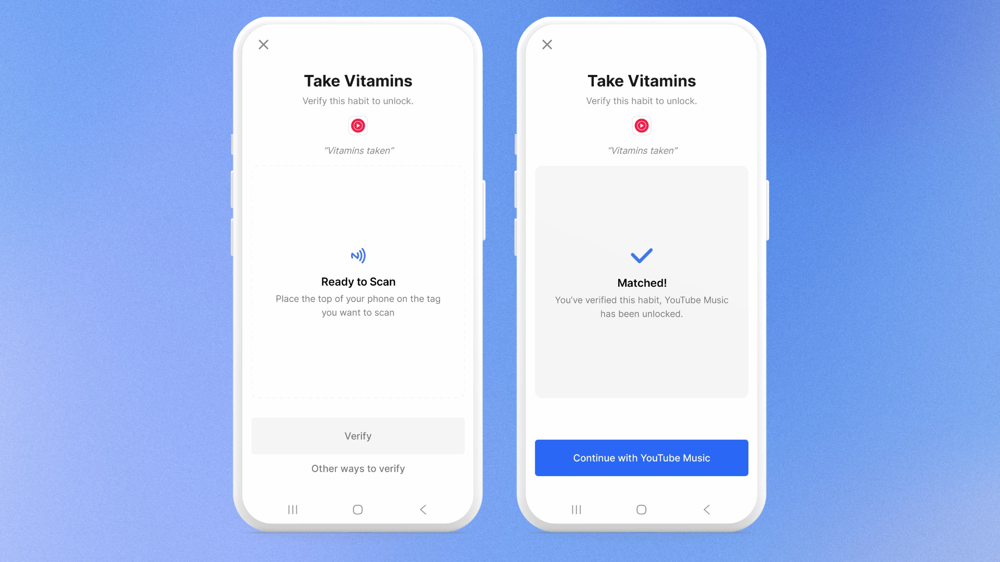

## Política de omisión

La política de omisión ofrece tres niveles:

- **Easy:** puedes abrir las aplicaciones bloqueadas en cualquier momento tras una confirmación rápida. No requiere verificación.
- **Friction:** puedes abrir las aplicaciones bloqueadas durante un breve periodo después de confirmar la solicitud de Habitify. A continuación, se vuelven a bloquear.
- **Strict:** las aplicaciones permanecen bloqueadas hasta que se verifica el hábito. No es posible omitir la verificación.

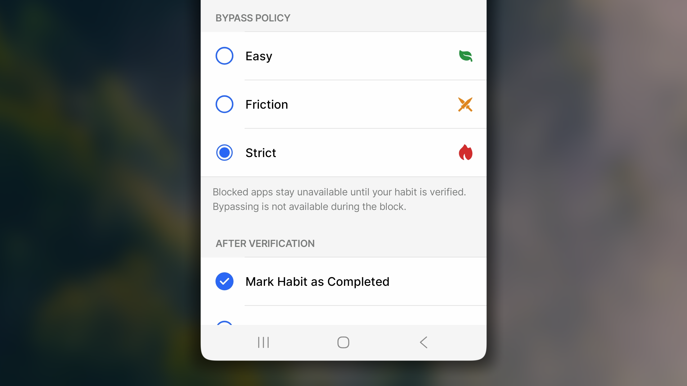

## Después de la verificación

Este ajuste controla qué otras acciones realiza Habitify cuando se acepta la verificación. Se ejecuta automáticamente, por lo que no tienes que hacer nada más cuando se abre la puerta.

Hay dos opciones:

- **Marcar el hábito como completado:** cuando se acepta la verificación, Habitify completa el hábito por ti.
- **Guardar la foto en las notas del hábito:** cuando se acepta una foto para la verificación, Habitify la guarda en Note para ese hábito.

## Preguntas frecuentes

<Accordion title="**¿Mis aplicaciones vuelven a bloquearse al día siguiente?**">
  Sí. La puerta se restablece a medianoche (00:00). Tras verificar un hábito, las aplicaciones y sitios web permanecen desbloqueados durante el resto del día. A las 00:00 vuelven a bloquearse hasta que realices otra verificación.
</Accordion>

<Accordion title="**¿Qué ocurre si una misma aplicación está bloqueada por más de un hábito?**">
  Debes verificar todos esos hábitos. Verificar uno no desbloquea la aplicación mientras siga sin verificarse otro hábito que también la bloquea.
</Accordion>

<Accordion title="**Si activo varios métodos de verificación, ¿cuál aparece primero?**">
  Habitify los muestra en un orden fijo: Location, Photo, Screen Time, Health Connect y NFC. No puedes reordenarlos, pero sí cambiar de método eligiendo «Other ways to verify» en la pantalla de bloqueo.
</Accordion>
