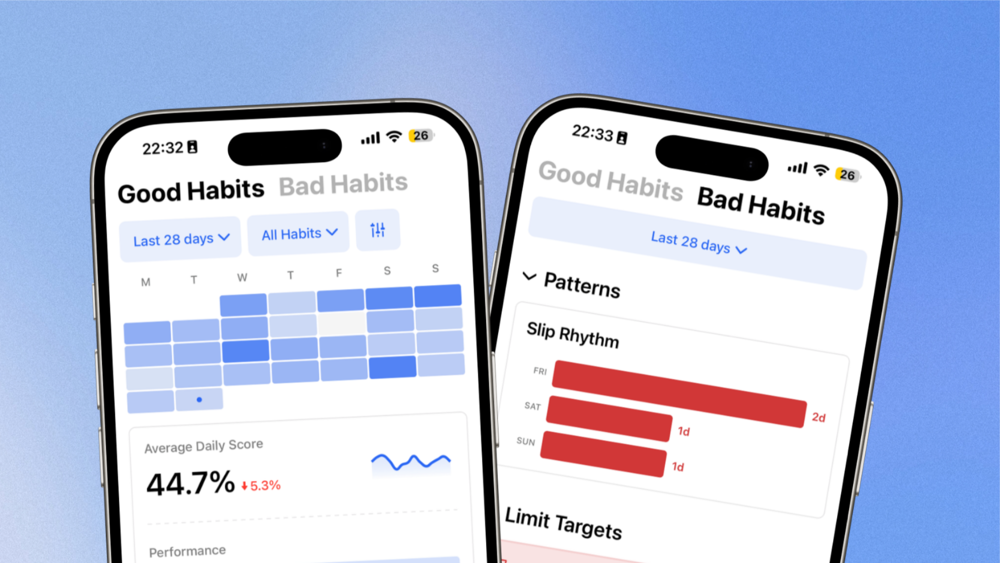
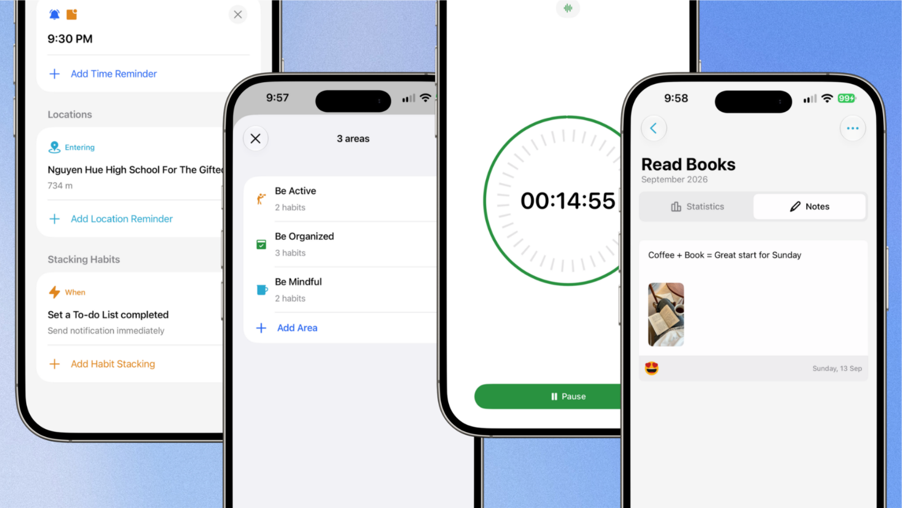
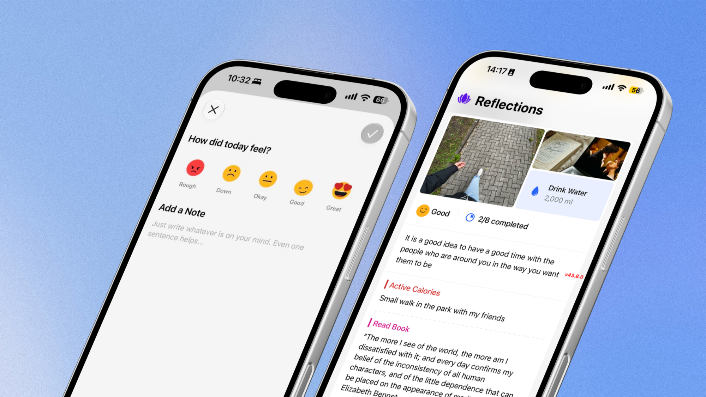
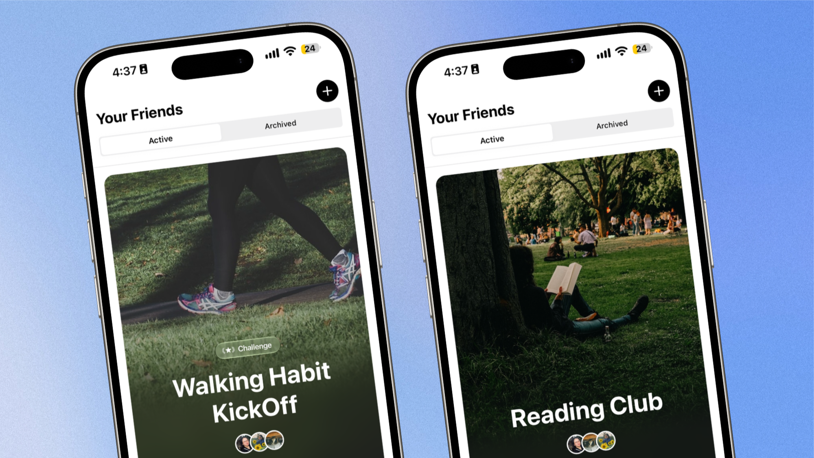
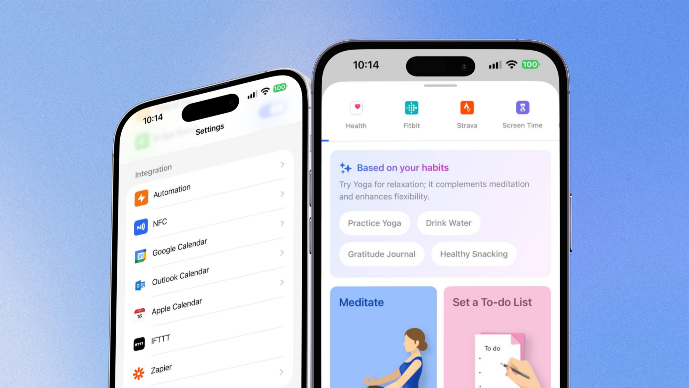
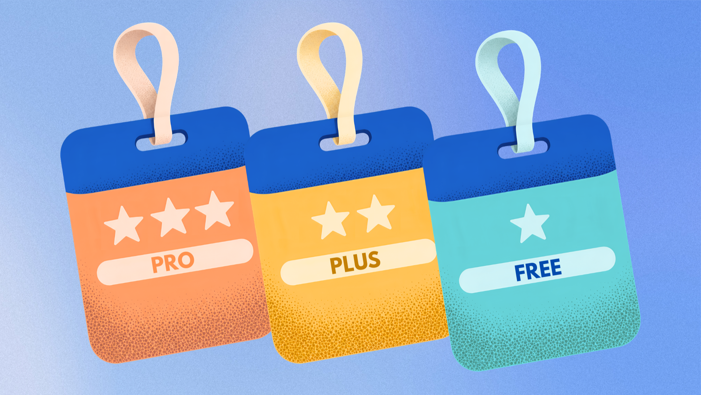
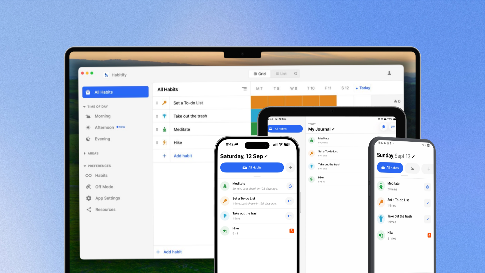

Habitify es una aplicación de seguimiento de hábitos basada en una idea sencilla: los cambios duraderos nacen de acciones pequeñas y constantes, registradas con sinceridad a lo largo del tiempo. En lugar de depender únicamente de la memoria o de la fuerza de voluntad, Habitify te ofrece una vista diaria centrada en lo que debes hacer, una forma sencilla de registrarlo y una imagen clara de tu evolución real. Todo se mantiene sincronizado en tu teléfono, ordenador y la web.

## Registra hábitos positivos y negativos

Habitify admite dos tipos de hábitos, porque crear algo nuevo y abandonar algo antiguo son procesos realmente distintos:

- Hábitos positivos: aquello que quieres incorporar, como hacer ejercicio, leer o beber más agua. Establece un objetivo diario, semanal, mensual o anual, y Habitify registrará tu constancia para alcanzarlo.
- Hábitos negativos: aquello que quieres reducir o abandonar por completo, como fumar o desplazarte sin parar por contenido negativo. Establece un límite que no quieras superar o comprométete a dejarlo por completo, y Habitify registrará tu autocontrol en lugar de tu actividad.

Ambos se registran de la misma forma —se configuran una vez y después se actualizan a diario—, mientras la aplicación adapta silenciosamente la forma de medir el éxito de cada tipo.

## Conjunto de funciones

Cuando domines lo básico, Habitify ofrece un conjunto completo de herramientas para organizar tus hábitos y comprender _por qué_ funcionan o por qué fallan:

- Áreas: agrupa hábitos relacionados en categorías de tu vida, como «Salud» o «Trabajo», para ver cómo marcha una parte completa de tu vida y no solo un hábito aislado.
- Notas: un pequeño diario vinculado a cada hábito para registrar el contexto —estados de ánimo e imágenes— de cada actualización.
- Temporizador: modos Cuenta atrás, Cronómetro y Pomodoro para cualquier hábito medido por tiempo.
- Recordatorios: por hora, ubicación o encadenamiento de hábitos, para que el aviso adecuado te llegue en el momento oportuno.
- Vista de progreso: mapas de calor, puntuaciones diarias e información sobre patrones que muestran tu constancia real durante semanas y meses, no solo hoy.

## Registro del estado de ánimo y reflexión

Registrar hábitos es solo una parte del crecimiento personal; comprender cómo afectan esas rutinas a tu bienestar mental es la otra.

Por eso, Reflexión es el espacio de atención plena de Habitify: registra rápidamente tu estado de ánimo con un emoji, añade una nota sobre tu día y consulta toda esa información junto con el progreso de tus hábitos.

Juntas, Reflexión y Notas convierten Habitify en un verdadero registro de tu recorrido, no en una simple colección de marcas de verificación.

## Círculo y Desafío

Crear hábitos no tiene por qué ser una tarea solitaria y puede resultar más divertido cuando se unen tus familiares y amigos. Para eso existen Círculo y Desafío.

Con Círculo, creas un espacio privado y permanente con las personas que más te importan: compartís el progreso de varios hábitos, os animáis mutuamente y mantenéis el compromiso a largo plazo.

Con Desafío, participas durante un periodo limitado en una competición por un único objetivo compartido, con clasificación, rachas y una puntuación opcional para mantener el interés.

Sea cual sea la opción más adecuada para tu grupo, Habitify convierte el seguimiento de una actividad individual en algo que construís juntos.

## Integraciones y automatización

Habitify no funciona de forma aislada: está diseñado para conectarse con las herramientas y los dispositivos que ya utilizas en tu vida diaria:

- Sincronización de salud y ejercicio: Apple Health, Health Connect, Strava y Fitbit permiten que tu dispositivo registre la actividad automáticamente.
- Sincronización de calendarios: Google Calendar, Outlook Calendar y Apple Calendar sitúan tus hábitos junto al resto de tu agenda.
- Registro del tiempo de pantalla: Tiempo de uso y RescueTime convierten el uso real del dispositivo en datos de hábitos, tanto para crear hábitos digitales más saludables como para reducir las distracciones.
- Plataformas de automatización: Zapier e IFTTT conectan Habitify con cientos de aplicaciones y servicios, de modo que completar un hábito puede desencadenar casi cualquier otra acción que utilices, o ser desencadenado por ella.
- Automatización integrada: Actualización de estado marca automáticamente los hábitos sin registrar a la hora que elijas; las etiquetas NFC convierten objetos físicos en registros de un toque; y Atajos —junto con Siri— te permite registrar el progreso con la voz sin abrir la aplicación.

## Empieza y crece según tus necesidades

No necesitas utilizarlo todo de una vez. La mayoría de las personas empiezan con unos pocos hábitos en el plan gratuito, añaden áreas y recordatorios a medida que crece su rutina e incorporan integraciones y automatizaciones cuando pasan a Pro y saben exactamente qué quieren automatizar.

Habitify está diseñado para crecer contigo y ser tan sencillo o estar tan conectado como necesite realmente tu seguimiento de hábitos.

## Mantén el rumbo en todas partes

Tus hábitos no deberían detenerse en el momento en que cierras la aplicación. Habitify te acompaña en el teléfono, la tableta, el ordenador y la web, y se sincroniza automáticamente para que tu progreso esté siempre actualizado, sin importar desde dónde lo registres.

