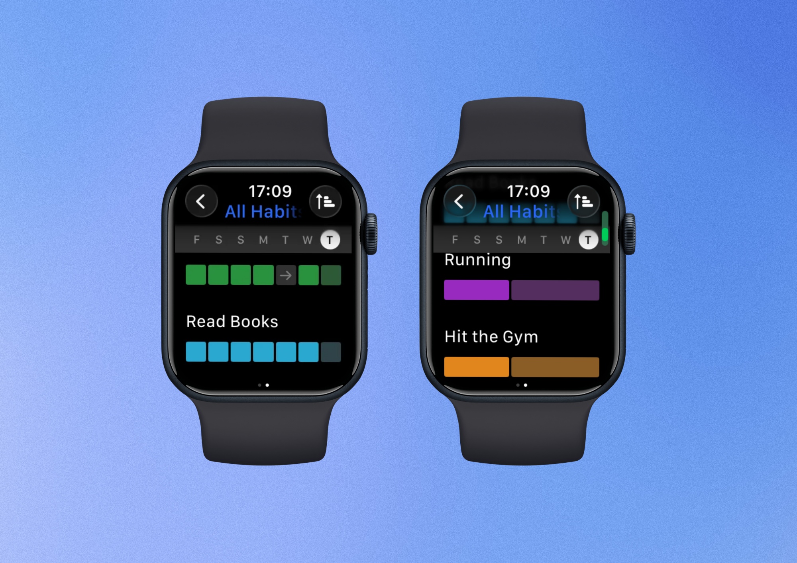
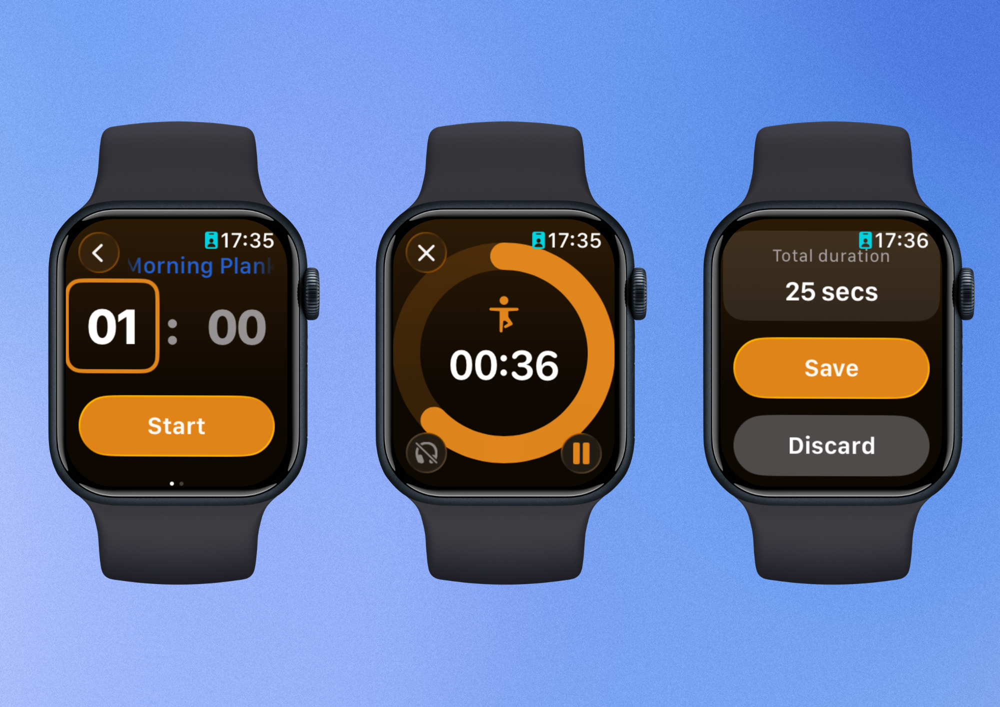

La app Habitify para Apple Watch te permite ver tus hábitos, registrar el progreso, utilizar un temporizador y omitir o marcar un hábito como no completado desde la muñeca, sin tener que sacar el teléfono. Se sincroniza con la app Habitify del iPhone, por lo que tus hábitos, el historial de registros y los ajustes ya están disponibles cuando la abres.

Este artículo describe todas las funciones de la app para watchOS.

## Iniciar sesión en Habitify desde el Apple Watch

**Antes de empezar, comprueba lo siguiente:**

- Habitify está instalado en el iPhone y has iniciado sesión.
- Tu Apple Watch **está enlazado con** ese iPhone.
- Ambos dispositivos **utilizan el mismo Apple ID y tienen activado el Llavero de iCloud**. El Apple Watch obtiene los datos de inicio de sesión del iPhone a través del Llavero de iCloud.
- El **Bluetooth está activado** en el iPhone.

**Abrir la app por primera vez**

1. Instala Habitify en el Apple Watch.
2. **Mantén el iPhone cerca del Apple Watch** y **mantén abierta la app Habitify** en el iPhone.
3. Abre Habitify en el Apple Watch.
4. Espera mientras la app se sincroniza con el iPhone. Importará tus hábitos, el historial de registros y los ajustes.

## Ver listas de hábitos en el Apple Watch

La primera pantalla se titula **Hoy**. Muestra tres grupos de listas:

1. **Todos los hábitos:** todos tus hábitos de hoy.
2. **Momento del día:** una lista para cada momento del día, como Mañana, Tarde y Noche. El actual está marcado como **Ahora**. Los demás muestran su intervalo horario, por ejemplo, 18:00 – 00:00.
3. **Áreas:** una lista para cada una de tus áreas personalizadas.

Cada lista muestra cuántos hábitos has completado del total de hoy, por ejemplo, 0/4.

Toca una lista para ver los hábitos que contiene. Cada lista tiene dos modos de visualización: **Hoy** y **Últimos 7 días**.

###  Vista Hoy

La vista Hoy se abre primero. El nombre de la lista, como **Todos los hábitos**, aparece en la parte superior y hay un botón para volver en la esquina superior izquierda.

Cada fila muestra el nombre del hábito, tu progreso con respecto al objetivo (por ejemplo, 10/20 min, 0/1 vez o 12,8/40 km) y un botón a la derecha. El anillo que rodea el botón se va llenando a medida que te acercas al objetivo.

Los hábitos aparecen en el orden que estableciste en la app para iOS, agrupados por tipo de objetivo y estado. Por ejemplo, los hábitos con un objetivo semanal aparecen bajo el encabezado **Esta semana**.

Junto a cada hábito hay un botón que cambia según su objetivo:

<table>
  <colgroup>
    <col width="241" />
    <col width="149" />
    <col width="345" />
  </colgroup>
  <thead>
    <tr>
      <th>Objetivo del hábito</th>
      <th>Botón</th>
      <th>Qué hace</th>
    </tr>
  </thead>
  <tbody>
    <tr>
      <td>Duración (minutos u horas)</td>
      <td>Temporizador</td>
      <td>Inicia una sesión de cuenta regresiva</td>
    </tr>
    <tr>
      <td>Unidad «veces»</td>
      <td>Plus (+)</td>
      <td>Añade una cantidad al progreso del hábito</td>
    </tr>
    <tr>
      <td>Cualquier otra unidad</td>
      <td>Registrar</td>
      <td>Te permite introducir un valor</td>
    </tr>
  </tbody>
</table>

### Vista Últimos 7 días

Para acceder a la vista de los últimos 7 días, desliza hacia la izquierda desde la vista Hoy.

En esta vista puedes ver tu lista de hábitos con el progreso de los últimos 7 días de cada hábito. Lee la vista de arriba abajo:

1. Una fila de letras de los días de la semana en la parte superior muestra los últimos 7 días. El día de hoy es la letra rodeada con un círculo a la derecha.
2. Debajo, cada hábito muestra su nombre y un cuadrado por día, del color del hábito, alineados bajo las letras de los días de la semana.
3. Un hábito con un objetivo semanal, mensual o anual muestra una barra para el periodo actual en lugar de siete cuadrados.

Aquí, los hábitos se ordenan independientemente del tipo de objetivo y del estado.

## Ver la vista de progreso de un hábito

Toca cualquier hábito para abrir su vista de progreso. Desplázate hacia abajo para ver, en orden:

1. **Nombre y progreso del hábito:** tu progreso con respecto al objetivo del periodo actual, por ejemplo, 2/3 veces esta semana. Un anillo a la derecha muestra el estado del hábito. Tu racha actual aparece como una insignia de llama con el número de días, por ejemplo, 0d.
2. **Lista de verificación**, si el hábito tiene una. Los elementos completados aparecen marcados y tachados.
3. **Historial:** lo que muestra depende del tipo de objetivo del hábito (consulta la información siguiente).
4. **Notas de hoy:** las notas de texto que has añadido hoy.

#### Qué muestra el historial

<table>
  <colgroup>
    <col width="100" />
    <col width="597" />
  </colgroup>
  <thead>
    <tr>
      <th>Objetivo del hábito</th>
      <th>Historial</th>
    </tr>
  </thead>
  <tbody>
    <tr>
      <td>Diario</td>
      <td>**Últimas 4 semanas:** una cuadrícula con una columna para cada día de la semana (de L a D) y una fila para cada una de las últimas 4 semanas. Los cuadrados más brillantes son días en los que completaste el hábito. Los cuadrados más oscuros son días en los que no lo completaste.</td>
    </tr>
    <tr>
      <td>Semanal</td>
      <td>**Últimas 4 semanas:** una barra por semana, etiquetada como Esta semana, Semana pasada y, a continuación, intervalos de fechas como 11 jul – 18 jul.</td>
    </tr>
    <tr>
      <td>Mensual</td>
      <td>**Últimos 3 meses:** una barra por mes, etiquetada con el mes y el año.</td>
    </tr>
    <tr>
      <td>Anual</td>
      <td>Sin historial. La vista solo muestra la lista de verificación y las notas.</td>
    </tr>
  </tbody>
</table>

En las barras, la parte rellena muestra cuánto del objetivo completaste en ese periodo.

## Registrar el progreso de tus hábitos

### Cómo registrar el progreso

Hay 2 formas de registrar el progreso de un hábito en el Apple Watch:

- En la **vista Día** de tu lista de hábitos, utiliza los botones inteligentes situados junto al hábito.

- Abre la **vista de progreso del hábito** y toca el botón para registrar un valor en la esquina inferior derecha.

### **Cómo** omitir o marcar un hábito como no completado hoy

1. Abre la vista de progreso del hábito.
2. Toca el botón de **3 puntos**.
3. Elige **Omitir hoy** o **Marcar como no completado**.

## Añadir una nota a tu hábito

1. Abre la vista de progreso del hábito.
2. Toca el botón de **3 puntos**.
3. Elige **Nota de texto** y añade tu nota.

## Utilizar una sesión del Temporizador

### Cómo iniciar una sesión

1. En la vista Hoy, toca el botón de **temporizador** situado junto al hábito.
2. Accede a la **Cuenta regresiva** predeterminada: toca los **minutos** o los **segundos** para seleccionarlos y, después, gira la Digital Crown para establecer el tiempo.
3. Accede al **Cronómetro**: desliza la pantalla de Cuenta regresiva hacia la izquierda.
4. Toca **Iniciar**.

### Controlar una sesión en curso

El Apple Watch muestra una cuenta regresiva en tiempo real con tres controles:

- **Pausar y reanudar:** toca el botón de pausa (||) en la esquina inferior derecha. Cambia a un icono de reproducción (▶). Tócalo para reanudar.
- **Sonidos de fondo:** toca el icono de auriculares del centro para activar o desactivar los sonidos ambientales de fondo.
- **Detener y guardar:** toca la **X** en la esquina superior izquierda para detener el temporizador. Habitify te pregunta si quieres guardar el tiempo transcurrido en el progreso del hábito del día. Por ejemplo, si tu objetivo es de 30 minutos y lo detienes a los 15, puedes guardar esos 15 minutos o descartarlos.

## Preguntas frecuentes

<AccordionGroup>
  <Accordion title="**¿Por qué no aparecen mis hábitos en el Apple Watch?**">
    1. En el iPhone, abre Habitify y desliza hacia abajo desde la parte superior de la lista de hábitos para actualizarla. Después, vuelve a abrir Habitify en el Apple Watch.
    2. Comprueba que el Bluetooth esté activado y que el Apple Watch esté conectado al iPhone.
    3. Reinicia tanto el iPhone como el Apple Watch.
  </Accordion>

  <Accordion title="**La app se queda bloqueada en «Esperando autenticación». ¿Qué debo hacer?**">
    Esto ocurre cuando el Llavero de iCloud está desactivado en uno de los dispositivos o cuando el Apple Watch y el iPhone utilizan Apple IDs diferentes.

    1.  En el iPhone, abre **Ajustes**.
    2. Toca **[tu nombre]** y, después, **iCloud**.
    3. Toca **Contraseñas** y activa **Sincronizar este iPhone**.
    4. Asegúrate de que el Apple Watch haya iniciado sesión con el mismo Apple ID que el iPhone. Si los ajustes de watchOS incluyen una opción de Llavero, asegúrate de que esté activada.
    5. Mantén el iPhone cerca del Apple Watch, con Habitify abierto en el iPhone, durante entre 2 y 5 minutos.
    6. Vuelve a abrir Habitify en el Apple Watch.

    Si continúa bloqueada, reinicia ambos dispositivos, abre Habitify primero en el iPhone y después en el Apple Watch, o reinstala la app del Apple Watch. Si el problema persiste, ponte en contacto con nosotros e indícanos el modelo de iPhone, el modelo de Apple Watch y la versión de watchOS, además de enviarnos un vídeo breve del problema.
  </Accordion>

  <Accordion title="**¿Por qué no veo el botón del temporizador en un hábito?**">
    El botón del temporizador solo aparece en los hábitos que tienen un objetivo en minutos u horas. No aparece en hábitos de sí/no ni en hábitos medidos en otras unidades. Comprueba el objetivo del hábito en el iPhone y asegúrate de que utiliza una unidad de duración.
  </Accordion>

  <Accordion title="**¿Por qué mis hábitos se ven diferentes en las vistas Hoy y Últimos 7 días?**">
    Ambas vistas conservan el orden de los hábitos de la app para iOS. La vista Hoy también agrupa los hábitos por tipo de objetivo y estado. La vista Últimos 7 días no lo hace, por lo que muestra el mismo orden independientemente del tipo de objetivo y del estado.
  </Accordion>

  <Accordion title="**¿Qué complicaciones están disponibles para Habitify?**">
    Habitify tiene tres complicaciones:

    1. **Redonda:** Toca para registrar.
    2. **Esquina:** Toca para registrar.
    3. **Central:** una complicación rectangular que muestra una de las siguientes opciones: la lista de hoy, la lista del momento actual del día o un mapa de bloques del progreso de un hábito.

    Las que puedes añadir dependen de los espacios disponibles en la esfera del Apple Watch
  </Accordion>

  <Accordion title="**He marcado un hábito como no completado u omitido por error. ¿Cómo lo deshago?**">
    Abre el hábito y toca **Restablecer** en la esquina inferior derecha de la vista de progreso.
  </Accordion>

  <Accordion title="**¿Puedo ver en el Apple Watch todas las notas que he registrado?**">
    No. El Apple Watch solo muestra las notas de hoy, en **Notas de hoy**, dentro de la vista de progreso de un hábito. Las notas de días anteriores no se muestran en el Apple Watch.

    Para leer notas anteriores, utiliza Habitify en el iPhone:

    1. **Notas de un hábito:** en Diario, toca el hábito y abre la pestaña **Nota**.
    2. **Notas de todos los hábitos:** en Diario, desliza la lista hacia abajo para abrir Reflexión. Muestra tus notas y registros de estado de ánimo en un mismo lugar.
  </Accordion>
</AccordionGroup>
