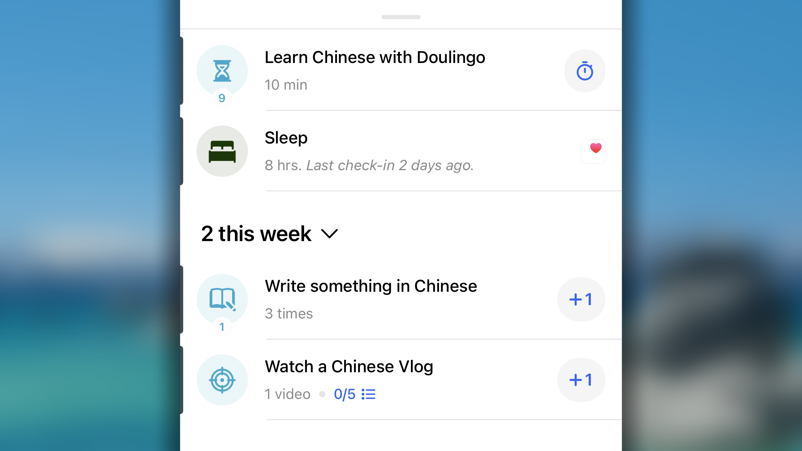
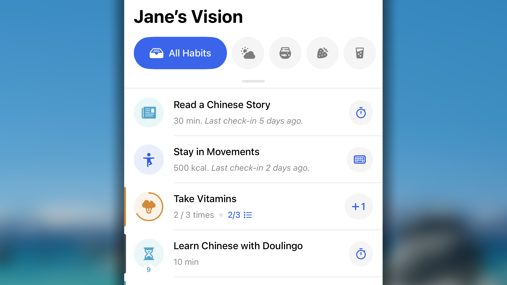
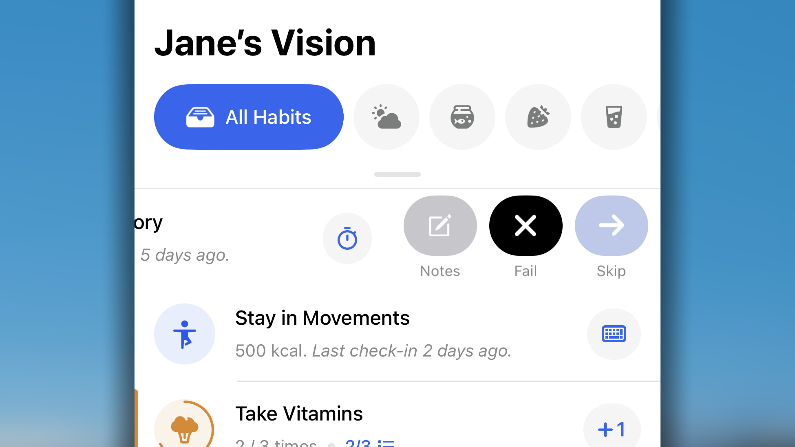
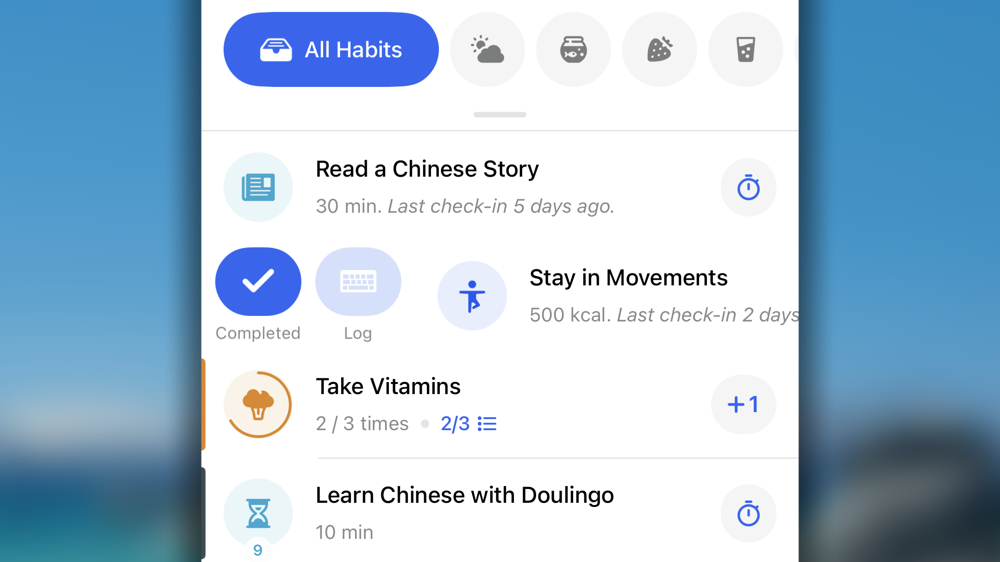
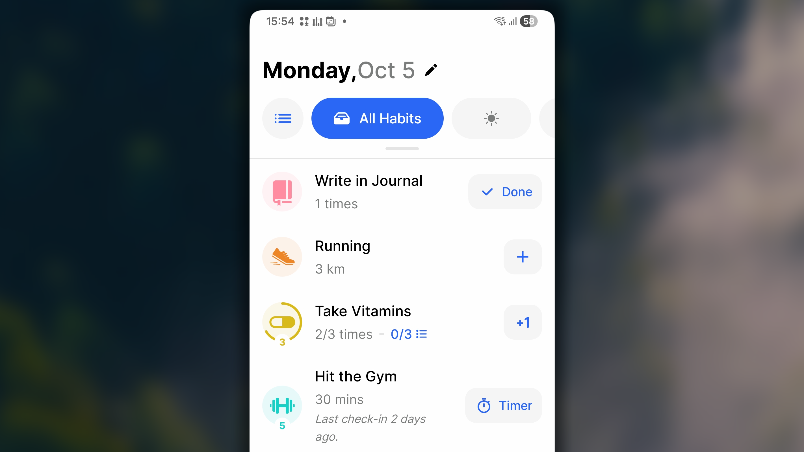
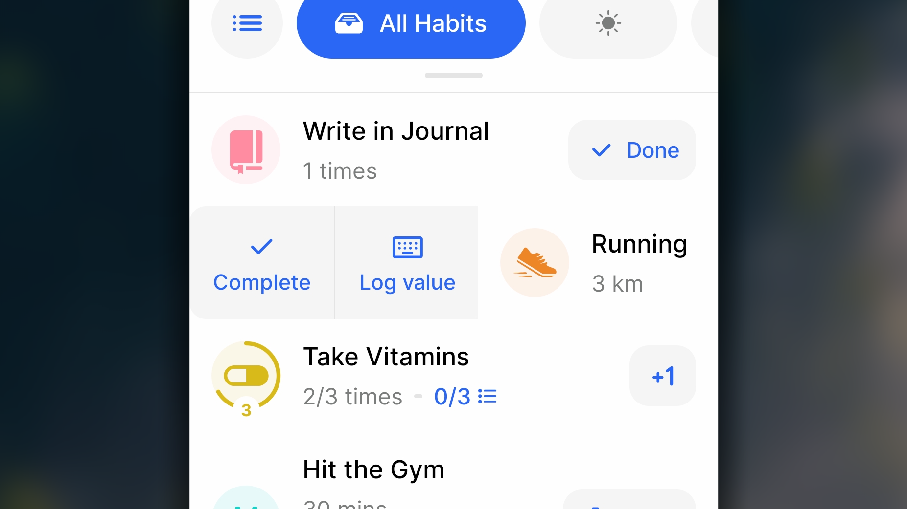
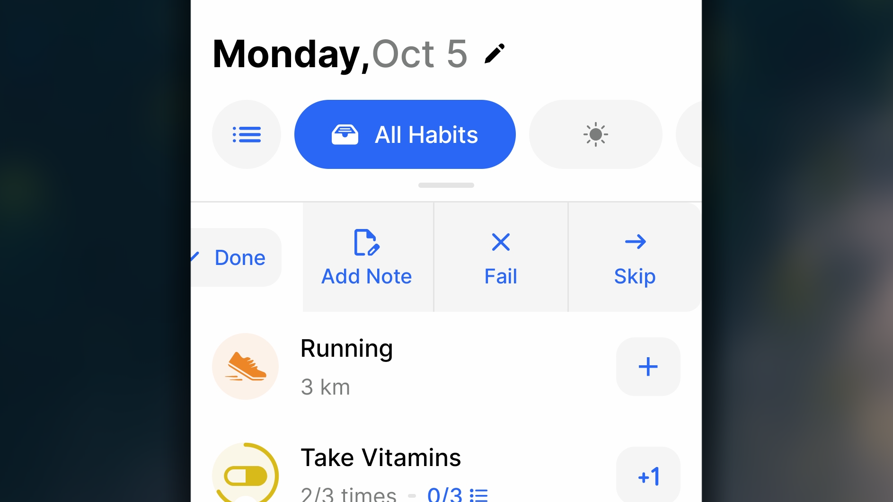

Dans Habitify, une habitude est un comportement régulier, du simple verre d’eau à une séance quotidienne. Une bonne habitude vous rapproche d’une version plus saine, productive ou sereine de vous-même. Ce guide couvre sa création, ses réglages et son suivi.

<Tabs>
  <Tab title=" iOS">
    ## Créer une bonne habitude

    <iframe src="https://drive.google.com/file/d/1Sm2g8KAFHdm67Je7YV6KH6qSpUps2tDN/preview" width="640" height="360" />

    1. Ouvrez le **Journal** dans Habitify iOS.
    2. Touchez **+**, puis **Créer une bonne habitude**.
    3. Choisissez un modèle ou **Habitude personnalisée**.
    4. Configurez l’objectif, les rappels et les autres détails.
    5. Touchez ✓ pour enregistrer.

    ## Détails d’une bonne habitude

    ### Répétition

    <iframe src="https://drive.google.com/file/d/13tFVYs9GZiq8q9som3Rx4qHJVOuDOhWt/preview" width="640" height="360" />

    **Répétition** détermine quand l’habitude apparaît dans le Journal et, pour un objectif quotidien, quels jours comptent dans la série et le score.

    | Mode | Fonctionnement | Exemple |
    | :-- | :-- | :-- |
    | **Hebdomadaire** | Tous les jours ou certains jours de la semaine | <ul><li>Tous les jours</li><li>Lun., mer. et ven.</li><li>Week-ends</li></ul> |
    | **Mensuelle** | Une ou plusieurs dates du mois | <ul><li>Le 2</li><li>Les 15 et 30</li></ul> |
    | **Intervalle** | Tous les N jours, avec aperçu des trois prochaines dates | <ul><li>Tous les 2 jours</li><li>Tous les 7 jours</li></ul> |

    ### Objectif

    <iframe src="https://drive.google.com/file/d/1kEg-ORk6bbUY6V2KO90NtbxaNJ9m3-kx/preview" width="640" height="360" />

    L’**objectif** est le minimum qui définit la réussite :

    - **Valeur :** montant minimal, par exemple 1 fois, 30 minutes ou 2 litres.
    - **Unité :** choisissez une unité adaptée ou créez-en une à partir de « fois », comme chapitres ou clients.
    - **Période :** par jour, semaine, mois ou année ; elle définit aussi la réinitialisation.

    Depuis •••, choisissez **Sélection rapide** pour une valeur prédéfinie ou **Valeur exacte** pour saisir la vôtre.

    <Info>
      **Le type d’unité ne peut plus changer après l’enregistrement.** Vous pouvez passer de minutes à heures, mais pas de minutes à kilomètres ; créez alors une nouvelle habitude.
    </Info>

    <Info>
      **Renommer une unité personnalisée modifie aussi l’historique.** « Bouteilles » renommé en « verres » s’affichera ainsi dans toutes les anciennes entrées.
    </Info>

    ### Moment de la journée

    <iframe src="https://drive.google.com/file/d/1Z5ghdzaL-DicVDK7FaDQgGK8zj5dBcD3/preview" width="640" height="360" />

    Matin, Après-midi, Soir ou toute période personnalisée structurent votre liste afin de vous concentrer sur les habitudes pertinentes au bon moment.

    <Info>
      **Au moins un moment doit être sélectionné.** Choisissez-les tous pour que l’habitude apparaisse toute la journée.
    </Info>

    <Info>
      Le moment sert uniquement à **organiser**. Un **rappel** est une notification envoyée à une heure précise ; une habitude du matin peut par exemple avoir un rappel à 8 h.
    </Info>

    <Card title="Moment de la journée" icon="calendar-day" horizontal href="/fr/app-behavior#moment-de-la-journée">
      Personnalisez Matin, Après-midi et Soir avec vos propres horaires.
    </Card>

    ### Espace

    <iframe src="https://drive.google.com/file/d/1tvk66uyWt5d6rRJoQHpPx_TnZR7C53Kb/preview" width="640" height="360" />

    Un **espace** regroupe les habitudes liées, comme Santé, Travail ou Routine matinale. Il permet d’observer un domaine de vie dans son ensemble plutôt qu’une liste à plat.

    <Card title="Espace" icon="shelves" horizontal href="/fr/area">
      Créez et classez vos habitudes.
    </Card>

    ### Rappels

    <iframe src="https://drive.google.com/file/d/1cSlZs9QFyc_Zq1iXugJLcDRAXXRLfIMI/preview" width="640" height="360" />

    Un rappel envoyé au bon moment aide à rester régulier. Habitify propose :

    - des **rappels horaires**, à une ou plusieurs heures ;
    - des **rappels géolocalisés**, à l’arrivée ou au départ d’un lieu ;
    - des **rappels d’enchaînement**, déclenchés par le statut d’une autre habitude.

    <Card title="Rappels" icon="alarm-clock" horizontal href="/fr/reminder">
      Découvrez comment configurer chaque type de rappel.
    </Card>

    ### Liste de contrôle

    <iframe src="https://drive.google.com/file/d/1NpDA2pu6Mkz6akeGqF_iW4DGYvrqSgtx/preview" width="640" height="360" />

    Une **liste de contrôle** décompose une habitude complexe en petites étapes faciles à gérer.

    - Dans _Nouvelle habitude_, ouvrez **Liste de contrôle**.
    - Saisissez le nom d’un élément.
    - Touchez **Terminé** sur le clavier.

    <Info>
      Habitify ne permet pas encore de modifier ou réordonner directement les éléments. Supprimez-les puis recréez-les dans l’ordre voulu.
    </Info>

    ### Date de début

    <iframe src="https://drive.google.com/file/d/1aW_cVwF1Zxnp9_rgIL9SdSqDN4r-RAGU/preview" width="640" height="360" />

    Elle définit le premier jour d’affichage dans le Journal. Choisissez une date passée pour compléter un historique, aujourd’hui par défaut, ou une date future pour planifier.

    <Info>
      Si vous reculez la date d’une habitude existante, les jours ajoutés utilisent par défaut un objectif de « 1 fois ».
    </Info>

    ### Condition de fin

    <iframe src="https://drive.google.com/file/d/1sH9Zrz06-6-7W6lsbX2ixtNLqtNU7uEP/preview" width="640" height="360" />

    Elle arrête automatiquement une habitude temporaire lorsqu’une ligne d’arrivée est atteinte.

    | Type | Fin lorsque... | Exemple | Condition |
    | :-- | :-- | :-- | :-- |
    | **À une date** | Une date précise est atteinte | 31 décembre 2026 | Au moins 7 jours après aujourd’hui |
    | **Après une série** | Un nombre de périodes consécutives est atteint | Série de 100 jours | Supérieur à la série actuelle |
    | **Après un total d’achèvements** | Un nombre de périodes réussies est atteint | 50 jours réussis | Supérieur au total actuel |
    | **Selon un montant total** | La valeur cumulée atteint la cible | 10 000 pages | Supérieure au montant actuel |

    ## **Apparence dans la liste**

    En vue hebdomadaire, l’habitude apparaît immédiatement. En vue quotidienne, Répétition et Date de début déterminent son apparition dans Toutes les habitudes, Moment de la journée et les espaces.

    

    Les objectifs quotidiens figurent en haut ; les objectifs hebdomadaires, mensuels et annuels sous **Cette semaine**, **Ce mois-ci** et **Cette année**. Après enregistrement, l’habitude rejoint Terminées, Ignorées ou Échecs.

    ## Enregistrer la progression

    - **Consigner la progression :** saisir toute valeur réelle.
    - **Terminer :** enregistrer la valeur de l’objectif et terminer la période.
    - **Ignorer :** prendre une journée de pause et protéger une série quotidienne.
    - **Échec :** signaler un manquement, ce qui rompt la série.

    ### **Vue quotidienne**

    <iframe src="https://drive.google.com/file/d/1D9yxRTFhWyQTBADrCzTgCjrIh6qc196a/preview" width="640" height="360" />

    Utilisez le bouton intelligent, faites glisser vers la droite pour Terminer/Consigner, ou vers la gauche pour Ignorer/Échec.

    #### Boutons intelligents

    

    **+1** pour les répétitions, **⏱️ Minuteur** pour la durée, et **⌨️ Consigner** pour les autres unités.

    #### Glissement vers la droite

    

    **Terminer** enregistre la valeur de l’objectif. **Consigner** propose :

    - **Ajouter :** ajoute la valeur au total, par exemple 2 km + 3 km = 5 km.
    - **Définir :** remplace le total, par exemple 2 km devient 3 km.

    #### Glissement vers la gauche

    

    **Échec** signale un objectif manqué et rompt une série quotidienne ; **Ignorer** convient à une maladie, des vacances ou une pause.

    <Note>
      Les habitudes synchronisées avec Apple Health, Fitbit ou Strava ne peuvent pas être terminées ni alimentées manuellement, mais peuvent être ignorées ou mises en échec.
    </Note>

    ### **Vue hebdomadaire**

    <iframe src="https://drive.google.com/file/d/1N8q-bySztMM_E1SH1FAwN5dgnda466Eg/preview" width="640" height="360" />

    Pour un objectif quotidien, touchez une cellule prévue : chaque toucher ajoute 1 pour l’unité « fois », tandis que les autres unités ouvrent la saisie. Maintenez la cellule pour Ignorer ou Échec. Pour un objectif long, touchez la barre de progression ; elle se remplit selon le total.

    ## FAQ

    <Accordion title="**Comment ignorer une semaine ou un mois entier pour protéger ma série ?**">
      Habitify ne permet pas d’ignorer en masse ni de geler une série pendant une longue période. Ignorer sert aux imprévus quotidiens ; un gel de plusieurs semaines rendrait la série artificielle plutôt que représentative de votre régularité.
    </Accordion>

    <Accordion title="**Comment annuler une entrée incorrecte ?**">
      Si un statut existe, faites glisser vers la droite pour le retirer et remettre la progression du jour à zéro. Sinon, touchez l’habitude, ouvrez ••• → **Historique**, faites glisser l’entrée vers la gauche, choisissez **Supprimer**, puis revenez avec \<.
    </Accordion>

    <Accordion title="**Comment modifier une bonne habitude ?**">
      Touchez-la dans le Journal, puis ••• → **Modifier**. Si elle n’apparaît pas aujourd’hui, ouvrez **Paramètres → Toutes les habitudes**, touchez-la et choisissez **Modifier**.
    </Accordion>
  </Tab>
  <Tab title="🤖 Android">
    ## Créer une bonne habitude

    <iframe src="https://drive.google.com/file/d/1eq5cs-OzScF595HEu2RXYL_z81mkbO5h/preview" width="640" height="360" />

    1. Dans le **Journal**, touchez **+**, puis **Créer une bonne habitude**.
    2. Choisissez un modèle ou **Créer la vôtre**.
    3. Configurez l’objectif, les rappels et les autres détails ; touchez ← après chaque modification.
    4. Touchez **Enregistrer**.

    ## Détails d’une bonne habitude

    ### Répétition

    <iframe src="https://drive.google.com/file/d/1tB4wzZ-RLCpLUrsSxFUN9PjZ8U1-x4o_/preview" width="640" height="360" />

    Elle détermine l’affichage dans le Journal et les jours comptant pour les séries quotidiennes.

    | Mode | Fonctionnement | Exemple |
    | :-- | :-- | :-- |
    | **Quotidienne** | Tous les jours ou certains jours | <ul><li>Tous les jours</li><li>Lun., mer., ven.</li><li>Week-ends</li></ul> |
    | **Mensuelle** | Certaines dates du mois | <ul><li>Le 2</li><li>Les 15 et 30</li></ul> |
    | **Intervalle** | Tous les N jours | <ul><li>Tous les 2 jours</li><li>Tous les 7 jours</li></ul> |

    ### Objectif

    <iframe src="https://drive.google.com/file/d/1w_8oq1xtattunqK6wpy9xpT5Skw8REjP/preview" width="640" height="360" />

    Définissez la **valeur**, l’**unité** prédéfinie ou personnalisée, et la **période** quotidienne, hebdomadaire, mensuelle ou annuelle. Depuis •••, utilisez Sélection rapide ou Valeur exacte.

    <Info>
      Le type d’unité ne peut pas changer après l’enregistrement ; seules les unités du même type sont interchangeables.
    </Info>

    <Info>
      Renommer une unité personnalisée modifie également son libellé dans l’historique.
    </Info>

    ### Moment de la journée

    <iframe src="https://drive.google.com/file/d/1lEggXoVdb6FhW2YDqtq1X_uf7JCSrflQ/preview" width="640" height="360" />

    Il organise votre liste en Matin, Après-midi, Soir ou périodes personnalisées.

    <Info>
      Au moins une période doit être sélectionnée ; choisissez-les toutes pour un affichage permanent.
    </Info>

    <Info>
      Ce réglage organise la liste, tandis qu’un rappel envoie une notification à une heure précise.
    </Info>

    <Card title="Moment de la journée" icon="calendar-day" horizontal href="/fr/app-behavior#moment-de-la-journée">
      Personnalisez les périodes de votre journée.
    </Card>

    ### Espace

    <iframe src="https://drive.google.com/file/d/1F_7f_gieW9pIv8yLPskQdST6gSE2ofCn/preview" width="640" height="360" />

    Un espace regroupe les habitudes par domaine comme Santé, Travail ou Routine matinale.

    <Card title="Espace" icon="shelves" horizontal href="/fr/area">
      Créez et classez vos habitudes.
    </Card>

    ### Rappels

    <iframe src="https://drive.google.com/file/d/1AeGcjekiJ3fV5x8iNuTYzG4eCAXGkRu3/preview" width="640" height="360" />

    Utilisez des rappels horaires, géolocalisés ou d’enchaînement d’habitudes.

    <Card title="Rappels" icon="alarm-clock" horizontal href="/fr/reminder">
      Configurez chaque type de rappel.
    </Card>

    ### Liste de contrôle

    <iframe src="https://drive.google.com/file/d/1MwcF4YQhAWM6PHHr50nKh6P6fhImpl4i/preview" width="640" height="360" />

    Dans _Nouvelle habitude_, ouvrez **Liste de contrôle**, saisissez chaque élément puis touchez **Terminé**.

    <Info>
      Pour modifier l’ordre, supprimez actuellement les éléments et recréez-les dans l’ordre voulu.
    </Info>

    ### Date de début

    <iframe src="https://drive.google.com/file/d/1iiNRS92TIjE95ZyC1K3D_sbPpMD0oh05/preview" width="640" height="360" />

    Elle définit le premier jour d’affichage. Une date passée permet de compléter l’historique, une date future de planifier.

    <Info>
      En reculant une date existante, les nouveaux jours utilisent par défaut un objectif de « 1 fois ».
    </Info>

    ### Condition de fin

    <iframe src="https://drive.google.com/file/d/1146BLNt-MIWaqw0vIeoy8RSNSpuegFYP/preview" width="640" height="360" />

    | Type | Fin lorsque... | Exemple | Condition |
    | :-- | :-- | :-- | :-- |
    | **À une date** | Une date est atteinte | 31 décembre 2026 | Au moins 7 jours plus tard |
    | **Après une série** | Une série cible est atteinte | 100 jours | Supérieure à l’actuelle |
    | **Après un total d’achèvements** | Un total est atteint | 50 jours | Supérieur à l’actuel |
    | **Selon un montant total** | La valeur cumulée atteint la cible | 10 000 pages | Supérieure à l’actuelle |

    ## **Apparence dans le Journal**

    En vue quotidienne, Répétition et Date de début déterminent l’affichage. Par exemple, une habitude débutant le 1er juillet 2026 tous les deux jours apparaît les 1er, 3, 5, etc. En vue hebdomadaire, elle apparaît immédiatement.

    ## Enregistrer la progression

    Utilisez Consigner une valeur, Terminer, Ignorer ou Échec selon les mêmes principes que sur iOS.

    ### Vue quotidienne

    <iframe src="https://drive.google.com/file/d/1N6w3WP1xBLz61FEtsK4YxzRDOCFiV1h5/preview" width="640" height="360" />

    Utilisez le bouton intelligent, glissez à droite pour Terminer/Consigner ou à gauche pour Ignorer/Échec.

    #### Boutons intelligents

    

    **Terminé** pour 1 fois, **+1** pour plusieurs fois, **Minuteur** pour une durée et **+** pour les autres unités.

    #### Glissement vers la droite

    

    Terminer enregistre l’objectif ; Consigner une valeur l’ajoute au total actuel.

    #### Glissement vers la gauche

    

    Échec rompt une série quotidienne ; Ignorer protège une journée de pause.

    <Note>
      Les habitudes synchronisées avec Health Connect, Fitbit ou Strava ne peuvent pas être alimentées ni terminées manuellement, mais peuvent être ignorées ou mises en échec.
    </Note>

    ### Vue hebdomadaire

    <iframe src="https://drive.google.com/file/d/13Jk2uWSrzhhf4qbx_V31NGzWEE1jy6e_/preview" width="640" height="360" />

    Touchez une cellule quotidienne : chaque toucher ajoute 1 pour l’unité « fois », les autres unités ouvrent la saisie. Maintenez pour Ignorer/Échec. Pour un objectif long, touchez sa barre de progression.

    ## FAQ

    <Accordion title="**Comment ignorer une semaine ou un mois entier et protéger ma série ?**">
      Ce gel en masse n’est pas pris en charge ; Ignorer est destiné aux imprévus quotidiens afin que la série reste une mesure fidèle de votre régularité.
    </Accordion>

    <Accordion title="**Comment annuler une entrée incorrecte ?**">
      Si un statut existe, glissez à droite pour le retirer. Sinon, touchez l’habitude, ouvrez ⋮ → **Historique**, faites glisser l’entrée, choisissez **Supprimer**, puis revenez avec \<.
    </Accordion>

    <Accordion title="**Comment modifier une bonne habitude ?**">
      Si elle apparaît, touchez-la puis ⫶ → **Modifier**. Sinon, ouvrez **Paramètres → Gérer les habitudes**, maintenez-la et choisissez **Modifier**.
    </Accordion>
  </Tab>
  <Tab title="🖥️ Web et bureau">
    ## Créer une bonne habitude

    <iframe src="https://drive.google.com/file/d/1W4NzQD2KMWiJ-o1xODD0iIZVpXDP5Cok/preview" width="640" height="360" />

    1. Ouvrez **Toutes les habitudes** dans la barre latérale.
    2. Cliquez sur **+ Ajouter une habitude → Créer une bonne habitude**.
    3. Choisissez un modèle dans le champ du nom ou saisissez le vôtre.
    4. Configurez les détails, puis cliquez sur **Enregistrer**.

    ## Détails d’une bonne habitude

    ### Répétition

    <iframe src="https://drive.google.com/file/d/1EVN2hfFCz-1jTYtnvOMQ7hCnQDFSQolS/preview" width="640" height="360" />

    Elle détermine l’affichage en liste et les jours comptant pour une série quotidienne.

    | Mode | Fonctionnement | Exemple |
    | :-- | :-- | :-- |
    | **Quotidienne** | Tous les jours ou certains jours | <ul><li>Tous les jours</li><li>Lun., mer., ven.</li><li>Week-ends</li></ul> |
    | **Mensuelle** | Certaines dates du mois | <ul><li>Le 2</li><li>Les 15 et 30</li></ul> |
    | **Intervalle** | Tous les N jours | <ul><li>Tous les 2 jours</li><li>Tous les 7 jours</li></ul> |

    ### Objectif

    <iframe src="https://drive.google.com/file/d/1k-1HNm-XHWrvB93sFjJ1oVDzYKmLv8ix/preview" width="640" height="360" />

    Définissez la valeur, l’unité et la période quotidienne, hebdomadaire, mensuelle ou annuelle.

    <Info>
      Le type d’unité ne peut plus changer après l’enregistrement.
    </Info>

    <Info>
      Renommer une unité personnalisée modifie également son libellé dans l’historique.
    </Info>

    ### Moment de la journée

    <iframe src="https://drive.google.com/file/d/1jDbpc5RUrZuRyiVCaf15076MQAmKVu3R/preview" width="640" height="360" />

    Il organise votre liste en périodes. Au moins une doit être sélectionnée ; un rappel reste une notification distincte à une heure précise.

    <Info>
      Choisissez toutes les périodes pour que l’habitude apparaisse toute la journée.
    </Info>

    <Info>
      Moment de la journée organise ; Rappel avertit à une heure exacte.
    </Info>

    ### **Date de début**

    <iframe src="https://drive.google.com/file/d/1LT1VoV6AUh-T-wBd3F16QHbSOuh_AQAX/preview" width="640" height="360" />

    Elle détermine le premier affichage en liste et la première cellule interactive en grille. Les cellules précédentes sont barrées. Utilisez une date passée pour compléter l’historique ou future pour planifier.

    <Info>
      Reculer la date d’une habitude existante donne aux nouveaux jours un objectif par défaut de « 1 fois ».
    </Info>

    ### Condition de fin

    <iframe src="https://drive.google.com/file/d/1s2iJYzac7bLfjSeNqoxmb5wxqPcu0kEW/preview" width="640" height="360" />

    | Type | Fin lorsque... | Exemple | Condition |
    | :-- | :-- | :-- | :-- |
    | **À une date** | Une date est atteinte | 31 décembre 2026 | Au moins 7 jours plus tard |
    | **Après une série** | Une série cible est atteinte | 100 jours | Supérieure à l’actuelle |
    | **Après un total d’achèvements** | Un total est atteint | 50 jours | Supérieur à l’actuel |
    | **Selon un montant total** | Une valeur cumulée est atteinte | 10 000 pages | Supérieure à l’actuelle |

    ### **Rappels**

    <iframe src="https://drive.google.com/file/d/1mWEF3ydUbInI5-ftWDaaB16rkRzBt-3G/preview" width="640" height="360" />

    <Tabs>
      <Tab title="Rappel horaire">
        1. Cliquez sur **Rappel**, choisissez **Heure**.
        2. Saisissez l’heure et AM/PM.
        3. Activez éventuellement un programme personnalisé et ses jours.
        4. Cliquez sur **Terminé**.
      </Tab>
      <Tab title="Rappel géolocalisé">
        1. Cliquez sur **Rappel**, choisissez **Lieu**.
        2. Recherchez le lieu et réglez la distance.
        3. Choisissez **Arrivée** ou **Départ**, puis **Terminé**.
      </Tab>
      <Tab title="Rappel d’enchaînement">
        1. Cliquez sur **Rappel**, choisissez **Enchaînement d’habitudes**.
        2. Choisissez l’habitude et le statut déclencheurs.
        3. Définissez le moment de la notification, puis cliquez sur **Terminé**.
      </Tab>
    </Tabs>

    ### **Espace**

    <iframe src="https://drive.google.com/file/d/1-jFIqXsmgOC3dAhdALhaUJw_JrwXUl34/preview" width="640" height="360" />

    Un espace regroupe les habitudes liées et permet d’observer un domaine de vie dans son ensemble.

    <Card title="Espace" icon="boxes-alt" horizontal href="/fr/area">
      Créez vos espaces et classez vos habitudes.
    </Card>

    ### Liste de contrôle

    <iframe src="https://drive.google.com/file/d/1uGHlyc4cpTPlQzVBwHCNQAK0Xt4AzJhF/preview" width="640" height="360" />

    Dans _Nouvelle habitude_, cliquez dans **Liste de contrôle** et saisissez les éléments, séparés par Entrée.

    ## **Apparence dans la liste**

    En liste, Répétition et Date de début déterminent l’affichage. Une habitude débutant le 1er juillet 2026 tous les deux jours apparaît les 1er, 3, 5, etc. En grille, toutes les habitudes actives apparaissent ; les cellules antérieures au début sont barrées.

    ## Enregistrer la progression

    <iframe src="https://drive.google.com/file/d/1eibpmQUbkYaPlY5uvJg-WzLE8A2AApRE/preview" width="640" height="360" />

    Utilisez **Ajouter une entrée**, **Terminer**, **Ignorer** ou **Échec**.

    <Info>
      Ignorer protège une série quotidienne pendant une pause ; Échec signale un objectif qui aurait dû être accompli.
    </Info>

    <Info>
      Ignorer ne protège pas une série hebdomadaire, mensuelle ou annuelle : si l’objectif de la période n’est pas atteint, elle revient à zéro.
    </Info>

    ### Suivi en grille

    Pour une journée, sélectionnez une cellule puis utilisez la barre inférieure, faites un clic droit, ou utilisez Option+C/S/F sur macOS et Alt+C/S/F sous Windows.

    Pour plusieurs jours, maintenez Ctrl sous Windows ou Cmd sur Mac et sélectionnez des cellules distinctes ; ou faites glisser sur une plage continue, puis appliquez l’action.

    <Info>
      La sélection de plusieurs jours est réservée aux objectifs quotidiens.
    </Info>

    ### Suivi en liste

    - Survolez une habitude, saisissez une valeur dans le champ puis appuyez sur Entrée ou ☑.
    - Sélectionnez-la et utilisez Terminer, Ignorer ou Échec dans la barre inférieure.
    - Faites un clic droit ou utilisez le menu •••.

    ## FAQ

    <Accordion title="**Comment ignorer une semaine, un mois ou une année ?**">
      Habitify ne permet pas ce gel en masse ; Ignorer est réservé aux imprévus quotidiens afin de garder une série fidèle à votre régularité.
    </Accordion>

    <Accordion title="**Comment annuler une entrée ?**">
      Si un statut existe, faites un clic droit sur la cellule et choisissez **Supprimer les entrées**. Sinon, ouvrez la progression individuelle, la barre latérale, puis **Historique** ; sélectionnez l’entrée et cliquez sur **Supprimer**.
    </Accordion>

    <Accordion title="**Comment modifier une bonne habitude ?**">
      En grille, cliquez sur le nom pour ouvrir la progression individuelle, puis sur 🖊 en haut à droite.
    </Accordion>
  </Tab>
</Tabs>
