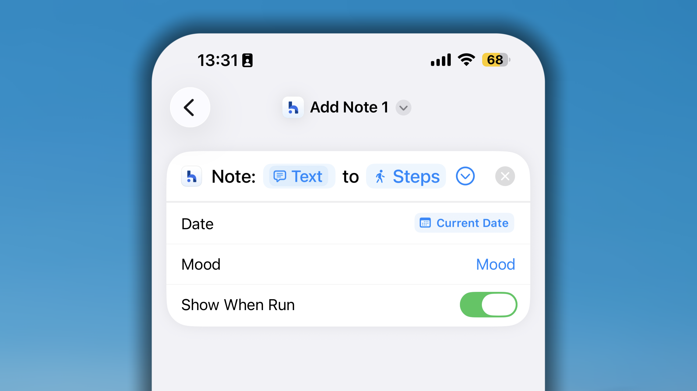
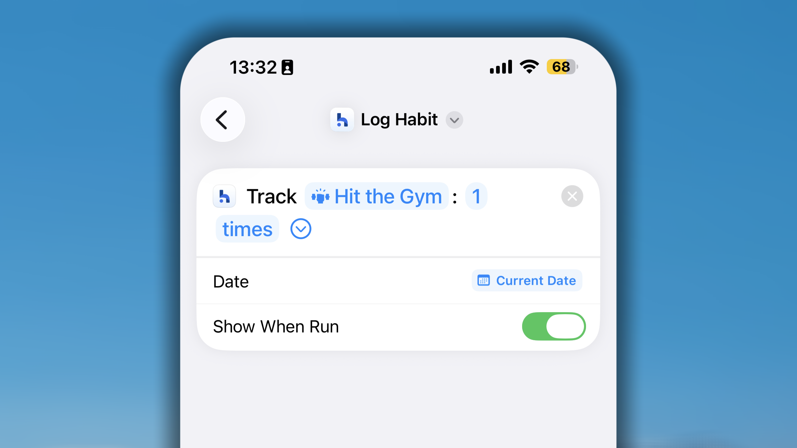
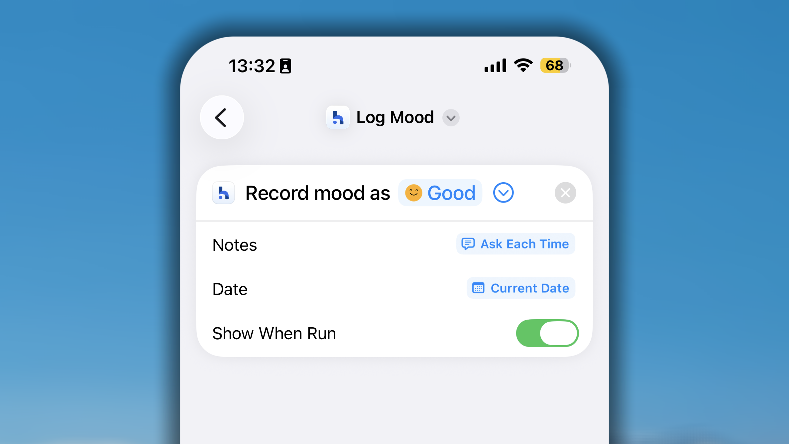
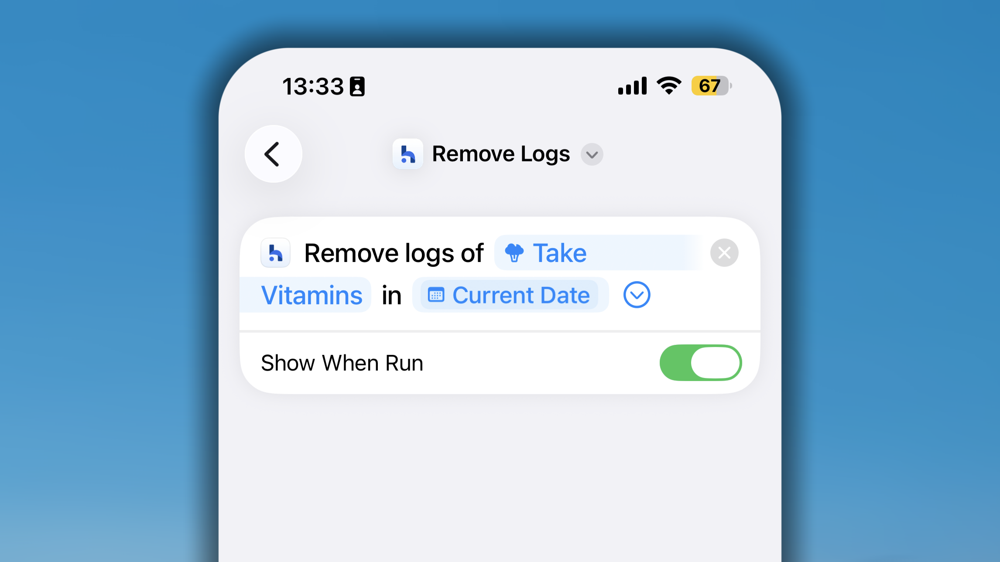
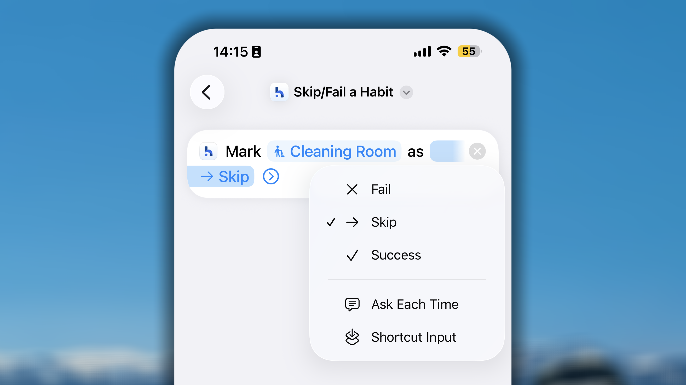
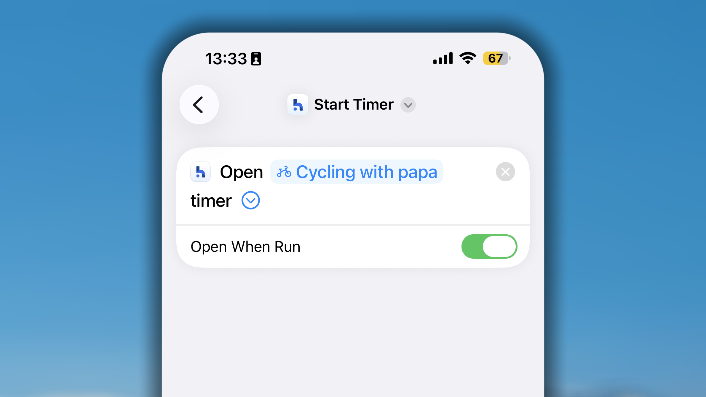
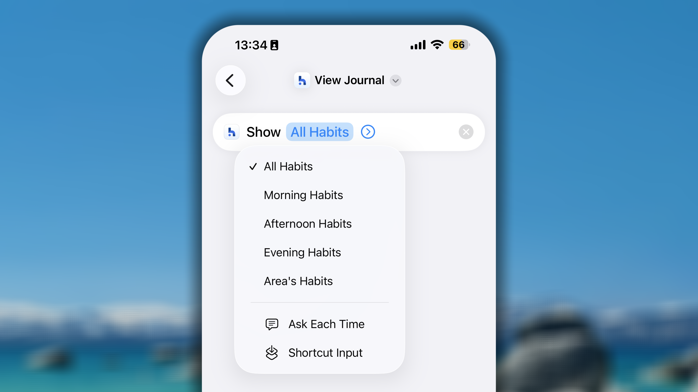

Habitify prend en charge l’intégration avec l’app Raccourcis d’Apple, ce qui vous permet d’enregistrer vos habitudes et de consulter votre progression sans jamais ouvrir Habitify.

Une fois un raccourci configuré, son exécution peut enregistrer une progression, modifier le statut d’une habitude ou vérifier votre situation actuelle, avec le mode de déclenchement de votre choix : un toucher sur l’écran d’accueil, une automatisation ou même votre voix par l’intermédiaire de Siri.

Sept actions Habitify sont disponibles dans Raccourcis :

- **Ajouter une note** : écrire une note sur une habitude.
- **Ajouter une entrée** : enregistrer une valeur de progression pour une habitude.
- **Enregistrer l’humeur** : enregistrer votre humeur.
- **Supprimer l'historique** : supprimer la progression enregistrée pour une habitude à une date précise.
- **Reporter/Échouer une habitude** : définir le statut d’une habitude pour la journée en cours.
- **Démarrer le chrono** : lancer une session de chronométrage pour une habitude basée sur le temps.
- **Consulter mon journal** : ouvrir un aperçu rapide de votre liste d’habitudes.

Pour chacune de ces actions, laisser le champ de l’habitude vide rend le raccourci plus flexible : il vous demandera simplement de choisir une habitude à chaque exécution, au lieu d’être associé à une seule.

## Réglages des raccourcis Habitify

### **Ajouter une note**

Ce raccourci vous aide à écrire une note sur votre habitude.

- Dans Raccourcis, recherchez Habitify et choisissez le raccourci **Ajouter une note**.
- Dans les réglages de ce raccourci, vous devez choisir une habitude précise.
- Si vous laissez ce champ vide, chaque fois que le raccourci s’exécute, vous devrez choisir l’habitude sur laquelle vous souhaitez laisser une note.
- Dans ce raccourci, vous pouvez définir la date sur « Date actuelle » par défaut ou sur « Demander à chaque fois » que vous l’exécutez.

### **Enregistrer une habitude**

Ce raccourci sert à enregistrer votre valeur de progression.

- Dans Raccourcis, recherchez Habitify et choisissez le raccourci **Enregistrer une habitude**.

- Dans les réglages de ce raccourci, vous devez choisir une habitude précise et penser à sélectionner « répétition » comme unité.
- Chaque fois que vous exécutez le raccourci, une fenêtre contextuelle s’affiche pour vous permettre de saisir la valeur.
- Dans ce raccourci, vous pouvez définir la date sur « Date actuelle » par défaut ou sur « Demander à chaque fois » que vous l’exécutez.

### **Enregistrer l’humeur**

Ce raccourci vous permet d’enregistrer facilement votre humeur.

- Dans Raccourcis, recherchez Habitify et choisissez le raccourci **Enregistrer l’humeur**.
- Dans les réglages du raccourci, choisissez l’humeur que vous souhaitez enregistrer automatiquement.
- Vous pouvez également régler le raccourci sur « Demander à chaque fois » : il vous proposera alors la liste des humeurs parmi lesquelles choisir à chaque exécution.

### **Supprimer l'historique**

Ce raccourci vous permet de supprimer le ou les enregistrements de progression d’une habitude à une date précise. Notez qu’une seule exécution supprimera ces enregistrements et réinitialisera votre progression à 0.

- Dans Raccourcis, recherchez Habitify et choisissez le raccourci **Supprimer l'historique**.
- Dans les réglages du raccourci, choisissez l’habitude dont vous souhaitez supprimer les enregistrements. Vous pouvez laisser ce champ vide afin que le raccourci vous le demande à chaque exécution.
- Choisissez la **Date** dont vous souhaitez supprimer les enregistrements. Vous pouvez également la régler sur « Demander à chaque fois ».

### **Reporter/Échouer une habitude**

Vous pouvez utiliser ce raccourci pour mettre à jour le statut d’une habitude pour la journée en cours.

- Dans _Raccourcis_, recherchez Habitify et choisissez le raccourci **Reporter/Échouer une habitude**.
- Dans les réglages du raccourci, choisissez l’habitude dont vous souhaitez mettre à jour le statut. Vous pouvez laisser ce champ vide afin que le raccourci vous le demande à chaque exécution.
- Choisissez l’**Action** que le raccourci doit exécuter (Ignorer, Marquer comme échec ou Réussite). Vous pouvez régler l’action sur « Demander à chaque fois ».

### **Démarrer le chrono**

Utilisez ce raccourci pour lancer facilement une session de chronométrage sur votre habitude. Ce raccourci est disponible pour les habitudes dont l’objectif est exprimé en minutes ou en heures.

- Dans Raccourcis, recherchez Habitify et choisissez le raccourci **Démarrer le chrono**.
- Dans les réglages du raccourci, choisissez l’habitude pour laquelle vous souhaitez lancer une session de chronométrage. Vous pouvez laisser ce champ vide afin que le raccourci vous le demande à chaque exécution.

L’exécution d’un chronomètre nécessite toujours d’ouvrir l’app. Par conséquent, le résultat de l’exécution de ce raccourci ouvrira l’app et vous conduira à la configuration de la session de chronométrage.

### **Consulter mon journal**

Ce raccourci vous permet d’ouvrir un aperçu rapide de la liste de vos habitudes.

- Dans Raccourcis, recherchez Habitify et choisissez le raccourci **Consulter mon journal**.
- Dans les réglages du raccourci, choisissez la liste que vous souhaitez afficher lors de son exécution. Vous pouvez choisir Toutes les habitudes, un moment de la journée (Matin, Après-midi ou Soir) ou une catégorie. Vous pouvez laisser le champ vide ou choisir « Demander à chaque fois » afin que le raccourci vous pose la question à chaque exécution.

## Raccourcis Habitify avec Siri

Habitify ne permet pas d’enregistrer directement vos habitudes par la voix. Toutefois, grâce à l’intégration avec Raccourcis sur iOS, vous disposez de cette solution de contournement.

- Créez les raccourcis avec Habitify.
- Donnez à vos raccourcis des noms faciles à retenir.
- Dites ensuite simplement « Dis Siri ! » puis prononcez le nom de vos raccourcis.

Après l’exécution du raccourci, Siri vous en indique le résultat.

Lorsque votre appareil est verrouillé et que vous exécutez un raccourci qui ouvre Habitify, Siri vous demande de déverrouiller votre appareil avant de continuer.

<Note>
  À partir d’iOS 27, Habitify peut fonctionner directement avec l’IA de Siri sans qu’il soit nécessaire de configurer des raccourcis iOS natifs.

  Pour vérifier si vos appareils prennent en charge Apple Intelligence et l’IA de Siri, consultez ce guide d’Apple : [**Comment obtenir l’IA de Siri**](https://support.apple.com/en-us/127893?st_source=ai_mode)
</Note>

## Raccourcis Habitify avec les automatisations iOS

Au-delà de la création de simples boutons de raccourci manuels, la véritable puissance de Raccourcis sur iOS réside dans sa fonction **Automatisation**. Une automatisation est un type particulier de raccourci qui s’exécute **automatiquement** en arrière-plan lorsqu’un événement « déclencheur » précis se produit sur votre iPhone ou votre Apple Watch.

### **Le principe**

Le plus important est de comprendre que chaque automatisation comporte deux parties :

- **Le déclencheur (le « Quand ») :** il s’agit de l’événement que le système d’exploitation de votre iPhone (iOS) « surveille ». **Ces déclencheurs sont intégrés par Apple.** _Exemples : « Lorsque mon alarme “Réveil” est arrêtée », « Lorsque j’arrive à la salle de sport » ou « Lorsqu’un entraînement Apple Watch se termine »._

- **L’action (le « Faire ceci ») :** il s’agit de ce qu’Habitify doit _faire_ lorsque le déclencheur se produit. **Ce sont les raccourcis Habitify** (comme « Faire le point », « Enregistrer la progression », etc.) que vous avez vus dans l’app Raccourcis.

Votre objectif consiste à relier ces deux éléments.

### **Comment la configurer**

<Steps>
  <Step title="Créer les raccourcis Habitify">
    Il sera plus facile de poursuivre si vos raccourcis Habitify sont déjà prêts.
  </Step>
  <Step title="Créer votre automatisation">
    1. Ouvrez l’app **Raccourcis** sur votre iPhone.
    2. Touchez l’onglet **Automatisation **en bas, au centre de l’écran.
    3. Touchez l’icône **+ **pour démarrer une nouvelle automatisation.
    4. Vous devrez d’abord **Choisir un déclencheur** (par exemple, « Alarme », « Arriver », « App »).
    5. Après avoir configuré votre déclencheur, vous devrez **Ajouter une action**. Recherchez Habitify et choisissez l’une des actions ou l’un des raccourcis que vous avez créés.
  </Step>
</Steps>

### **Un exemple**

**Objectif :** lorsque vous terminez un entraînement sur votre Apple Watch, ajouter une note telle que « Entraînement terminé ! » à votre habitude « Calories actives » dans Habitify.

<Steps>
  <Step title="Créer des raccourcis Ajouter une note">
    Ajoutez un nouveau raccourci Ajouter une note d’Habitify :

    - dans le champ **Habitude**, sélectionnez l’habitude **Calories actives**.
    - dans le champ **Contenu**, écrivez « Entraînement terminé ! » ou laissez-le simplement vide afin de pouvoir saisir votre propre texte à chaque fois.
    - Définissez la **Date** sur **Date actuelle** par défaut.

    Nommez le raccourci afin de pouvoir le retrouver facilement par la suite.
  </Step>
  <Step title="Choisir votre déclencheur Apple">
    1. Sur l’écran **Nouvelle automatisation**, faites défiler vers le bas et touchez **Entraînement Apple Watch**.
    2. Sélectionnez **Se termine**. (Vous pouvez également choisir un type d’entraînement précis, comme « Course ».)
    3. Assurez-vous que **Exécuter immédiatement **est sélectionné.
    4. Touchez **Suivant**.
  </Step>
  <Step title="Choisir votre action Habitify">
    1. Touchez **Ajouter une action**.
    2. Recherchez et sélectionnez le raccourci que vous avez créé à l’étape 1.
  </Step>
</Steps>

**Quelques idées d’automatisations à essayer :**

- **Déclencheur :** `Arriver` à `[L’adresse de votre salle de sport]` → **Action :** `Démarrer le chrono` pour votre habitude « Entraînement ».
- **Déclencheur :** `App` \> `Kindle` \> `Est ouverte` → **Action :** `Démarrer le chrono` pour votre habitude « Lire un livre ».
- **Déclencheur :** `Bluetooth` \> `Se connecte à [Nom de votre voiture]` → **Action :** `Enregistrer la progression` (1 fois) pour votre habitude « Trajet ».

Nous espérons que ces explications clarifient le concept et vous aident à créer de puissantes automatisations !

## FAQ

<Accordion title="**Les raccourcis Habitify peuvent-ils être exécutés depuis une Apple Watch ?**">
  Cette fonctionnalité n’est pas encore prise en charge.
</Accordion>
