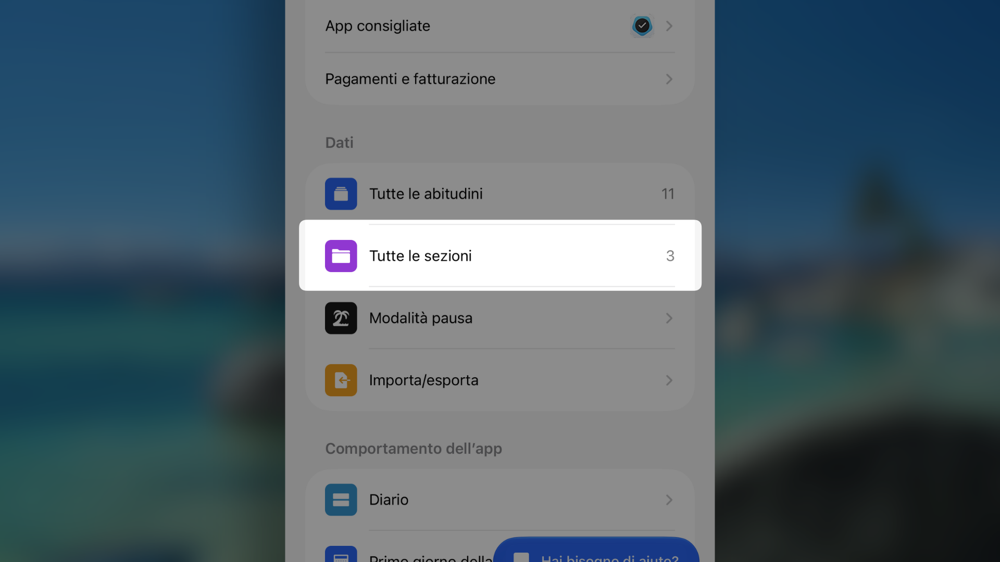
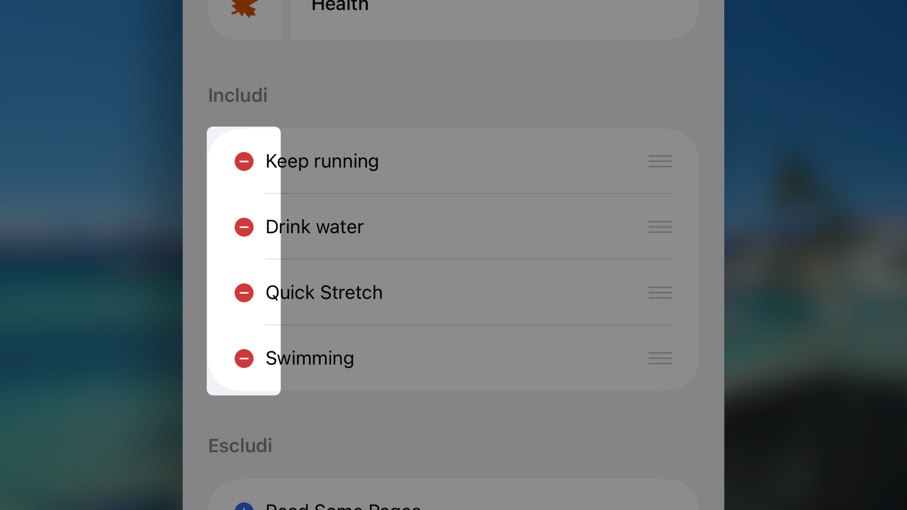
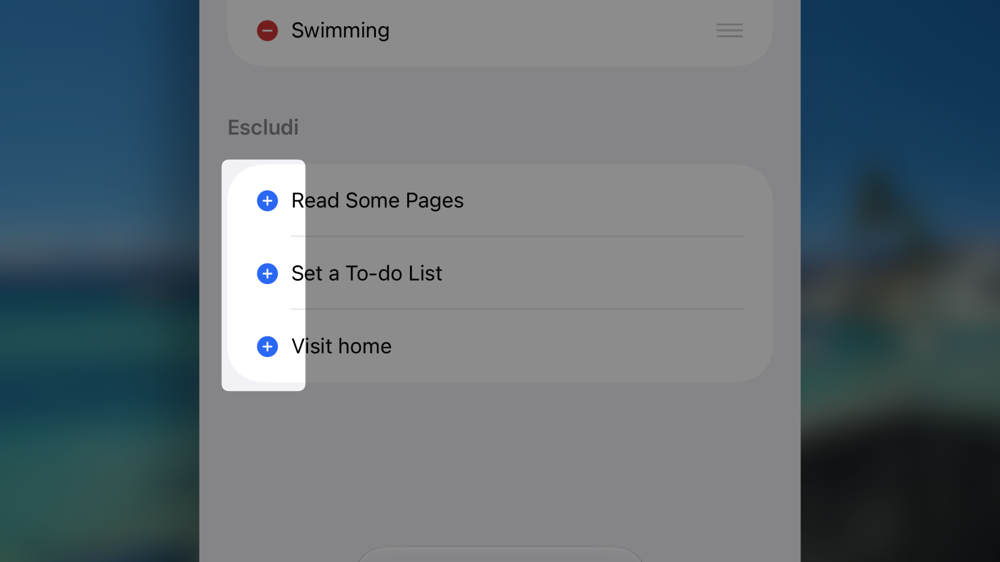
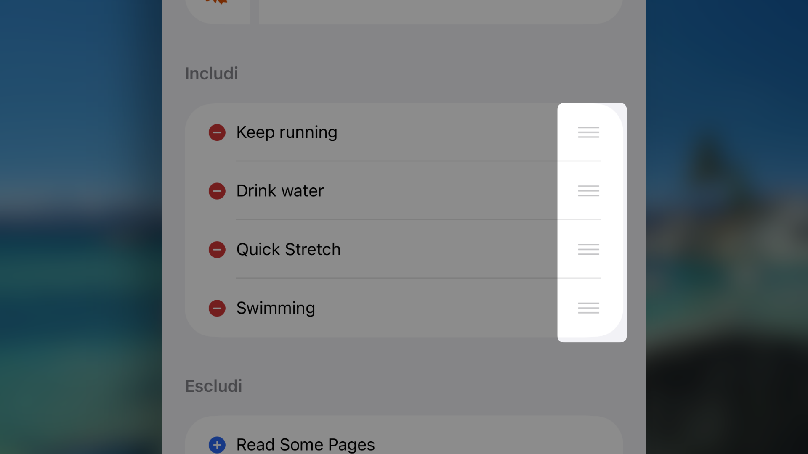
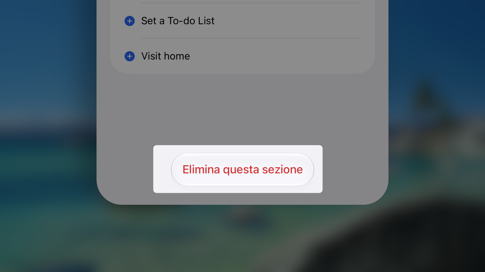
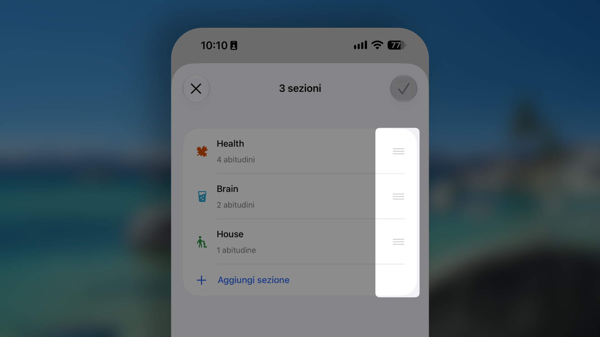
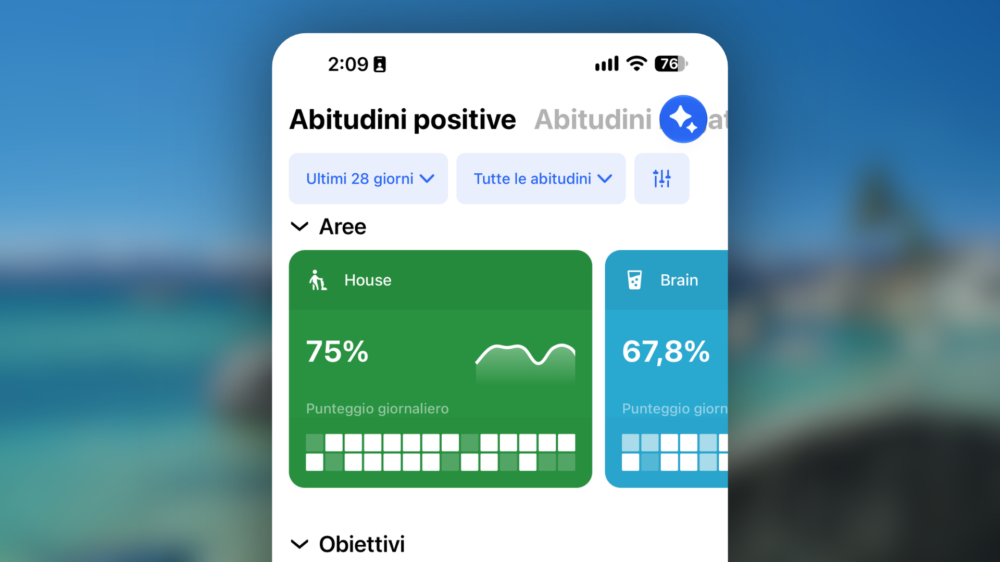
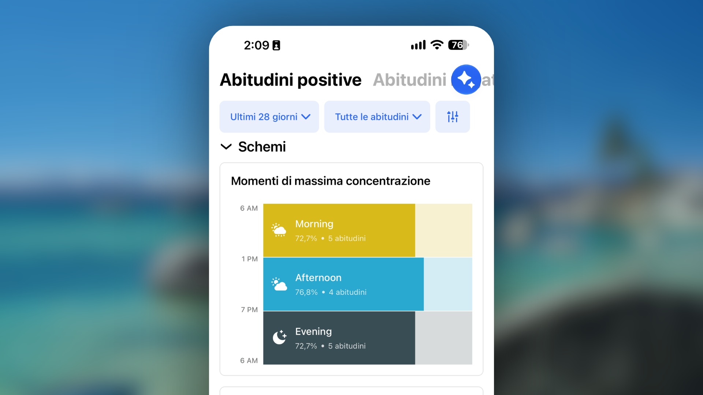
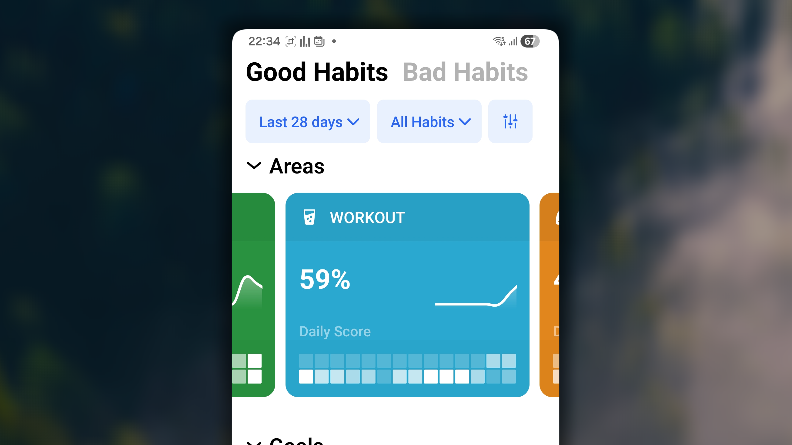
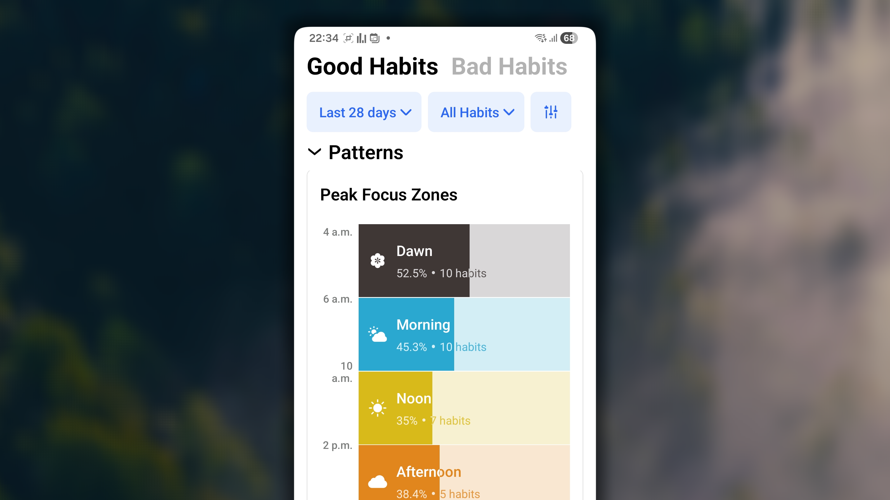

Un'Area è un gruppo, o una cartella, di abitudini che ti permette di organizzare il monitoraggio in base ai diversi ambiti della tua vita, anziché trattare ogni abitudine come parte di un unico elenco piatto e indistinto. Raggruppa sotto «Salute» le abitudini relative all'attività fisica, al consumo di acqua e al sonno; sotto «Lavoro» quelle dedicate al lavoro profondo e alle e-mail; sotto «Consapevolezza» la scrittura del diario e la meditazione: scegli la suddivisione che rispecchia davvero la tua vita.

Le Aree servono ad aiutarti a stabilire le priorità. Invece di avere un unico Punteggio giornaliero che comprende tutto, puoi concentrarti su una categoria e vedere esattamente come sta andando quell'ambito della tua vita.

<Tabs>
  <Tab title=" iOS">
    ## Creare una nuova sezione

    <iframe src="https://drive.google.com/file/d/1tvk66uyWt5d6rRJoQHpPx_TnZR7C53Kb/preview" width="640" height="360" />

    1. In **Diario**, scorri verso sinistra la barra delle sezioni fino alla fine, quindi tocca **\+**.
    2. Scegli **Nuova sezione**.
    3. Nella schermata **Nuova sezione**:
       1. tocca l'icona, scegli un'icona e assegna un colore alla nuova sezione, quindi tocca ✓ per salvare le selezioni;
       2. tocca il campo del nome e inserisci il nome della sezione.
    5. Nell'elenco **Escludi**, tocca ⊕ davanti al nome dell'abitudine per aggiungerla alla sezione.
    6. Dopo aver configurato tutto, tocca ✓ per salvare la nuova sezione.

    ## Gestire una sezione personalizzata

    Puoi modificare liberamente il nome e l'icona di una sezione personalizzata, gestire le abitudini incluse e rimuovere la sezione.

    ### Modificare una sezione

    1. Nell'app Habitify, accedi a **Impostazioni**.
    2. Individua e tocca la sezione **Tutte le sezioni** per aprirla.
       
    3. Nell'elenco delle sezioni, tocca quella che vuoi modificare.
    4. Nella schermata dei dettagli della sezione puoi:
       1. toccare l'**icona** per cambiare icona e colore; tocca il pulsante ✓ nell'angolo in alto a destra per salvare le selezioni;
       2. toccare il **campo del nome** per cambiare il nome della sezione;
          
       3. nell'elenco **Includi**, toccare ⊖ davanti al nome dell'abitudine per rimuoverla dalla sezione;
          
       4. nell'elenco **Escludi**, toccare ⊕ davanti al nome dell'abitudine per aggiungerla alla sezione.
          
    5. Tocca il **pulsante ✓** nell'angolo in alto a destra per salvare tutte le modifiche.

    ### Modificare l'ordine delle abitudini in una sezione

    1. Nell'app Habitify, accedi a **Impostazioni**.
    2. Individua e tocca la sezione **Tutte le sezioni** per aprirla.
    3. Nell'elenco delle sezioni, tocca quella di cui vuoi modificare l'ordine delle abitudini.
    4. Nell'elenco **Includi**, tieni premuto il pulsante ☰ a destra dell'abitudine, quindi trascinalo verso l'alto o verso il basso per cambiarne l'ordine nell'elenco.
       
    5. Dopo aver configurato tutto, tocca il pulsante ✓ per salvare le modifiche.

    ### Eliminare una sezione

    1. In Habitify, accedi a **Impostazioni**.
    2. Individua e tocca la sezione **Tutte le sezioni** per aprirla.
    3. Nell'elenco delle sezioni, tocca quella che vuoi rimuovere.
    4. Tocca il pulsante **Elimina questa sezione**.
       
    5. Nel passaggio di conferma, tocca **Elimina**.

    ## Gestire l'ordine delle sezioni

    Puoi organizzare l'ordine delle sezioni personalizzate nella barra delle sezioni del Diario. Ecco come:

    1. Nell'app Habitify, accedi a **Impostazioni**.
    2. Individua e tocca la sezione **Tutte le sezioni** per aprirla.
    3. Tieni premuto il pulsante ☰ a destra della sezione e trascinalo verso l'alto o verso il basso per cambiarne l'ordine.
       
    4. Tocca il pulsante ✓ per salvare le modifiche.

    <Info>
      Le modifiche all'ordine delle sezioni apportate nelle app iOS e Android vengono sincronizzate con le app Website & Desktop immediatamente dopo il salvataggio.
    </Info>

    ## Progressi di un'area

    La vista Progressi permette di vedere come sta andando ogni area. Le sezioni seguenti si trovano nella scheda **Buone abitudini** e seguono l'intervallo di date scelto nella vista Progressi.

    ### Progressi di un'area personalizzata

    Nella vista Progressi, scorrere fino alla sezione **Aree**. Contiene una scheda di progresso per ciascuna area personalizzata. Scorrere lateralmente per vedere ogni scheda.

    

    Ogni scheda è un breve report relativo solo a quell'area. Mostra:

    - **Punteggio giornaliero medio:** il tasso medio di completamento giornaliero delle abitudini dell'area.
    - **Una mini linea di tendenza.**
    - **Una heatmap compatta.**

    Confrontando le schede si può capire se una parte della vita va bene mentre un'altra richiede attenzione.

    ### Tasso di completamento di un'area Momento della giornata

    Le aree Momento della giornata (Mattina, Pomeriggio e Sera) non hanno schede nella sezione **Aree**. Per vederne il tasso di completamento, usare **Momenti di massima concentrazione** nella sezione **Schemi**.

    

    Mostra il tasso medio di completamento per ciascun momento della giornata nell'intervallo di date scelto. Ad esempio, con 3 abitudini al mattino, completandone 2 un giorno e 1 il giorno successivo, il tasso di completamento del mattino è del 50%.

    ### Vedere il report completo di un'area

    Per vedere la vista Progresso di una sola area, usare il filtro abitudini:

    1. Nella vista **Progresso**, aprire il filtro abitudini.
    2. Scegliere l'area personalizzata o l'area Momento della giornata da visualizzare.

    Il report include quindi solo le abitudini di quell'area.
  </Tab>
  <Tab title="🤖 Android">
    ## Creare una nuova area

    <iframe src="https://drive.google.com/file/d/1F_7f_gieW9pIv8yLPskQdST6gSE2ofCn/preview" width="640" height="360" />

    1. In Diario, scorri la barra delle aree verso sinistra fino alla fine.
    2. Tocca il pulsante \+, quindi scegli **Nuova area**.
    3. Tocca l'icona, quindi scegli un'icona e assegna un colore alla nuova area. Tocca **Fatto** nell'angolo in alto a destra per salvare la selezione.
    4. Tocca il campo del nome e inserisci il nome della nuova area.
    5. Nell'elenco **Escludi**, tocca il pulsante + a destra dell'abitudine per aggiungerla alla nuova area.
    6. Dopo aver configurato tutto, tocca il pulsante **Salva** nell'angolo in alto a destra per salvare la nuova area.

    ## Gestire un'area personalizzata

    Puoi modificare liberamente il nome e l'icona di un'area personalizzata, gestire le abitudini incluse e rimuovere l'area.

    ### Modificare un'area

    1. Nell'app Habitify, accedi a **Impostazioni**.
    2. Individua e tocca la sezione **Gestisci Area** per aprirla.
    3. Nell'elenco delle aree, tocca quella che vuoi modificare.
    4. Nella schermata dei dettagli dell'area puoi:
       1. toccare l'icona per cambiare icona e colore; tocca «Fatto» nell'angolo in alto a destra per salvare le selezioni;
       2. toccare il campo del nome per cambiare il nome dell'area;
       3. nell'elenco **Includi**, toccare il pulsante ⛌ a destra dell'abitudine per rimuoverla dall'area;
       4. nell'elenco **Escludi**, toccare il pulsante ╋ a destra dell'abitudine per aggiungerla all'area.
    5. Tocca il pulsante **Salva** nell'angolo in alto a destra per salvare tutte le modifiche.

    ### Modificare l'ordine delle abitudini in un'area

    1. Nell'app Habitify, accedi a **Impostazioni**.
    2. Individua e tocca la sezione **Gestisci Area** per aprirla.
    3. Nell'elenco delle aree, tocca quella di cui vuoi modificare l'ordine delle abitudini.
    4. Nell'elenco Includi, tieni premuto il pulsante = a sinistra dell'abitudine, quindi trascinalo verso l'alto o verso il basso per cambiarne l'ordine nell'elenco.
    5. Dopo aver configurato tutto, tocca il pulsante **Salva** per salvare le modifiche.

    ### Eliminare un'area

    1. In Habitify, accedi a **Impostazioni**.
    2. Individua e tocca la sezione **Gestisci Area** per aprirla.
    3. Nell'elenco delle aree, tocca quella che vuoi rimuovere.
    4. Scorri fino in fondo e tocca **«Elimina questa area»**.
    5. Nel passaggio di conferma, tocca **Elimina**.

    ## Gestire l'ordine delle aree

    Puoi organizzare l'ordine delle aree personalizzate nella barra delle aree del Diario. Ecco come:

    1. Nell'app Habitify, accedi a **Impostazioni**.
    2. Individua e tocca la sezione **Gestisci Area** per aprirla.
    3. Tieni premuto il pulsante **=** a destra dell'area e trascinalo verso l'alto o verso il basso per cambiarne l'ordine.
    4. Tocca il pulsante **Salva** per salvare le modifiche.

    ## Progressi di un'area

    La vista Progressi permette di vedere come sta andando ogni area. Le sezioni seguenti si trovano nella scheda **Buone abitudini** e seguono l'intervallo di date scelto nella vista Progressi.

    ### Progressi di un'area personalizzata

    Nella vista Progressi, scorrere fino alla sezione **Aree**. Contiene una scheda di progresso per ciascuna area personalizzata. Scorrere lateralmente per vedere ogni scheda.

    

    Ogni scheda è un breve report relativo solo a quell'area. Mostra:

    - **Punteggio giornaliero medio:** il tasso medio di completamento giornaliero delle abitudini dell'area.
    - **Una mini linea di tendenza.**
    - **Una heatmap compatta.**

    Confrontando le schede si può capire se una parte della vita va bene mentre un'altra richiede attenzione.

    ### Tasso di completamento di un'area Momento della giornata

    Le aree Momento della giornata (Mattina, Pomeriggio e Sera) non hanno schede nella sezione **Aree**. Per vederne il tasso di completamento, usare **Momenti di massima concentrazione** nella sezione **Schemi**.

    

    Mostra il tasso medio di completamento per ciascun momento della giornata nell'intervallo di date scelto. Ad esempio, con 3 abitudini al mattino, completandone 2 un giorno e 1 il giorno successivo, il tasso di completamento del mattino è del 50%.

    ### Vedere il report completo di un'area

    Per vedere la vista Progresso di una sola area, usare il filtro abitudini:

    1. Nella vista **Progresso**, aprire il filtro abitudini.
    2. Scegliere l'area personalizzata o l'area Momento della giornata da visualizzare.

    Il report include quindi solo le abitudini di quell'area.

    <Info>
      Le modifiche all'ordine delle aree apportate nelle app iOS e Android vengono sincronizzate con le app Website & Desktop immediatamente dopo il salvataggio.
    </Info>
  </Tab>
  <Tab title="🖥️ Website & Desktop">
    ## Creare una nuova area

    <iframe src="https://drive.google.com/file/d/1-jFIqXsmgOC3dAhdALhaUJw_JrwXUl34/preview" width="640" height="360" />

    1. Nell'app, vai alla sezione Aree nella barra laterale sinistra.
    2. Fai clic su **\+ Nuova area**.
    3. Assegna un nome alla nuova area e premi Invio per salvare la voce.
    4. Fai clic sull'icona, quindi scegli una nuova icona e assegna un colore alla nuova area.
    5. Fai clic all'esterno per salvare le modifiche.

    ## Gestire un'area personalizzata

    Puoi modificare liberamente il nome e l'icona di un'area personalizzata, gestire le abitudini incluse e rimuovere l'area.

    ### Modificare icona, colore e nome di un'area

    Per modificare l'icona e il colore di un'area:

    1. Nella barra laterale sinistra, vai alla sezione **Aree**.
    2. Fai clic sull'icona dell'area.
    3. Scegli una nuova icona e un nuovo colore.
    4. Fai clic all'esterno per confermare le modifiche.

    Per modificare il nome di un'area:

    1. Nella barra laterale sinistra, vai alla sezione **Aree**.
    2. Fai clic per scegliere l'area che vuoi modificare.
    3. Fai nuovamente clic per abilitare la modifica.
    4. Inserisci il nuovo nome.
    5. Premi Invio per salvare la modifica.

    ### Gestire le abitudini in un'area

    Per aggiungere un'abitudine a un'area:

    1. Nella barra laterale sinistra, accedi a **Preferenze \> Abitudini**.
    2. Accedi all'elenco **Attive**.
    3. Trova l'abitudine e trascinala nell'area desiderata.

    Per rimuovere un'abitudine da un'area:

    1. Nella barra laterale sinistra, accedi a **Preferenze \> Abitudini**.
    2. Vai ad **Aree** e fai clic sull'area corrente in cui è inclusa l'abitudine.
    3. Fai clic con il tasto destro sull'abitudine e scegli **Modifica**.
    4. Nei dettagli dell'abitudine, vai al **campo Area** e fai clic per rimuovere l'area.
    5. Fai clic su **Salva**.

    ### Eliminare un'area

    Per rimuovere un'area:

    1. Nella barra laterale sinistra, vai alla sezione **Aree**.
    2. Fai clic con il tasto destro sull'abitudine che vuoi rimuovere, quindi scegli **Elimina**.

    ## Progressi di un'area

    La vista Progressi permette di vedere come sta andando ogni area. Le sezioni seguenti si trovano nella scheda **Buone abitudini** e seguono l'intervallo di date scelto nella vista Progressi.

    ### Progressi di un'area personalizzata

    Nella vista Progressi, scorrere fino alla sezione **Aree**. Contiene una scheda di progresso per ciascuna area personalizzata. Scorrere lateralmente per vedere ogni scheda.

    Ogni scheda è un breve report relativo solo a quell'area. Mostra:

    - **Punteggio giornaliero medio:** il tasso medio di completamento giornaliero delle abitudini dell'area.
    - **Una mini linea di tendenza.**
    - **Una heatmap compatta.**

    Confrontando le schede si può capire se una parte della vita va bene mentre un'altra richiede attenzione.

    ### Tasso di completamento di un'area Momento della giornata

    Le aree Momento della giornata (Mattina, Pomeriggio e Sera) non hanno schede nella sezione **Aree**. Per vederne il tasso di completamento, usare **Momenti di massima concentrazione** nella sezione **Schemi**.

    Mostra il tasso medio di completamento per ciascun momento della giornata nell'intervallo di date scelto. Ad esempio, con 3 abitudini al mattino, completandone 2 un giorno e 1 il giorno successivo, il tasso di completamento del mattino è del 50%.

    ### Vedere il report completo di un'area

    Per vedere la vista Progresso di una sola area, usare il filtro abitudini:

    1. Nella vista **Progresso**, aprire il filtro abitudini.
    2. Scegliere l'area personalizzata o l'area Momento della giornata da visualizzare.

    Il report include quindi solo le abitudini di quell'area.
  </Tab>
</Tabs>
