Una cerchia Habitify è il tuo spazio privato in cui entrare in contatto, condividere e crescere con le persone che contano di più per te. È un piccolo gruppo nel quale tu e gli altri membri condividete i progressi relativi ad abitudini specifiche, vi incoraggiate a vicenda e vi aiutate a mantenere i vostri impegni.

Immagina di allenarti per una maratona con i tuoi compagni di corsa, di imparare una nuova lingua con i compagni di corso o semplicemente di impegnarti a bere più acqua insieme alla tua famiglia. Cerchia trasforma l’attività individuale di monitorare le abitudini in un’esperienza collettiva, solidale e davvero divertente.

Questo articolo ti fornisce tutti i dettagli necessari per iniziare una cerchia con familiari e amici.

## Confronto tra Cerchia e Sfida

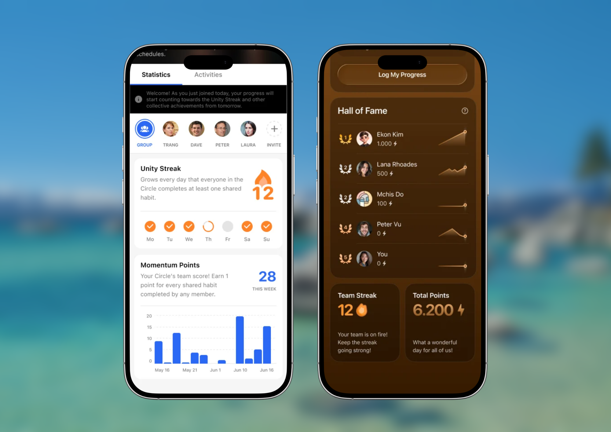

|  | **Cerchia** | **Sfida** |
| :-- | :-- | :-- |
| **Durata** | Continuativa: non ha una data di fine e rimane attiva finché il proprietario non la archivia o la elimina | Limitata nel tempo, si svolge tra una data di inizio e una data di fine definite |
| **Abitudini monitorate** | Più abitudini condivise contemporaneamente, personalizzate da ciascun membro. | Un obiettivo di abitudine condiviso per ogni sfida |
| **Elementi statistici** | <ul><li>La **Serie dell’unità** aumenta quando ogni membro completa almeno 1 abitudine quotidiana condivisa programmata per il giorno corrente.</li><li>Il **Punto slancio** aumenta quando viene completata un’abitudine condivisa; facoltativamente, è possibile vedere la classifica in base ai punti slancio di ciascun membro.</li></ul> | <ul><li>La **Classifica delle serie** ordina i punti dei partecipanti per ogni giorno completato, con penalità facoltative nel punteggio per i giorni mancati.</li><li>Lo **Streak di squadra** aumenta quando tutti i membri completano l’abitudine della sfida per il giorno corrente.</li></ul> |
| **Modifica dei progressi** | Riflette i progressi dell’abitudine dalla vista Diario, comprese le modifiche successive. | Bloccata dopo la registrazione per il giorno corrente; non è possibile inserire dati retroattivamente né modificare i giorni passati. |
| **Dimensioni del gruppo** | Illimitate | Illimitate |
| **Interazione sociale** | Scheda Attività: reazioni, commenti, menzioni con @, conversazioni continue | Scheda Attività: reazioni, commenti, menzioni con @, conversazioni continue |
| **Disponibilità sulle piattaforme** | iOS, Android | iOS, Android |

<Tabs>
  <Tab title="iOS e Android">
    ## Creare una nuova cerchia

    1. Nell’app Habitify, accedi ad **Amici** dalla barra di navigazione in basso
    2. Tocca **il pulsante +**, quindi scegli **Cerchia**.
    3. Inserisci i dettagli della nuova cerchia:
       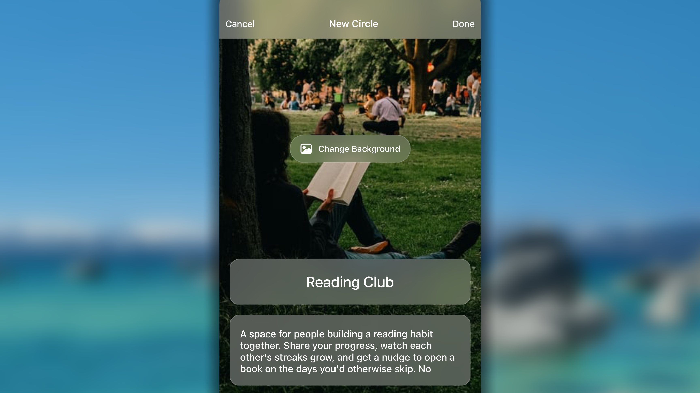
       1. Tocca il campo di inserimento **Nome della cerchia** e assegna un nome alla cerchia.
       2. Tocca il campo **Breve descrizione** e fornisci una breve descrizione della cerchia.
       3. Tocca il pulsante **Cambia sfondo** e assegna alla nuova cerchia una foto di copertina scegliendo tra 3 fonti: **Suggeriti** (la nostra raccolta)**, Unsplash** e **Foto** (la tua libreria di foto).
    4. Dopo aver configurato tutto, tocca il pulsante **Fine su iOS o Fatto su Android** nell’angolo in alto a destra.

    ## Gestire la tua cerchia

    In qualità di creatore della cerchia, disponi di tutti i diritti per modificare, archiviare o eliminare sia la cerchia sia i suoi membri.

    Da **Amici**, apri la cerchia e vai alla scheda **Informazioni su iOS o Info su Android**, quindi:

    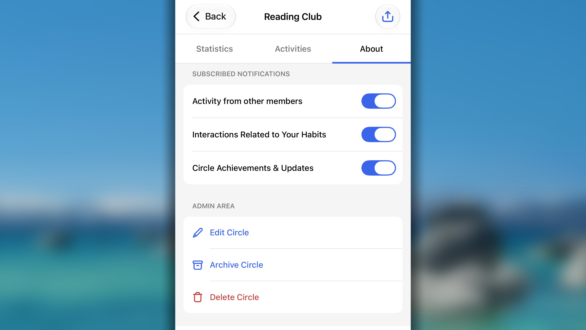

    - Nella sezione **Notifiche sottoscritte**, puoi controllare se ricevere notifiche quando:
      - **Attività di altri membri:** qualcuno reagisce o commenta un tuo aggiornamento nella scheda **Attività**, oppure ti menziona; un membro raggiunge una nuova serie o aumenta la Serie dell’unità della cerchia.
      - **Interazioni relative alle tue abitudini:** qualcuno effettua un check-in sulle tue abitudini per ricordartele e inviarti un incoraggiamento relativo all’abitudine.
      - **Traguardi e aggiornamenti della cerchia**: viene accettata la tua richiesta di partecipazione a una cerchia, un nuovo membro entra nella cerchia oppure qualcuno chiede di partecipare alla cerchia che hai creato.

    - Nella sezione **Area amministratore** puoi:
      - Toccare **Modifica cerchia** per modificare nome, descrizione e foto di sfondo della cerchia.
      - Toccare **Archivia cerchia** per conservare la cerchia senza mantenerla attiva e impostarla permanentemente in modalità di sola lettura, nella quale i membri possono ancora vedere la cerchia e la relativa cronologia, ma non verranno aggiunte nuove attività.
      - Toccare **Elimina cerchia** per rimuovere per sempre la cerchia e tutti i suoi dati.

    ## Gestire le persone nella cerchia

    ### Invitare persone

    Una cerchia prende vita grazie ai suoi membri. Ecco come invitare amici, familiari o colleghi a partecipare alla cerchia di cui sei il proprietario:

    1. Da _Amici_, apri la cerchia.
    2. Tocca l’**icona** 📤 nell’angolo in alto a destra.
    3. Nella schermata di condivisione, nella sezione _Invita con link pubblico_:
       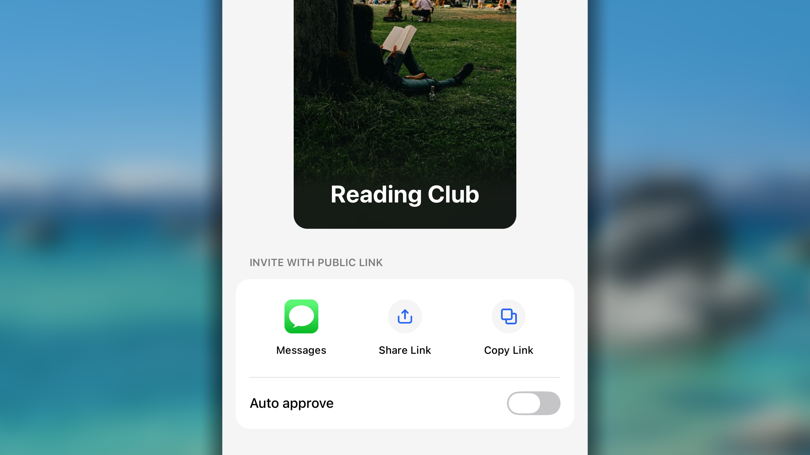
       - Scegli come inviare l’invito:
         - **Messaggi:** invia il link direttamente tramite l’app Messaggi del telefono.
         - **Condividi link:** condividi direttamente il link di invito con un contatto o un’app.
         - **Copia link:** copia il link di invito per incollarlo in un secondo momento dove preferisci.
       - Controlla l’interruttore **Approvazione automatica**:
         - **Attiva**: chiunque faccia clic sul link di invito potrà entrare immediatamente nella cerchia, senza bisogno della tua autorizzazione.
         - **Disattiva**: quando qualcuno chiede di partecipare tramite il link, riceverai una notifica e dovrai **accettarlo** manualmente prima che diventi un membro.

    ### Gestire le richieste di partecipazione alla cerchia

    Quando disattivi l’Approvazione automatica, dovrai approvare manualmente le richieste di altre persone che desiderano partecipare alla cerchia.

    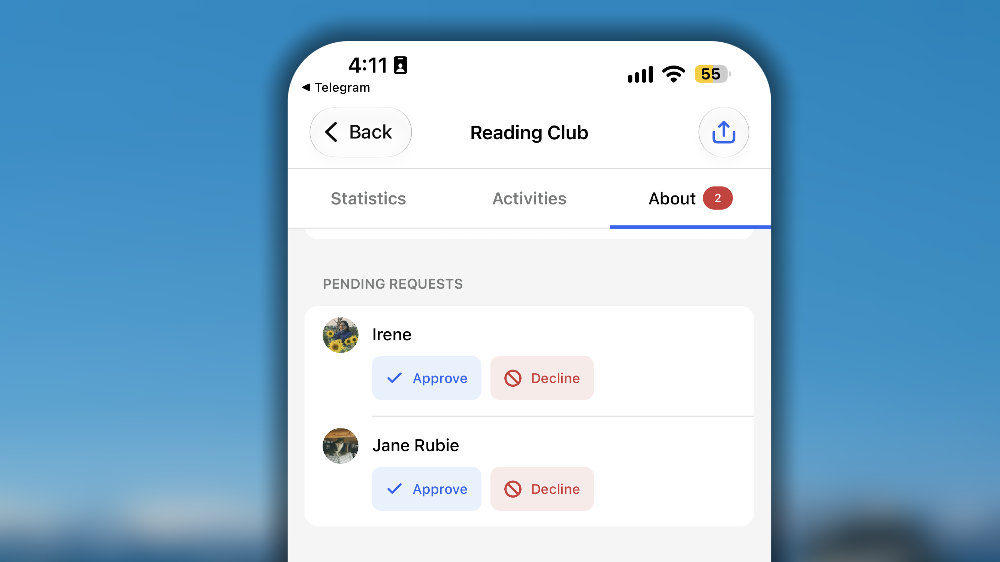

    Quando una persona chiede di partecipare alla cerchia, riceverai una notifica push. In alternativa, puoi vedere tutte le richieste nella scheda **Informazioni su iOS o Info su Android** della cerchia, nella sezione **Richieste in sospeso**:

    - Tocca **Approva su iOS o Approvare su Android** se accetti che la persona entri nella cerchia
    - Tocca **Rifiuta** se non vuoi consentirle di partecipare

    ### Rimuovere un membro dalla cerchia

    Nella cerchia di cui sei il creatore puoi rimuovere i membri che non sono più sufficientemente idonei a farne parte. Segui questi passaggi:

    1. In **Amici**, apri la tua cerchia e passa alla scheda **Informazioni su iOS o Info su Android**.
    2. Vai alla sezione **Membri**, che mostra tutte le persone attualmente presenti nella cerchia.
    3. Trova il membro, scorri verso sinistra sul suo nome e tocca **Rimuovi**.
    4. Comparirà una finestra di conferma: tocca **Rimuovi** per completare l’azione.

    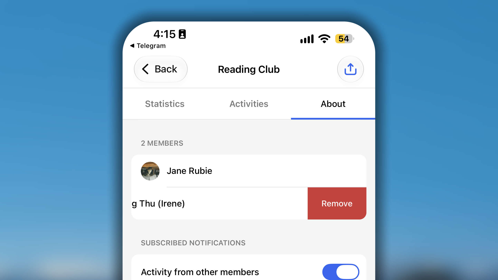

    Il membro viene rimosso immediatamente dalla Cerchia. Le sue abitudini condivise e i progressi futuri non saranno più visibili né contribuiranno al gruppo. Questa azione non influisce sui risultati passati della cerchia: tutti i traguardi raggiunti insieme dal gruppo rimarranno nella cronologia.

    ## Gestire una cerchia di altri proprietari

    ### Partecipare alla cerchia di un’altra persona

    Ricevere un invito a una Cerchia Habitify significa che qualcuno pensa che saresti un ottimo compagno nel suo percorso di miglioramento personale e desidera partecipare al tuo.

    Potresti ricevere un link di invito univoco; segui questi passaggi:

    - Tocca semplicemente il link ricevuto. Il telefono aprirà automaticamente l’app Habitify e ti porterà alla schermata di invito.
    - Tocca il pulsante **Richiedi di partecipare su iOS o Richiedi di aderire su Android**

    

    Ciò che accade dopo dipende dalle impostazioni di privacy della cerchia:

    - **Se la cerchia è pubblica**, verrai aggiunto immediatamente. Potrai entrare subito nella cerchia e vedere gli altri membri.
    - **Se la cerchia è privata**, verrà inviata una richiesta al creatore della cerchia. Vedrai una conferma dell’invio della richiesta e riceverai un’altra notifica quando verrà approvata.

    ### Lasciare la cerchia di un’altra persona

    1. Nella cerchia, tocca per passare alla scheda **Informazioni su iOS o Info su Android**
    2. Scorri fino all’_Area pericolosa_ in fondo e tocca il pulsante **Lascia questa cerchia**.
    3. Comparirà una finestra di conferma: tocca **Lascia** per confermare la decisione.

    <Warning>
      **L’uscita da una cerchia è immediata e comporta i seguenti effetti:**

      - Vieni rimosso immediatamente dall’elenco dei membri della cerchia.
      - Le persone nella cerchia non vedranno più il tuo profilo, le abitudini condivise, le mappe dei progressi o le serie, comprese quelle condivise in precedenza
      - Perderai completamente l’accesso alla cerchia e non potrai più vedere i progressi o le abitudini condivise degli altri membri.
    </Warning>

    ## Gestire le tue abitudini in una cerchia

    ### Condividere le tue abitudini con una cerchia

    La condivisione dei progressi è il cuore di una cerchia Habitify. È il modo in cui ispiri gli altri e, a tua volta, ricevi motivazione.

    **Per condividere le tue abitudini con una cerchia di cui sei membro:**

    - Da _Amici_, apri la cerchia con cui desideri condividere le abitudini.
    - Nella cerchia, vai alla barra dei membri e tocca il tuo profilo.
    - Nello spazio sottostante, tocca il pulsante **Seleziona le abitudini da condividere**.
      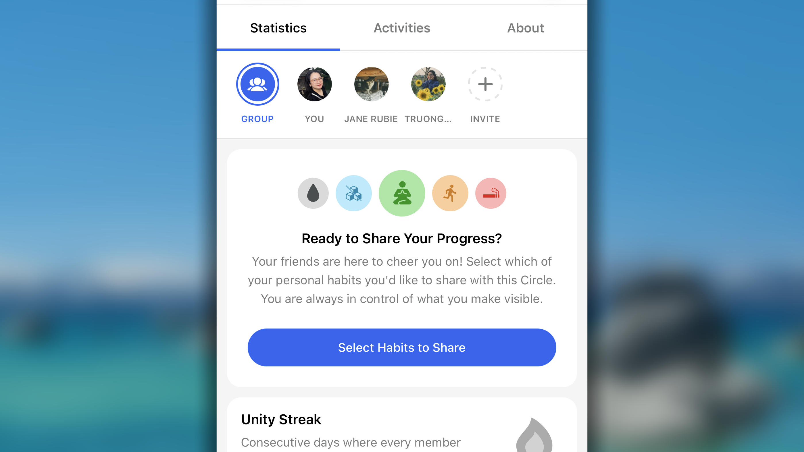
    - Nell’elenco delle tue abitudini, tocca per selezionare quelle che desideri condividere con la cerchia.
    - Quando hai terminato, tocca il pulsante **Avanti** nell’angolo in alto a destra.
    - Esamina l’elenco un’ultima volta e tocca il pulsante **Conferma** o **Salva** per confermare la scelta.

    **Contenuti condivisi**

    Dopo la conferma, le abitudini condivise diventano visibili a tutti i membri della cerchia. Questa trasparenza è fondamentale per la responsabilità e la motivazione. Per ogni abitudine che condividi, i membri vedranno:

    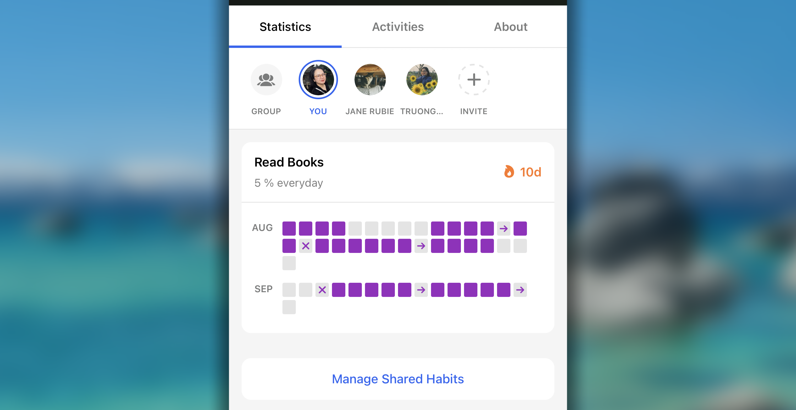

    - **La mappa a blocchi dei progressi della tua abitudine:** una mappa visiva a blocchi che mostra i check-in degli ultimi 3 mesi dell’abitudine, offrendo un’ottima istantanea della tua costanza.
    - **L’obiettivo della tua abitudine:** l’obiettivo che hai impostato per tale abitudine.
    - **La serie attuale della tua abitudine:** la serie attuale dell’abitudine, un potente incentivo che il gruppo può festeggiare insieme a te.

    ### Modificare l’elenco delle abitudini condivise

    Proseguendo nel tuo percorso, potresti voler condividere nuove ambizioni con la cerchia Habitify oppure rendere nuovamente privata una determinata abitudine. Segui questi passaggi:

    - Da **Amici**, apri la cerchia in cui desideri modificare le abitudini condivise.
    - Nella barra dei membri, tocca la tua immagine del profilo.
    - Scorri fino in fondo all’elenco delle abitudini condivise e tocca il pulsante **Gestisci abitudini condivise**.
      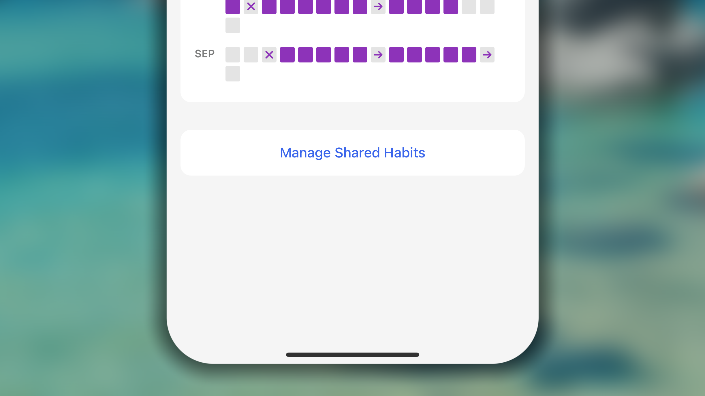
    - Nell’elenco delle tue abitudini, tocca un’abitudine per selezionarla o deselezionarla; un segno di spunta indica che verrà condivisa con la cerchia.
    - Quando hai configurato tutto, tocca il pulsante **Avanti** nell’angolo in alto a destra.
    - Esamina l’elenco un’ultima volta e tocca il pulsante **Conferma** o **Salva** per confermare le modifiche.

    <Note>
      È importante capire cosa vedono gli altri membri dopo le modifiche:

      - **Quando aggiungi una nuova abitudine:** l’abitudine appena condivisa comparirà immediatamente sul tuo profilo nella cerchia. Gli altri membri potranno vederne la mappa dei progressi, l’obiettivo e la serie attuale. Tuttavia, inizierà a contribuire ai risultati collettivi come le **Serie dell’unità** soltanto **dal giorno successivo**.
      - **Quando smetti di condividere un’abitudine:** l’abitudine viene rimossa immediatamente dal tuo profilo pubblico nella cerchia. Gli altri membri non potranno più vederne la mappa dei progressi o altri dettagli. Questa azione non influisce sui risultati passati della cerchia.
    </Note>

    ## **Comprendere la scheda Statistiche**

    Nella Cerchia Habitify, due statistiche chiave misurano il successo e lo slancio collettivi del gruppo: la **Serie dell’unità** e i **Punti slancio**. Sebbene entrambe siano alimentate dal completamento delle abitudini, misurano aspetti diversi delle prestazioni del gruppo.

    <Info>
      I progressi della tua abitudine verranno conteggiati sia per la _Serie dell’unità_ sia per i _Punti slancio_ **a partire dal giorno successivo a quello in cui condividi l’abitudine.**
    </Info>

    ### Serie dell’unità

    La Serie dell’unità è la misura definitiva della costanza quotidiana della Cerchia. Indica per quanti giorni consecutivi _ogni membro attivo_ della cerchia ha completato almeno una delle proprie abitudini condivise.

    .png "Sfida e Cerchia a confronto (3)")

    Ecco le **<u>5 regole per mantenere attiva la Serie dell’unità</u>**<u>:</u>

    1. Soltanto **il completamento** di un’abitudine con un **obiettivo giornaliero** e **programmata per ripetersi "Oggi"** contribuisce alla Serie dell’unità.
    2. **Se oggi tutti completano almeno una delle proprie abitudini giornaliere**, la Serie dell’unità aumenta di 1. Contrassegnare un’abitudine come "Saltata" o "Non riuscita" su iOS / "Saltato" o "Fallito" su Android equivale a non svolgerla.
    3. **Il completamento viene conteggiato** per il giorno corrente soltanto quando **viene effettuato nel giorno corrente e per il giorno corrente.**
    4. **Se un membro attiva la Modalità pausa su iOS o la Modalità Spenta su Android**, riceve un "lasciapassare" e la Serie dell’unità può continuare senza di lui.
    5. **Se tutti i membri della cerchia si trovano contemporaneamente in Modalità pausa/Modalità Spenta**, la serie non si interrompe. Rimane invece congelata finché la prima persona non torna dalla modalità e completa un’abitudine.

    Dalla scheda _Statistiche_ puoi **toccare la Serie dell’unità** e vedere lo stato del contributo di tutti i membri: chi ha completato almeno 1 abitudine oggi, chi non lo ha fatto e chi è esentato.

    ### Punti slancio

    I Punti slancio sono la misura più semplice dell’impegno totale della cerchia. Questa statistica mostra il risultato grezzo del gruppo.

    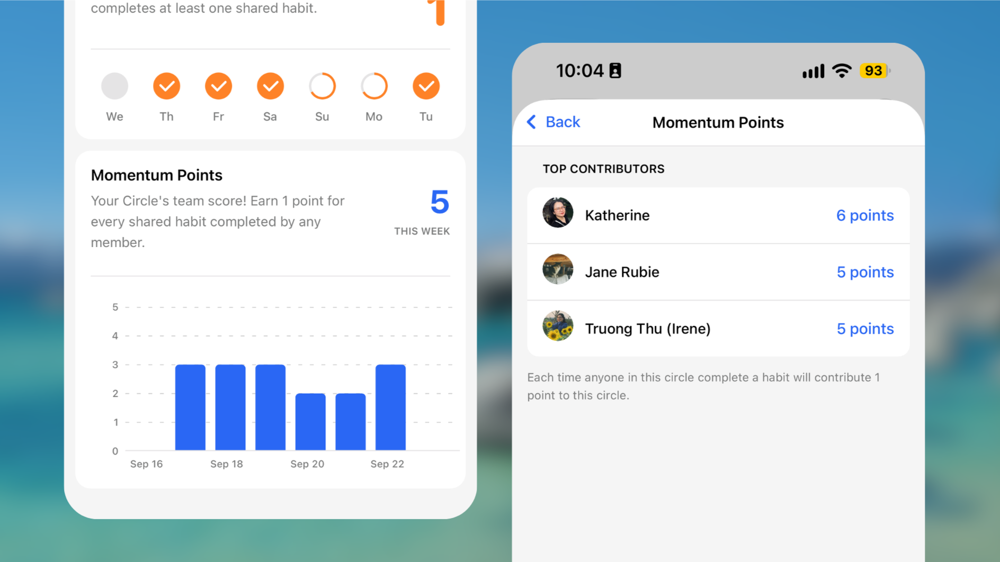

    La regola è semplice: **1 completamento = 1 Punto slancio**

    Ogni volta che un membro completa un’abitudine condivisa, viene aggiunto un punto al punteggio slancio totale della cerchia, indipendentemente dal tipo di obiettivo. È un totale progressivo di tutte le azioni positive svolte dal gruppo.

    Tutti i membri possono ottenere una visione intuitiva dei Punti slancio della cerchia, che include:

    - Un grafico delle tendenze che rappresenta **i Punti slancio di ogni giorno** negli ultimi 30 giorni.
    - **I Punti slancio totali della settimana corrente**, considerando lunedì come primo giorno della settimana. Quando inizia una nuova settimana (arriva un nuovo lunedì), i Punti slancio della settimana vengono reimpostati su 0.

    Dalla scheda _Statistiche_ puoi **toccare i Punti slancio** per vedere i punti di ciascun membro della cerchia. È qui che la cerchia può acquisire un carattere più ludico.

    ## Esplorare la scheda Attività

    La cerchia Habitify è più di un semplice strumento di monitoraggio dei progressi: è una comunità viva. Il cuore di questa comunità è la scheda **Attività**; considerala un feed social privato riservato a te e ai membri del gruppo.

    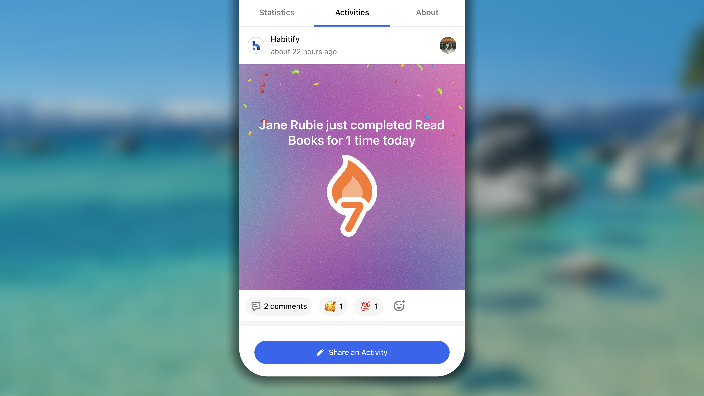

    ### Ricevere aggiornamenti sulla cerchia

    La scheda Attività si aggiorna automaticamente con i momenti importanti della cerchia. Il sistema creerà automaticamente dei post quando si verificano eventi chiave:

    - **Partecipa un nuovo membro:** comparirà un post di benvenuto per informare tutti che una nuova persona è entrata nel gruppo, così potrete salutarla.
    - **Aumenta la serie di un membro:** quando qualcuno estende con successo la propria serie per un’abitudine condivisa, verrà pubblicato automaticamente un post celebrativo. È l’occasione perfetta per applaudire la sua costanza!

    ### Condividere i tuoi pensieri con la cerchia

    Oltre ai post automatici, puoi condividere con il gruppo pensieri, sensazioni e aggiornamenti.

    1. Nella scheda **Attività**, tocca il pulsante **Condividi un’attività**
    2. Nello spazio di creazione del post puoi:
       1. Scrivere qualcosa che desideri condividere
       2. Toccare 🏞️ per caricare un’immagine oppure 📷 per scattarne rapidamente una con la fotocamera del telefono.
    3. Infine, tocca il pulsante **Pubblica** nell’angolo in alto a destra per condividerlo nel feed.

    ### Interagire con altri post nella cerchia

    Una comunità prospera grazie alle interazioni. Per ogni post nel feed Attività, sia automatico sia condiviso da un membro, puoi:

    - **Inviare una reazione**: tocca il pulsante delle reazioni e scegli l’emoji che esprime il tuo sostegno, apprezzamento o entusiasmo per il post.
    - **Lasciare un commento:** tocca il post, quindi il campo di inserimento _"Aggiungi la tua risposta"_, scrivi il messaggio e tocca ↑ per pubblicare il commento sotto il post.
    - **Menzionare altre persone con @:** nel commento puoi usare _@qualcuno_ che si trova nella cerchia con te per attirarne l’attenzione o rispondergli direttamente

    ## Inviare promemoria ai membri

    In qualsiasi Cerchia Habitify, un piccolo incoraggiamento può fare una grande differenza. Per aiutarti a sostenere i compagni, abbiamo aggiunto la funzione **Registrazione su iOS e Fatto su Android**, che consente di inviare a un altro membro un promemoria cordiale e incoraggiante relativo a una delle sue abitudini condivise, invitandolo a completarla per la giornata.

    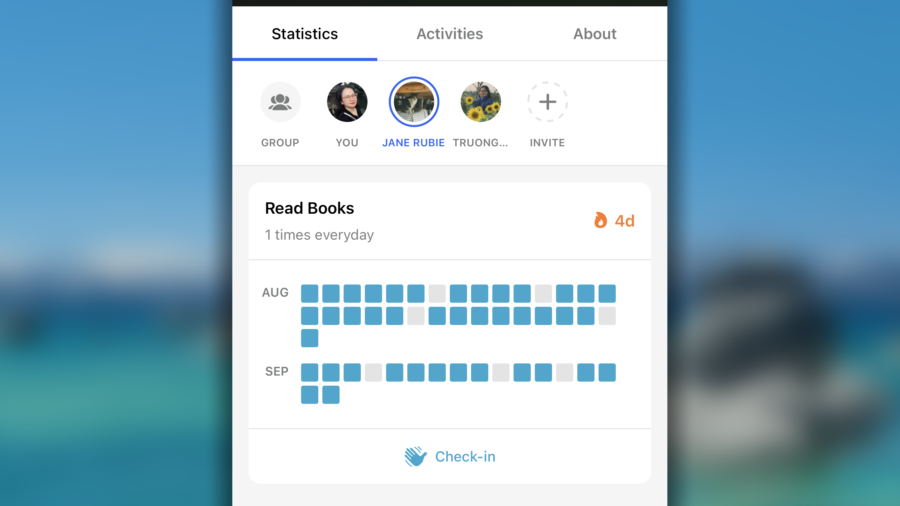

    Per inviare un promemoria di check-in:

    1. Nella cerchia, apri la scheda **Statistiche**.
    2. Nella barra dei membri, tocca il profilo del membro a cui desideri inviare un check-in
    3. Scorri verso il basso, esamina l’elenco e trova l’abitudine che desideri ricordargli. Sotto la mappa a blocchi dei progressi dell’abitudine, tocca il pulsante **Registrazione su iOS o Fatto su Android**.

    Il membro riceverà immediatamente una notifica push sul proprio dispositivo, che lo inviterà a _effettuare il check-in_ per quella specifica abitudine.

    <Note>
      **Regole per l’invio dei promemoria di check-in**

      - **Un check-in per abitudine**: puoi toccare il pulsante "Registrazione" su iOS o "Fatto" su Android una sola volta per la stessa abitudine e per la stessa persona nell’arco di 24 ore.
      - **Cinque check-in per persona**: in totale, puoi inviare un massimo di 5 check-in a una singola persona nell’arco di 24 ore (quindi puoi ricordarle fino a cinque abitudini diverse).

      La funzione di check-in è concepita come uno strumento positivo. Usala per sostenere i tuoi amici quando ritieni che possano apprezzare un promemoria gentile che li aiuti a mantenere lo slancio del gruppo.
    </Note>

    ## **Domande frequenti**

    <Accordion title="**Non riesco a condividere le mie buone abitudini con la cerchia. Cosa devo fare?**">
      Se si tratta di una buona abitudine e stai tentando di condividerla senza riuscirci, potrebbe esserci un problema temporaneo di connessione. Prova queste rapide soluzioni:

      - Controlla la connessione a Internet.
      - Chiudi completamente e riapri l’app Habitify per forzare una nuova sincronizzazione.
      - Riavvia il dispositivo.

      Se hai provato tutto quanto sopra e non riesci ancora a condividere un’abitudine compatibile, contatta il nostro team di assistenza in **Impostazioni > Contattaci** indicando i dettagli dell’abitudine e il nome della cerchia: saremo lieti di aiutarti!
    </Accordion>

    <Accordion title="**Perché non posso condividere una cattiva abitudine con la cerchia?**">
      L’intero concetto di Cerchia si fonda su azione positiva, condivisione e crescita. I progressi del gruppo, i Punti slancio e la Serie dell’unità vengono tutti calcolati in base ai contributi e ai check-in riusciti dei suoi membri.

      - Le **Buone abitudini** riguardano l’azione. Quando ne completi una, contribuisci attivamente al successo della Cerchia.
      - Le **Cattive abitudini**, invece, riguardano l’_evitamento_ e l’_inazione_. Il successo si ottiene _non_ facendo qualcosa.

      Poiché questo concetto del "non fare" non si adatta al modello di contributo attivo e condiviso, nella cerchia possono essere condivise soltanto le buone abitudini.

      **La soluzione:** se il tuo obiettivo è abbandonare una cattiva abitudine insieme al gruppo, prova a riformularla come una "Buona abitudine" positiva. Ad esempio:

      - Invece di condividere la cattiva abitudine _"Niente cibo spazzatura"_, crea e condividi una buona abitudine chiamata _"Mangiare uno spuntino sano"._
      - Invece di _"Non fumare"_, crea e condividi _"Praticare un esercizio di respirazione"._
    </Accordion>

    <Accordion title="**Il mio completamento non viene conteggiato nella Serie dell’unità della cerchia. Cosa devo fare?**">
      Esistono 2 possibili motivi:

      - L’abitudine non ha un obiettivo giornaliero. I completamenti delle abitudini con un obiettivo settimanale, mensile o annuale non vengono conteggiati ai fini della Serie dell’unità.
      - Hai condiviso l’abitudine con la cerchia soltanto oggi. Per garantire a ogni membro un’opportunità equa di vedere e iniziare una nuova abitudine condivisa, il calcolo della Serie dell’unità per una nuova abitudine comincia il giorno successivo a quello in cui viene aggiunta alla cerchia.
    </Accordion>

    <Accordion title="**Dove posso accedere alla mia cerchia nelle app per sito web e desktop?**">
      Cerchia non è ancora disponibile nelle app per sito web e desktop. Attualmente, Cerchia è disponibile soltanto su telefoni e tablet.
    </Accordion>
  </Tab>
  <Tab title="Sito web e desktop">
    Attualmente, Cerchia non è ancora disponibile sul sito web e nell’app desktop.
  </Tab>
</Tabs>
