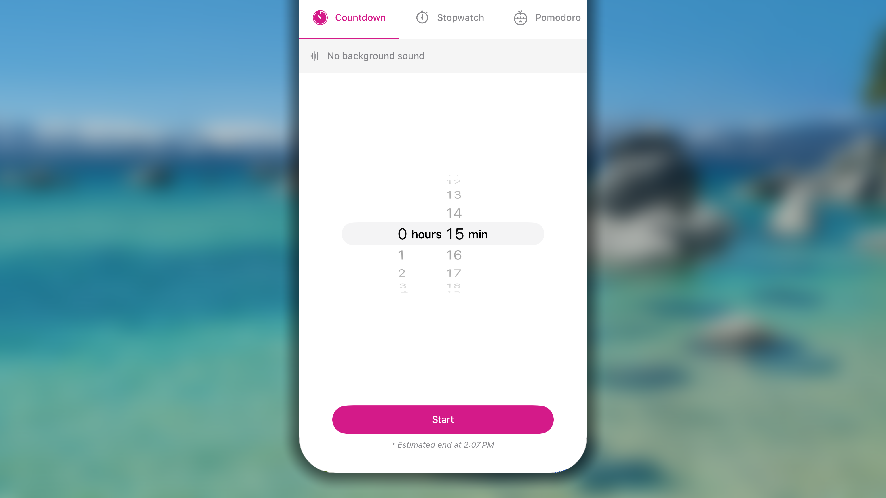
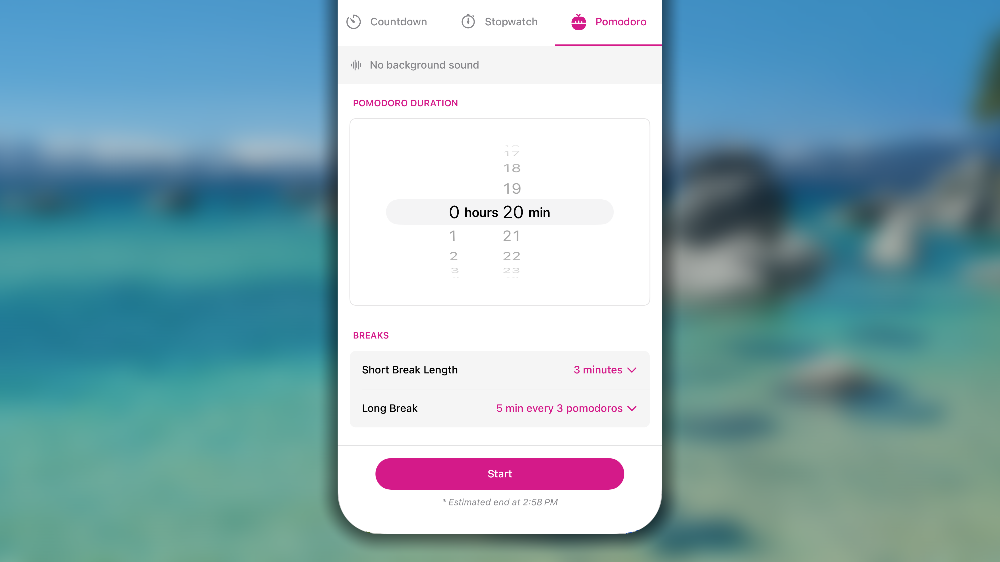
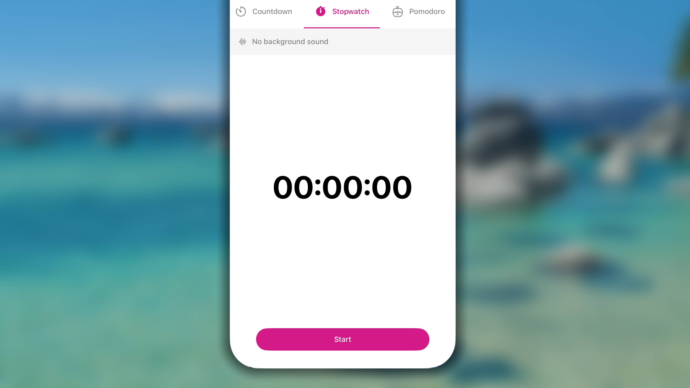
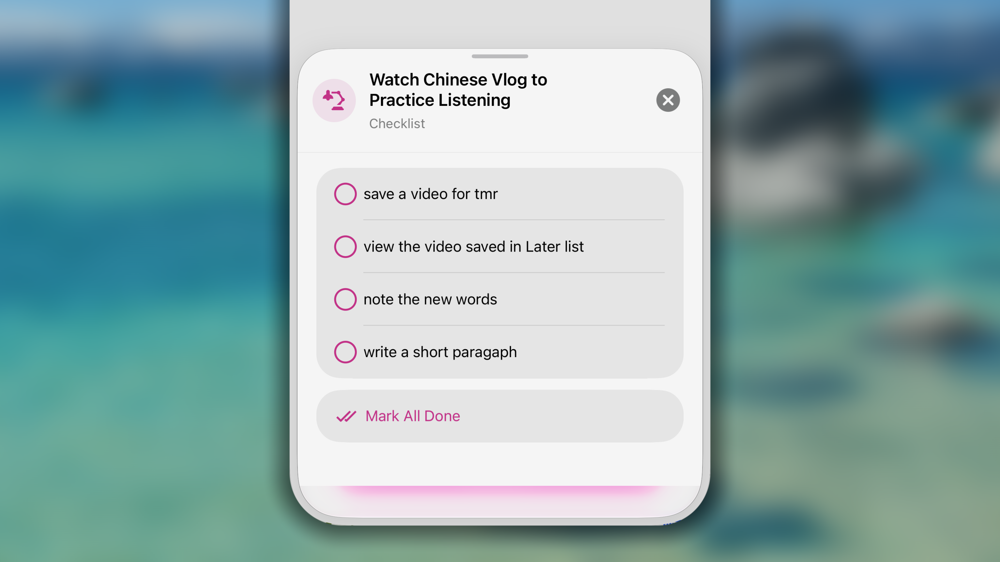
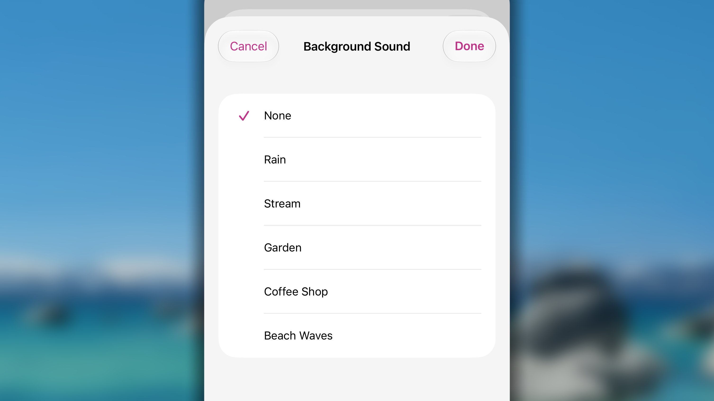
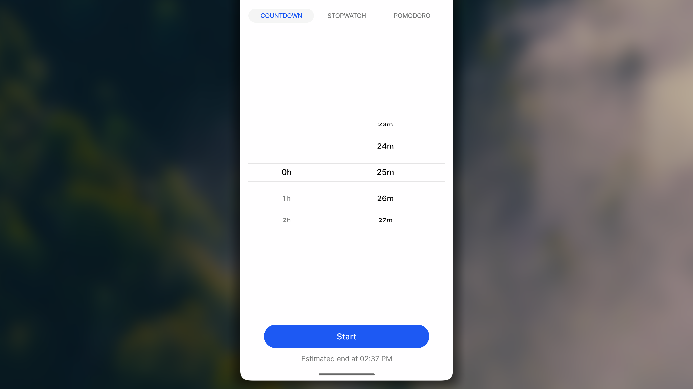
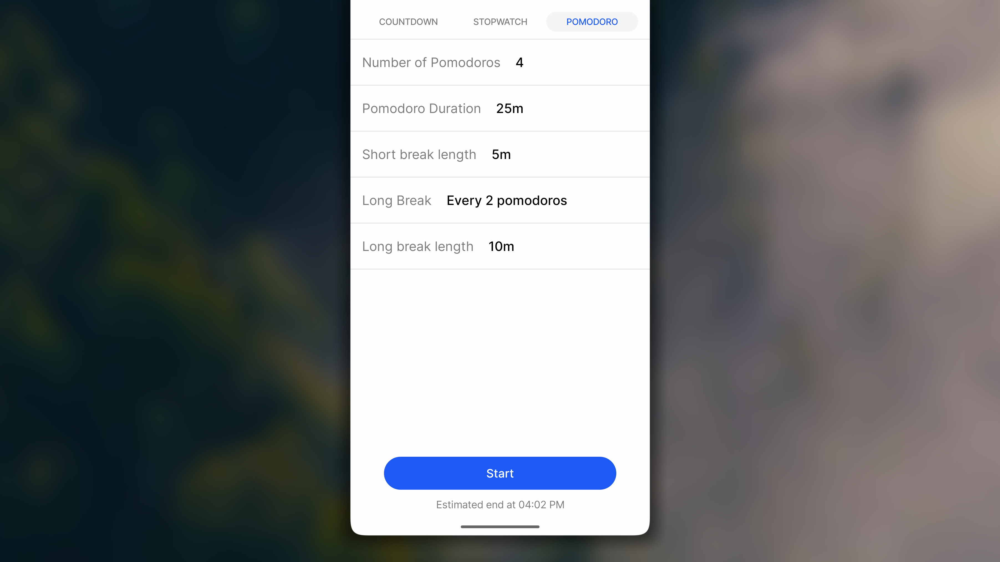
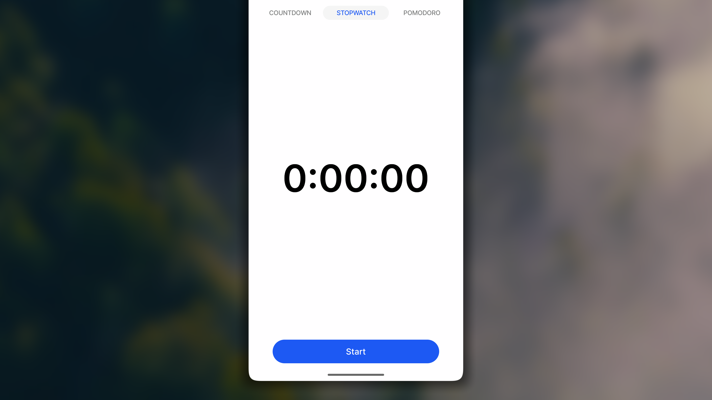
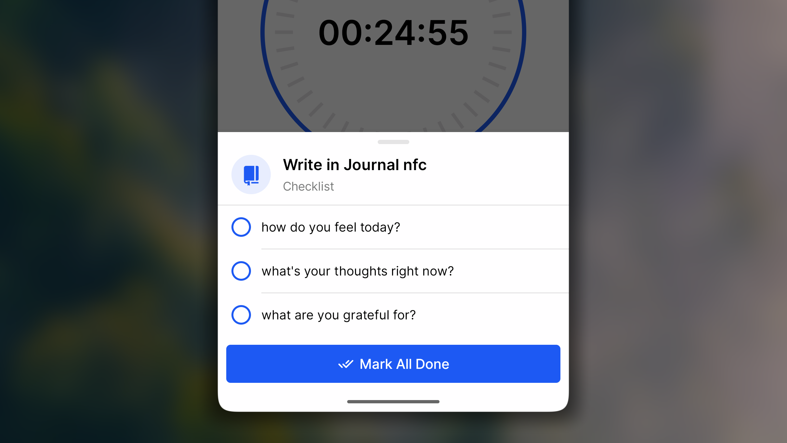
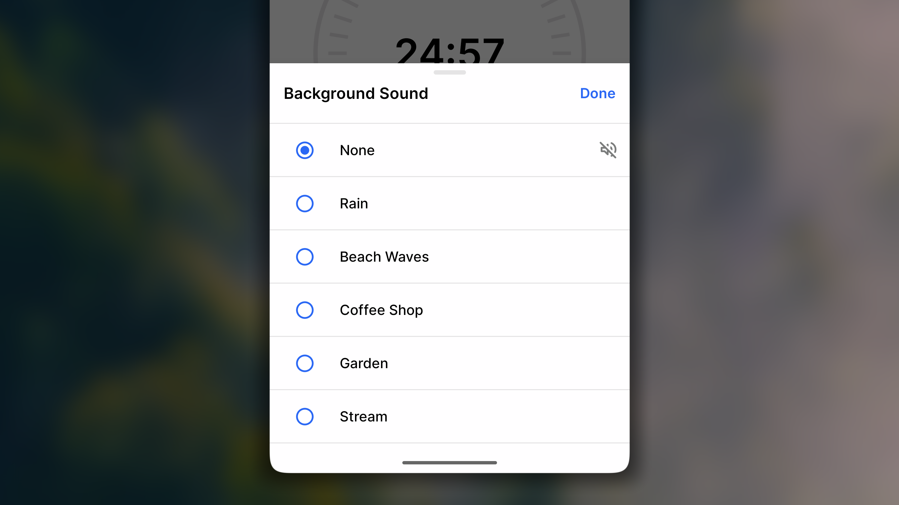

Timer è uno strumento integrato per tutte le abitudini il cui obiettivo viene misurato in tempo anziché con una semplice casella di controllo. Invece di svolgere l'attività e poi cercare di ricordare quanto tempo abbia effettivamente richiesto, avvii il Timer, svolgi l'abitudine e lasci che Habitify registri automaticamente il tempo al posto tuo.

Timer offre tre modalità, così puoi scegliere quella più adatta al tuo modo di lavorare:

- **Conto alla rovescia**: esegue un conto alla rovescia a partire da una durata impostata; è ideale quando sai esattamente quanto tempo vuoi dedicare a un'attività.
- **Cronometro**: conta il tempo trascorso senza una fine prestabilita; è ideale quando non sai in anticipo quanto durerà l'attività.
- **Pomodoro**: alterna intervalli di lavoro concentrato a brevi pause; è ideale per le attività che traggono beneficio da periodi strutturati di concentrazione.

<Note>
  Timer è disponibile per qualsiasi abitudine con un obiettivo misurato in un'unità di base pari a «minuto» o «ora».
</Note>

Di seguito trovi la guida all'uso di Timer con Habitify per monitorare i progressi delle abitudini che hanno un obiettivo di durata.

<Tabs>
  <Tab title=" iOS">
    <iframe src="https://drive.google.com/file/d/1AJscq-OhekkPpfNtFcW2_o9hif6ehNim/preview" width="640" height="360" />

    ## Avviare una sessione del Timer

    ### Avviare una sessione Conto alla rovescia

    

    1. In **Diario**:
       1. nella vista **Giorno**, vai all'abitudine e tocca il pulsante intelligente **⏱️** accanto a essa;
       2. nella vista **Settimana**, tieni premuta la cella di oggi e scegli **Avvia Timer**.
    2. Nella schermata Timer, tocca per aprire la scheda **Conto alla rovescia**.
    3. Regola la durata della sessione. Facoltativamente, se desideri un rumore bianco, tocca **၊၊||၊ Nessun suono di sottofondo**, scegline uno dall'elenco e tocca il pulsante **«**_Fine_**»** nell'angolo in alto a destra. In caso contrario, tocca **Annulla**.
    4. Tocca il pulsante **Avvia** per iniziare la sessione.

    ### Avviare una sessione Pomodoro

    

    1. In **Diario**:
       1. nella vista **Giorno**, vai all'abitudine e tocca il pulsante intelligente **⏱️** accanto a essa;
       2. nella vista **Settimana**, tieni premuta la cella di oggi e scegli **Avvia Timer**.
    2. Nella schermata Timer, tocca per aprire la scheda **Pomodoro**.
    3. Regola la durata della sessione.
       1. **Numero di Pomodori**: scegli il numero di intervalli di lavoro durante la sessione. Il massimo è 30.
       2. **Durata del Pomodoro**: imposta la durata di ciascun intervallo di lavoro. Il massimo è 23 ore e 59 minuti per intervallo.
       3. **Pause**:
          - **Durata della pausa breve:** definisci la durata di ciascuna pausa breve tra 2 intervalli di lavoro.
          - **Pausa lunga**: configura le impostazioni seguenti e tocca **Fine** per salvare.
            - **Pomodori prima della pausa lunga**: imposta il numero di intervalli di lavoro da completare prima di arrivare alla pausa lunga.
            - **Durata della pausa lunga**: definisci la durata di ciascuna pausa lunga.
    4. Facoltativamente, se desideri un rumore bianco, tocca **၊၊||၊ Nessun suono di sottofondo** sotto il nome dell'abitudine e scegline uno dall'elenco. Tocca il pulsante **Fine** nell'angolo in alto a destra per salvare la modifica. In caso contrario, tocca **Annulla**.
    4. Dopo aver configurato tutto, tocca il pulsante **Avvia** per iniziare la sessione di concentrazione.

    ### Avviare una sessione Cronometro

    

    1. In **Diario**:
       1. nella vista **Giorno**, vai all'abitudine e tocca il pulsante intelligente **⏱️** accanto a essa;
       2. nella vista **Settimana**, tieni premuta la cella di oggi e scegli **Avvia Timer**.
    2. Nella schermata Timer, tocca per aprire la scheda **Cronometro**.
    3. Facoltativamente, se desideri un rumore bianco, tocca **၊၊||၊ Nessun suono di sottofondo** e scegline uno dall'elenco. Quindi tocca il pulsante **Fine** nell'angolo in alto a destra per salvare la modifica. In caso contrario, tocca **Annulla**.
    4. Tocca il pulsante **Avvia** per iniziare la sessione.

    ## Durante una sessione del Timer

    ### Mettere in pausa o interrompere la sessione

    - Per mettere in pausa la sessione in corso, tocca il pulsante **⏸ Metti in pausa** sotto il contatore del tempo. In seguito, tocca il pulsante **▶︎ Riprendi** per far ripartire il conteggio del tempo.
    - Per interrompere la sessione in corso, tocca il pulsante **◼Ferma** nell'angolo in alto a destra, tocca nuovamente **Ferma** per confermare, quindi scegli tra:
      - **Salva**: registra il tempo conteggiato nei progressi dell'abitudine;
      - **Inserisci una durata diversa**: registra nei progressi dell'abitudine un valore personalizzato;
      - **Scarta** (nell'angolo in alto a sinistra): non salva nulla;
      - facoltativamente, tocca **Note (facoltative)** per aggiungere comodamente una nota all'abitudine.

    ### Seguire la lista di controllo dell'abitudine

    

    1. Tocca **⫶☰ #/# attività** sotto il nome dell'abitudine.
    2. Visualizza la lista di controllo ed effettua il check-in delle relative voci.
    3. Tocca il pulsante ⨂ nell'angolo in alto a destra della lista di controllo per chiuderla.

    ### Controllare il suono di sottofondo

    

    Inoltre, **per controllare il suono di sottofondo** mentre il contatore è in funzione:

    1. Tocca il **pulsante ၊၊||၊** sotto il nome dell'abitudine.
    2. Scegli **Nessuno** per disattivarlo oppure scegli un rumore bianco dall'elenco.
    3. Tocca **Salva** per salvare la modifica.  In caso contrario, tocca **Annulla** per ignorare tutte le modifiche.

    ## Domande frequenti

    <Accordion title="**Come si cambia il suono riprodotto al termine di una sessione?**">
      Al momento non è possibile cambiare o personalizzare il suono riprodotto al termine di una sessione del Timer.
    </Accordion>

    <Accordion title="**Come si disattiva il suono al termine di una sessione?**">
      Per disattivare il suono del Timer, imposta il telefono in modalità silenziosa oppure usa semplicemente l'interruttore sul lato sinistro del telefono.
    </Accordion>

    <Accordion title="**Il Timer si interrompe improvvisamente. Come si risolve il problema?**">
      Potrebbe capitarti che la sessione del Timer si interrompa improvvisamente. Segui questi passaggi per individuare e risolvere il problema.

      **1/ Controlla le autorizzazioni dell'app**

      Assicurati che Habitify disponga delle autorizzazioni necessarie per funzionare senza interruzioni:

      - Apri **Impostazioni**.
      - Scorri verso il basso e tocca **Habitify**.
      - Assicurati che tutte le autorizzazioni pertinenti, come **Aggiornamento app in background** e **Notifiche**, siano abilitate.

      **2/ Verifica la disponibilità di aggiornamenti software**

      Assicurati che sia Habitify sia il sistema operativo del dispositivo siano aggiornati:

      - Apri l'**App Store**.
      - Cerca Habitify e apri la pagina dell'app.
      - Se è disponibile un aggiornamento, tocca **Aggiorna**.
      - Inoltre, verifica la disponibilità di aggiornamenti iOS o Android andando su **Impostazioni** \> **Generali** \> **Aggiornamento software**.

      **3/ Evita la modalità di risparmio energetico**

      Assicurati che il dispositivo non sia in modalità di risparmio energetico, che può limitare le funzionalità dell'app:

      - Apri **Impostazioni**.
      - Vai a **Batteria**.
      - Assicurati che **Risparmio energetico** sia disattivato.
    </Accordion>
  </Tab>
  <Tab title="🤖 Android">
    <iframe src="https://drive.google.com/file/d/17S2aXYnFABFiZWAsXu4oRVJRX1uIn_gJ/preview" width="640" height="360" />

    ## Avviare una sessione del Timer

    ### Avviare una sessione Conto alla rovescia

    

    1. In **Diario**:
       1. nella vista **Giorno**, vai all'abitudine e tocca il pulsante intelligente **⏱️** accanto a essa;
       2. nella vista **Settimana**, tieni premuta la cella di oggi e scegli **Avvia Timer**.
    2. Nella schermata Timer, tocca per aprire la scheda **Conto alla rovescia**.
    2. Regola la durata della sessione. Facoltativamente, se desideri un rumore bianco, tocca **♪** nell'angolo in alto a destra e scegline uno dall'elenco.
    3. Tocca il pulsante **Inizia** per iniziare la sessione.

    ### Avviare una sessione Pomodoro

    

    1. In **Diario**:
       1. nella vista **Giorno**, vai all'abitudine e tocca il pulsante intelligente **⏱️** accanto a essa;
       2. nella vista **Settimana**, tieni premuta la cella di oggi e scegli **Avvia Timer**.
    2. Nella schermata Timer, tocca per aprire la scheda **Pomodoro**.
    3. Regola la durata della sessione.
       1. **Numero di Pomodori**: scegli il numero di intervalli di lavoro durante la sessione. Il massimo è 30.
       2. **Durata del Pomodoro**: imposta la durata di ciascun intervallo di lavoro. Il massimo è 23 ore e 59 minuti per intervallo.
       3. **Durata della pausa breve**: definisci la durata di ciascuna pausa breve tra 2 intervalli di lavoro.
       4. **Lunga pausa**: imposta il numero di intervalli di lavoro da completare prima di arrivare alla pausa lunga.
       5. **Durata della pausa lunga:** definisci la durata di ciascuna pausa lunga.
    4. Facoltativamente, se desideri un rumore bianco, tocca **♪** nell'angolo in alto a destra e scegline uno dall'elenco.
    5. Dopo aver configurato tutto, tocca il pulsante **Inizia** per iniziare la sessione di concentrazione.

    ### Avviare una sessione Cronometro

    

    1. In **Diario**:
       1. nella vista **Giorno**, vai all'abitudine e tocca il pulsante intelligente **⏱️** accanto a essa;
       2. nella vista **Settimana**, tieni premuta la cella di oggi e scegli **Avvia Timer**.
    2. Nella schermata Timer, tocca per aprire la scheda **Cronometro**.
    2. Facoltativamente, se desideri un rumore bianco, tocca **♪** nell'angolo in alto a destra e scegline uno dall'elenco.
    3. Tocca il pulsante **Inizia** per iniziare la sessione.

    ## Durante una sessione del Timer

    ### Mettere in pausa o interrompere la sessione

    - Per mettere in pausa la sessione in corso, tocca il pulsante **⏸ Pausa** sotto il contatore del tempo. In seguito, tocca il pulsante **▶︎ Riprendi** per far ripartire il conteggio del tempo.
    - Per interrompere la sessione in corso, tocca il pulsante **◼Stop** nell'angolo in alto a sinistra, tocca nuovamente **Stop** per confermare, quindi scegli tra:
      - **Salva e chiudi**: registra il tempo conteggiato nei progressi dell'abitudine;
      - **Inserisci durata diversa**: registra nei progressi dell'abitudine un valore personalizzato;
      - pulsante **x** nell'angolo in alto a sinistra: non salva nulla.

    ### Seguire la lista di controllo dell'abitudine

    

    1. Tocca **≔ #/# compiti** sotto il nome dell'abitudine.
    2. Visualizza la lista di controllo ed effettua il check-in delle relative voci.
    3. Tocca all'esterno della lista di controllo per chiuderla.

    ### Controllare il suono di sottofondo

    

    Inoltre, **per controllare il suono di sottofondo** mentre il contatore è in funzione:

    1. Tocca il **pulsante** ♪ nell'angolo in alto a destra.
    2. Scegli **Nessuno** per disattivarlo oppure scegli un rumore bianco dall'elenco.

    ## Domande frequenti

    <Accordion title="**Come si cambia il suono riprodotto al termine di una sessione?**">
      Al momento non è possibile cambiare o personalizzare il suono riprodotto al termine di una sessione del Timer.
    </Accordion>

    <Accordion title="**Come si disattiva il suono al termine di una sessione?**">
      Il suono riprodotto al termine del Timer può essere configurato usando il pulsante audio sul lato del telefono, separatamente dalle impostazioni del dispositivo.
    </Accordion>

    <Accordion title="**Il Timer si interrompe improvvisamente. Come si risolve il problema?**">
      Potrebbe capitarti che la sessione del Timer si interrompa improvvisamente. Segui questi passaggi per individuare e risolvere il problema.

      **1/ Controlla le autorizzazioni dell'app**

      Assicurati che Habitify disponga delle autorizzazioni necessarie per funzionare senza interruzioni:

      - Apri **Impostazioni**.
      - Scorri verso il basso e tocca **Habitify**.
      - Assicurati che tutte le autorizzazioni pertinenti, come **Aggiornamento app in background** e **Notifiche**, siano abilitate.

      **2/ Verifica la disponibilità di aggiornamenti software**

      Assicurati che sia Habitify sia il sistema operativo del dispositivo siano aggiornati:

      - Apri il **Play Store**.
      - Cerca Habitify e apri la pagina dell'app.
      - Se è disponibile un aggiornamento, tocca **Aggiorna**.
      - Inoltre, verifica la disponibilità di aggiornamenti iOS o Android andando su **Impostazioni** \> **Generali** \> **Aggiornamento software**.

      **3/ Evita la modalità di risparmio energetico**

      Assicurati che il dispositivo non sia in modalità di risparmio energetico, che può limitare le funzionalità dell'app:

      - Apri **Impostazioni**.
      - Vai a **Batteria**.
      - Assicurati che **Risparmio energetico** sia disattivato.
    </Accordion>
  </Tab>
  <Tab title="🖥️ Website & Desktop">
    <Note>
      Al momento, nelle app Website & Desktop è supportato soltanto il Timer Conto alla rovescia.
    </Note>

    <iframe src="https://drive.google.com/file/d/12qnrjuWdfpbSXvdecCoojyRNUbFZtwsU/preview" width="640" height="360" />

    ## Avviare una sessione del Timer

    <Steps>
      <Step title="Apri la schermata Timer">
        - Nel layout **Griglia**, fai clic con il tasto destro sulla cella e scegli **Avvia timer**.
        - Nel layout **Elenco**, passa il puntatore sull'abitudine, quindi fai clic su ⏱️.
      </Step>
      <Step title="Configura la durata della sessione">
        - Fai clic sul campo del valore della durata.
        - Scegli uno dei valori predefiniti nell'elenco.

        <Note>
          Al momento, l'app Website & Desktop non consente di configurare un valore personalizzato per la durata di una sessione del Timer.
        </Note>
      </Step>
      <Step title="Avvia la sessione">
        - Fai clic sul pulsante **Avvia sessione** per iniziare.
      </Step>
    </Steps>

    ## Durante una sessione del Timer

    Mentre una sessione è in corso, puoi metterla in pausa o interromperla prima del termine.

    - **Per metterla in pausa**: fai clic sul pulsante **Pausa** sotto l'orologio. In seguito, puoi fare clic sul pulsante **Continua** per riprendere la sessione.
    - **Per interromperla**: fai clic sul pulsante **Interrompi** sotto l'orologio. In **Conferma**, fai clic su **Scarta sessione** per confermare e chiudere il Timer.

    <Note>
      Al momento, nell'app Website & Desktop, l'interruzione di una sessione in corso non offre l'opzione di registrare direttamente il tempo conteggiato nei progressi dell'abitudine.
    </Note>
  </Tab>
</Tabs>
