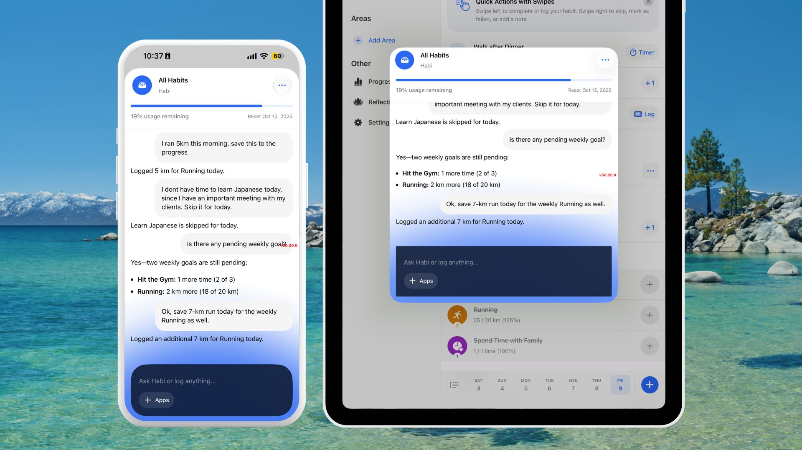
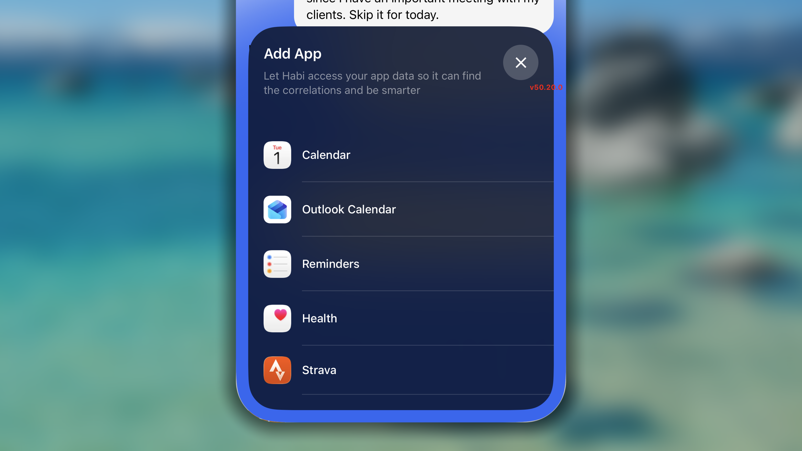
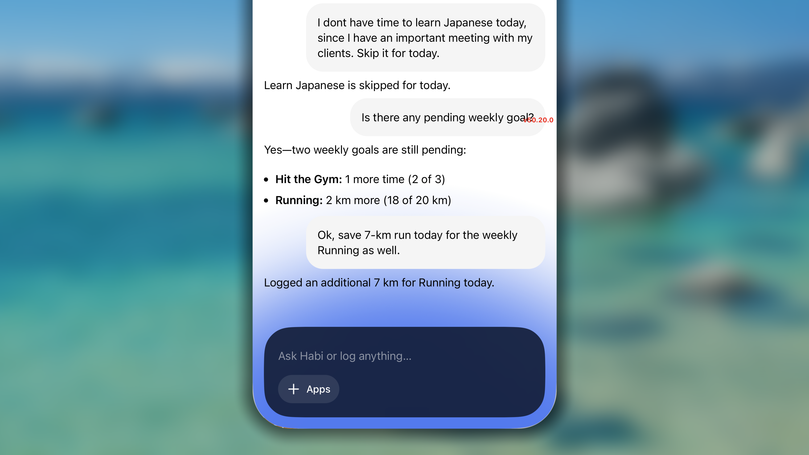
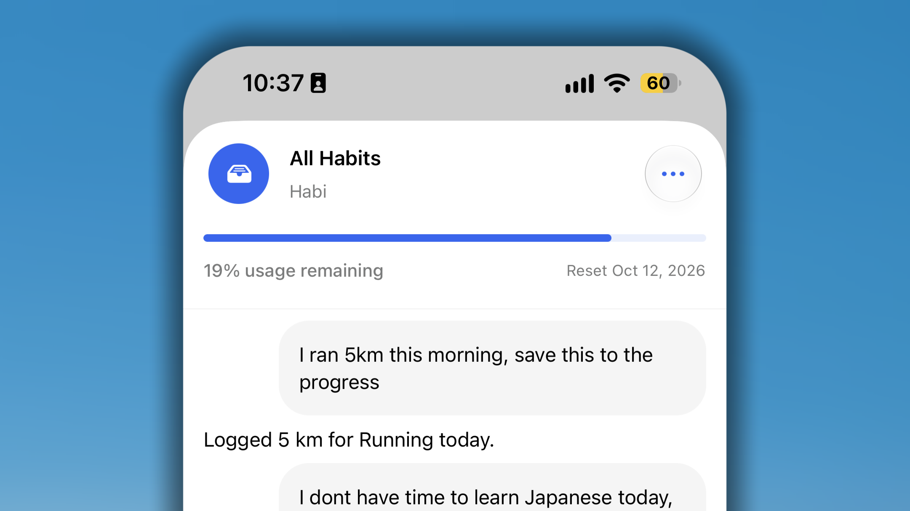

Habiは、Habitifyで記録している習慣を身につけ、継続するためのパーソナルアシスタントです。

チェックインや目標の調整、履歴の確認のためにメニューをたどる必要はありません。Habiに話しかけるだけで、習慣データを理解し、自然な言葉による依頼を直接実行します。

## Habi AIを開く場所

<iframe src="https://drive.google.com/file/d/1imqM5ZxvCvjVuQrNujaH8kRiPUWkyyj2/preview" width="640" height="360" />

Habiは現在の画面を読み取れるように設計されているため、入力を始める前から、何を見ているのかを理解しています。アプリ内のさまざまな場所からHabiを利用できます。

- **ジャーナル：** 一覧を下に引くとチャットが開きます。Habiは、当日の一覧、表示中の日付、適用中のフィルターを自動的に参照します。
- **進捗：** 右下のAIボタンをタップします。Habiは、全体のパフォーマンスレポート、現在のフィルター、期間を参照します。
- **個別習慣の進捗：** 画面の隅にあるAIボタンをタップします。Habiは、表示中の習慣に絞ってチャットを進めます。

<Note>
  Habiは最初に開いた場所から文脈を把握しますが、どのチャットからでも自由に質問できます。
</Note>

チャット履歴は自動的に保存されます。別の画面やデバイスへ移動しても、いつでも中断したところから会話を再開できます。

画面を消去して新しく始めたい場合は、履歴を手動で削除できます。

- チャット画面右上の**3点ボタン**をタップします。
- **「この会話を消去」**を選びます。

## Habiが参照・連携するデータ

より的確な提案を行うため、HabiはHabitifyの全履歴と、明示的に許可された外部アプリから文脈を取得します。

- **Habitifyのデータ：** 習慣、メモ、チェックイン記録、時間帯、エリア、アプリ全般の設定を理解します。
- **外部アプリ（許可した場合）：**
  
  - **カレンダー：** デバイス標準のCalendar、Outlook Calendar、Google Calendarのイベントと同期します。
  - **タスク：** Apple Remindersのタスクとリストを読み取ります。
  - **ヘルスデータ：** Apple Health（iOS）、Health Connect（Android）、Stravaから、対応するヘルス指標を取得します。共有するデータの種類は自分で選択できます。

## Habiでできること

Habiは単なるチャットボットではなく、日々のルーティンを実際に管理できるアシスタントです。たとえば、次の操作を依頼できます。

- **記録を管理：** 指定した日の習慣記録（成功、スキップ、失敗）をすぐに追加、削除、更新できます。習慣へのメモ追加や、その日の気分の記録も依頼できます。
- **習慣を作成・編集：** 良い習慣または悪い習慣を新規作成できます。目標の更新、チェックリスト項目の管理、リマインダーの追加・削除、古い習慣のアーカイブ、新しい習慣に合うアイコンの検索も依頼できます。
- **ダッシュボードを整理：** 新しい生活エリアや時間帯を作成し、習慣を該当するカテゴリへすぐに分類できます。
- **使い方の質問に回答：** Habiはヘルプセンターのドキュメントに直接接続されています。Habitifyの機能の使い方を忘れたときは、Habiに尋ねると公式ガイドに基づいた手順を案内します。

## 利用上限

すべての方に快適で素早い体験を提供するため、Habi AIには現在、**通常の1週間あたり100,000トークン**の利用上限があります。上限は毎週月曜日にリセットされます。

週間使用量のバーは通常は表示されず、週間上限の残りが25%未満になると表示されます。

今後この方針が更新または変更されるまで、この週間上限はメンバーシップの種類にかかわらず、すべてのHabitifyアカウントに適用されます。

## よくある質問

<Accordion title="**Habi AIのトークン上限を増やすにはどうすればよいですか？**">
  現在、個別にトークン上限を引き上げることはできません。Habi AIはリリース直後の機能であるため、すべてのメンバーシップに共通して**週100,000トークン**の上限を設けています。

  この初期上限により、機能の成長段階におけるシステムの安定性を確保し、実際の利用傾向を把握しながら、すべての方へ公平で高速な動作を提供できます。Habi AIの体験をさらに最適化し、将来のアップデートでは、柔軟なトークンオプションや利用頻度の高い方向けの上限引き上げを検討する予定です。
</Accordion>

<Accordion title="**アプリでHabi AIへのアクセスをオフにするにはどうすればよいですか？**">
  現在、設定にはHabi AIを無効化する専用のトグルはありません。

  Habi AIは、文脈に応じた習慣の提案や進捗分析を支援する機能として組み込まれていますが、利用は任意です。従来どおり手動で記録したい場合は、AIの案内や起動ボタンを使用しなければ、主要な記録ツール、ルーティン、分析には影響しません。

  AI機能のカスタマイズ性については現在フィードバックを収集しており、今後のリリースに向けて、より細かな制御方法を検討しています。
</Accordion>
