ジャーナルは今日行うことを示します。進捗画面は、今朝チェックを付けたかだけでなく、その習慣が週ごと、月ごとに本当に定着しているかを含め、実際の成果を示します。

習慣を身につけることと、やめることは、測るべき内容が異なる別の道のりです。そのため進捗は、**良い習慣**と**悪い習慣**の2つの専用スペースに分かれています。

この記事では、各画面に表示される内容と、提供される分析情報の読み方を説明します。

<Tabs>
  <Tab title="  iOS">
    ## 進捗：良い習慣

    <iframe src="https://drive.google.com/file/d/1RgPVgX9tVf25E2MN4CiJA842tR3csvgS/preview" width="640" height="360" />

    ### 日付範囲と習慣の管理

    データを確認する前に、条件を設定します。絞り込みツールは画面右上にあります。

    このセクションでは、次の操作ができます。

    - 7、14、28、60日から最大6か月までの標準期間を選ぶか、開始日と終了日を完全にカスタマイズします。
    - 特定の習慣、指定したエリアの習慣、指定した時間帯の習慣へ絞り込みます。

    1年間全体の成績を振り返る場合でも、特定の30日間フィットネスチャレンジへ焦点を合わせる場合でも、目的に合うようデータを調整できます。

    ### 日々の努力の概要

    これは進捗画面の入口であり、「本当に継続できているのか、それともそう感じるだけなのか」という問いに答えるために設計されています。

    **継続ヒートマップ**、**平均日次スコア**、**成績バー**の3つの主要指標を使い、実際の努力を全体的に確認できます。

    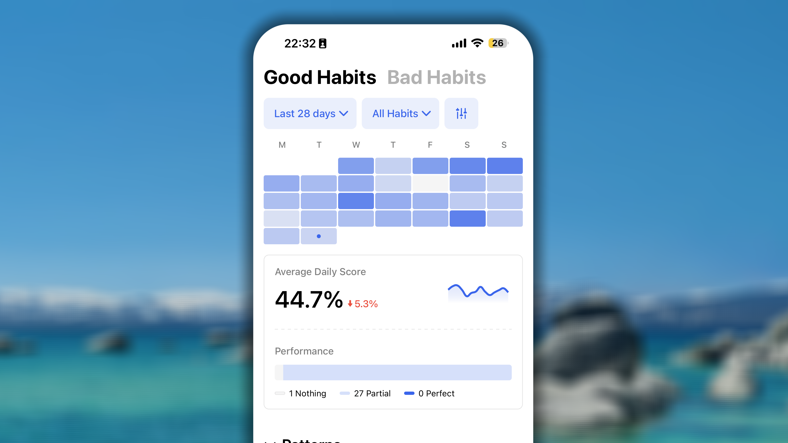

    #### **継続ヒートマップ**

    ダッシュボードの最上部にあり、時間の経過に伴う継続力を鮮やかな視覚表現で示します。

    グリッドの小さな四角は各日を表し、セル数は絞り込みで選択した日付範囲と一致します。各セルの色の濃さはその日の完了率を示します。完了率が高いほど、色は濃く、はっきりと表示されます。

    #### **平均日次スコア**

    ヒートマップのすぐ下には、選択期間の全体的な有効性を評価する主要指標と、現在の勢いを過去と比較する推移指標があります。

    - **平均日次スコア：**全体の日次完了率です。各日の完了率の合計を、絞り込み期間の日数で割って計算します。_（例：今日の日次習慣が3つあり、そのうち1つを完了した場合、今日の完了率は**33.3%**です。）_
    - **推移指標：**現在のスコアと直前の同じ長さの期間を比較します。_（例：「過去7日間」を表示している場合、その7日間と、さらに前の7日間を比較します。）_

    #### **成績バー**

    各日を次の3つの明確な状態へ分けます。

    - **なし**：日次習慣を1つも完了しなかった日数。
    - **一部**：一部の習慣を完了したものの、全部は完了しなかった日数。
    - **完了**：日次習慣を100%完了した日数。

    完璧な日が少なくても、「一部」の努力をした日が多ければ、継続して取り組み、全体の成功へ貢献していることが分かります。自分に優しくするための良い指標です。

    ### パターン

    「パターン」セクションでは、最も生産的な時期と、行き詰まりやすい場所を把握できます。傾向を理解すると、自分の自然なエネルギーへ逆らうのではなく、それを活かせます。

    **週間リズム**、**集中力が最も高い時間帯**、**未達成の習慣**という3つの強力な分析に分かれています。

    #### **週間リズム**

    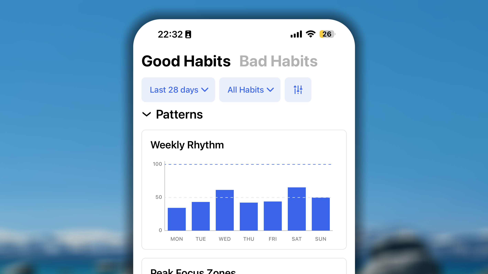

    月曜日から日曜日までの平均完了率を比較し、通常の1週間を示す小さなレポートとして機能します。特定の曜日のスコアは、選択期間内にある同じ曜日すべての平均です。

    **_例：_**_日付の絞り込みに火曜日が2回含まれ、最初の火曜日の完了率が**50%**、2回目が**0%**の場合、グラフに表示される火曜日全体の平均は**25%**です。_

    最も高いバーと低いバーを見ると、生産性が最も高い曜日と、勢いが落ちる曜日を特定できます。エネルギーの高い日に負荷の高い習慣を予定し、低い日には柔軟性を持たせるなど、賢く計画できます。

    #### **集中力が最も高い時間帯**

    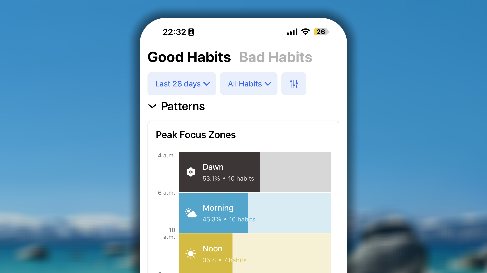

    カスタム時間帯（朝、昼、夜）に基づき、絞り込み期間内の各時間ブロックの完了率を平均します。

    たとえば、朝に3つの習慣を予定し、1日目に3つ中2つ、2日目に3つ中1つを完了した場合、朝全体の完了率は50%です。

    自分だけの「ゴールデンタイム」が分かります。最も成功率が高い時間ブロックを把握し、難しく優先度の高い習慣をそこへ移し、成績の低い時間を休息や簡単なタスクへ使うことで、ルーティンを最適化できます。

    #### **未達成の習慣**

    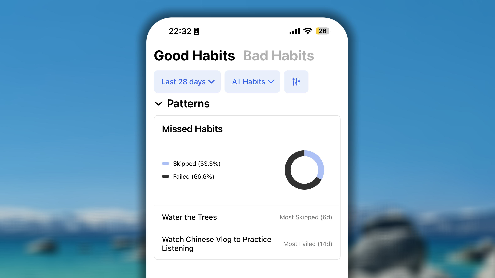

    ドーナツグラフで、絞り込み期間中に日次習慣を達成できなかった回数を合計し、**スキップ**と**失敗**のチェックインの割合を計算します。グラフの下には、最もスキップした習慣と、最も失敗した習慣が明示されます。

    _例：_選択期間中に未達成のチェックインが合計10回あり、スキップ6回、失敗4回の場合、グラフにはスキップ60%、失敗40%と表示されます。

    未達成の日に罪悪感を持つ代わりに、改善へ使えるデータへ変換できます。

    - 特定の習慣が**最も失敗**になっている場合、現在は難しすぎる、または時間が合っていないなど、ルーティンを調整すべき明確な合図です。
    - **最もスキップ**した習慣については、その目標が現在の道のりに本当に関係しているかを見直すきっかけになります。

    ### エリア

    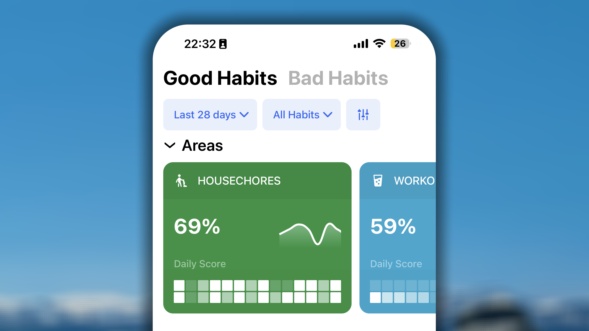

    良い習慣を身につけることは、1つのことだけではなく、健康、仕事、自己成長、人間関係などの組み合わせです。**エリア**セクションは、生活の各カテゴリーでバランスよく進んでいるかを示します。

    カスタムエリアごとに、横へスクロールできるカードのカルーセルが表示されます。各カードには、そのカテゴリーだけの短い「全体の努力」レポートがあります。

    - **平均日次スコア**：選択期間中、そのエリアに含まれる日次目標の習慣について、1日あたりの平均完了率。
    - **小さな推移線**：選択期間中、そのエリアに含まれる日次目標の習慣の全体成績を示す折れ線グラフ。
    - **要約ヒートマップ**：選択期間中、そのエリアに含まれる日次習慣の完了率を視覚化します。

    カードをスワイプすると、生活のある側面が順調な一方で、別の側面が疎かになっていないかをすぐに確認できます。

    ### 目標

    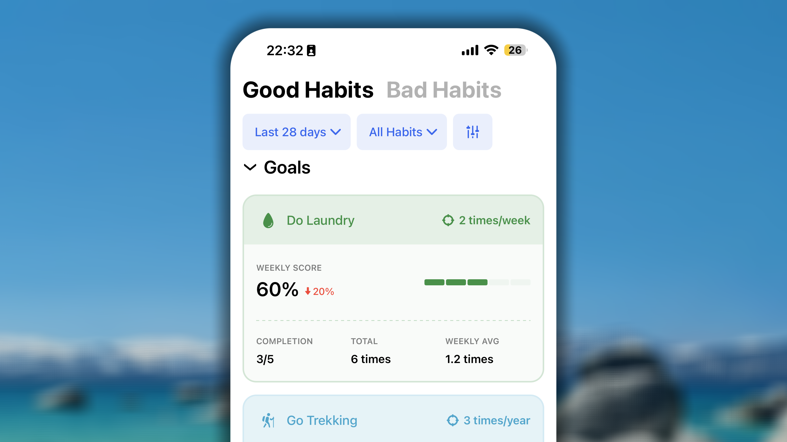

    **目標**セクションは、週次、月次、年次目標を持つ目標型習慣専用です。適切なペースで進んでいるかを確認する専用の小さなレポートを提供します。

    週次、月次、年次目標を持つ各習慣に専用カードが表示されます。

    - **ヘッダー**：習慣名と具体的な目標。
    - **週次／月次／年次スコア**：現在の週、月、年の完了率。
    - **ヒートマップ**：標準の各週、月、年の努力を小さな進捗バーで視覚化。
    - **詳細内訳**：
      - **完了**：完了したサイクル数（例：15週中7週）。
      - **合計：**日付の絞り込みで選択した範囲内に記録した進捗値の合計。
      - **週次／月次／年次平均**：日付範囲に含まれる標準の週、月、年ごとに達成した平均値。

    大きな目標は困難に感じられますが、このレポートカードが分解します。_日次平均_は大きな月次目標を小さく管理可能な日次値へ変え、_年初来_の合計は継続した努力が大きな成果へ積み重なっていることを示します。

    ### 習慣

    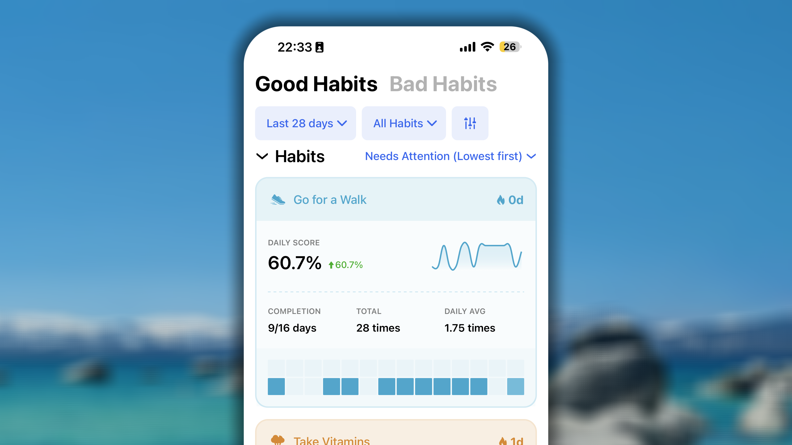

    **習慣**セクションは日次目標の習慣専用です。毎日完了したいルーティンごとに小さなレポートを提供し、個々の成績へ焦点を合わせられます。

    各日次習慣には専用のレポートカードがあります。

    1. **ヘッダー**：習慣名と、現在の有効なストリークを示す炎のアイコン。
    2. **スコアと推移**：この習慣の日次スコアと推移線。
    3. **詳細内訳**：完了比率（例：15日中7日）、達成した累積値の合計、日次平均値。
    4. **小さなヒートマップ**：この1つの習慣だけの日々の努力を分離して示す専用ヒートマップ。

    個別カードは、責任感を高める究極のツールです。現在のストリークを上部へ固定することで、勢いの心理的な力を活かします。小さなヒートマップのグリッドに空白が多ければ、明日さらに集中すべきルーティンがすぐに分かります。

    ## 進捗：悪い習慣

    <iframe src="https://drive.google.com/file/d/1uPA4C2RByoFmdJ1NtOCmpX8GyPuFC1EB/preview" width="640" height="360" />

    ### **日付範囲と習慣の管理**

    絞り込みツールは画面右上にあります。7、14、28日などの標準期間、またはカスタムの開始日と終了日を使って期間を調整できます。

    データを分離して確認できます。「禁酒の10月」や30日間のデジタルデトックスを行う場合、正確な日付条件を設定し、そのチャレンジだけに焦点を合わせたレポートを確認できます。

    ### **日々の努力の概要**

    「悪い習慣」タブを初めて開くと、選択期間の努力の概要が表示されます。「良い習慣」タブと似たレイアウトですが、ここでの目標は正反対です。

    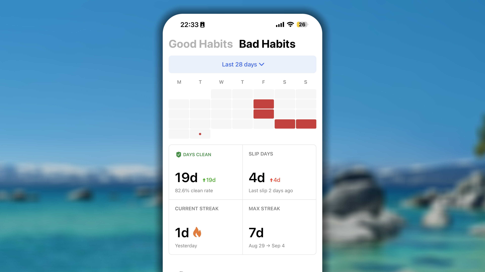

    #### **ブロックカレンダー**

    「良い習慣」画面のように濃い色で埋めるのではなく、ここではできるだけ空白を保つことが目標です。薄いグレーのブロックは、悪い習慣を行わなかった日を表します。

    悪い習慣を行った記録を追加すると、その日のブロックはすぐに赤く塗りつぶされます。

    現実を一目で確認できます。赤いブロックに罪悪感を持つ必要はありません。悪い習慣を行いやすい時期を把握するためのデータ点です。

    #### **主要指標**

    カレンダーのすぐ下では、継続状況を4つの意欲向上指標へ分けて表示します。

    1. **クリーンな日**：悪い習慣を完全に避けられた合計日数と、全体の「クリーン率」。
    2. **スリップした日**：合計記録値が上限以内の場合も含め、進捗ログがある合計日数。最後のスリップが何日前かも表示します。
    3. **現在のストリーク**：今日まで途切れず続くクリーンな日数。炎のアイコンで示します。
    4. **最大ストリーク**：連続したクリーン日数の過去最高記録。

    ### **パターン**

    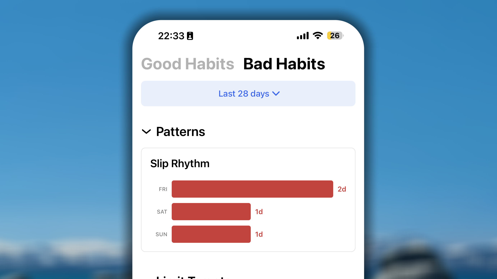

    良い習慣では生産性のピークを見つけますが、悪い習慣をやめるには_弱さ_のピークを特定します。**パターン**セクションの**スリップのリズム**は、古い罠へ戻る危険が最も高い時期を特定します。

    **スリップのリズム**は週間の弱さを示すレポートです。横長の赤いバーで曜日ごとのスリップを合計し、選択期間中の月曜日と日曜日などで、何回行ったかを正確に示します。

    スリップが最も多い時期を可視化し、失敗を改善へ使える情報へ変えます。意志の力だけに頼らず、事前に防御策を作れます。

    弱くなりやすい曜日が分かれば、環境を意図的に変えたり、必要な時期に責任感を高める予定を追加したりできます。

    ### **制限目標**

    前のセクションでは全体の努力を確認しましたが、ここでは各悪い習慣の個別レポートを提供します。

    Habitifyでは、悪いルーティンに対して、節度を守るか完全にやめるかという2種類の目標を設定できます。そのため、習慣に応じて少し異なる2種類のカードが表示されます。

    #### **制限型習慣**

    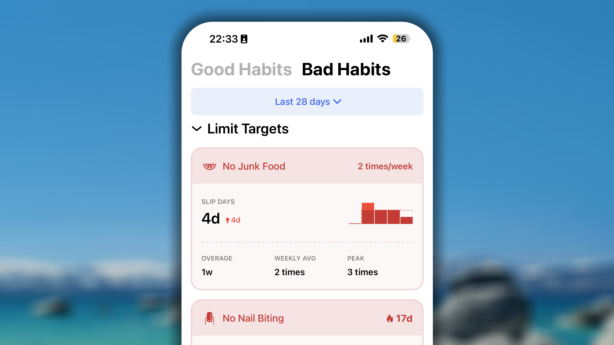

    制限目標を持つ習慣の小さなレポートカードには、次が含まれます。

    1. **ヘッダー：**習慣名と設定した上限。
    2. **スリップと制限グラフ：少なくとも1つの進捗ログがあり、「スリップ」した日数を強調します。横には、実際のログを赤い点線の上限線**と比較する縦棒グラフがあります。赤い線を超えた列がスリップです。
    3. **詳細内訳：**次の3指標で記録を要約します。
       - **超過：**許可した上限を_超えて_消費または行動した期間数。
       - **平均：**期間（日、週、月）ごとの実際の平均量。
       - **ピーク：**1期間に記録した最大量。

    完璧さを求めず、徐々に減らす現実を全体的に示します。どの程度超えたかと、低下している全体平均を一緒に見ることで、部分的な勝利にも意味があると分かります。時折赤い線を超えても、衝動へのコントロールを着実に取り戻している証拠です。

    #### **禁欲型習慣**

    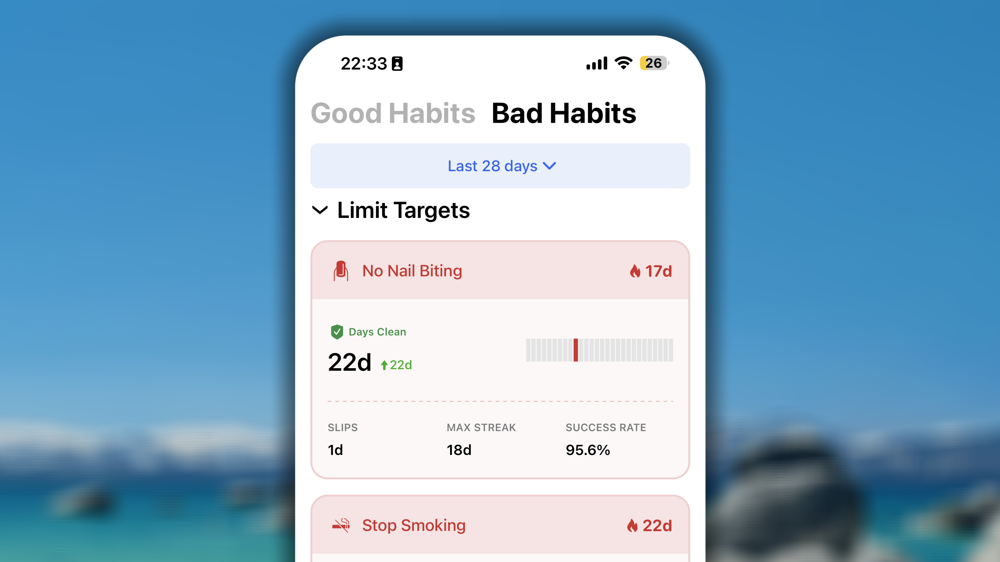

    節度ではなく完全にやめることが目標の場合、回復力を明確かつ率直に確認できます。

    1. **ヘッダー：**習慣名と、現在のクリーン日ストリークを示す炎のアイコン。
    2. **クリーンな日とチェーン：**期間内のクリーンな合計日数（進捗ログが0の日）と、視覚的な進捗チェーン。クリーンな日は空白のままで、スリップした日はチェーンを切る縦の赤線として目立ちます。
    3. **詳細内訳：**次の内容で努力を要約します。
       - **スリップ**：悪い習慣を行った日数。
       - **最大ストリーク**：クリーンな連続日数の過去最高。
       - **成功率：**選択期間の合計日数に対するクリーンな日の割合。

    まれなスリップを高い成功率や過去最高ストリークと直接比較することで、1日の失敗が数週間の努力を消すわけではないと常に思い出せます。全体像へ目を向け、すぐに立ち直って次のクリーンなチェーンを始めるための寛容さと意欲を与えます。

    ## 進捗についてHabiへ質問する

    進捗画面の右下にあるチャットアイコンをタップし、AI習慣アシスタントのHabiとの会話を開きます。

    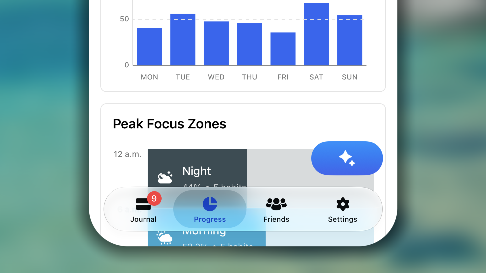

    成績について話し、実際の状況をHabiへ質問して分析を得たり、既存の習慣の改善や、現在のルーティンへ新しい習慣を入れる場所などの提案を受けたりできます。

    ## iPhone Duoの進捗

    iPhone Duoを折りたたむと、進捗は標準的なiPhoneと同じように表示されます。端末を開いて横向きにすると、追加の領域を利用できます。

    **_次の短い動画では、iPhone Duoでの進捗を確認できます。_**

    <iframe src="https://drive.google.com/file/d/1cI46cugx2xPzgrp7PnDYVCddtgw98OXP/preview" width="640" height="360" />

    すべてを長い1列に積み重ねる代わりに、広い画面を使って各行へより多くの内容を表示します。「パターン」などではグラフが横に並ぶため、週間リズム、集中力が最も高い時間帯、未達成の習慣を一緒に確認し、下へスクロールせず比較できます。

    エリアセクションも同様に、エリアカードが1列に並びます。習慣は2列のグリッド内のカードとして表示されるため、同時に2倍の習慣を確認し、スコアを横に比較できます。少ないスクロールで進捗の全体像を把握できます。
  </Tab>
  <Tab title="🤖 Android">
    ## 進捗：良い習慣

    <iframe src="https://drive.google.com/file/d/1QB0V4TFIw4V6YPEY-OfWhZBoesx_Flal/preview" width="640" height="360" />

    ### 日付範囲と習慣の管理

    データを確認する前に条件を設定します。絞り込みツールは画面右上にあります。

    このセクションでは、次の操作ができます。

    - 7、14、28、60日から最大6か月までの標準期間を選ぶか、開始日と終了日を完全にカスタマイズします。
    - 特定の習慣、指定したエリアの習慣、指定した時間帯の習慣へ絞り込みます。

    Habitifyでは柔軟に調整できます。1年間全体の成績を振り返る場合でも、特定の30日間フィットネスチャレンジへ焦点を合わせる場合でも、目的に合うようデータを調整できます。

    ### 日々の努力の概要

    これは進捗画面の入口であり、「本当に継続できているのか、それともそう感じるだけなのか」という問いに答えるために設計されています。

    **継続ヒートマップ**、**平均日次スコア**、**成績バー**の3つの主要指標を使い、実際の努力を全体的に確認できます。

    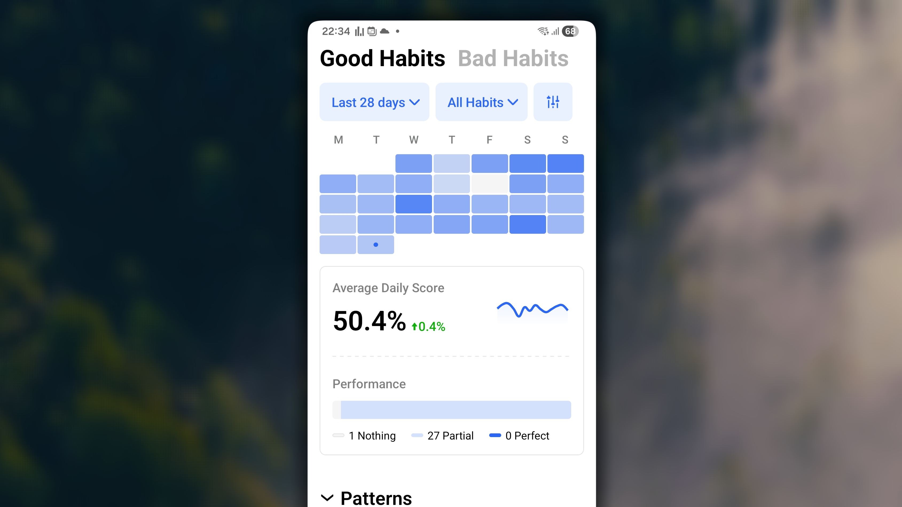

    #### **全体ヒートマップ**

    ダッシュボードの最上部にあり、時間の経過に伴う継続力を鮮やかな視覚表現で示します。

    グリッドの小さな四角は各日を表し、セル数は絞り込みで選択した日付範囲と一致します。各セルの色の濃さはその日の完了率を示します。完了率が高いほど、色は濃く、はっきりと表示されます。

    #### **日次スコアと推移指標**

    ヒートマップのすぐ下には、選択期間の全体的な有効性を評価する主要指標と、現在の勢いを過去と比較する推移指標があります。

    - \*\*平均日次スコア：**全体の日次完了率です。各日の完了率の合計を、絞り込み期間の日数で割って計算します。\_（例：今日の日次習慣が3つあり、そのうち1つを完了した場合、今日の完了率は**33.3%\*\*です。）\_
    - \*\*推移指標：\*\*現在のスコアと直前の同じ長さの期間を比較します。_（例：「過去7日間」を表示している場合、その7日間と、さらに前の7日間を比較します。）_

    #### **成績バー**

    各日を次の3つの明確な状態へ分けます。

    - **なし**：日次習慣を1つも完了しなかった日数。
    - **一部**：一部の習慣を完了したものの、全部は完了しなかった日数。
    - **完了**：日次習慣を100%完了した日数。

    完璧な日が少なくても、「一部」の努力をした日が多ければ、継続して取り組み、全体の成功へ貢献していることが分かります。自分に優しくするための良い指標です。

    ### パターン

    **パターン**セクションでは、最も生産的な時期と、行き詰まりやすい場所を把握できます。傾向を理解すると、自分の自然なエネルギーへ逆らうのではなく、それを活かせます。

    **週間リズム**、**集中力が最も高い時間帯**、**未達成の習慣**という3つの強力な分析に分かれています。

    #### **週間リズム**

    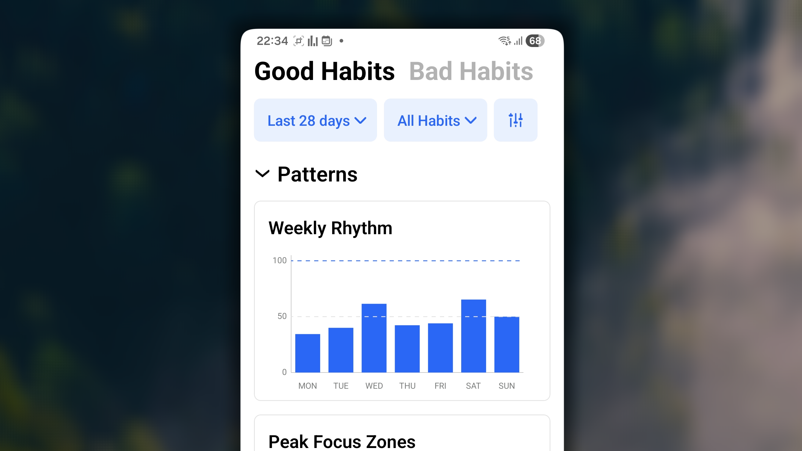

    月曜日から日曜日までの平均完了率を比較し、通常の1週間を示す小さなレポートとして機能します。特定の曜日のスコアは、選択期間内にある同じ曜日すべての平均です。

    _例：日付の絞り込みに火曜日が2回含まれ、最初の火曜日の完了率が50%、2回目が0%の場合、グラフに表示される火曜日全体の平均は25%です。_

    最も高いバーと低いバーを見ると、生産性が最も高い曜日と、勢いが落ちる曜日を特定できます。エネルギーの高い日に負荷の高い習慣を予定し、低い日には柔軟性を持たせるなど、賢く計画できます。

    #### **集中力が最も高い時間帯**

    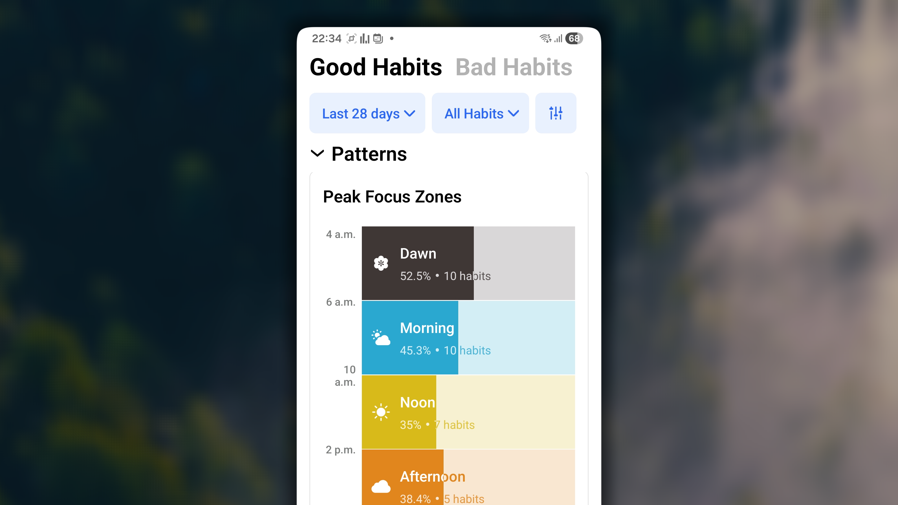

    カスタム時間帯（朝、昼、夜）に基づき、絞り込み期間内の各時間ブロックの完了率を平均します。

    _例：朝に3つの習慣を予定し、1日目に3つ中2つ、2日目に3つ中1つを完了した場合、朝全体の完了率は50%です。_

    自分だけの「ゴールデンタイム」が分かります。最も成功率が高い時間ブロックを把握し、難しく優先度の高い習慣をそこへ移し、成績の低い時間を休息や簡単なタスクへ使うことで、ルーティンを最適化できます。

    #### **未達成の習慣**

    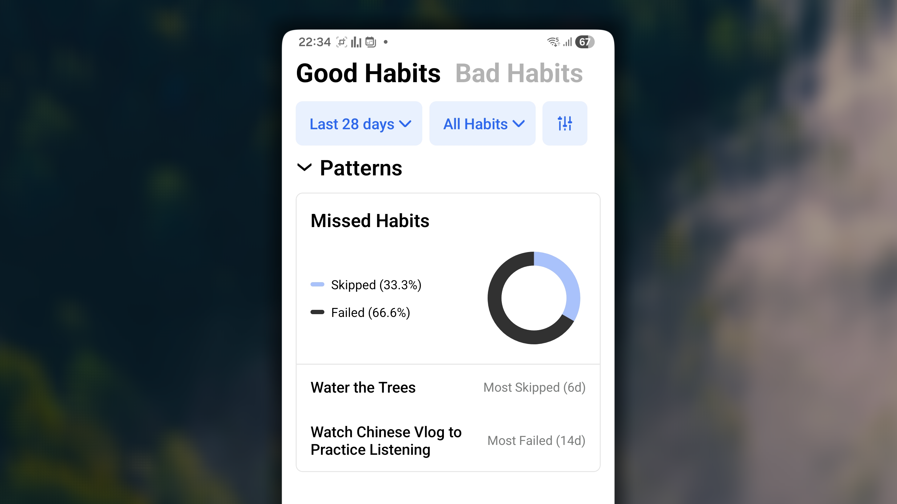

    ドーナツグラフで、絞り込み期間中に日次習慣を達成できなかった回数を合計し、スキップと失敗のチェックインの割合を計算します。

    _例：選択期間中に未達成のチェックインが合計10回あり、スキップ6回、失敗4回の場合、グラフにはスキップ60%、失敗40%と表示されます。_

    グラフの下には「最もスキップした」習慣と「最も失敗した」習慣が明示されます。未達成の日に罪悪感を持つ代わりに、改善へ使えるデータへ変換できます。

    - 特定の習慣が**最も失敗**になっている場合、現在は難しすぎる、または時間が合っていないなど、ルーティンを調整すべき明確な合図です。
    - **最もスキップ**した習慣については、その目標が現在の道のりに本当に関係しているかを見直すきっかけになります。

    ### エリア

    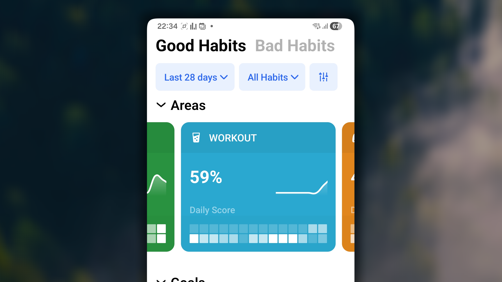

    良い習慣を身につけることは、1つのことだけではなく、健康、仕事、自己成長、人間関係などの組み合わせです。**エリア**セクションは、生活の各カテゴリーでバランスよく進んでいるかを示します。

    カスタムエリアごとに、横へスクロールできるカードのカルーセルが表示されます。各カードには、そのカテゴリーだけの短い「全体の努力」レポートがあります。

    - \*\*_平均日次スコア：_\*\*選択期間中、そのエリアに含まれる日次目標の習慣について、1日あたりの平均完了率。
    - \*\*_小さな推移線：_\*\*選択期間中、そのエリアに含まれる日次目標の習慣の全体成績を示す折れ線グラフ。
    - **_要約ヒートマップ_**：選択期間中、そのエリアに含まれる日次習慣の完了率を視覚化します。

    カードをスワイプすると、生活のある側面が順調な一方で、別の側面が疎かになっていないかをすぐに確認できます。

    ### 目標

    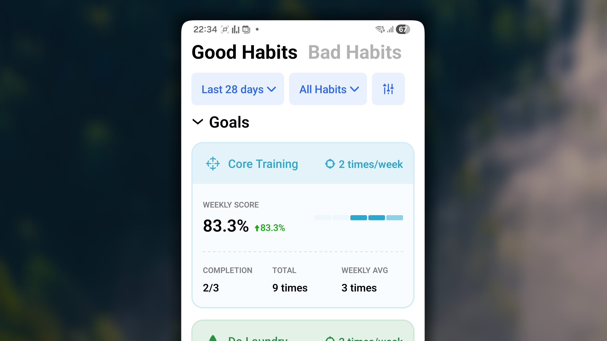

    「目標」セクションは、週次、月次、年次目標を持つ目標型習慣専用です。適切なペースで進んでいるかを確認する専用の小さなレポートを提供します。

    各目標型習慣には、次の情報を含む専用カードがあります。

    - **ヘッダー**：習慣名と具体的な目標。
    - **週次／月次／年次スコア**：現在の週、月、年の完了率。
    - **ヒートマップ**：標準の各週、月、年の努力を小さな進捗バーで視覚化。
    - **詳細内訳**：
      - **完了**：完了したサイクル数（例：15週中7週）。
      - **合計**：日付の絞り込みで選択した範囲内に記録した進捗値の合計。
      - **週次／月次／年次平均**：日付範囲に含まれる標準の週、月、年ごとに達成した平均値。

    大きな目標は困難に感じられますが、このレポートカードが分解します。日次平均は大きな月次目標を小さく管理可能な日次値へ変え、年初来の合計は継続した努力が大きな成果へ積み重なっていることを示します。

    ### 習慣

    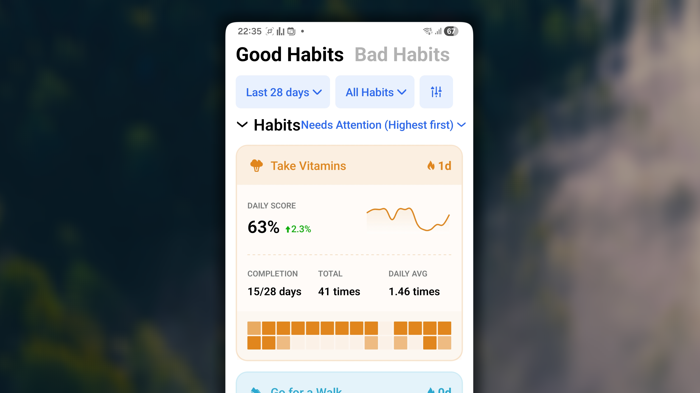

    「習慣」セクションは日次目標の習慣専用です。毎日完了したいルーティンごとに小さなレポートを提供し、個々の成績へ焦点を合わせられます。

    各日次習慣には専用のレポートカードがあります。

    1. **ヘッダー**：習慣名と、現在の有効なストリークを示す炎のアイコン。
    2. **スコアと推移**：この習慣の日次スコアと推移線。
    3. **詳細内訳**：完了比率（例：15日中7日）、達成した累積値の合計、日次平均値。
    4. **小さなヒートマップ**：この1つの習慣だけの日々の努力を分離して示す専用ヒートマップ。個別カードは、責任感を高める究極のツールです。

    現在のストリークを上部へ固定することで、勢いの心理的な力を活かします。小さなヒートマップのグリッドに空白が多ければ、明日さらに集中すべきルーティンがすぐに分かります。

    ## 進捗：悪い習慣

    <iframe src="https://drive.google.com/file/d/1cO_Ui_U6vwvkGOuNLM62rYZqJyyF6B8H/preview" width="640" height="360" />

    ### **日付範囲と習慣の管理**

    絞り込みツールは画面右上にあります。7、14、28日などの標準期間、またはカスタムの開始日と終了日を使って期間を調整できます。

    データを分離して確認できます。「禁酒の10月」や30日間のデジタルデトックスを行う場合、正確な日付条件を設定し、そのチャレンジだけに焦点を合わせたレポートを確認できます。

    ### **日々の努力の概要**

    「悪い習慣」タブを初めて開くと、選択期間の努力の概要が表示されます。「良い習慣」タブと似たレイアウトですが、ここでの目標は正反対です。

    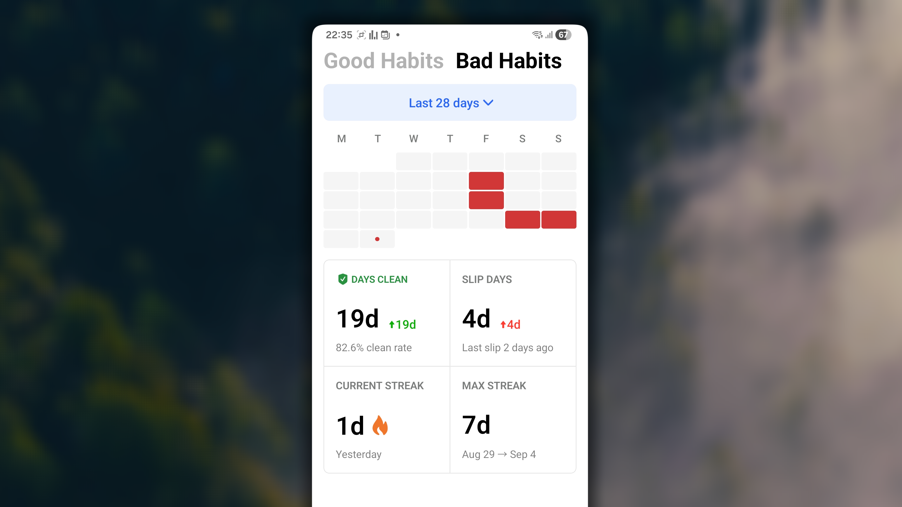

    #### **ブロックカレンダー**

    「良い習慣」画面のように濃い色で埋めるのではなく、ここではできるだけ空白を保つことが目標です。薄いグレーのブロックは、悪い習慣を行わなかった日を表します。

    悪い習慣を行った記録を追加すると、その日のブロックはすぐに赤く塗りつぶされます。

    現実を一目で確認できます。赤いブロックに罪悪感を持つ必要はありません。悪い習慣を行いやすい時期を把握するためのデータ点です。

    #### **主要指標**

    カレンダーのすぐ下では、継続状況を4つの意欲向上指標へ分けて表示します。

    1. **クリーンな日**：悪い習慣を完全に避けられた合計日数と、全体の「クリーン率」。
    2. **スリップした日**：合計記録値が上限以内の場合も含め、進捗ログがある合計日数。最後のスリップが何日前かも表示します。
    3. **現在のストリーク**：今日まで途切れず続くクリーンな日数。炎のアイコンで示します。
    4. **最大ストリーク**：連続したクリーン日数の過去最高記録。

    ### **パターン**

    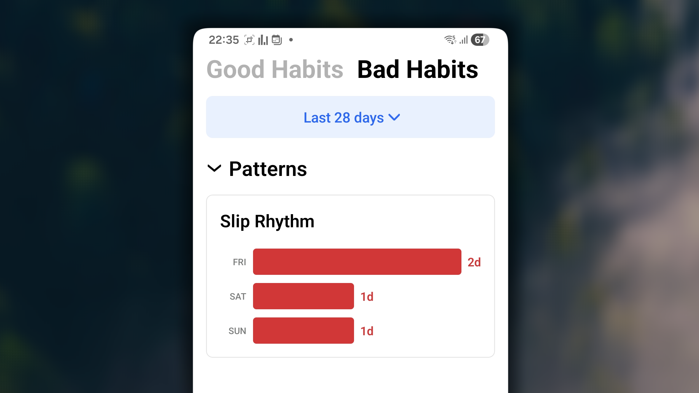

    良い習慣では生産性のピークを見つけますが、悪い習慣をやめるには_弱さ_のピークを特定します。**パターン**セクションの**スリップのリズム**は、古い罠へ戻る危険が最も高い時期を特定します。

    **スリップのリズム**は週間の弱さを示すレポートです。横長の赤いバーで曜日ごとのスリップを合計し、選択期間中の月曜日と日曜日などで、何回行ったかを正確に示します。

    スリップが最も多い時期を可視化し、失敗を改善へ使える情報へ変えます。意志の力だけに頼らず、事前に防御策を作れます。

    弱くなりやすい曜日が分かれば、環境を意図的に変えたり、必要な時期に責任感を高める予定を追加したりできます。

    ### **制限目標**

    前のセクションでは全体の努力を確認しましたが、ここでは各悪い習慣の個別レポートを提供します。

    Habitifyでは、悪いルーティンに対して、節度を守るか完全にやめるかという2種類の目標を設定できます。そのため、習慣に応じて少し異なる2種類のカードが表示されます。

    #### **制限型習慣**

    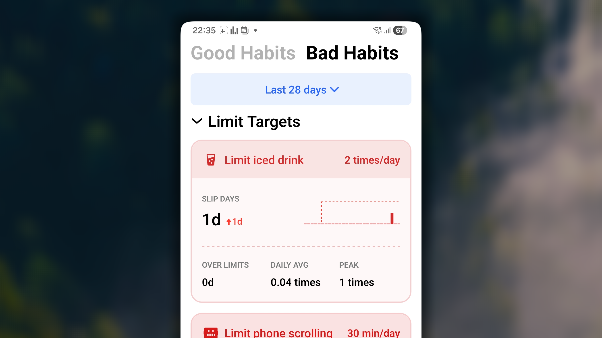

    制限目標を持つ習慣の小さなレポートカードには、次が含まれます。

    1. \*\*ヘッダー：\*\*習慣名と設定した上限。
    2. **スリップと制限グラフ：少なくとも1つの進捗ログがあり、「スリップ」した日数を強調します。横には、実際のログを赤い点線の上限線**と比較する縦棒グラフがあります。赤い線を超えた列がスリップです。
    3. \*\*詳細内訳：\*\*次の3指標で記録を要約します。
       - \*\*超過：\*\*許可した上限を_超えて_消費または行動した期間数。
       - \*\*平均：\*\*期間（日、週、月）ごとの実際の平均量。
       - \*\*ピーク：\*\*1期間に記録した最大量。

    完璧さを求めず、徐々に減らす現実を全体的に示します。どの程度超えたかと、低下している全体平均を一緒に見ることで、部分的な勝利にも意味があると分かります。時折赤い線を超えても、衝動へのコントロールを着実に取り戻している証拠です。

    #### **禁欲型習慣**

    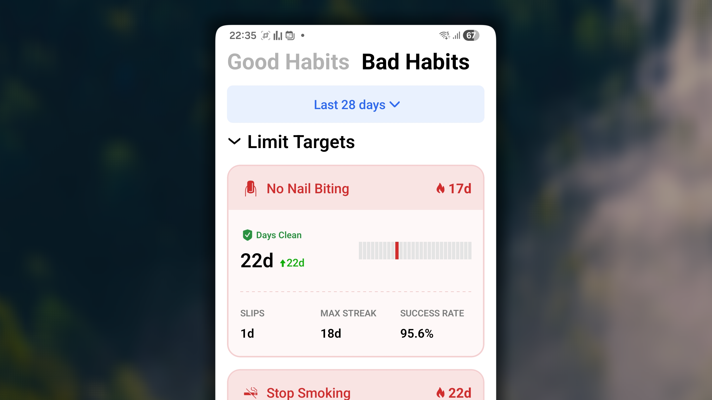

    節度ではなく完全にやめることが目標の場合、回復力を明確かつ率直に確認できます。

    1. \*\*ヘッダー：\*\*習慣名と、現在のクリーン日ストリークを示す炎のアイコン。
    2. \*\*クリーンな日とチェーン：\*\*期間内のクリーンな合計日数（進捗ログが0の日）と、視覚的な進捗チェーン。クリーンな日は空白のままで、スリップした日はチェーンを切る縦の赤線として目立ちます。
    3. \*\*詳細内訳：\*\*次の内容で努力を要約します。
       - **スリップ**：悪い習慣を行った日数。
       - **最大ストリーク**：クリーンな連続日数の過去最高。
       - \*\*成功率：\*\*選択期間の合計日数に対するクリーンな日の割合。

    まれなスリップを高い成功率や過去最高ストリークと直接比較することで、1日の失敗が数週間の努力を消すわけではないと常に思い出せます。全体像へ目を向け、すぐに立ち直って次のクリーンなチェーンを始めるための寛容さと意欲を与えます。

    ## 進捗についてHabiへ質問する

    進捗画面の右下にあるチャットアイコンをタップし、AI習慣アシスタントのHabiとの会話を開きます。

    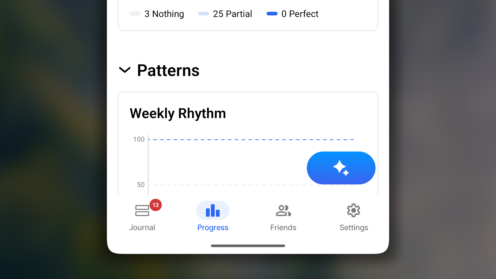

    成績について話し、実際の状況をHabiへ質問して分析を得たり、既存の習慣の改善や、現在のルーティンへ新しい習慣を入れる場所などの提案を受けたりできます。
  </Tab>
  <Tab title="🖥️ ウェブサイトとデスクトップ">
    ## 進捗：良い習慣

    <iframe src="https://drive.google.com/file/d/1LSv9tAF5ML1U-KgfUEdQ-3-YzCD1lmyV/preview" width="640" height="360" />

    ### **日付範囲と習慣の管理**

    データを確認する前に条件を設定します。絞り込みツールは画面右上にあります。

    このセクションでは、次の操作ができます。

    - 7、14、28、60日から最大6か月までの標準期間を選ぶか、開始日と終了日を完全にカスタマイズします。
    - 特定の習慣、指定したエリアの習慣、指定した時間帯の習慣へ絞り込みます。

    Habitifyでは柔軟に調整できます。1年間全体の成績を振り返る場合でも、特定の30日間フィットネスチャレンジへ焦点を合わせる場合でも、目的に合うようデータを調整できます。

    ### 全期間ヒートマップ

    ダッシュボード上部の大きな領域には、日々の努力をグリッドで可視化した大規模なヒートマップがあります。

    日付が縦方向、標準の各週が列となり、進捗を横方向に表示します。習慣の最も早い開始日から現在の週まで、道のり全体を示します。

    - 絞り込みで選択した期間は、実線の枠で囲まれます。
    - グリッドへポインターを合わせると、特定の月が破線の枠で囲まれます。
    - 各セルの色の濃さは、すべての日次習慣の完了率を示します。スコアが高いほど、色は濃く、はっきりと表示されます。

    これは「チェーンを途切れさせない」ための究極の意欲向上要素です。濃い色の週が密集したブロックは継続を一目で証明し、薄い部分は勢いが落ちた場所をすぐに示します。

    ### **平均日次スコアと成績**

    ヒートマップのすぐ下には、選択期間の全体的な継続状況の概要があります。

    - **平均日次スコア：**日次目標の習慣だけを数えた平均日次完了率です。選択期間中のスコアの変化を示す推移線もあります。
    - **成績：**各日を「なし」（進捗なし）、「一部」（進捗はあるが100%未満）、「完璧」（日次習慣をすべて達成）の3カテゴリーへ分ける割合バーです。

    平均日次スコアは現在の勢いをすばやく確認する脈拍のような役割を果たします。一方、成績バーは現実を健全に捉え、自分へ寛容になる材料を提供します。「完璧」な日が少なくても、「一部」の日が多ければ、取り組み続けて努力していることが分かります。

    ### **週間リズム**

    月曜日から日曜日までの平均完了率を比較し、通常の1週間を示す小さなレポートとして機能します。特定の曜日のスコアは、選択期間内にある同じ曜日すべての平均です。

    _例：日付の絞り込みに火曜日が2回含まれ、最初の火曜日の完了率が**50%**、2回目が**0%**の場合、グラフに表示される火曜日全体の平均は**25%**です。_

    最も高いバーと低いバーを見ると、生産性が最も高い曜日と、勢いが落ちる曜日を特定できます。エネルギーの高い日に負荷の高い習慣を予定し、低い日には柔軟性を持たせるなど、賢く計画できます。

    ### **未達成の習慣**

    習慣を「スキップ」と「失敗」にした回数を合計し、分かりやすい割合として示すシンプルなグラフで、ルーティンから漏れた内容を穏やかに確認できます。

    摩擦の原因を特定できます。

    - **失敗率が高い**場合、現在は難しすぎる習慣があり、規模を縮小する必要がある可能性を示します。
    - **スキップ率が高い**場合、目標に関係しなくなった習慣がある、または避けている理由を見直す必要がある可能性を示します。

    ### **集中力が最も高い時間帯**

    時間帯に基づいて生産性を分け、1日を通した活動量と生産性を分析します。

    自分だけの「ゴールデンタイム」が分かります。夜の完了率は低く、朝のスコアが高い場合は、負荷が高く最も重要な習慣を集中力が最も高い時間帯へ移し、成績の低い時間を休息や摩擦の少ない簡単なタスクへ使うことで、ルーティンを最適化できます。

    ### **テーブル**

    ダッシュボード下部には、「習慣」と「エリア」の2つのタブに分かれた、非常に詳細な進捗内訳があります。

    #### **全習慣テーブル**

    画面上部のグラフが全体の勢いを示すのに対し、**習慣テーブル**では習慣ごとの非常に細かなデータを確認できます。

    各列が示す内容は次のとおりです。

    - **名前：**記録している前向きなルーティンの名前。
    - **日次スコア：**この習慣の平均完了率と、勢いを可視化する小さな推移線（スパークライン）。_（この指標は日次目標の習慣だけで計算・表示されます。）_
    - **合計：**選択期間中にこの習慣へ記録したすべての進捗値の累積合計。
    - **平均：**「合計」を選択期間内の期間数で割った値。期間ごとの実際の基準努力を数学的に示します。
    - **完了：**成功率を具体的な数値で表示します。絞り込み期間の全期間のうち、目標を100%達成した期間数です（例：「21日中14日」、「4週中3週」）。
    - **小さなヒートマップ：**最後の列にある、この習慣専用の要約ヒートマップ。各期間の努力を分離して可視化し、ルーティンの具体的な空白をすぐに見つけられます。

    _（**「期間」**は習慣に設定した目標で決まります。日次目標なら1日、週次目標なら1週間です。）_

    列を横に比較すると、順調な習慣と、明日さらに集中すべき習慣が簡単に分かります。

    #### **全エリアテーブル**

    「習慣」テーブルが個別ルーティンを細かく示すのに対し、「エリア」テーブルは視点を広げ、生活の各カテゴリーのバランスを全体的に示します。

    エリアテーブルの各列が示す内容は次のとおりです。

    - **名前：**カスタムエリアの名前（例：健康、キャリア、自己成長）。
    - **日次スコア：**選択期間中、そのエリア内の全習慣を合わせた平均完了率と、小さな推移線。_（現在、このスコアと推移線へ反映されるのは日次目標の習慣だけです。）_
    - **小さなヒートマップ：**エリア全体の取り組みを合わせて示す要約ヒートマップ。_（現在、この視覚グリッドへ反映されるのは日次目標の習慣の完了だけです。）_

    各カテゴリーを横に比較し、不均衡をすぐに見つけ、時間とエネルギーを意図的に再配分するための全体的な明確さを得られます。

    ## 進捗：悪い習慣

    <iframe src="https://drive.google.com/file/d/1Djxe476TEsuRaRTqF7l2j1BTRxujkCoW/preview" width="640" height="360" />

    ### **日付範囲と習慣の管理**

    絞り込みツールは画面右上にあります。7、14、28日などの標準期間、またはカスタムの開始日と終了日を使って期間を調整できます。

    データを分離して確認できます。「禁酒の10月」や30日間のデジタルデトックスを行う場合、正確な日付条件を設定し、そのチャレンジだけに焦点を合わせたレポートを確認できます。

    ### **全期間ヒートマップ**

    ダッシュボード上部の大きな領域には、努力をグリッドで可視化した広範なヒートマップがあります。

    日付が縦方向、週が列となり、進捗を表示します。ただし「良い習慣」タブとは異なり、このグリッドで使う色は赤だけです。設定した上限を超えたかどうかに関係なく、その日に悪い習慣の進捗を1つでも記録すると、セルが赤くなります。

    逆転した心理を利用します。ここでの目標は、カレンダーをできるだけ空白とグレーに保つことです。赤いブロックは現実をすぐに可視化し、ストレスの多い平日や予定のない週末など、スリップが特定の時期に集中しているかを把握できます。

    ### **クリーンな日**

    記録中のすべての悪い習慣について、進捗値が完全に0だった合計日数を示します。メインの数値の下には、選択期間全体に対するクリーンな日の割合である「クリーン率」が表示されます。

    士気を守るための指標です。1日の失敗について自分を責めるのは簡単ですが、クリーン率95%を見れば、客観的には全体で勝ち、行動を変えることに成功していると分かります。

    ### **スリップした日**

    過度に厳しくならず、正直さと責任感を保つための指標です。

    少なくとも1つの悪い習慣で失敗した合計日数を示します。最後のスリップが何日前かという情報と、過去7日間の活動を示す小さな縦棒グラフもあります。

    失敗を改善へ使えるデータに変える証拠となります。7日間の小さなグラフから、最近のスリップが単発だったのか、数日間の再発へ変わりつつあるのかがすぐに分かり、直ちに軌道修正できます。

    ### **現在と最大のストリーク**

    この2つの指標は、勢いの心理的な力を活かします。

    - **現在のストリーク**（炎のアイコン）は、今日まで途切れず続くクリーンな日数を示します。
    - **最大ストリーク**は、連続したクリーン日数の過去最高記録を示します。

    衝動が起きたとき、確かな現在のストリークを見ると、途切れさせる前に考え直せます。最大ストリークは、立ち直って次のクリーンなチェーンを始める際に、更新を目指せる具体的なハイスコアとなります。

    ### **習慣テーブル**

    ダッシュボード下部には、各悪い習慣の進捗を非常に細かく示す内訳があります。

    包括的なテーブルには次の列があります。

    - **名前：**記録している悪い習慣の名前。
    - **成功率：**自分を抑えられた期間の割合。「やめる」習慣では何もせず、「制限」習慣では許可した上限以内に留まった期間です。
    - **スリップ：**選択期間内の全期間に対して、上限を超えた期間の比率。
    - **上限超過：**実際に失敗した期間数。「やめる」習慣を行った、または「制限」習慣の最大上限を超えた期間です。
    - **平均：**期間ごとの平均記録値。その下には「ピーク」（1期間に記録した最大量）も表示されます。
    - **目標：**自分で設定した境界または目標（例：「1日30 mg未満」、「やめる」）。
    - **視覚グラフ：**最後の列に努力の概要を視覚的に表示します。
      - 「制限」習慣では、実際のログを**赤い破線の上限線**と比較する縦棒グラフ。
      - 「やめる」習慣では、失敗日を赤く強調した簡潔な進捗チェーン。

    _（**「期間」**は習慣に設定した目標で決まります。日次目標なら1日、週次目標なら1週間です。）_
  </Tab>
</Tabs>
