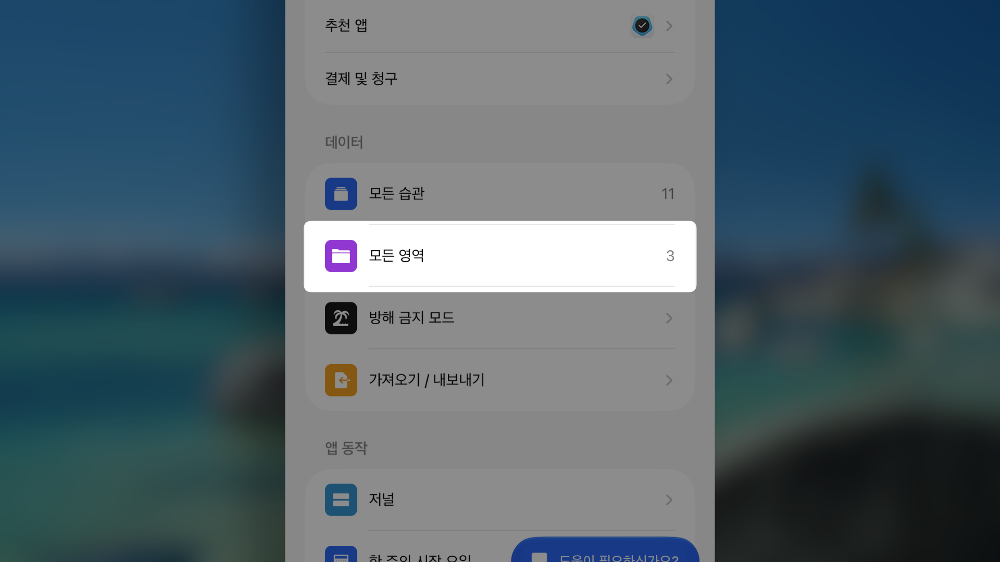
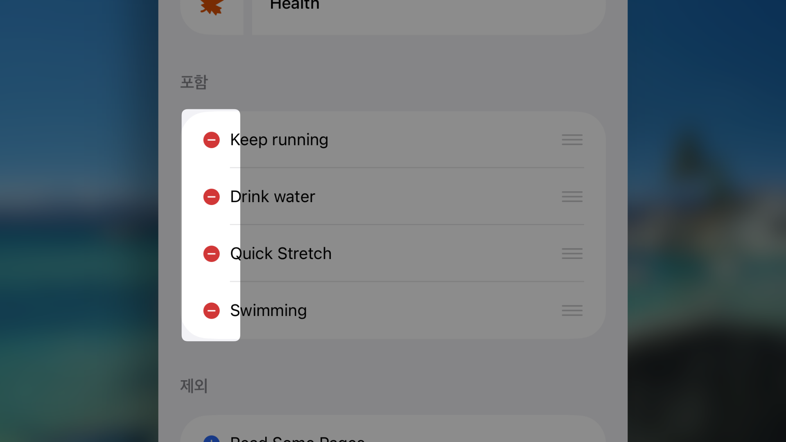
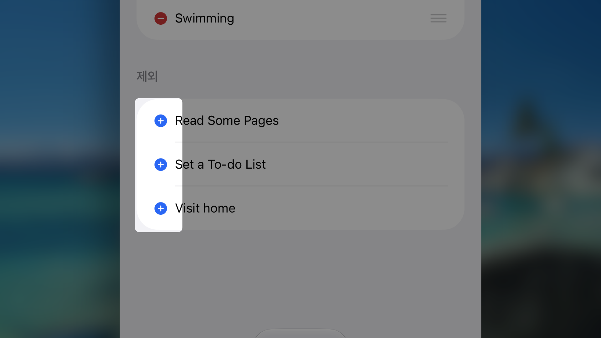
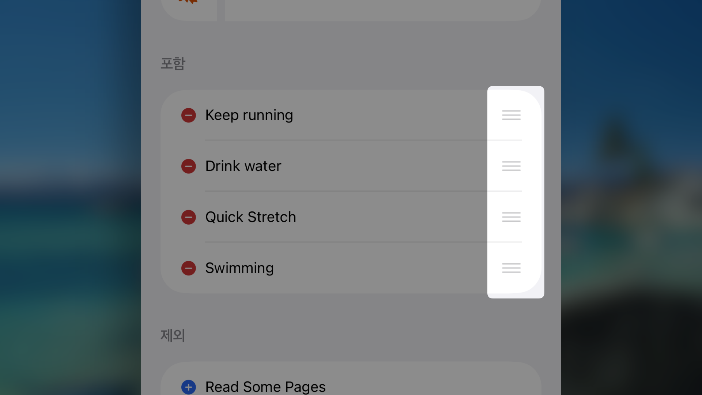
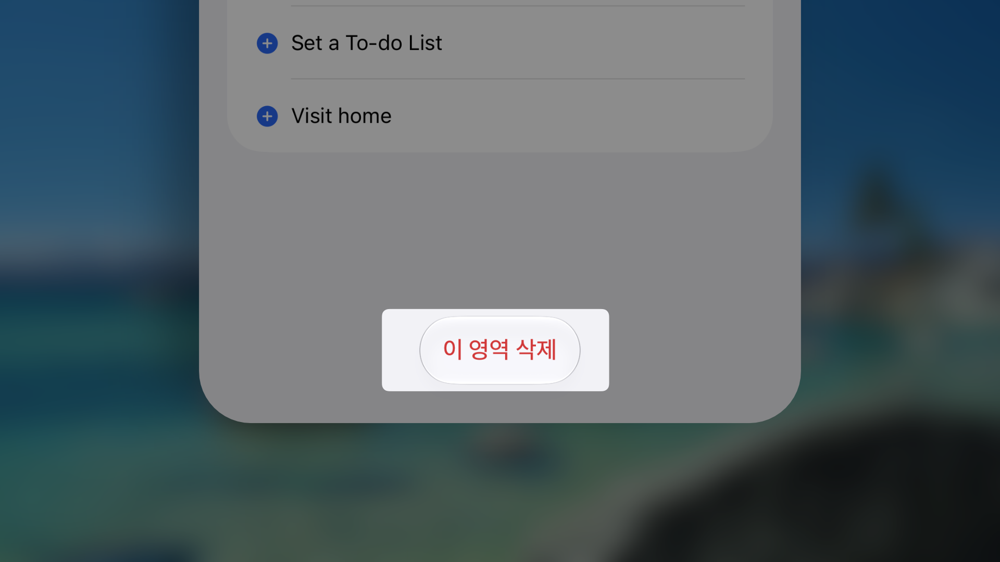
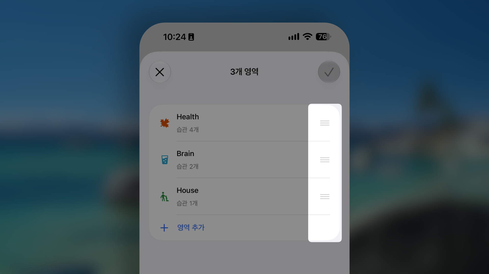
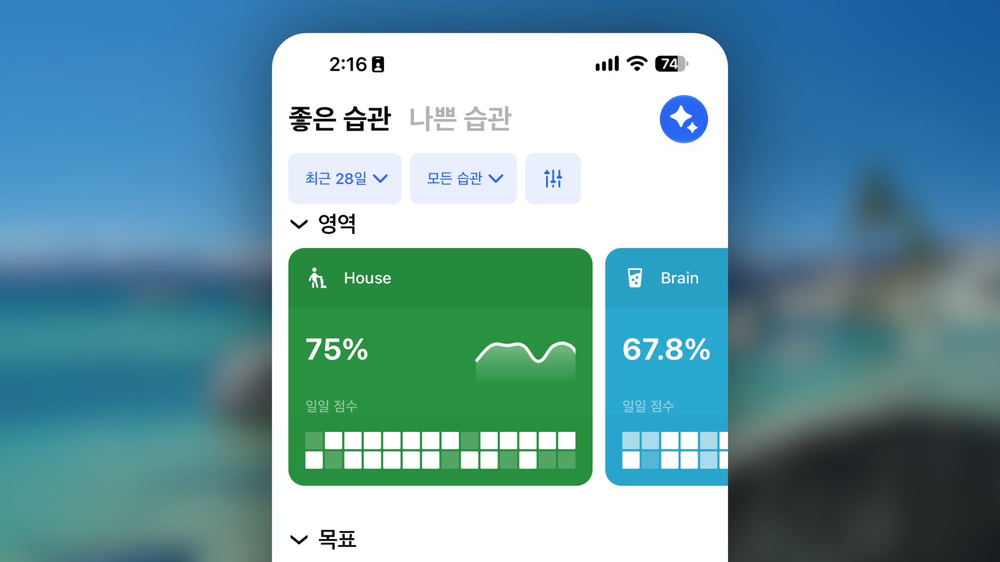
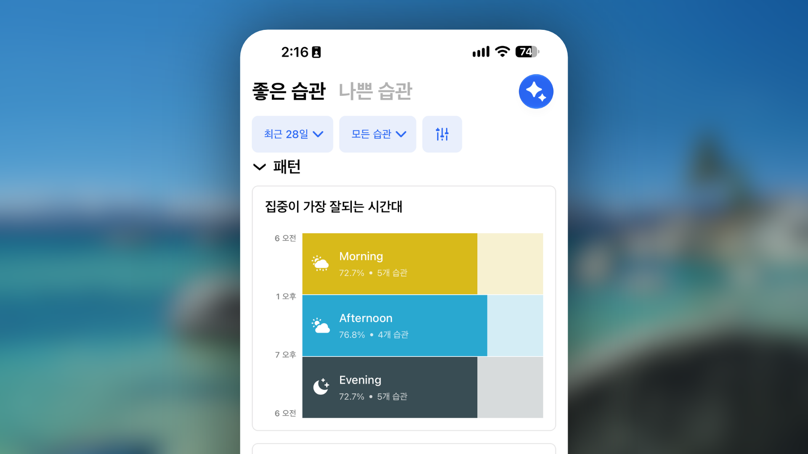
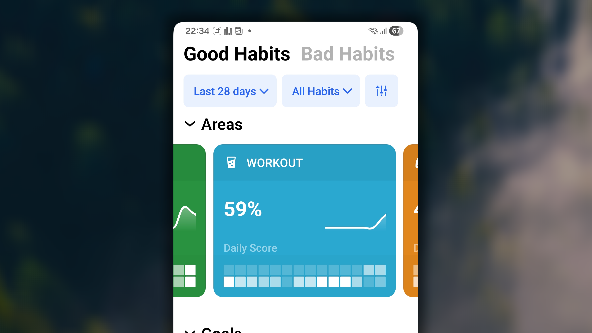
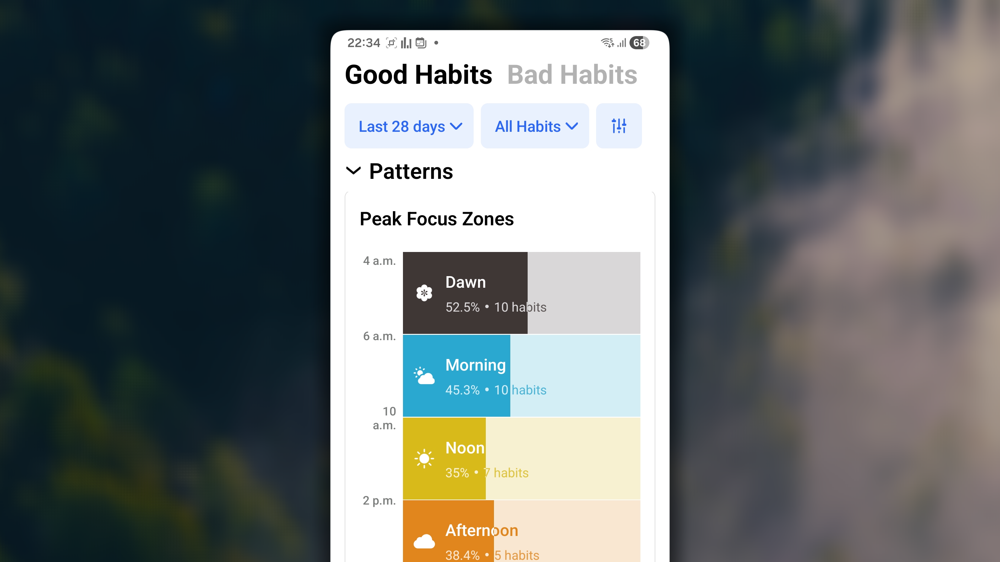

영역은 습관을 묶는 그룹 또는 폴더입니다. 모든 습관을 구분 없이 하나의 목록으로 다루는 대신, 삶의 여러 부분에 맞춰 기록을 정리할 수 있습니다. 운동, 수분 섭취, 수면 습관은 "건강" 아래에, 집중 업무와 이메일 습관은 "업무" 아래에, 일기 쓰기와 명상은 "마음 챙김" 아래에 묶는 식으로 실제 삶의 구분에 맞게 구성해 보세요.

영역은 우선순위를 정하는 데 도움을 줍니다. 모든 항목을 한꺼번에 아우르는 하나의 일일 점수만 보는 대신, 특정 카테고리를 자세히 살펴보고 그 부분이 정확히 어떻게 진행되고 있는지 확인할 수 있습니다.

<Tabs>
  <Tab title=" iOS">
    ## 새 영역 만들기

    <iframe src="https://drive.google.com/file/d/1tvk66uyWt5d6rRJoQHpPx_TnZR7C53Kb/preview" width="640" height="360" />

    1. **저널**에서 영역 표시줄을 맨 끝까지 왼쪽으로 밀고 + 를 탭합니다.
    2. **새 영역**을 선택합니다.
    3. **새 영역** 화면에서
       1. 아이콘을 탭하고 새 영역에 사용할 아이콘과 색상을 선택한 다음 ✓를 탭해 선택 사항을 저장합니다.
       2. 이름 필드를 탭하고 영역 이름을 입력합니다.
    5. **제외** 목록에서 습관 이름 앞의 ⊕를 탭해 영역에 추가합니다.
    6. 모든 설정을 마쳤으면 ✓를 탭해 새 영역을 저장합니다.

    ## 사용자 지정 영역 관리하기

    사용자 지정 영역의 이름과 아이콘을 자유롭게 편집하고, 영역에 포함된 습관을 관리하며, 영역을 삭제할 수 있습니다.

    ### 영역 편집하기

    1. Habitify 앱에서 **설정**으로 이동합니다.
    2. **모든 영역** 섹션을 찾아 탭해 엽니다.
       
    3. 영역 목록에서 변경하려는 영역을 탭합니다.
    4. 영역 세부 정보 화면에서 다음 작업을 할 수 있습니다.
       1. **아이콘**을 탭해 아이콘과 색상을 변경합니다. 오른쪽 상단의 ✓ 버튼을 탭해 선택 사항을 저장합니다.
       2. **이름 필드**를 탭해 영역 이름을 변경합니다.
          
       3. **포함** 목록에서 습관 이름 앞의 ⊖를 탭해 영역에서 습관을 제거합니다.
          
       4. **제외** 목록에서 습관 이름 앞의 ⊕를 탭해 영역에 습관을 추가합니다.
          
    5. 오른쪽 상단의 **✓ 버튼**을 탭해 모든 변경 사항을 저장합니다.

    ### 영역의 습관 순서 편집하기

    1. Habitify 앱에서 **설정**으로 이동합니다.
    2. **모든 영역** 섹션을 찾아 탭해 엽니다.
    3. 영역 목록에서 습관 순서를 변경하려는 영역을 탭합니다.
    4. **포함** 목록에서 습관 오른쪽에 있는 ☰ 버튼을 길게 누른 다음 위아래로 드래그해 목록 순서를 변경합니다.
       
    5. 모든 설정을 마쳤으면 ✓ 버튼을 탭해 변경 사항을 저장합니다.

    ### 영역 삭제하기

    1. Habitify에서 **설정**으로 이동합니다.
    2. **모든 영역** 섹션을 찾아 탭해 엽니다.
    3. 영역 목록에서 삭제하려는 영역을 탭합니다.
    4. '**이 영역 삭제**' 버튼을 탭합니다.
       
    5. 확인 단계에서 '**삭제**'를 탭합니다.

    ## 영역 순서 관리하기

    저널의 영역 표시줄에서 사용자 지정 영역의 순서를 정리할 수 있습니다. 방법은 다음과 같습니다.

    1. Habitify 앱에서 **설정**으로 이동합니다.
    2. **모든 영역** 섹션을 찾아 탭해 엽니다.
    3. 영역 오른쪽에 있는 ☰ 버튼을 길게 누르고 위아래로 드래그해 영역 순서를 변경합니다.
       
    4. ✓ 버튼을 탭해 변경 사항을 저장합니다.

    <Info>
      iOS 및 Android 앱에서 변경한 영역 순서는 저장하는 즉시 웹사이트 및 데스크톱 앱에 동기화됩니다.
    </Info>

    ## 영역 진행 상황

    진행 상황 화면에서 각 영역이 어떻게 진행되고 있는지 확인할 수 있어요. 아래 섹션은 **좋은 습관** 탭에 있어요. 진행 상황 화면에서 선택한 기간을 기준으로 표시돼요.

    ### 사용자 지정 영역의 진행 상황

    진행 상황 화면에서 **영역** 섹션까지 스크롤하세요. 사용자 지정 영역마다 진행 상황 카드가 하나씩 있어요. 옆으로 이동하며 각 카드를 확인하세요.

    

    각 카드는 해당 영역만 보여 주는 짧은 리포트예요. 다음 내용이 표시돼요.

    - **일일 점수 평균**
    - **미니 추세선**
    - **간략한 히트맵**

    카드를 비교해 보면 삶의 한 부분은 잘되고 있는데 다른 부분은 신경 써야 하는지 알 수 있어요.

    ### 하루 시간대 영역의 달성률

    하루 시간대 영역(아침, 오후, 저녁)은 **영역** 섹션에 카드가 없어요. 달성률을 보려면 **패턴** 섹션의 **집중이 가장 잘되는 시간대**을 사용하세요.

    

    선택한 기간 동안 하루 시간대별 평균 달성률이 표시돼요. 예를 들어 아침에 습관이 3개 있고, 하루는 2개를 완료하고 다음 날은 1개를 완료하면 아침 달성률은 50%예요.

    ### 한 영역의 전체 리포트 보기

    한 영역에 대한 진행 상황 화면을 보려면 습관 필터를 사용하세요.

    1. 진행 상황 화면에서 습관 필터를 여세요.
    2. 보고 싶은 사용자 지정 영역 또는 하루 시간대 영역을 선택하세요.

    그러면 리포트에 해당 영역의 습관만 포함돼요.
  </Tab>
  <Tab title="🤖 Android">
    ## 새 영역 만들기

    <iframe src="https://drive.google.com/file/d/1F_7f_gieW9pIv8yLPskQdST6gSE2ofCn/preview" width="640" height="360" />

    1. 일지에서 영역 표시줄을 맨 왼쪽 끝까지 밉니다.
    2. \+ 버튼을 탭한 다음 **새로운 공간**을 선택합니다.
    3. 아이콘을 탭한 다음 새 영역에 사용할 아이콘과 색상을 선택합니다. 오른쪽 상단의 **완료**를 탭해 선택 사항을 저장합니다.
    4. 이름 필드를 탭하고 새 영역의 이름을 입력합니다.
    5. **제외** 목록에서 습관 오른쪽의 더하기 버튼을 탭해 새 영역에 추가합니다.
    6. 모든 설정을 마쳤으면 오른쪽 상단의 **저장** 버튼을 탭해 새 영역을 저장합니다.

    ## 사용자 지정 영역 관리하기

    사용자 지정 영역의 이름과 아이콘을 자유롭게 편집하고, 영역에 포함된 습관을 관리하며, 영역을 삭제할 수 있습니다.

    ### 영역 편집하기

    1. Habitify 앱에서 **설정**으로 이동합니다.
    2. **영역 관리** 섹션을 찾아 탭해 엽니다.
    3. 영역 목록에서 변경하려는 영역을 탭합니다.
    4. 영역 세부 정보 화면에서 다음 작업을 할 수 있습니다.
       1. 아이콘을 탭해 아이콘과 색상을 변경합니다.
오른쪽 상단의 '완료'를 탭해 선택 사항을 저장합니다.
       2. 이름 필드를 탭해 영역 이름을 변경합니다.
       3. **포함** 목록에서 습관 오른쪽의 ⛌ 버튼을 탭해 영역에서 습관을 제거합니다.
       4. **제외** 목록에서 습관 오른쪽의 ╋ 버튼을 탭해 영역에 습관을 추가합니다.
    5. 오른쪽 상단의 **저장** 버튼을 탭해 모든 변경 사항을 저장합니다.

    ### 영역의 습관 순서 편집하기

    1. Habitify 앱에서 **설정**으로 이동합니다.
    2. **영역 관리** 섹션을 찾아 탭해 엽니다.
    3. 영역 목록에서 습관 순서를 변경하려는 영역을 탭합니다.
    4. 포함 목록에서 습관 왼쪽에 있는 = 버튼을 길게 누른 다음 위아래로 드래그해 목록 순서를 변경합니다.
    5. 모든 설정을 마쳤으면 **저장** 버튼을 탭해 변경 사항을 저장합니다.

    ### 영역 삭제하기

    1. Habitify에서 **설정**으로 이동합니다.
    2. **영역 관리** 섹션을 찾아 탭해 엽니다.
    3. 영역 목록에서 삭제하려는 영역을 탭합니다.
    4. 맨 아래까지 내려간 다음 '**이 영역 삭제**'를 탭합니다.
    5. 확인 단계에서 **삭제**를 탭합니다.

    ## 영역 순서 관리하기

    일지의 영역 표시줄에서 사용자 지정 영역의 순서를 정리할 수 있습니다. 방법은 다음과 같습니다.

    1. Habitify 앱에서 **설정**으로 이동합니다.
    2. **영역 관리** 섹션을 찾아 탭해 엽니다.
    3. 영역 오른쪽에 있는 **=** 버튼을 길게 누르고 위아래로 드래그해 영역 순서를 변경합니다.
    4. **저장** 버튼을 탭해 변경 사항을 저장합니다.

    <Info>
      iOS 및 Android 앱에서 변경한 영역 순서는 저장하는 즉시 웹사이트 및 데스크톱 앱에 동기화됩니다.
    </Info>

    ## 영역 진행 상황

    진행 상황 화면에서 각 영역이 어떻게 진행되고 있는지 확인할 수 있어요. 아래 섹션은 **좋은 습관** 탭에 있어요. 진행 상황 화면에서 선택한 기간을 기준으로 표시돼요.

    ### 사용자 지정 영역의 진행 상황

    진행 상황 화면에서 **영역** 섹션까지 스크롤하세요. 사용자 지정 영역마다 진행 상황 카드가 하나씩 있어요. 옆으로 이동하며 각 카드를 확인하세요.

    

    각 카드는 해당 영역만 보여 주는 짧은 리포트예요. 다음 내용이 표시돼요.

    - **일일 점수 평균**
    - **미니 추세선**
    - **간략한 히트맵**

    카드를 비교해 보면 삶의 한 부분은 잘되고 있는데 다른 부분은 신경 써야 하는지 알 수 있어요.

    ### 하루 시간대 영역의 달성률

    하루 시간대 영역(아침, 오후, 저녁)은 **영역** 섹션에 카드가 없어요. 달성률을 보려면 **패턴** 섹션의 **집중이 가장 잘되는 시간대**을 사용하세요.

    

    선택한 기간 동안 하루 시간대별 평균 달성률이 표시돼요. 예를 들어 아침에 습관이 3개 있고, 하루는 2개를 완료하고 다음 날은 1개를 완료하면 아침 달성률은 50%예요.

    ### 한 영역의 전체 리포트 보기

    한 영역에 대한 진행 상황 화면을 보려면 습관 필터를 사용하세요.

    1. 진행 상황 화면에서 습관 필터를 여세요.
    2. 보고 싶은 사용자 지정 영역 또는 하루 시간대 영역을 선택하세요.

    그러면 리포트에 해당 영역의 습관만 포함돼요.
  </Tab>
  <Tab title="🖥️ 웹사이트 및 데스크톱">
    ## 새 영역 만들기

    <iframe src="https://drive.google.com/file/d/1-jFIqXsmgOC3dAhdALhaUJw_JrwXUl34/preview" width="640" height="360" />

    1. 앱 왼쪽 사이드바에서 영역 섹션으로 이동합니다.
    2. **\+ 새 영역**을 클릭합니다.
    3. 새 영역의 이름을 입력하고 Enter 키를 눌러 항목을 저장합니다.
    4. 아이콘을 클릭한 다음 새 아이콘과 새 영역에 사용할 색상을 선택합니다.
    5. 바깥쪽을 클릭해 변경 사항을 저장합니다.

    ## 사용자 지정 영역 관리하기

    사용자 지정 영역의 이름과 아이콘을 자유롭게 편집하고, 영역에 포함된 습관을 관리하며, 영역을 삭제할 수 있습니다.

    ### 영역의 아이콘, 색상 및 이름 편집하기

    영역의 아이콘과 색상을 편집하려면 다음 단계를 따릅니다.

    1. 왼쪽 사이드바에서 **영역** 섹션으로 이동합니다.
    2. 영역 아이콘을 클릭합니다.
    3. 새 아이콘과 색상을 선택합니다.
    4. 바깥쪽을 클릭해 변경 사항을 확정합니다.

    영역 이름을 편집하려면 다음 단계를 따릅니다.

    1. 왼쪽 사이드바에서 **영역** 섹션으로 이동합니다.
    2. 편집하려는 영역을 클릭해 선택합니다.
    3. 다시 클릭해 편집을 활성화합니다.
    4. 새 이름을 입력합니다.
    5. Enter 키를 눌러 변경 사항을 저장합니다.

    ### 영역의 습관 관리하기

    영역에 습관을 추가하려면 다음 단계를 따릅니다.

    1. 왼쪽 사이드바에서 **환경설정 \> 습관**으로 이동합니다.
    2. **활성** 목록으로 이동합니다.
    3. 습관을 찾아 대상 영역으로 드래그합니다.

    영역에서 습관을 제거하려면 다음 단계를 따릅니다.

    1. 왼쪽 사이드바에서 **환경설정 \> 습관**으로 이동합니다.
    2. **영역**으로 이동해 습관이 현재 포함된 영역을 클릭합니다.
    3. 습관을 마우스 오른쪽 버튼으로 클릭하고 **편집**을 선택합니다.
    4. 습관 세부 정보에서 **영역 필드**로 이동하고 클릭해 영역을 제거합니다.
    5. **저장**을 클릭합니다.

    ### 영역 삭제하기

    영역을 삭제하려면 다음 단계를 따릅니다.

    1. 왼쪽 사이드바에서 **영역** 섹션으로 이동합니다.
    2. 삭제하려는 습관을 마우스 오른쪽 버튼으로 클릭한 다음 **삭제**를 선택합니다.

    ## 영역 진행 상황

    진행 상황 화면에서 각 영역이 어떻게 진행되고 있는지 확인할 수 있어요. 아래 섹션은 **좋은 습관** 탭에 있어요. 진행 상황 화면에서 선택한 기간을 기준으로 표시돼요.

    ### 사용자 지정 영역의 진행 상황

    진행 상황 화면에서 **영역** 섹션까지 스크롤하세요. 사용자 지정 영역마다 진행 상황 카드가 하나씩 있어요. 옆으로 이동하며 각 카드를 확인하세요.

    각 카드는 해당 영역만 보여 주는 짧은 리포트예요. 다음 내용이 표시돼요.

    - **일일 점수 평균**
    - **미니 추세선**
    - **간략한 히트맵**

    카드를 비교해 보면 삶의 한 부분은 잘되고 있는데 다른 부분은 신경 써야 하는지 알 수 있어요.

    ### 하루 시간대 영역의 달성률

    하루 시간대 영역(아침, 오후, 저녁)은 **영역** 섹션에 카드가 없어요. 달성률을 보려면 **패턴** 섹션의 **집중이 가장 잘되는 시간대**을 사용하세요.

    선택한 기간 동안 하루 시간대별 평균 달성률이 표시돼요. 예를 들어 아침에 습관이 3개 있고, 하루는 2개를 완료하고 다음 날은 1개를 완료하면 아침 달성률은 50%예요.

    ### 한 영역의 전체 리포트 보기

    한 영역에 대한 진행 상황 화면을 보려면 습관 필터를 사용하세요.

    1. 진행 상황 화면에서 습관 필터를 여세요.
    2. 보고 싶은 사용자 지정 영역 또는 하루 시간대 영역을 선택하세요.

    그러면 리포트에 해당 영역의 습관만 포함돼요.
  </Tab>
</Tabs>
