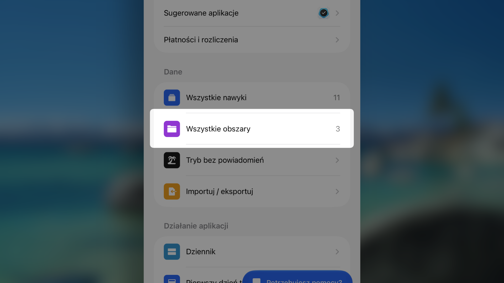
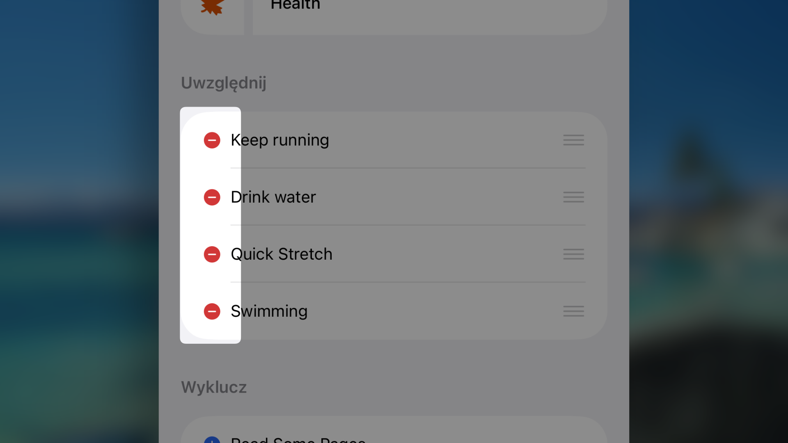
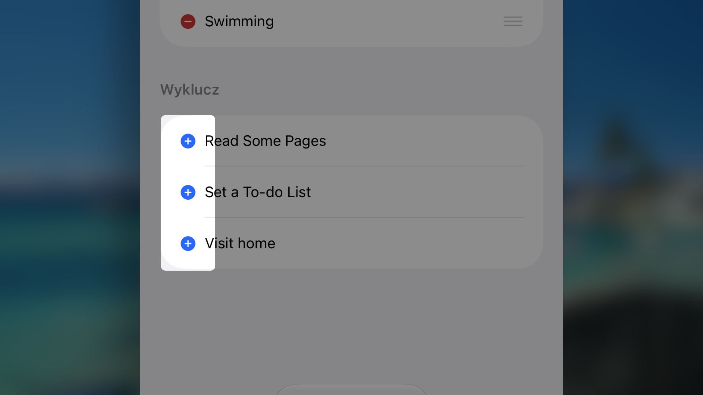
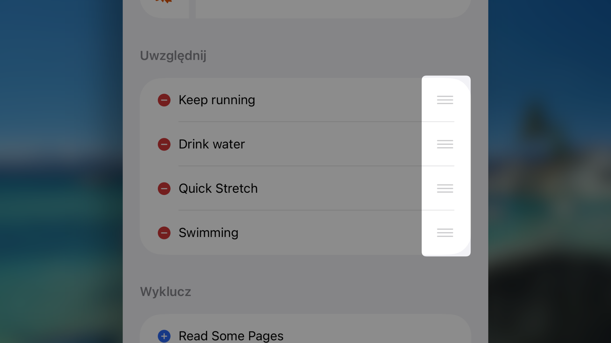
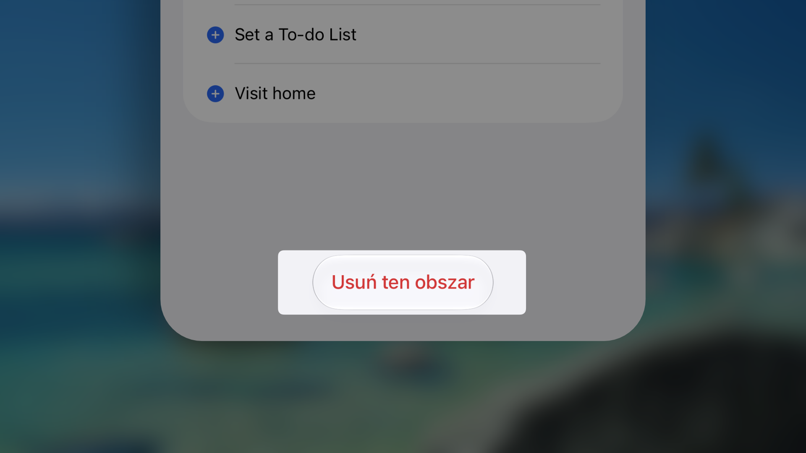
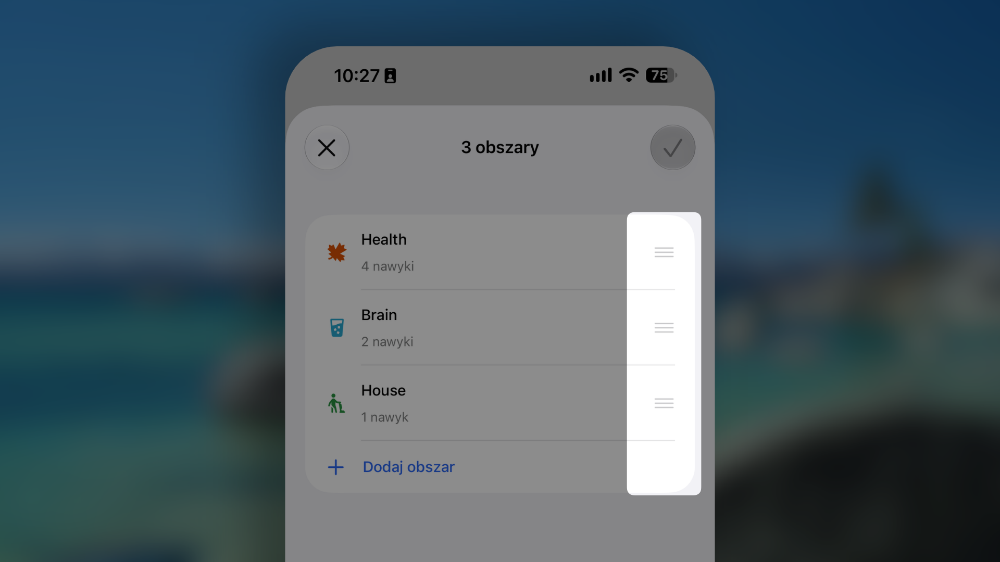
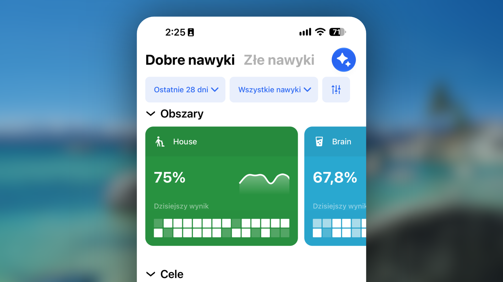
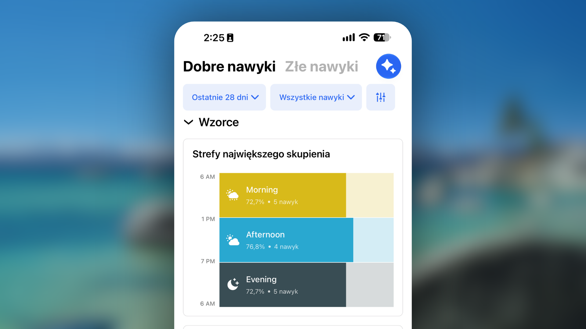
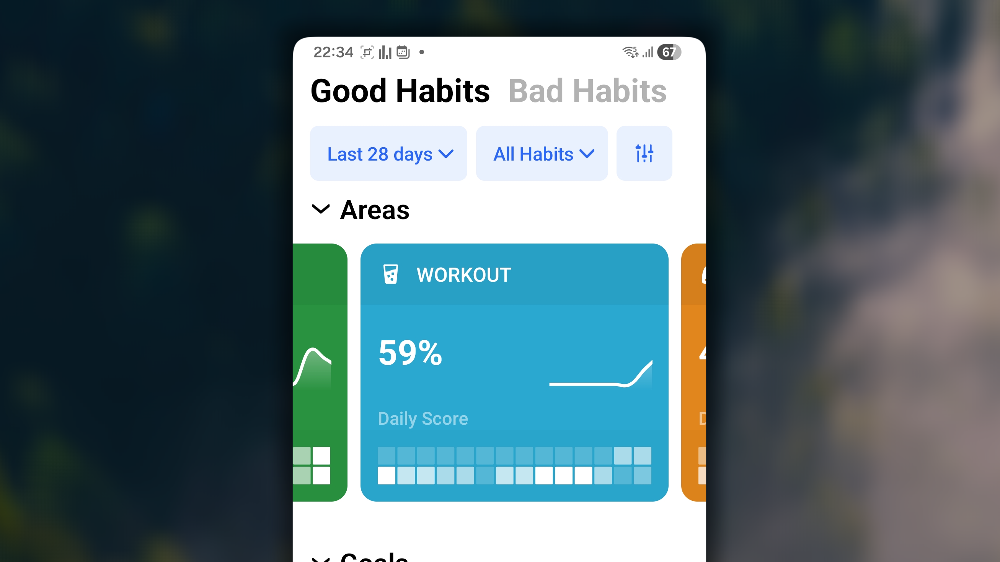
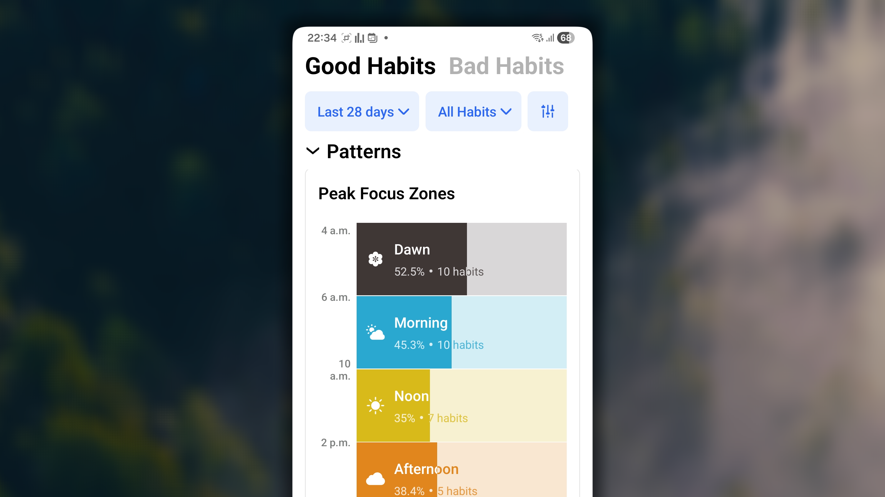

Obszar to grupa lub folder nawyków, który pozwala uporządkować śledzenie według różnych sfer życia, zamiast traktować wszystkie nawyki jako jedną płaską, jednolitą listę. Zgrupuj nawyki związane z ćwiczeniami, piciem wody i snem w obszarze „Zdrowie”; pracę w skupieniu i obsługę poczty w obszarze „Praca”; a prowadzenie dziennika i medytację w obszarze „Uważność” — zgodnie z tym, jak rzeczywiście dzielisz swoje życie.

Obszary pomagają ustalać priorytety. Zamiast jednego wyniku dnia obejmującego wszystko naraz możesz skupić się na jednej kategorii i dokładnie sprawdzić, jak radzisz sobie w danej sferze życia.

<Tabs>
  <Tab title=" iOS">
    ## Tworzenie nowego obszaru

    <iframe src="https://drive.google.com/file/d/1tvk66uyWt5d6rRJoQHpPx_TnZR7C53Kb/preview" width="640" height="360" />

    1. W **Dzienniku** przesuń pasek obszarów w lewo aż do samego końca i stuknij **\+**.
    2. Wybierz **Nowy obszar**.
    3. Na ekranie **Nowy obszar**,
       1. stuknij ikonę, wybierz ikonę i przypisz kolor do nowego obszaru, a następnie stuknij ✓, aby zapisać wybór.
       2. Stuknij pole nazwy i wpisz nazwę obszaru.
    5. Na liście **Wyklucz** stuknij ⊕ przed nazwą nawyku, aby dodać go do obszaru.
    6. Gdy wszystko będzie gotowe, stuknij ✓, aby zapisać nowy obszar.

    ## Zarządzanie własnym obszarem

    Możesz dowolnie edytować nazwę i ikonę własnego obszaru, zarządzać zawartymi w nim nawykami oraz usunąć obszar.

    ### Edytowanie obszaru

    1. W aplikacji Habitify przejdź do **Ustawień**.
    2. Znajdź i otwórz sekcję **Wszystkie obszary**.
       
    3. Na liście obszarów stuknij obszar, który chcesz zmienić.
    4. Na ekranie szczegółów obszaru możesz:
       1. stuknąć **ikonę**, aby zmienić ikonę i kolor. stuknij przycisk ✓ w prawym górnym rogu, aby zapisać wybór.
       2. stuknąć **pole nazwy**, aby zmienić nazwę obszaru.
          
       3. na liście **Uwzględnij** stuknąć ⊖ przed nazwą nawyku, aby usunąć go z obszaru.
          
       4. na liście **Wyklucz** stuknąć ⊕ przed nazwą nawyku, aby dodać go do obszaru.
          
    5. Stuknij **przycisk ✓** w prawym górnym rogu, aby zapisać wszystkie zmiany.

    ### Zmienianie kolejności nawyków w obszarze

    1. W aplikacji Habitify przejdź do **Ustawień**.
    2. Znajdź i otwórz sekcję **Wszystkie obszary**.
    3. Na liście obszarów stuknij obszar, w którym chcesz zmienić kolejność nawyków.
    4. Na liście **Uwzględnij** przytrzymaj przycisk ☰ po prawej stronie nawyku, a następnie przeciągnij go w górę lub w dół, aby zmienić jego pozycję na liście.
       
    5. Gdy wszystko będzie gotowe, stuknij przycisk ✓, aby zapisać zmiany.

    ### Usuwanie obszaru

    1. W Habitify przejdź do **Ustawień**.
    2. Znajdź i otwórz sekcję **Wszystkie obszary**.
    3. Na liście obszarów stuknij obszar, który chcesz usunąć
    4. Stuknij przycisk „**Usuń ten obszar**”
       
    5. W kroku potwierdzenia stuknij „**Usuń**”.

    ## Zarządzanie kolejnością obszarów

    Możesz uporządkować własne obszary na pasku obszarów w Dzienniku. Oto jak to zrobić:

    1. W aplikacji Habitify przejdź do **Ustawień**.
    2. Znajdź i otwórz sekcję **Wszystkie obszary**.
    3. Przytrzymaj przycisk ☰ po prawej stronie obszaru i przeciągnij go w górę lub w dół, aby zmienić kolejność obszarów.
       
    4. Stuknij przycisk ✓, aby zapisać zmiany.

    <Info>
      Zmiany kolejności obszarów wprowadzone w aplikacji na iOS lub Androida są synchronizowane z aplikacjami internetową i komputerową natychmiast po zapisaniu.
    </Info>

    ## Postępy w obszarze

    Widok Postępy pokazuje, jak idzie w poszczególnych obszarach. Poniższe sekcje znajdują się na karcie **Dobre nawyki**. Uwzględniają zakres dat wybrany w widoku Postępy.

    ### Postępy w obszarze własnym

    W widoku Postępy przewiń do sekcji **Obszary**. Zawiera ona kartę postępów dla każdego z własnych obszarów. Przewijaj w bok, aby zobaczyć kolejne karty.

    

    Każda karta to krótki raport dotyczący tylko danego obszaru. Zawiera:

    - **Średni wynik dzienny**
    - **Miniwykres trendu.**
    - **Skróconą mapę cieplną.**

    Porównanie kart pozwala sprawdzić, czy jedna część życia idzie dobrze, a inna wymaga uwagi.

    ### Wskaźnik realizacji obszaru pory dnia

    Obszary pory dnia (Rano, Popołudnie i Wieczór) nie mają kart w sekcji **Obszary**. Aby zobaczyć ich wskaźnik realizacji, użyj **Strefy największego skupienia** w sekcji **Wzorce**.

    

    Pokazuje ona średni wskaźnik realizacji dla każdej pory dnia w wybranym zakresie dat. Na przykład jeśli rano są 3 nawyki, a jednego dnia zrealizowane zostaną 2, a następnego 1, wskaźnik realizacji rano wyniesie 50%.

    ### Cały raport dla jednego obszaru

    Aby zobaczyć widok Postępy dla jednego obszaru, użyj filtra nawyków:

    1. W widoku **Postęp** otwórz filtr nawyków.
    2. Wybierz obszar własny lub obszar pory dnia, który chcesz zobaczyć.

    Raport będzie wtedy zawierał tylko nawyki z tego obszaru.
  </Tab>
  <Tab title="🤖 Android">
    ## Tworzenie nowego obszaru

    <iframe src="https://drive.google.com/file/d/1F_7f_gieW9pIv8yLPskQdST6gSE2ofCn/preview" width="640" height="360" />

    1. W Dzienniku przesuń pasek obszarów w lewo aż do samego końca
    2. Stuknij przycisk \+, a następnie wybierz **Nowy obszar.**
    3. Stuknij ikonę, a następnie wybierz ikonę i przypisz kolor do nowego obszaru. Stuknij **Gotowe** w prawym górnym rogu, aby zapisać wybór.
    4. Stuknij pole nazwy i wpisz nazwę nowego obszaru.
    5. Na liście **Wyklucz** stuknij przycisk plus po prawej stronie nawyku, aby dodać go do nowego obszaru.
    6. Gdy wszystko będzie gotowe, stuknij przycisk **Zapisz** w prawym górnym rogu, aby zapisać nowy obszar.

    ## Zarządzanie własnym obszarem

    Możesz dowolnie edytować nazwę i ikonę własnego obszaru, zarządzać zawartymi w nim nawykami oraz usunąć obszar.

    ### Edytowanie obszaru

    1. W aplikacji Habitify przejdź do **Ustawień**.
    2. Znajdź i otwórz sekcję **Wszystkie obszary**.
    3. Na liście obszarów stuknij obszar, który chcesz zmienić.
    4. Na ekranie szczegółów obszaru możesz:
       1. stuknąć ikonę, aby zmienić ikonę i kolor.
stuknij „Gotowe” w prawym górnym rogu, aby zapisać wybór.
       2. stuknąć pole nazwy, aby zmienić nazwę obszaru.
       3. na liście **Uwzględnij** stuknąć przycisk ⛌ po prawej stronie nawyku, aby usunąć go z obszaru.
       4. na liście **Wyklucz** stuknąć przycisk ╋ po prawej stronie nawyku, aby dodać go do obszaru.
    5. Stuknij przycisk **Zapisz** w prawym górnym rogu, aby zapisać wszystkie zmiany.

    ### Zmienianie kolejności nawyków w obszarze

    1. W aplikacji Habitify przejdź do **Ustawień**.
    2. Znajdź i otwórz sekcję **Zarządzaj obszarami**.
    3. Na liście obszarów stuknij obszar, w którym chcesz zmienić kolejność nawyków.
    4. Na liście Uwzględnij przytrzymaj przycisk = po lewej stronie nawyku, a następnie przeciągnij go w górę lub w dół, aby zmienić jego pozycję na liście.
    5. Gdy wszystko będzie gotowe, stuknij przycisk **Zapisz**, aby zapisać zmiany.

    ### Usuwanie obszaru

    1. W Habitify przejdź do **Ustawień**.
    2. Znajdź i otwórz sekcję **Zarządzaj obszarami**.
    3. Na liście obszarów stuknij obszar, który chcesz usunąć
    4. Przewiń na sam dół i stuknij „**Usuń ten obszar**”
    5. W kroku potwierdzenia stuknij **Usuń**.

    ## Zarządzanie kolejnością obszarów

    Możesz uporządkować własne obszary na pasku obszarów w Dzienniku. Oto jak to zrobić:

    1. W aplikacji Habitify przejdź do **Ustawień**.
    2. Znajdź i otwórz sekcję **Zarządzaj obszarami**.
    3. Przytrzymaj przycisk **=** po prawej stronie obszaru i przeciągnij go w górę lub w dół, aby zmienić kolejność obszarów.
    4. Stuknij przycisk **Zapisz**, aby zapisać zmiany.

    <Info>
      Zmiany kolejności obszarów wprowadzone w aplikacji na iOS lub Androida są synchronizowane z aplikacjami internetową i komputerową natychmiast po zapisaniu.
    </Info>

    ## Postępy w obszarze

    Widok Postępy pokazuje, jak idzie w poszczególnych obszarach. Poniższe sekcje znajdują się na karcie **Dobre nawyki**. Uwzględniają zakres dat wybrany w widoku Postępy.

    ### Postępy w obszarze własnym

    W widoku Postępy przewiń do sekcji **Obszary**. Zawiera ona kartę postępów dla każdego z własnych obszarów. Przewijaj w bok, aby zobaczyć kolejne karty.

    

    Każda karta to krótki raport dotyczący tylko danego obszaru. Zawiera:

    - **Średni wynik dzienny**
    - **Miniwykres trendu.**
    - **Skróconą mapę cieplną.**

    Porównanie kart pozwala sprawdzić, czy jedna część życia idzie dobrze, a inna wymaga uwagi.

    ### Wskaźnik realizacji obszaru pory dnia

    Obszary pory dnia (Rano, Popołudnie i Wieczór) nie mają kart w sekcji **Obszary**. Aby zobaczyć ich wskaźnik realizacji, użyj **Strefy największego skupienia** w sekcji **Wzorce**.

    

    Pokazuje ona średni wskaźnik realizacji dla każdej pory dnia w wybranym zakresie dat. Na przykład jeśli rano są 3 nawyki, a jednego dnia zrealizowane zostaną 2, a następnego 1, wskaźnik realizacji rano wyniesie 50%.

    ### Cały raport dla jednego obszaru

    Aby zobaczyć widok Postępy dla jednego obszaru, użyj filtra nawyków:

    1. W widoku **Postęp** otwórz filtr nawyków.
    2. Wybierz obszar własny lub obszar pory dnia, który chcesz zobaczyć.

    Raport będzie wtedy zawierał tylko nawyki z tego obszaru.
  </Tab>
  <Tab title="🖥️ Witryna i aplikacja komputerowa">
    ## Tworzenie nowego obszaru

    <iframe src="https://drive.google.com/file/d/1-jFIqXsmgOC3dAhdALhaUJw_JrwXUl34/preview" width="640" height="360" />

    1. W aplikacji przejdź do sekcji Obszary na lewym pasku bocznym
    2. Kliknij **\+ Nowy obszar**.
    3. Nadaj nazwę nowemu obszarowi i naciśnij Enter, aby zapisać wpis.
    4. Kliknij ikonę, a następnie wybierz nową ikonę i przypisz kolor do nowego obszaru.
    5. Kliknij poza tym elementem, aby zapisać zmiany.

    ## Zarządzanie własnym obszarem

    Możesz dowolnie edytować nazwę i ikonę własnego obszaru, zarządzać zawartymi w nim nawykami oraz usunąć obszar.

    ### Edytowanie ikony, koloru i nazwy obszaru

    Aby edytować ikonę i kolor obszaru:

    1. Na lewym pasku bocznym przejdź do sekcji **Obszary**.
    2. Kliknij ikonę obszaru.
    3. Wybierz nową ikonę i kolor.
    4. Kliknij poza tym elementem, aby potwierdzić zmiany.

    Aby edytować nazwę obszaru:

    1. Na lewym pasku bocznym przejdź do sekcji **Obszary**.
    2. Kliknij obszar, który chcesz edytować.
    3. Kliknij ponownie, aby włączyć edycję.
    4. Wpisz nową nazwę.
    5. Naciśnij Enter, aby zapisać zmianę.

    ### Zarządzanie nawykami w obszarze

    Aby dodać nawyk do obszaru:

    1. Na lewym pasku bocznym przejdź do **Preferencje \> Nawyki.**
    2. Otwórz listę **Aktywny**.
    3. Znajdź nawyk i przeciągnij go do docelowego obszaru.

    Aby usunąć nawyk z obszaru:

    1. Na lewym pasku bocznym przejdź do **Preferencje \> Nawyki**
    2. Przejdź do **Obszarów** i kliknij bieżący obszar, do którego należy nawyk.
    3. Kliknij nawyk prawym przyciskiem myszy i wybierz **Edytuj**.
    4. W szczegółach nawyku przejdź do **pola Obszar** i kliknij, aby usunąć obszar.
    5. Kliknij **Zapisz**.

    ### Usuwanie obszaru

    Aby usunąć obszar:

    1. Na lewym pasku bocznym przejdź do sekcji **Obszary**.
    2. Kliknij prawym przyciskiem nawyk, który chcesz usunąć, a następnie wybierz **Usuń**.

    ## Postępy w obszarze

    Widok Postępy pokazuje, jak idzie w poszczególnych obszarach. Poniższe sekcje znajdują się na karcie **Dobre nawyki**. Uwzględniają zakres dat wybrany w widoku Postępy.

    ### Postępy w obszarze własnym

    W widoku Postępy przewiń do sekcji **Obszary**. Zawiera ona kartę postępów dla każdego z własnych obszarów. Przewijaj w bok, aby zobaczyć kolejne karty.

    Każda karta to krótki raport dotyczący tylko danego obszaru. Zawiera:

    - **Średni wynik dzienny**
    - **Miniwykres trendu.**
    - **Skróconą mapę cieplną.**

    Porównanie kart pozwala sprawdzić, czy jedna część życia idzie dobrze, a inna wymaga uwagi.

    ### Wskaźnik realizacji obszaru pory dnia

    Obszary pory dnia (Rano, Popołudnie i Wieczór) nie mają kart w sekcji **Obszary**. Aby zobaczyć ich wskaźnik realizacji, użyj **Strefy największego skupienia** w sekcji **Wzorce**.

    Pokazuje ona średni wskaźnik realizacji dla każdej pory dnia w wybranym zakresie dat. Na przykład jeśli rano są 3 nawyki, a jednego dnia zrealizowane zostaną 2, a następnego 1, wskaźnik realizacji rano wyniesie 50%.

    ### Cały raport dla jednego obszaru

    Aby zobaczyć widok Postępy dla jednego obszaru, użyj filtra nawyków:

    1. W widoku **Postęp** otwórz filtr nawyków.
    2. Wybierz obszar własny lub obszar pory dnia, który chcesz zobaczyć.

    Raport będzie wtedy zawierał tylko nawyki z tego obszaru.
  </Tab>
</Tabs>
