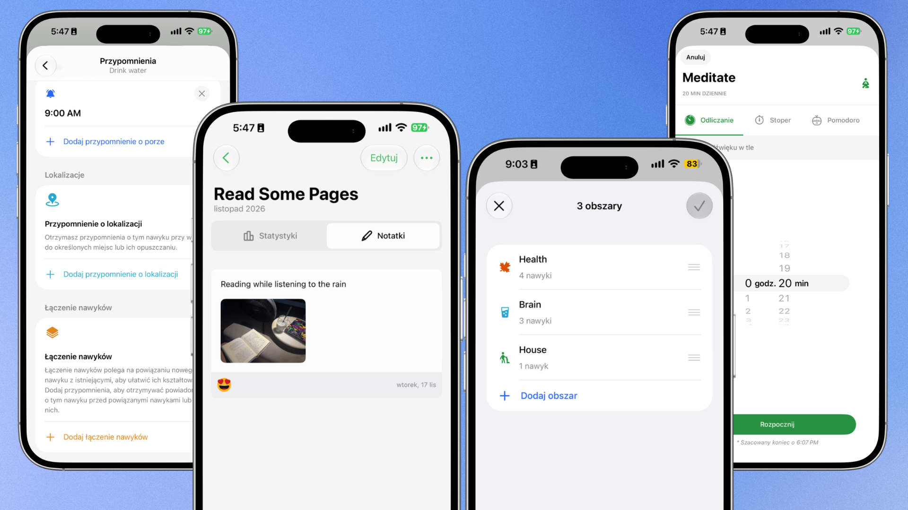
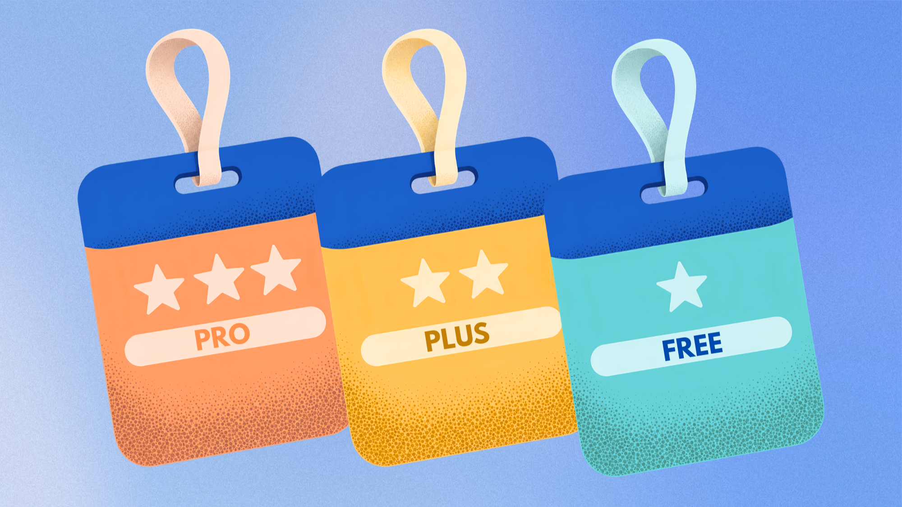
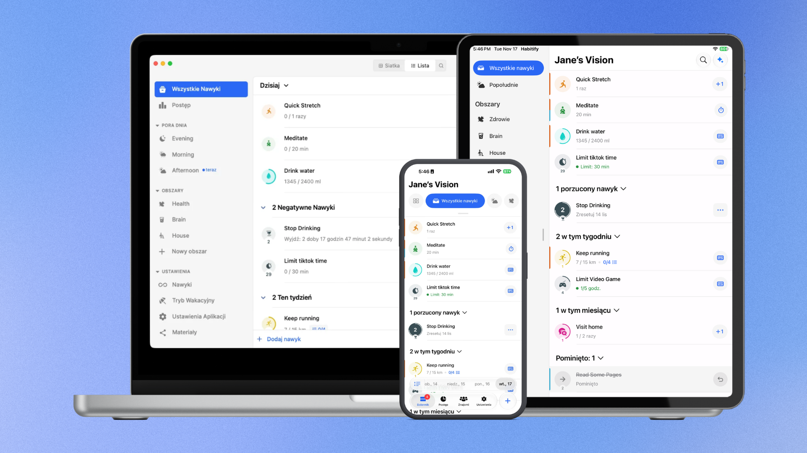

Habitify to aplikacja do śledzenia nawyków oparta na prostej idei: trwała zmiana rodzi się z małych, konsekwentnych działań, które są rzetelnie rejestrowane na przestrzeni czasu. Zamiast polegać wyłącznie na pamięci lub sile woli, Habitify zapewnia przejrzysty dzienny widok tego, co masz do zrobienia, łatwy sposób rejestrowania oraz jasny obraz rzeczywistych trendów — na telefonie, komputerze i w przeglądarce, zawsze z pełną synchronizacją.

## Śledź dobre i złe nawyki

Habitify obsługuje dwa rodzaje nawyków, ponieważ budowanie czegoś nowego i porzucanie czegoś starego to naprawdę dwie różne drogi:

- [Dobre nawyki](/pl/good-habits): zachowania, które chcesz wypracować, takie jak ćwiczenia, czytanie czy picie większej ilości wody. Ustaw cel dzienny, tygodniowy, miesięczny lub roczny, a Habitify będzie śledzić Twoją systematyczność w jego realizacji.
- [Złe nawyki](/pl/bad-habits): zachowania, które chcesz ograniczyć lub całkowicie porzucić, takie jak palenie czy bezmyślne przewijanie negatywnych treści. Ustaw limit, którego nie chcesz przekraczać, albo zobowiąż się do całkowitego zerwania z nawykiem, a Habitify będzie śledzić Twoją powściągliwość zamiast liczby wykonań.

Oba rodzaje rejestruje się tak samo — wystarczy raz zdefiniować nawyk, a następnie codziennie odnotowywać postępy — podczas gdy aplikacja w tle dyskretnie dostosowuje sposób mierzenia sukcesu dla każdego z nich.

## Zestaw funkcji

Gdy opanujesz podstawy, Habitify oferuje pełny zestaw narzędzi do porządkowania nawyków i zrozumienia, _dlaczego_ udaje się je utrzymać lub dlaczego zdarzają się potknięcia:

- [Obszary](/pl/area): grupuj powiązane nawyki w kategorie życia, takie jak „Zdrowie” lub „Praca”, aby oceniać całą sferę swojego życia, a nie tylko pojedynczy nawyk.
- [Notatki](/pl/note): mały dziennik przypisany do każdego nawyku, w którym możesz zapisywać kontekst danego wpisu (na przykład zapisy nastroju i zdjęcia).
- [Minutnik](/pl/timer): tryby Odliczanie, Stoper i Pomodoro dla każdego nawyku mierzonego czasem.
- [Przypomnienia](/pl/reminder): oparte na czasie, lokalizacji lub łączeniu nawyków, dzięki czemu właściwy impuls dociera do Ciebie we właściwym momencie.
- [Widok postępów](/pl/overall-progress): mapy cieplne, dzienne wyniki i analizy wzorców pokazujące Twoją rzeczywistą systematyczność na przestrzeni tygodni i miesięcy, a nie tylko dzisiaj.

## Śledzenie nastroju i refleksja

Śledzenie nawyków to tylko jedna strona rozwoju osobistego — drugą jest zrozumienie, jak te rutyny wpływają na Twój dobrostan psychiczny.

Dlatego [Refleksja](/pl/reflection) jest w Habitify osobną przestrzenią uważności: zapisz swój nastrój za pomocą szybkiego wyboru emoji, dodaj notatkę o swoim dniu i zobacz te informacje zestawione z postępami w nawykach.

Refleksja i Notatki wspólnie zmieniają Habitify z prostego narzędzia do śledzenia w prawdziwy zapis Twojej drogi, a nie tylko listę zaznaczeń.

## Krąg i Wyzwanie

Budowanie nawyków nie musi być samotnym wysiłkiem, a może nawet sprawiać więcej radości, gdy dołączą do Ciebie znajomi i rodzina. Właśnie do tego służą Krąg i Wyzwanie.

Dzięki funkcji [Krąg](/pl/circle) tworzysz stałą, prywatną przestrzeń z najważniejszymi dla Ciebie osobami — dzielicie się postępami w wielu nawykach, kibicujecie sobie nawzajem i pomagacie sobie dotrzymywać zobowiązań w dłuższej perspektywie.

W ramach [Wyzwania](/pl/challenge) podejmujesz ograniczoną czasowo rywalizację wokół jednego wspólnego celu — z rankingiem, seriami i opcjonalną punktacją, które ją urozmaicają.

Niezależnie od tego, która forma najlepiej odpowiada Twojej grupie, Habitify zmienia indywidualne śledzenie w coś, co tworzycie razem.

## Integracje i automatyzacja

Habitify nie działa w oderwaniu od innych narzędzi — zostało stworzone z myślą o łączeniu się z aplikacjami i urządzeniami, które już towarzyszą Ci na co dzień:

- **Synchronizacja zdrowia i aktywności**: Apple Health, Health Connect, Strava i Fitbit umożliwiają urządzeniu automatyczne rejestrowanie danych za Ciebie.
- **Synchronizacja kalendarza**: Google Calendar, Outlook Calendar i Apple Calendar umieszczają Twoje nawyki obok pozostałych pozycji w harmonogramie.
- **Śledzenie czasu przed ekranem**: Czas przed ekranem i RescueTime przekształcają rzeczywiste korzystanie z urządzenia w dane dotyczące nawyków, pomagając zarówno budować zdrowsze nawyki cyfrowe, jak i ograniczać te rozpraszające.
- **Platformy automatyzacji**: Zapier i IFTTT łączą Habitify z setkami innych aplikacji i usług, dzięki czemu ukończenie nawyku może uruchomić niemal dowolne inne używane przez Ciebie działanie albo zostać przez nie wyzwolone.
- **Wbudowana automatyzacja**: Aktualizacja stanu automatycznie oznacza niezarejestrowane nawyki o wybranej przez Ciebie porze, tagi NFC sprawiają, że wystarczy dotknąć fizycznego przedmiotu, aby zarejestrować wykonanie, a Skróty (wraz z Siri) pozwalają rejestrować postępy głosem, bez otwierania aplikacji.

## Zacznij i rozwijaj się według własnych potrzeb

Nie musisz korzystać ze wszystkiego od razu. Większość osób zaczyna od kilku nawyków w planie Bezpłatnym, dodaje obszary i przypomnienia w miarę rozwoju swojej rutyny, a integracje i automatyzacje wprowadza dopiero po przejściu na Pro, gdy dokładnie wie, co chce zautomatyzować.

Habitify zaprojektowano tak, aby rozwijało się razem z Tobą — może pozostać tak proste lub stać się tak zintegrowane z innymi narzędziami, jak tego faktycznie wymaga śledzenie Twoich nawyków.

## Trzymaj się planu wszędzie

Śledzenie Twoich nawyków nie powinno ustawać w chwili zamknięcia aplikacji. Habitify towarzyszy Ci na telefonie, tablecie, komputerze i w przeglądarce, automatycznie synchronizując dane, aby postępy były zawsze aktualne bez względu na to, gdzie je rejestrujesz.

