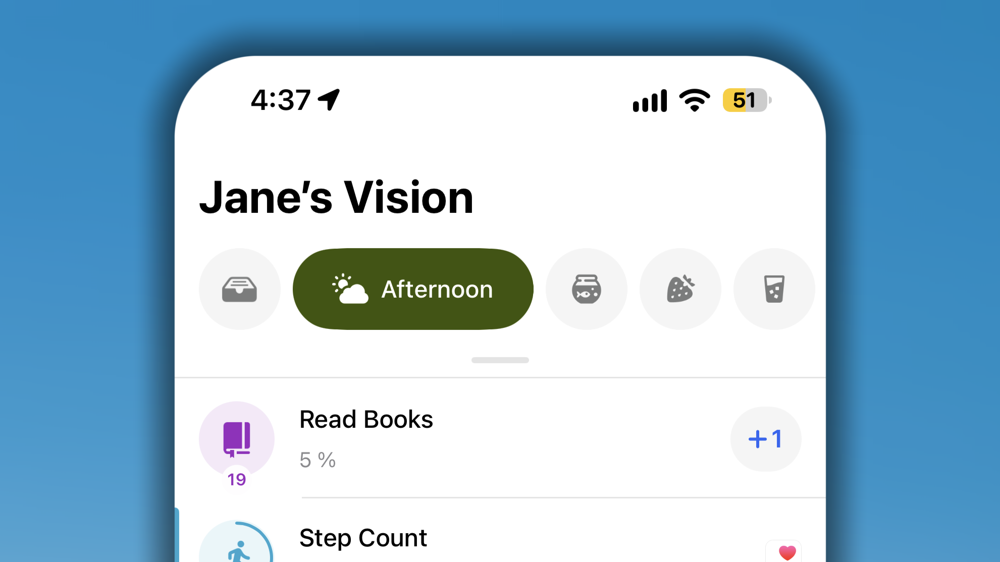
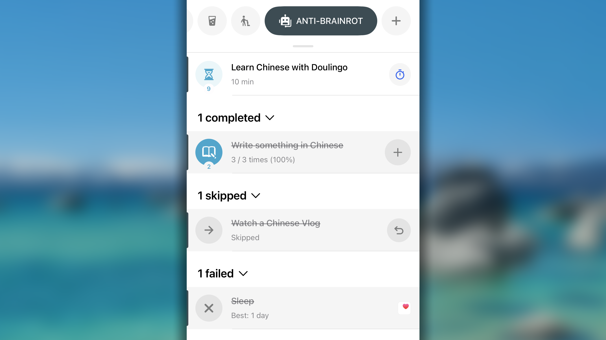
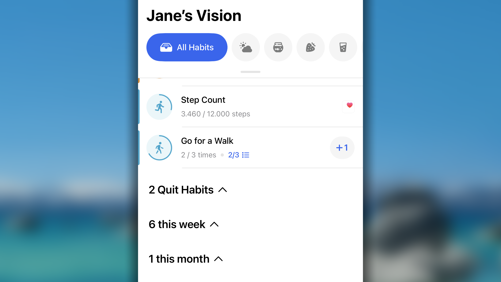
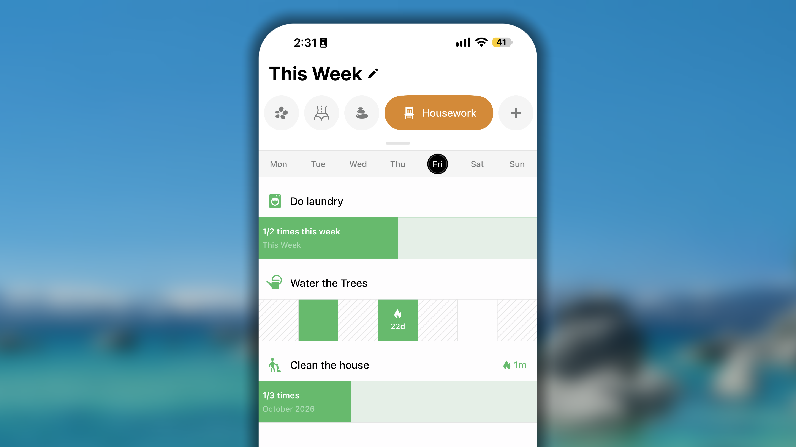
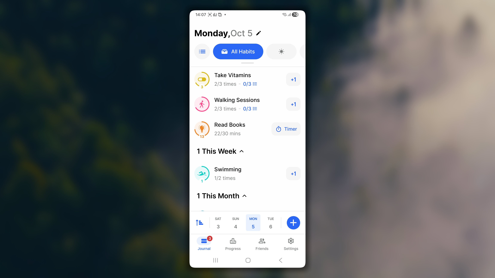
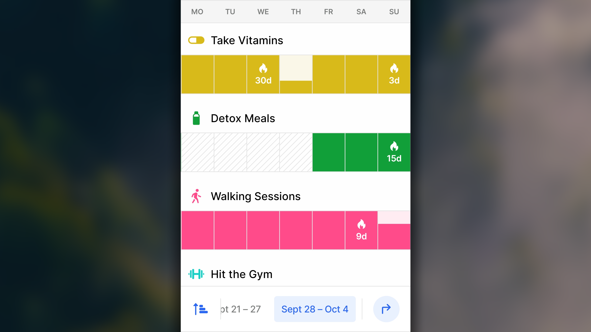
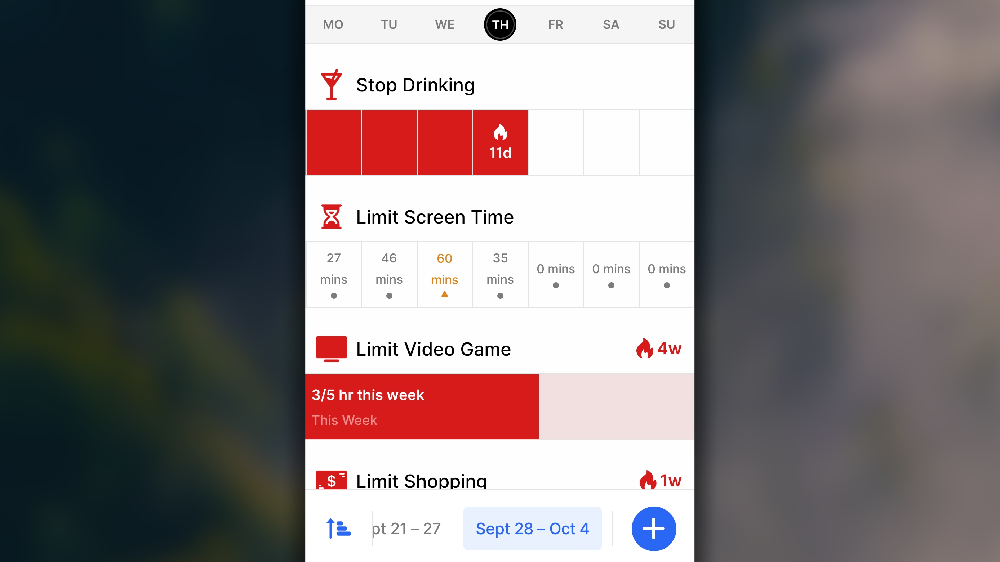
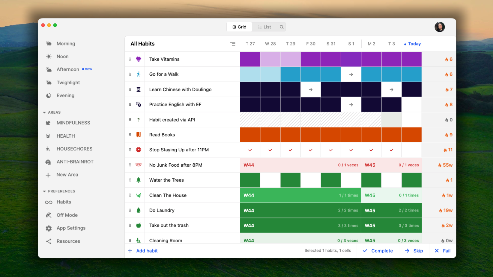
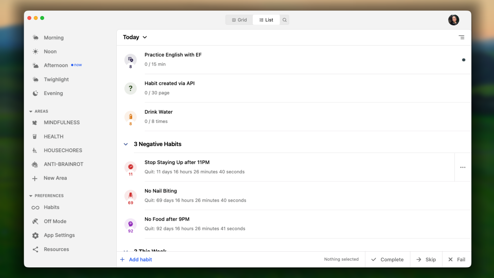

Dziennik to miejsce, w którym Twoje nawyki naprawdę towarzyszą Ci na co dzień. Jest pierwszym ekranem wyświetlanym po otwarciu Habitify i pokazuje dokładnie to, co przypada na dziś — nic więcej. Niezależnie od używanej platformy Dziennik opiera się na tej samej idei: dzisiejszy dzień ma pozostać prosty i przejrzysty, a jednocześnie masz mieć do dyspozycji narzędzia do porządkowania, filtrowania i sortowania nawyków.

W tym artykule dowiesz się, jak poruszać się po Dzienniku, rozumieć sposób grupowania nawyków i zarządzać kolejnością ich wyświetlania, aby dopasować go do rzeczywistego rytmu swojego dnia.

<Tabs>
  <Tab title=" iOS">
    <iframe src="https://drive.google.com/file/d/1FVghynLUGkO6QicsLFLkIjXaJoGzbCMq/preview" width="640" height="360" />

    ## Przełączanie między listami

    U góry Dziennika, tuż obok listy Wszystkie nawyki, znajdziesz opcje umożliwiające przełączanie się między różnymi sposobami przeglądania dnia:

    

    - **Wszystkie nawyki**: wszystkie nawyki zaplanowane na dziś na jednej liście.
    - Bieżąca lista **Pora dnia**: tylko nawyki przypisane do danego przedziału dnia. Aplikacja automatycznie przechodzi do aktualnego przedziału na podstawie ustawionych zakresów (na przykład przełącza się na „Rano” w chwili rozpoczęcia porannego przedziału), więc nie musisz ręcznie zmieniać kart przez cały dzień.
    - Listy własnych **Obszarów**: nawyki pogrupowane w utworzonych przez Ciebie obszarach, takich jak „Zdrowie” lub „Praca”. Zamiast przeglądać cały dzień, możesz skupić się tylko na jednej sferze życia naraz.

    ## Przełączanie między układami

    **Dziennik** ma dwa układy: widok Dzień i widok Tydzień. Widok Dzień pozwala skupić się na dzisiaj, natomiast widok Tydzień pokazuje na pierwszy rzut oka cały tydzień, dzięki czemu łatwiej zauważyć wzorce.

    Aby przełączać się między układami, stuknij przycisk układu obok listy **Wszystkie nawyki**.

    Widoki Dzień i Tydzień pokazują te same nawyki z tej samej listy. Zmienia się wyłącznie sposób wyświetlania poszczególnych nawyków.

    ### Widok Dzień

    Widok Dzień pokazuje dokładnie to, co przypada na dziś — nic więcej. To tutaj możesz sprawdzić stan nawyków, rejestrować postępy i zobaczyć, co pozostało do zrobienia w ciągu dnia.

    

    - W toku / nieukończone: nawyki, których jeszcze dziś nie udało Ci się ukończyć. Domyślnie to właśnie na nich skupia się lista.
    - **Ukończono**: nawyki już oznaczone jako ukończone, które pozostają widoczne, aby dzisiejsze sukcesy były od razu zauważalne.
    - **Pominięto**: nawyki, które zostały zapisane jako dzień wolny, aby nie przerywać serii. Pominięty dzień zamraża serię zamiast ją zerować.
    - **Nie wykonano**: nawyki uczciwie oznaczone jako potknięcie, które chcesz zapisać w niezmienionej postaci, zamiast łagodzić je jako pominięcie.

    W grupie nawyków w toku / nieukończonych są one dodatkowo uporządkowane według typu celu, od góry do dołu:

    

    - Nawyki z celem dziennym: znajdują się razem u góry, ponieważ są podstawowymi codziennymi działaniami, które masz wykonać dzisiaj.
    - **Nawyki do rzucenia**: nawyki, które chcesz porzucić, albo nawyki do ograniczenia z celem dziennym.
    - **Ten tydzień**: dobre nawyki i nawyki do ograniczenia z celem tygodniowym.
    - **Ten miesiąc**: dobre nawyki i nawyki do ograniczenia z celem miesięcznym.
    - **Ten rok**: dobre nawyki i nawyki do ograniczenia z celem rocznym.

    ### Widok Tydzień

    <iframe src="https://drive.google.com/file/d/1rP5gma82_VPux2kBGOyRJrX72UAw218U/preview" width="640" height="360" />

    Widok Tydzień pokazuje nawyki z całego tygodnia, dzięki czemu możesz obserwować ich tendencje, a nie tylko to, co przypada na dziś.

    Tydzień zaczyna się w poniedziałek lub niedzielę, zależnie od opcji wybranej w **Ustawieniach** → **Pierwszy dzień tygodnia**.

    Każdy nawyk ma osobny wiersz, a nad nim znajdują się jego ikona i nazwa. Bieżący dzień jest wyróżniony na pasku dni u góry. Do przechodzenia między tygodniami służy pasek tygodni u dołu ekranu. Wybrany tydzień jest wyróżniony.

    Wygląd nawyku zależy od jego typu: może to być dobry nawyk, nawyk do ograniczenia albo nawyk do rzucenia.

    

    **Jeśli jest to dobry nawyk z celem dziennym:**

    - Każdy dzień jest pojedynczą komórką przedstawiającą postęp z danego dnia:
      - Ukończony dzień jest wypełniony jednolitym odcieniem koloru nawyku. Kolejne ukończone dni łączą się w jeden ciągły pasek.
      - Dzień będący nadal w toku wypełnia się od dołu w miarę rejestrowania postępów w realizacji celu dziennego.
      - Pominięty dzień jest oznaczony symbolem →.
      - Niewykonany dzień jest oznaczony symbolem ✕.
    - W dniach, w których nawyk się nie powtarza albo jeszcze się nie rozpoczął, komórka jest zakreskowana ukośnymi liniami.
    - Seria jest przedstawiona za pomocą symbolu 🔥 i jej długości (na przykład 🔥7d) w komórce ostatniego dnia, w którym udało Ci się zrealizować cel dzienny.

    **Jeśli jest to dobry nawyk z celem tygodniowym, miesięcznym lub rocznym:**

    - Okres jest przedstawiony jako jeden ciągły pasek.
    - Pasek pokazuje postęp w realizacji celu i wypełnia się w miarę rejestrowania danych. Na przykład „_2/7 razy w tym tygodniu_” lub „_27/30 km w sierpniu 2026 r._”.
    - Po prawej stronie nazwy nawyku znajduje się seria liczona w tygodniach, miesiącach lub latach, odpowiednio do okresu celu (na przykład „_🔥2 tyg._” lub „_🔥3 mies._”). Jest obliczana do przeglądanego tygodnia, dlatego może się zmieniać podczas przechodzenia między tygodniami.

    

    **Jeśli jest to zły nawyk do rzucenia:**

    - Nawyki do rzucenia nie mają okresu celu. Są śledzone dzień po dniu.
    - Każdy dzień jest pojedynczą komórką przedstawiającą dany dzień:
      - Dzień bez potknięcia jest wypełniony jednolitym odcieniem koloru nawyku. Kolejne takie dni łączą się w jeden ciągły pasek.
      - Dzień oznaczony jako **Nie wykonano** jest oznaczony symbolem ✕.
      - Dzień oznaczony jako **Pominięto** jest oznaczony symbolem →.

    - W dniach poprzedzających datę rozpoczęcia nawyku komórka jest zakreskowana ukośnymi liniami.
    - Seria jest przedstawiona za pomocą symbolu 🔥 i jej długości (na przykład „🔥3d”) w komórce ostatniego dnia bez potknięcia.

    **Jeśli jest to zły nawyk do ograniczenia dziennie:**

    - Każdy dzień jest pojedynczą komórką pokazującą wartość zarejestrowaną tego dnia (na przykład 15 min) oraz umieszczony pod nią znacznik informujący o bieżącym stanie:
      - szara kropka • oznacza, że mieścisz się w limicie.
      - pomarańczowy trójkąt ▲ oznacza, że limit został osiągnięty.
      - czerwony symbol ✕ oznacza, że limit został przekroczony.
    - dzień oznaczony bezpośrednio jako **Pomiń** jest oznaczony symbolem →.
    - dzień oznaczony bezpośrednio jako **Oznacz jako niewykonany** jest oznaczony symbolem ✕.

    **Jeśli jest to zły nawyk do ograniczenia tygodniowo, miesięcznie lub rocznie**

    - Okres jest przedstawiony jako jeden ciągły pasek.
    - Pasek pokazuje, ile zarejestrowano względem limitu w danym okresie.
    - Pasek pokazuje postęp względem limitu i wypełnia się w miarę rejestrowania danych. Na przykład „27/60 minut w tym tygodniu” lub „2/5 razy w tym miesiącu”.

    ## Zarządzanie kolejnością nawyków

    <iframe src="https://drive.google.com/file/d/1cKK8d2w8I12G02TvZX4_9q0icU_Kni-L/preview" width="640" height="360" />

    Stuknij przycisk sortowania w prawym górnym rogu Dziennika, aby uporządkować listę według jednej z opcji:

    - **A–Z** lub **Z–A**: nawyki są uporządkowane alfabetycznie według nazwy.
    - **Godzina przypomnienia**: nawyki są uporządkowane chronologicznie według pierwszego przypomnienia w danym dniu.
    - **Kolejność moich nawyków**: nawyki są rozmieszczone ręcznie w wybranej przez Ciebie kolejności.

    <Note>
      Te ustawienia dotyczą wyłącznie kolejności nawyków na liście „Wszystkie nawyki”.
    </Note>

    ### Sposób stosowania sortowania w poszczególnych układach

    - Widok Dzień: nawyki są najpierw dzielone na podkategorie (według stanu, a w grupie W toku / nieukończone także według typu celu), a następnie sortowane w wybranej kolejności w obrębie każdej grupy.
    - Widok Tydzień: nawyki są sortowane w wybranej kolejności na jednej ciągłej liście, niezależnie od ich stanu, typu czy okresu celu.

    ### Jak dostosować opcję Kolejność moich nawyków

    1. W **Dzienniku**_,_ wyświetl listę **Wszystkie nawyki**.
    2. Stuknij przycisk sortowania na pasku daty i wybierz **Kolejność moich nawyków**.
    3. Ponownie stuknij przycisk sortowania, a następnie wybierz **Zmień kolejność nawyków**.
    4. Przytrzymaj ikonę ☰ po prawej stronie nawyku, a następnie przeciągnij go w górę lub w dół do nowej pozycji.
    5. Gdy wszystko będzie gotowe, stuknij ✓ w prawym górnym rogu, aby zapisać zmiany.

    <Note>
      Kolejność jest niezależna dla każdej listy.

      Zmiana kolejności nawyków na liście **Wszystkie nawyki** nie zmienia kolejności na liście **Pora dnia** ani na liście własnego **Obszaru**.

      - Aby zarządzać kolejnością nawyków na każdej liście **Pora dnia**: przejdź do **Ustawień** → **Pora dnia** → wybierz przedział czasu → uporządkuj nawyki w sekcji **Uwzględnij**.
      - Aby zarządzać kolejnością nawyków na każdej liście własnego **Obszaru**: przejdź do **Ustawień** → **Wszystkie obszary** → wybierz obszar → uporządkuj nawyki w sekcji listy **Uwzględnij**.
    </Note>

    ## Wyszukiwanie nawyków

    <iframe src="https://drive.google.com/file/d/1cCGRzUANz0gI0XlhaJiXkoFPezvG1hud/preview" width="640" height="360" />

    Aby poruszać się po długiej liście i znaleźć potrzebny nawyk:

    - W **Dzienniku** przytrzymaj listę nawyków i przeciągnij ją w dół.
    - Przeciągaj ekran w dół, aż zobaczysz opcję **🔍︎ Szukaj**, a następnie przesuń w prawo, aby wybrać tę funkcję.
    - Wpisz w polu wyszukiwania nawyk, do którego chcesz przejść. Wyniki pojawią się natychmiast na podstawie wprowadzonego tekstu.
    - W wynikach wyszukiwania możesz bezpośrednio zarejestrować nawyk.

    Aby zakończyć wyszukiwanie, po prostu stuknij **Anuluj**.

    ## Dziennik na iPhonie Duo

    Dziennik dostosowuje się do sposobu trzymania i składania iPhone'a Duo, dzięki czemu układ zawsze pasuje do używanego ekranu.

    _Poniżej znajduje się krótki film prezentujący podgląd Dziennika na iPhonie Duo:_

    <iframe src="https://drive.google.com/file/d/1sEK7isUjhRWzXzPIRgF45hUh9cCLbdkp/preview" width="640" height="360" />

    Gdy iPhone Duo jest złożony, Dziennik wygląda tak samo jak na standardowym iPhonie, tylko ma mniejszą wysokość. Przyciski nawigacyjne pozostałych kart znajdują się po prawej stronie ekranu.

    Po rozłożeniu urządzenia Dziennik przełącza się na wersję dla iPada, która zapewnia znacznie więcej miejsca do pracy:

    - Po lewej stronie pasek boczny umożliwia przechodzenie między Obszarami i innymi kartami, takimi jak Postęp, Znajomi i Refleksja.
    - Po prawej stronie znajduje się pasek daty wraz z przyciskiem sortowania nawyków lub przełączania układu między widokami Dzień i Tydzień.

    ## Często zadawane pytania

    <Accordion title="**Jak wyświetlić w widoku Dzień terminy późniejsze niż jutro?**">
      Obecnie widok Dzień umożliwia przeglądanie harmonogramu wyłącznie na dziś i jutro.

      Widok Dzień zaprojektowano specjalnie z myślą o natychmiastowym działaniu. Chociaż patrzenie w przyszłość może wydawać się produktywnym planowaniem, niekończąca się, stale przesuwająca lista nadchodzących codziennych zadań często prowadzi do „zmęczenia listą kontrolną” i przytłoczenia. Ograniczając widoczność przyszłych zadań do najbliższych 24 godzin, Habitify zmniejsza obciążenie poznawcze. Zachęca do pełnego skupienia się na dzisiejszych sukcesach i podstawowych przygotowaniach do jutra, tak aby ciężar zobowiązań na kolejny tydzień nie paraliżował Twojego obecnego tempa.
    </Accordion>

    <Accordion title="**Jak daleko wstecz można przeglądać wcześniejsze nawyki w widoku Dzień?**">
      W widoku Dzień możesz cofnąć się maksymalnie o 30 dni.

      Ograniczenie widoku Dzień do ruchomego 30-dniowego okna sprawia, że dzienny moduł śledzenia pozostaje szybki, lekki i skupiony wyłącznie na bieżącym tempie, zamiast obciążać Cię drobiazgowymi szczegółami z odległej przeszłości.
    </Accordion>

    <Accordion title="**Jak daleko wstecz można się cofnąć w widoku Tydzień?**">
      Habitify ogranicza historię w widoku Tydzień do ruchomego okna obejmującego 54 tygodnie, aby zapewnić pełny obraz rocznych postępów, a jednocześnie zachować wysoką przydatność danych w obecnym życiu.
    </Accordion>
  </Tab>
  <Tab title="🤖 Android">
    <iframe src="https://drive.google.com/file/d/1h7sSig4QW2TyZwuRtm6rIsk2cLKDhZ88/preview" width="640" height="360" />

    ## Przełączanie między listami

    U góry Dziennika, tuż obok listy Wszystkie nawyki, znajduje się pasek obszarów umożliwiający przełączanie się między różnymi sposobami przeglądania dnia:

    - **Wszystkie nawyki**: wszystkie nawyki zaplanowane na dziś na jednej liście.
    - Listy **Pora dnia**: tylko nawyki przypisane do danego przedziału dnia. Ten pasek działa inteligentnie: automatycznie przechodzi do aktualnego przedziału na podstawie ustawionych zakresów (na przykład przełącza się na „Rano” w chwili rozpoczęcia porannego przedziału), więc nie musisz ręcznie zmieniać kart przez cały dzień.
    - Listy własnych **Obszarów**: nawyki pogrupowane w utworzonych przez Ciebie Obszarach, takich jak „Zdrowie” lub „Praca”. Zamiast przeglądać cały dzień, możesz skupić się tylko na jednej sferze życia naraz.

    Każda z nich jest rzeczywiście osobną listą: pozycja nawyku na liście „Wszystkie nawyki” nie wpływa na jego miejsce na liście Pora dnia ani liście własnego Obszaru — właśnie dlatego następna sekcja jest przydatna.

    ## Przełączanie między układami

    **Dziennik** ma dwa układy: widok **Dzień** i widok **Tydzień**. _Widok dzienny_ pozwala skupić się na dzisiaj. _Widok tygodniowy_ pokazuje na pierwszy rzut oka cały tydzień, dzięki czemu łatwiej zauważyć wzorce.

    Aby przełączać się między układami, stuknij przycisk układu obok listy **Wszystkie nawyki**.

    Widoki Dzień i Tydzień pokazują te same nawyki z tej samej listy. Zmienia się wyłącznie sposób wyświetlania poszczególnych nawyków.

    ### Widok Dzień

    Widok Dzień pokazuje dokładnie to, co przypada na dziś — nic więcej. To tutaj możesz sprawdzić stan nawyków, rejestrować postępy i zobaczyć, co pozostało do zrobienia w ciągu dnia.

    

    W obrębie każdej listy Habitify dyskretnie grupuje nawyki według bieżącego stanu, dzięki czemu te wymagające uwagi trafiają na górę:

    - W toku / nieukończone: nawyki, których jeszcze dziś nie udało Ci się ukończyć. Domyślnie to właśnie na nich skupia się lista.
    - **Ukończono**: nawyki już oznaczone jako ukończone, które pozostają widoczne, aby dzisiejsze sukcesy były od razu zauważalne.
    - **Pominięto**: nawyki zapisane jako dzień wolny, aby nie przerywać serii. Pominięty dzień zamraża serię zamiast ją zerować.
    - **Odpuszczono**: nawyki uczciwie oznaczone jako potknięcie, które chcesz zapisać w niezmienionej postaci, zamiast łagodzić je jako pominięcie.

    W grupie nawyków w toku / nieukończonych są one dodatkowo uporządkowane według typu celu, od góry do dołu:

    - Dobre nawyki i nawyki do ograniczenia z celem dziennym: znajdują się razem u góry, ponieważ są podstawowymi codziennymi działaniami, które masz wykonać dzisiaj.
    - **Nawyki do rzucenia**: nawyki, które próbujesz całkowicie porzucić; są umieszczone we własnej podkategorii, ponieważ nie mają celu dziennego do osiągnięcia — chodzi jedynie o przetrwanie dnia bez potknięcia.
    - **Ten tydzień**: dobre nawyki i nawyki do ograniczenia z celem tygodniowym.
    - **Ten miesiąc**: dobre nawyki i nawyki do ograniczenia z celem miesięcznym.
    - **Ten rok**: dobre nawyki i nawyki do ograniczenia z celem rocznym.

    ### Widok Tydzień

    <iframe src="https://drive.google.com/file/d/1rP5gma82_VPux2kBGOyRJrX72UAw218U/preview" width="640" height="360" />

    Widok Tydzień pokazuje nawyki z całego tygodnia, dzięki czemu możesz obserwować ich tendencje, a nie tylko to, co przypada na dziś.

    Tydzień zaczyna się w poniedziałek lub niedzielę, zależnie od opcji wybranej w **Ustawieniach** → **Pierwszy dzień tygodnia**.

    Każdy nawyk ma osobny wiersz, a nad nim znajdują się jego ikona i nazwa. Bieżący dzień jest wyróżniony na pasku dni u góry. Do przechodzenia między tygodniami służy pasek tygodni u dołu ekranu. Wybrany tydzień jest wyróżniony.

    Wygląd nawyku zależy od jego typu: może to być dobry nawyk, nawyk do ograniczenia albo nawyk do rzucenia.

    

    **Jeśli jest to dobry nawyk z celem dziennym**

    - Każdy dzień jest pojedynczą komórką przedstawiającą postęp z danego dnia:
      - Ukończony dzień jest wypełniony jednolitym odcieniem koloru nawyku. Kolejne ukończone dni łączą się w jeden ciągły pasek.
      - Dzień będący nadal w toku wypełnia się od dołu w miarę rejestrowania postępów w realizacji celu dziennego.
      - Pominięty dzień jest oznaczony symbolem →.
      - Niewykonany dzień jest oznaczony symbolem ✕.
    - W dniach, w których nawyk się nie powtarza albo jeszcze się nie rozpoczął, komórka jest zakreskowana ukośnymi liniami.
    - Seria jest przedstawiona za pomocą symbolu 🔥 i jej długości (na przykład „🔥7d”) w komórce ostatniego dnia, w którym udało Ci się zrealizować cel dzienny. Jeśli cały tydzień należy do serii, oznaczenie pojawia się w ostatnim dniu tygodnia i pokazuje długość serii do tego dnia.

    **Jeśli jest to dobry nawyk z celem tygodniowym, miesięcznym lub rocznym**

    - Okres jest przedstawiony jako jeden ciągły pasek.
    - Pasek pokazuje postęp w realizacji celu i wypełnia się w miarę rejestrowania danych. Na przykład „2/7 razy w tym tygodniu” lub „27/30 km w sierpniu 2026 r.”.
    - Po prawej stronie nazwy nawyku znajduje się seria liczona w tygodniach, miesiącach lub latach, odpowiednio do okresu celu (na przykład „🔥2 tyg.” lub „🔥3 mies.”). Jest obliczana do przeglądanego tygodnia, dlatego może się zmieniać podczas przechodzenia między tygodniami.

    

    **Jeśli jest to zły nawyk do rzucenia**

    Nawyki do rzucenia nie mają okresu celu. Są śledzone dzień po dniu.

    - Każdy dzień jest pojedynczą komórką przedstawiającą dany dzień:
      - Dzień bez potknięcia jest wypełniony jednolitym odcieniem koloru nawyku. Kolejne takie dni łączą się w jeden ciągły pasek.
      - Dzień oznaczony jako Odpuszczono jest oznaczony symbolem ✕.
      - Dzień oznaczony jako **Pomiń** jest oznaczony symbolem →.
    - W dniach poprzedzających datę rozpoczęcia nawyku komórka jest zakreskowana ukośnymi liniami.
    - Seria jest przedstawiona za pomocą symbolu 🔥 i jej długości (na przykład „🔥3d”) w komórce ostatniego dnia bez potknięcia.

    **Jeśli jest to zły nawyk do ograniczenia dziennie**

    - Każdy dzień jest pojedynczą komórką pokazującą wartość zarejestrowaną tego dnia (_na przykład 15 min_) oraz umieszczony pod nią znacznik informujący o bieżącym stanie:
      - szara kropka • oznacza, że mieścisz się w limicie.
      - pomarańczowy trójkąt ▲ oznacza, że limit został osiągnięty.
      - czerwony symbol ✕ oznacza, że limit został przekroczony.
    - dzień oznaczony bezpośrednio jako **Pomiń** jest oznaczony symbolem →.
    - dzień oznaczony bezpośrednio jako **Odpuszczono** jest oznaczony symbolem ✕.

    **Jeśli jest to zły nawyk do ograniczenia tygodniowo, miesięcznie lub rocznie**

    - Okres jest przedstawiony jako jeden ciągły pasek.
    - Pasek pokazuje, ile zarejestrowano względem limitu w danym okresie.
    - Pasek pokazuje postęp względem limitu i wypełnia się w miarę rejestrowania danych. Na przykład „_27/60 minut w tym tygodniu_” lub „_2/5 razy w tym miesiącu_”.

    ## Zarządzanie kolejnością nawyków

    <iframe src="https://drive.google.com/file/d/18XRiIWdDYgHPnpRJGdDcZI7jqPOa8tYC/preview" width="640" height="360" />

    Przycisk sortowania znajduje się po lewej stronie paska daty, u dołu ekranu, tuż nad paskiem nawigacyjnym. Stuknij go, aby uporządkować listę według jednej z opcji:

    - **A–Z** lub **Z–A**: sortowanie nawyków alfabetycznie według nazwy.
    - **Czas przypomnienia**: sortowanie nawyków chronologicznie według pierwszego przypomnienia w danym dniu.
    - **Moje nawyki Zamówienie**: ręczne sortowanie nawyków i rozmieszczanie ich w wybranej przez Ciebie kolejności.

    <Note>
      To ustawienie służy wyłącznie do sortowania nawyków na liście „Wszystkie nawyki”.
    </Note>

    ### Sposób stosowania sortowania w poszczególnych układach

    - Widok Dzień: nawyki są najpierw dzielone na podkategorie (według stanu, a w grupie W toku / nieukończone także według typu celu), a następnie sortowane w wybranej kolejności w obrębie każdej grupy.
    - Widok Tydzień: nawyki są sortowane w wybranej kolejności na jednej ciągłej liście, niezależnie od ich stanu, typu czy okresu celu.

    ### Jak dostosować opcję Moje nawyki Zamówienie

    - W **Dzienniku** otwórz listę **Wszystkie nawyki**.
    - Przejdź do paska daty i stuknij przycisk sortowania.
    - W sekcji **Sortuj** _według_ wybierz **Moje nawyki Zamówienie**.
    - Ponownie otwórz menu i w sekcji **Zarządzaj** wybierz **Moje nawyki Zamówienie**.
    - Naciśnij i przytrzymaj ikonę ⚌, a następnie przeciągnij nawyk w górę lub w dół do nowej pozycji.
    - Stuknij **Zapisz**, aby zastosować zmiany.

    <Note>
      Kolejność jest niezależna dla każdej listy.

      Zmiana kolejności na liście **Wszystkie nawyki** nie zmienia kolejności na liście **Pora dnia** ani liście własnego **Obszaru**. Aby zmienić kolejność nawyków na tych listach:

      - Dla każdej listy **Pora dnia**: przejdź do **Ustawień** → **Pora dnia** → wybierz przedział czasu → uporządkuj nawyki.
      - Dla każdej listy własnego **Obszaru**: przejdź do **Ustawień** → **Zarządzaj obszarami** → wybierz obszar → uporządkuj nawyki.
    </Note>

    ## Wyszukiwanie nawyków

    <iframe src="https://drive.google.com/file/d/1-NZG-MdbHYXflMgV4ZbD8hMqc2L6CjIe/preview" width="640" height="360" />

    Aby poruszać się po długiej liście i znaleźć potrzebny nawyk:

    - W **Dzienniku** przytrzymaj listę nawyków i przeciągnij ją w dół.
    - Przytrzymaj ekran, aż zobaczysz opcję **🔍︎  Szukaj**, a następnie przeciągnij ją jeszcze niżej i puść.
    - Wpisz w polu wyszukiwania nawyk, do którego chcesz przejść. Wyniki pojawią się natychmiast na podstawie wprowadzonego tekstu.
    - W wynikach wyszukiwania możesz bezpośrednio zarejestrować nawyk.

    Aby zakończyć wyszukiwanie, po prostu stuknij **Anuluj**.

    ## Często zadawane pytania

    <Accordion title="**Jak daleko wstecz można się cofnąć w widoku Tydzień?**">
      Habitify ogranicza historię w widoku Tydzień do ruchomego okna obejmującego 54 tygodnie, aby zapewnić pełny obraz rocznych postępów, a jednocześnie zachować wysoką przydatność danych w obecnym życiu.
    </Accordion>

    <Accordion title="**Jak wyświetlić w widoku Dzień terminy późniejsze niż jutro?**">
      Obecnie widok Dzień umożliwia przeglądanie harmonogramu wyłącznie na dziś i jutro.

      Widok Dzień zaprojektowano specjalnie z myślą o natychmiastowym działaniu. Chociaż patrzenie w przyszłość może wydawać się produktywnym planowaniem, niekończąca się, stale przesuwająca lista nadchodzących codziennych zadań często prowadzi do „zmęczenia listą kontrolną” i przytłoczenia. Ograniczając widoczność przyszłych zadań do najbliższych 24 godzin, Habitify zmniejsza obciążenie poznawcze. Zachęca do pełnego skupienia się na dzisiejszych sukcesach i podstawowych przygotowaniach do jutra, tak aby ciężar zobowiązań na kolejny tydzień nie paraliżował Twojego obecnego tempa.
    </Accordion>

    <Accordion title="**Jak daleko wstecz można przeglądać wcześniejsze nawyki w widoku Dzień?**">
      W widoku Dzień możesz cofnąć się maksymalnie o 30 dni.

      Ograniczenie widoku Dzień do ruchomego 30-dniowego okna sprawia, że dzienny moduł śledzenia pozostaje szybki, lekki i skupiony wyłącznie na bieżącym tempie, zamiast obciążać Cię drobiazgowymi szczegółami z odległej przeszłości.
    </Accordion>
  </Tab>
  <Tab title="🖥️ Witryna i komputer">
    <iframe src="https://drive.google.com/file/d/1mpdmRbk9r8F6RVB4zzqrdHeMdU52-9Oe/preview" width="640" height="360" />

    ## Boczny pasek nawigacyjny

    Pasek boczny po lewej stronie okna aplikacji jest punktem początkowym każdej sesji. Z tego miejsca możesz przechodzić między następującymi listami:

    - Wszystkie nawyki: wszystkie śledzone nawyki zaplanowane na dziś, pokazane razem w jednym miejscu.
    - Listy Pora dnia: zawężają listę wyłącznie do nawyków przypisanych do danego przedziału dnia, dzięki czemu podczas śniadania nie widzisz jeszcze wieczornej rutyny.
    - Listy obszarów: jeśli pogrupujesz nawyki w Obszary, takie jak „Zdrowie”, „Praca” lub „Poranna rutyna”, każdy z nich otrzyma tutaj własną listę. Pozwala to skupić się na jednej sferze życia naraz zamiast na całym dniu jednocześnie.

    Lista wybrana na pasku bocznym pozostaje aktywna podczas przełączania nad nią między układami Siatka i Lista. Pasek boczny decyduje, _które_ nawyki widzisz, natomiast przełącznik układu określa, _jak_ są wyświetlane.

    ## Główny widok listy nawyków

    ### Układ Siatka

    Widok Siatka został zaprojektowany tak, aby pokazywać nawyki niczym kalendarz rozłożony na kilka dni jednocześnie. Dzięki temu możesz zauważać wzorce, zamiast sprawdzać pojedynczy dzień w oderwaniu od pozostałych.

    

    Każdy nawyk dzienny ma własny wiersz, a każdy dzień jest przedstawiony jako pojedyncza komórka w tym wierszu, wypełniona odcieniem przypisanego koloru nawyku. Przeglądając wiersz, widzisz w praktyce wizualizację serii: jednolite kolorowe pola łączą się w wyraźny ciąg systematyczności, natomiast przerwy lub jaśniejsze komórki dokładnie pokazują momenty potknięć.

    Z kolei nawyki tygodniowe, miesięczne i roczne są wyświetlane jako pojedynczy poziomy pasek rozciągający się na całą długość danego tygodnia, miesiąca lub roku. Wypełnia się stopniowo w miarę rejestrowania postępów, dzięki czemu od razu widzisz, jak blisko jesteś realizacji celu w danym okresie, bez konieczności liczenia w pamięci, które dni są już uwzględnione.

    Układ Siatka nie dzieli nawyków na grupy ukończonych, będących w toku ani pominiętych. Wszystkie znajdują się na jednej ciągłej, jednolitej liście. Układ Siatka służy do przeglądania wzorców w czasie, a nie do zarządzania dzisiejszą listą zadań, dlatego podział według stanu utrudniałby przeglądanie wszystkiego naraz.

    ### Układ Lista

    Układ Lista jest węższym i bardziej bezpośrednim odpowiednikiem Siatki: zamiast szerokiego widoku obejmującego wiele dni skupia się na pojedynczym dniu i tym, co pozostało jeszcze do zrobienia. Domyślnie otwiera się na dniu Dzisiaj.

    

    W układzie Lista nawyki są automatycznie sortowane do podkategorii na podstawie bieżącego stanu:

    - W toku / nieukończone: nawyki, których jeszcze nie udało Ci się ukończyć; domyślnie to właśnie na nich skupia się lista.
    - **Ukończone**: nawyki już oznaczone jako ukończone, które pozostają widoczne, aby dotychczasowe sukcesy z danego dnia były od razu zauważalne.
    - **Pominięto**: nawyki, w przypadku których został przekroczony limit lub wykonano czynność, którą próbujesz porzucić, ale zapisano ten dzień jako wolny, aby nie przerywać serii. Pominięty dzień zamraża serię zamiast ją zerować.
    - **Niepowodzenie**: nawyki uczciwie oznaczone jako potknięcie, które chcesz zapisać w niezmienionej postaci, zamiast łagodzić je jako pominięcie.

    W grupie nawyków w toku / nieukończonych istnieje dodatkowy poziom uporządkowania według typu celu, od góry do dołu:

    - Dobre nawyki z celem dziennym: znajdują się na samej górze, ponieważ są podstawowymi działaniami oczekiwanymi dzisiaj.
    - **Nawyki do porzucenia**: nawyki, które chcesz całkowicie rzucić, albo nawyki do ograniczenia z celem dziennym.
    - **W tym tygodniu**: dobre nawyki i nawyki do ograniczenia z celem tygodniowym.
    - **Ten miesiąc**: dobre nawyki i nawyki do ograniczenia z celem miesięcznym.
    - **Ten rok**: dobre nawyki i nawyki do ograniczenia z celem rocznym.

    ## Sortowanie nawyków

    Sortowanie działa identycznie w widoku Siatka i Lista. Kliknij przycisk sortowania w prawym górnym rogu kolumny nazw nawyków i wybierz jedną z opcji:

    - **Alfabetycznie** (A–Z lub Z–A): porządkuje listę według nazwy nawyku.
    - **Godzina przypomnienia**: porządkuje nawyki chronologicznie według pierwszego przypomnienia w danym dniu.
    - **Kolejność moich nawyków**: w pełni ręczna kolejność ustawiana samodzielnie

    #### Jak dostosować opcję Kolejność moich nawyków

    Własną kolejność możesz ustawić w jednym z dwóch miejsc. Oba aktualizują tę samą kolejność bazową, więc wybór nie ma znaczenia — wynik będzie widoczny zarówno w układzie Siatka, jak i Lista:

    W układzie **Siatka**:

    1. Wybierz **Kolejność moich nawyków** z menu sortowania,
    2. przytrzymaj myszą przycisk (☷) po lewej stronie ikony nawyku i przeciągnij go w górę lub w dół do nowej pozycji.

    W układzie **Lista**:

    1. Na lewym pasku bocznym przejdź do sekcji **Materiały referencyjne** i kliknij **Nawyki**.
    2. Kliknij **Aktywny(##)**
    3. Przytrzymaj nawyk myszą i przeciągnij go w górę lub w dół do nowej pozycji.

    ## Wyszukiwanie nawyków

    Nad listą nawyków, tuż obok przełącznika **Siatka/Lista**, znajduje się ikona 🔍︎. Kliknij ją, aby wyświetlić pole szybkiego wyszukiwania i znaleźć konkretny nawyk według nazwy.

    Funkcja staje się szczególnie przydatna, gdy lista jest zbyt długa, aby można ją było przejrzeć jednym spojrzeniem, i działa dokładnie tak samo niezależnie od aktualnie używanego układu.

    ## Często zadawane pytania

    <Accordion title="**Jak wyświetlić nawyki z dni późniejszych niż dzisiaj w witrynie lub aplikacji komputerowej?**">
      Wersje internetowa i komputerowa celowo ograniczają podgląd tylko do dzisiaj i jutra.

      Niekończąca się, przewijana lista przyszłych zobowiązań może szybko wywołać „zmęczenie listą kontrolną” i przytłoczenie. Ograniczając widoczność przyszłych zadań, internetowy pulpit sprawia, że energia poznawcza służy wykonywaniu dzisiejszych rutyn, a nie zamartwianiu się kolejnym tygodniem.
    </Accordion>

    <Accordion title="**Jak daleko wstecz można przeglądać postępy w układzie Lista?**">
      W układzie Lista możesz cofnąć się maksymalnie o 30 dni.

      Układ Lista zaprojektowano z myślą o szczegółowym wykonywaniu działań dzień po dniu i bezpośredniej refleksji. Ograniczenie go do ruchomego 30-dniowego okna zapewnia błyskawiczne działanie interfejsu i pozwala skupić się na bieżącym tempie.
    </Accordion>

    <Accordion title="**Jak daleko wstecz można się cofnąć w układzie Siatka?**">
      Widok historyczny w układzie Siatka jest całkowicie dynamiczny: zależy wyłącznie od rozmiaru okna na komputerze lub poziomu powiększenia w przeglądarce internetowej.

      Możesz pomniejszyć widok, aby jednym spojrzeniem objąć wiele miesięcy danych o seriach i dostrzec ogólne wzorce, albo powiększyć go, aby skupić się na wybranej grupie tygodni. Zapewnia to pełną kontrolę nad sposobem analizowania długoterminowych postępów.
    </Accordion>
  </Tab>
</Tabs>
