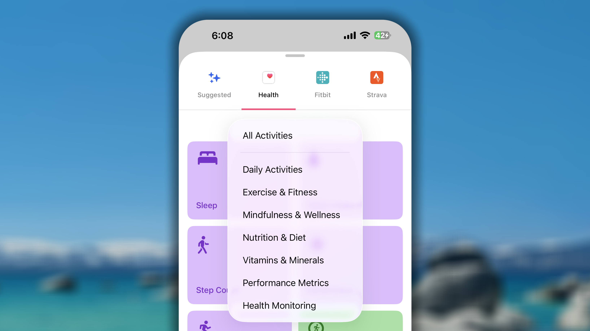
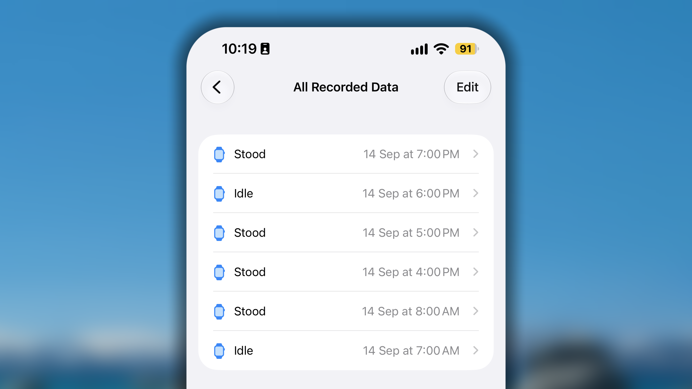
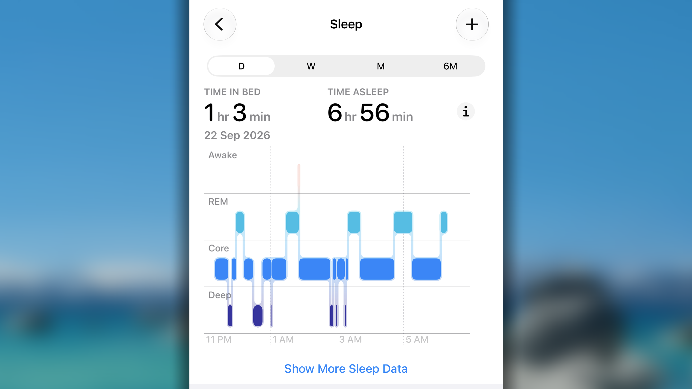

Automatizar o acompanhamento é uma das formas mais poderosas de manter a consistência. Ao conectar o Habitify ao Apple Health, o iPhone e o Apple Watch registram passos, sono, ingestão de água e outros dados, mantendo seu progresso preciso sem esforço manual.

A integração funciona nos dois sentidos: o Habitify lê dados de saúde e também pode enviar alguns registros manuais ao Apple Health, evitando inserir o mesmo número duas vezes.

## Adicionando um hábito sincronizado com o Apple Health

<iframe src="https://drive.google.com/file/d/1ycZxHYoHL8rjX1Y8N2QtklVAoaXYIT6d/preview" width="640" height="360" />

1. Em _Journal_, toque no botão \+ no canto inferior direito.
2. Selecione **Build Good Habit** ou **Break Bad Habit**.
3. Na parte superior da tela de criação, abra a aba **Health**, com o ícone do app Saúde.
4. Escolha o tipo de dado, como Steps.
5. Em _Health Access_, **ative o botão** para permitir a leitura e toque em **Allow**.
6. Configure normalmente os detalhes.
7. Toque no **botão ✓** para salvar.

O hábito conectado exibe um pequeno ícone do Apple Health no Journal, diferenciando-o dos hábitos manuais.

## Como funciona

- Os dados são sincronizados automaticamente. Ao alcançar a meta de um hábito positivo, o Habitify o marca como **Completed**, sem check-in manual.
- Você ainda pode marcar o hábito como **Skipped** ou **Failed** para registrar algo que o Apple Health não capturaria.

## Dados de saúde compatíveis

### Atividades diárias

Ideais para acompanhar movimentos cotidianos e os Anéis de Atividade do Apple Watch.

- **Atividades:** Sleep, Water Intake, Hand Washing, Stand Hours, Step Count, Mindfulness, Move Time, Stand Minutes, Exercise Time, Tooth Brushing e Sexual Activity.
- **Unidades:** as mesmas usadas no Apple Health. Por exemplo, Sleep em horas ou minutos, Water Intake em litros ou mL e Step Count em passos.

### Exercícios e condicionamento físico

Abrange treinos e períodos ativos.

- **Atividades:** duração e energia queimada em todos os tipos de treino, como Running, Walking, Cycling, Swimming e Strength Training.
- **Unidades:** duração (minutos, horas) e energia (kcal).

<Note>
  Para acompanhar o tempo de todos os treinos de uma só vez, use Exercise Time em Daily Activities.
</Note>

### Atenção plena e bem-estar

Ideal para saúde mental e descanso.

- **Atividades:** Time in Daylight e UV Exposure.
- **Unidades:** minutos por padrão e outras unidades de duração.

<Note>
  Para usar Mindful Minutes no hábito Meditation, encontre-o em Daily Activity.
</Note>

### Nutrição e dieta

Automatize metas alimentares sincronizando dados de aplicativos como MyFitnessPal pelo Apple Health:

- Fiber Intake, Protein Intake, Carbonhydrates, Monounsaturated Fat, Total Fat, Saturated Fat, Sugar Intake e Fat Intake — gramas por padrão e outras unidades de massa.
- Calories Consumed — kcal por padrão e outras unidades de energia.
- Cholesterol, Sodium Intake, Caffeine Intake e Blood Alcohol Content — miligramas por padrão e outras unidades de massa.
- Alcoholic Beverages — `rep` por padrão.

### Vitaminas e minerais

- **Dados:** Vitamin A, B6, B12, C, D, E e K, Calcium, Iron, Folate, Magnesium, Zinc, Niacin, Thiamin, Riboflavin, Biotin, Pantothenic Acid, Manganese, Copper, Selenium, Iodine, Phosphorus, Chloride e Molybdenum.
- **Unidades:** microgramas por padrão e outras unidades de massa.

### Métricas de desempenho

- **Active Calories:** calorias queimadas nas atividades e treinos, em kcal.
- **Flights Climbed:** número de andares subidos, em “times”; 1 andar = 1 vez.
- **Swimming Strokes:** número de braçadas, em “times”.
- **Cycling Power:** energia gerada pelas pernas ao pedalar, em joules e outras unidades de energia.
- **Rowing Distance:** distância remada, estimada pelo relógio ou medida por máquina conectada, em km, pés, jardas ou milhas.
- **Estimated Workout Effort:** avaliação subjetiva da dificuldade do treino, em “times”; 1 ponto = 1 vez.
- **Workout Effort Score:** pontuação objetiva da carga total do treino, em “times”.

### Monitoramento de saúde

- **Weight (Tracking the Action):** não acompanha o peso em kg ou lb, mas se você o registrou no Apple Health naquele dia. Ao salvar o peso, o hábito é concluído.
- **Medication Intake:** no _iOS 26 ou posterior_, o Habitify sincroniza a adesão a medicamentos, vitaminas e suplementos.  Veja [como adicionar um medicamento](https://support.apple.com/en-vn/105064).

## Sincronização bidirecional: registre no Habitify e envie ao Health

Ao registrar manualmente um valor compatível no Habitify, ele pode ser enviado ao Apple Health.

1. Em _Journal_, deslize o hábito para a direita.
2. Toque em **Log Progress**.
3. Selecione o modo **Add** e insira o valor.
4. Toque no **botão ✓** para salvar.

### **Dados não compatíveis com a sincronização bidirecional**

Embora possa **ler** quase todos os dados, o Habitify não pode **gravar** nos Anéis de Atividade nem nestas métricas automatizadas:

- **Exercise Time** (`.exerciseTime`, `.appleExerciseTime`)
- **Move Time** (`.appleMoveTime`)
- **Stand Time** (`.appleStandTime`)
- **Stand Hours** (`.appleStandHour`)
- **Medication**

Essas métricas são calculadas pelos algoritmos da Apple com dados brutos dos sensores. Aplicativos de terceiros não podem sobrescrever esses valores, pois isso comprometeria a precisão dos Anéis.

## Perguntas frequentes

<Accordion title="**Como conecto o Apple Health a um hábito existente sem perder minha sequência?**">
  Cada hábito permite apenas um método de registro por vez.

  Para preservar uma sequência de 30 dias, primeiro insira esses 30 dias no Apple Health. Depois, crie outro hábito sincronizado, que importará esses dados.
</Accordion>

<Accordion title="**A sincronização continua quando troco de telefone?**">
  Por segurança, as permissões do Apple Health não são transferidas para o novo iPhone. Reautorize o Habitify em **Settings > Health > Data Access & Devices > Habitify** e ative todas as permissões.

  Se ainda não funcionar, atualize cada conexão: **Edit habit > Goal > Manual Logging > Syncing with Apple Health**.

  Reativar as permissões e atualizar a conexão garante uma transição adequada.
</Accordion>

<Accordion title="**O Habitify parou de receber dados do Apple Health. O que devo fazer?**">
  Isso pode ocorrer após atualizações do iOS, do aplicativo ou ao trocar de dispositivo.

  **1/ Verifique as permissões**

  1. Abra **Settings** no iPhone.
  2. Toque em **Health**.
  3. Toque em **Data Access & Devices**.
  4. Selecione **Habitify**.
  5. Ative os tipos de dados desejados. Por exemplo, para Workout, ative Workouts.

  **2/ Dispare uma sincronização manualmente**

  1. Abra **Health**.
  2. Acesse o tipo sem sincronização, por exemplo, Browse \> Activity \> Steps ou Workouts.
  3. Toque em **Add Data**.
  4. Insira um valor, mesmo que seja 1 passo ou 1 minuto.
  5. Toque em **Add**.

  Isso pode levar o Apple Health a enviar os dados. Verifique o Habitify após um minuto.

  **3/ Atualize a conexão no Habitify**

  Se nada funcionar, desconecte e reconecte o hábito.

  **_Importante:_** _isso apaga os registros existentes desse hábito no Habitify. Só continue se as etapas anteriores falharem._

  1. Encontre o hábito sem sincronização.
  2. Toque e segure e selecione **Edit**.
  3. Toque em **Goal**.
  4. Em LOGGING METHOD, selecione **Manual Logging**.
  5. Confirme em **Erase Log**.
  6. Selecione novamente **Sync with Apple Health**.
  7. Se solicitado, toque novamente em **Erase Log**.
  8. Toque em **Save**.

  Essa redefinição cria uma conexão nova e limpa.
</Accordion>

<Accordion title="**O Habitify não recebe nenhum dado do Apple Health. O que devo fazer?**">
  As causas comuns são um tipo de treino incompatível ou uma unidade incorreta.

  **Motivo 1: tipo de treino incompatível**

  O modelo de hábito no Habitify **deve corresponder** ao tipo registrado no Apple Health. Para distância de corrida, use o modelo **Running**.

  Para verificar:

  1. Abra **Health**.
  2. Toque em **Browse** e **Activity**.
  3. Toque em **Workouts**.
  4. Toque em **Show All Data**.
  5. Abra o treino e verifique o **Workout Type**.

  **Motivo 2: unidade incorreta**

  A meta precisa usar uma unidade compatível:

  - **Distância:** km, mi ou m.
  - **Duração:** hr, min ou sec.
  - **Energia:** kcal ou cal.

  Verifique:

  1. Abra o hábito problemático.
  2. Observe a meta, como “Run 5 **km**” ou “Meditate 10 **minutes**”.
  3. Confirme que há uma unidade específica. Apenas “5”, sem unidade, não funciona.

  Se a unidade não for compatível, crie outro hábito alinhado ao tipo do Apple Health:

  - distância: **km** ou **mi**;
  - tempo: **hours** ou **minutes**;
  - calorias: **kcal** ou **cal**.

  Exemplo: se a corrida é registrada em quilômetros, a meta deve ser “Run 3 km”, e não “Run 3 times”.
</Accordion>

<Accordion title='**Um valor errado de calorias foi sincronizado. O que devo fazer?**'>
  Se uma meta de 500 Calories aparece como 500.000, a causa é a diferença entre Calorie e calorie.

  1. **Apple Health usa kcal:** como a maioria dos rastreadores, mede energia em **quilocalorias (kcal)**, frequentemente escritas como **Calories**.
  2. **Habitify oferece cal e kcal:** `cal` é a unidade menor; `kcal`, a maior.

  A conversão é: **1 kcal no Apple Health = 1.000 cal no Habitify**.

  Edite o hábito e escolha **kcal**, não cal.
</Accordion>

<Accordion title='**Como Exercise Time sincroniza os dados?**'>
  A diferença está entre **Workouts** e **Exercise Minutes**.

  - **Workout time** é a duração total de uma sessão registrada pelo Apple Watch ou outro aplicativo.
  - **Exercise Minutes** é o tempo calculado pelo Apple Watch conforme a intensidade: cada minuto completo de atividade igual ou superior a uma caminhada rápida. Também inclui sessões acompanhadas diretamente no relógio.

  O modelo **Exercise Time** sincroniza especificamente Exercise Minutes.

  Para sincronizar a duração de uma sessão:

  - Use Exercise Time e registre o treino no Apple Watch; ou
  - Use o modelo exato da atividade, como Running ou Swimming, defina uma meta de duração e conecte-o ao Apple Health.
</Accordion>

<Accordion title='**Como Stand Hours é calculado?**'>
  O Apple Watch registra dois tipos:

  - **Stand:** horas em que você ficou em pé e se moveu por pelo menos um minuto.
  - **Idle:** horas em que usou o relógio, mas permaneceu sentado ou inativo.

  

  Ambos ficam na categoria Stand Hours.

  - **Apple Health conta apenas Stand**, ocultando Idle da pontuação.
  - **Habitify conta Stand e Idle**, pois atualmente importa o volume total de registros dessa categoria.
</Accordion>

<Accordion title='**Como Sleep é calculado?**'>
  O Habitify acompanha **Time in Bed** e **Time Asleep**.

  

  Para não inflar as horas, ele aplica a regra **sem contagem dupla**: períodos sobrepostos são mesclados; períodos separados são somados.

  1. **Períodos separados:** soma as duas durações, como uma soneca e o sono noturno.
  2. **Um período dentro do outro:** usa a janela mais longa para não contar o período interno duas vezes.
  3. **Sobreposição parcial:** mescla em uma janela contínua, do início mais cedo ao fim mais tarde.

  | **Dados no Apple Health** | **Cálculo do Habitify** | **Resultado** |
  | :-- | :-- | :-- |
  | **Sem sobreposição** (2 h de soneca + 7 h à noite) | Soma as durações | **9 horas** |
  | **Um cobre o outro** (In Bed 23h–7h, Asleep 23h30–6h30) | Usa a janela abrangente | **8 horas** |
  | **Sobreposição parcial** (In Bed 23h–6h, Asleep 23h30–7h) | Mescla de 23h a 7h | **8 horas** |
</Accordion>
