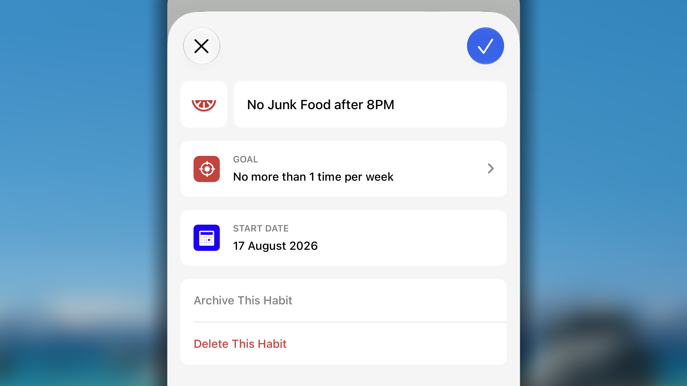
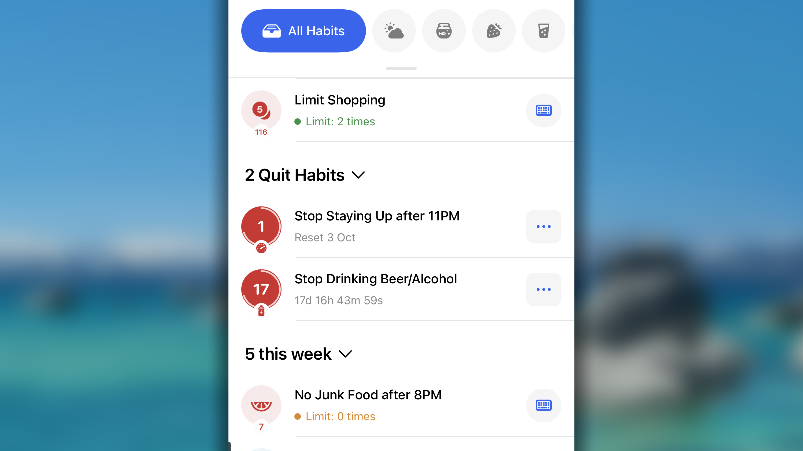
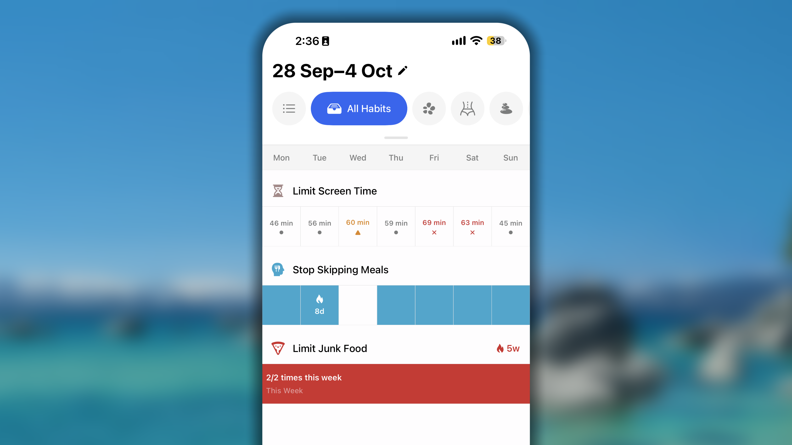
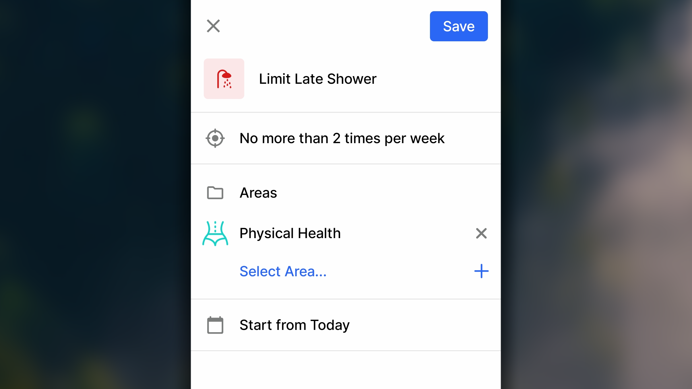
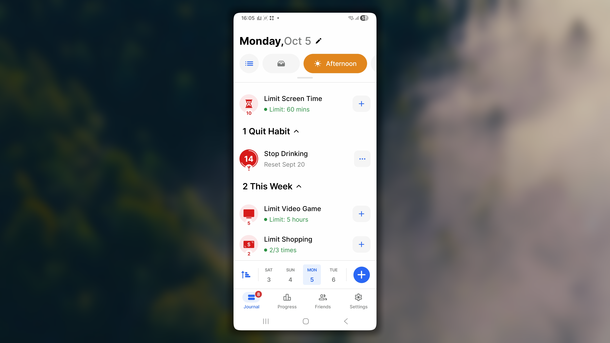
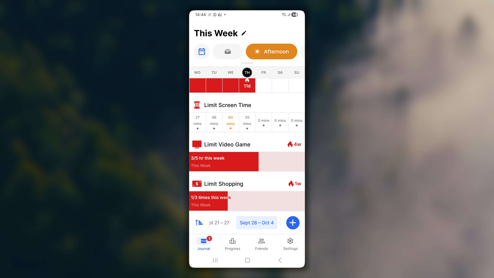

Um Hábito Negativo é um comportamento que você quer reduzir ou abandonar por ir contra a vida que deseja construir, desde olhar o celular ao acordar até fumar ou dormir tarde.

No Habitify, acompanhá-lo não é uma questão de culpa, mas de consciência. Ver o padrão com clareza é o primeiro passo para mudá-lo. Este artigo explica como criar e registrar o progresso de Hábitos Negativos.

<Tabs>
  <Tab title=" iOS">
    <iframe src="https://drive.google.com/file/d/1JXACNA-nd9Mx7n2um5IUahZSxCSxRiGq/preview" width="640" height="360" />

    ## Adicionando um hábito negativo

    1. Em **Journal**, toque no **botão \+**.
    2. Selecione **Break Bad Habit**.
    3. Escolha um modelo ou **Custom Habit**.
    4. Configure os detalhes.
    5. Toque no **botão ✓** para salvar.

    ## Detalhes

    

    ### Ícone e nome

    Permitem identificar o hábito no Journal, Progress e em todo o aplicativo.

    ### Meta

    Define o sucesso em dois tipos:

    - **No More Than (limite):** defina um máximo. Permanecer nele ou abaixo significa sucesso; ultrapassá-lo marca Failed.
    - **Quit This Habit (abandono):** a meta é zero ocorrências; uma única ocorrência causa falha.

    ### Data inicial

    A data a partir da qual o progresso é salvo e o hábito aparece no Journal.

    <Note>
      **Sucesso automático em dias passados**

      Se **Start from...** for uma data passada, todos os dias até ontem serão marcados automaticamente como Succeeded.
    </Note>

    ## Como aparece na lista

    O hábito aparece desde a data inicial. Como não há Repeat, Area nem Time of Day no iOS, ele sempre aparece em **All Habits** e nas listas de **Time of Day**.

    

    Na visualização diária:

    - **Limite com meta diária:** fica junto aos hábitos positivos diários.
    - **Abandono:** fica na categoria **Quit Habit(s)**.
    - **Limite semanal, mensal ou anual:** fica em **This Week**, **This Month** ou **This Year**.

    Após o check-in, vai para **Completed**, **Skipped** ou **Failed**.

    <Note>
      **Ao usar Mark as Done em um hábito de abandono**

      Ele permanece no lugar na visualização diária, com a indicação “Secured day [sequência atual]”.
    </Note>

    Na visualização semanal, permanece visível enquanto não estiver arquivado, independentemente do tipo e status.

    

    ## Registrando o progresso

    ### Status

    - **Succeeded:** valor total igual a 0 ou dentro do limite.
    - **Skipped:** você ultrapassou o limite ou praticou o hábito, mas tratou o dia como exceção; a sequência fica congelada.
    - **Failed:** valor acima do limite ou qualquer ocorrência em um hábito de abandono.

    ### **Check-in na visualização diária**

    <iframe src="https://drive.google.com/file/d/1NmlvYlsNKuYYOBJQ-OLSpgKhQhpL5LSf/preview" width="640" height="360" />

    **Abandono:**

    - Toque em ••• e escolha **Mark as Done** para confirmar que evitou o hábito ou **Reset my Streak** para registrar uma recaída.
    - Deslize para a esquerda para **Skip**.

    **Limite:**

    - Toque no botão ⌨️ para registrar progresso.
    - Deslize à esquerda para **Skip** ou **Fail**.
    - Deslize à direita para **Succeed** ou **Log Value**.

    ### **Check-in na visualização semanal**

    <iframe src="https://drive.google.com/file/d/1K2LKctsJpkbitevgJm_jAqDl2054iWT5/preview" width="640" height="360" />

    **Abandono:** segure a célula de hoje para Succeed, Skip ou Fail.

    **Limite diário:** toque na célula para registrar valor; segure para Skip ou Fail.

    **Limite semanal, mensal ou anual:** toque na faixa de progresso para abrir **Log Progress**.

    <Note>
      **Sucesso automático no fim do dia**

      Se o valor permanecer em 0 ou dentro do limite, o hábito é marcado como bem-sucedido.
    </Note>

    <Note>
      **Ao marcar Failed**

      - **Abandono:** registra automaticamente “1”.
      - **Limite:** marca falha, mas registra zero, pois o Habitify não sabe o valor real. Use **Log Progress** para informá-lo.
    </Note>

    ## Perguntas frequentes

    <Accordion title="**Como edito um hábito negativo?**">
      No Journal, toque no hábito, depois em ••• e em **Edit**. Se não aparecer hoje, acesse **Settings > All Habits**, toque no hábito e selecione **Edit**.
    </Accordion>

    <Accordion title="**Como desfaço um registro incorreto?**">
      Se já houver status: deslize à direita, selecione **Undo** e escolha **Remove Today Data** ou **Edit Log Manually**; nesta última opção, deslize o registro à esquerda e toque em Delete.

      Se ainda estiver em andamento: toque no hábito, em •••, em **Log History**, deslize o registro à esquerda e toque em **Delete**.
    </Accordion>

    <Accordion title="**Como altero o status em uma data passada?**">
      Toque no hábito, em •••, selecione **Log Progress**, escolha a data e insira o valor.
    </Accordion>
  </Tab>
  <Tab title="🤖 Android">
    <iframe src="https://drive.google.com/file/d/1ZrL5VHuGdFN-NG4dF4HeHAsKgzENeDmZ/preview" width="640" height="360" />

    ## Adicionando um hábito negativo

    1. Em _Journal_, toque no **botão \+** na barra de data.
    2. Selecione **Break Bad Habit**.
    3. Escolha um modelo ou **Create Your Own**.
    4. Configure os detalhes.
    5. Toque em **Save**.

    ## Detalhes

    

    ### Ícone e nome

    Identificam o hábito em todo o aplicativo.

    ### Meta

    - **No More Than:** defina um máximo; ultrapassá-lo marca Failed.
    - **Quit This Habit:** zero ocorrências; uma única ocorrência causa falha.

    ### Áreas

    Associe o Hábito Negativo a uma ou várias Áreas, como Saúde ou Crescimento Pessoal, para exibi-lo junto aos hábitos positivos daquela parte da vida.

    ### Start from...

    A data a partir da qual o progresso é salvo e o hábito aparece no Journal.

    <Note>
      **Sucesso automático em dias passados**

      Se Start from... for uma data passada, todos os dias até ontem serão marcados como Succeeded.
    </Note>

    ## Como aparece na lista

    Sem Repeat nem Time of Day, aparece diariamente em **All Habits**, listas de **Time of Day** e suas **Áreas**.

    Na visualização diária:

    - Limite diário fica com hábitos positivos diários.
    - Abandono fica em **Quit Habit(s)**.
    - Limite semanal, mensal ou anual fica em **This Week**, **This Month** ou **This Year**.

    

    Após o check-in, vai para **Completed**, **Skipped** ou **Failed**.

    <Note>
      Ao usar Mark as Done em um hábito de abandono, ele permanece no lugar com “Secured day [sequência atual]”.
    </Note>

    Na visualização semanal, permanece visível enquanto não estiver arquivado.

    

    ## Registrando o progresso

    ### Status

    - **Succeeded:** 0 ou dentro do limite.
    - **Skipped:** exceção que congela a sequência.
    - **Failed:** acima do limite ou qualquer ocorrência em um hábito de abandono.

    ### Check-in na visualização diária

    <iframe src="https://drive.google.com/file/d/189jfRYtYVd0qdl_BnCsXaZb9Bv7MXsgU/preview" width="640" height="360" />

    **Abandono:** toque em ••• e escolha **Mark as Done** ou **Reset my Streak**; deslize à esquerda para **Skip**.

    **Limite:** toque no botão inteligente, exibido como **+** para limite de 1 vez ou **+1** para outros limites; deslize à esquerda para Skip/Fail e à direita para Succeed/Log Value.

    ### Check-in na visualização semanal

    <iframe src="https://drive.google.com/file/d/1ca3j2CU9yJLAqvWBtmpsfRPJyXQ1GO5c/preview" width="640" height="360" />

    **Abandono:** segure a célula de hoje para Succeed, Skip ou Fail.

    **Limite diário:** toque para registrar valor; segure para Skip ou Fail.

    **Limite semanal, mensal ou anual:** toque na faixa para abrir **Log Value**.

    <Note>
      No fim do dia, um valor 0 ou dentro do limite é marcado automaticamente como sucesso.
    </Note>

    <Note>
      **Falha em hábito de limite:** marca o dia como Failed, mas registra zero. Use **+** ou **+1** para inserir o valor real.
    </Note>

    ## Perguntas frequentes

    <Accordion title="**Como edito um hábito negativo?**">
      Na Day view, abra o hábito, toque em ⫶ e em **Edit**. Na Week view, segure o progresso e selecione **Edit**. Toque em Save para salvar.
    </Accordion>

    <Accordion title="**Como desfaço um registro incorreto?**">
      Se já houver status, deslize à direita, selecione **Undo** e **Remove Today Data** ou **Edit Log Manually**. Se ainda estiver em andamento, abra o hábito, toque em ⋮, em **Log History**, deslize o registro e toque em **Delete**.
    </Accordion>

    <Accordion title="**Como altero o status em uma data passada?**">
      Para Skip ou Fail, navegue à data na Day view, encontre o hábito e deslize à direita. Para um valor, abra o hábito, toque em ⋮, selecione **Log Progress**, informe valor e data e toque em **Save**.
    </Accordion>
  </Tab>
  <Tab title="🖥️ Web e Desktop">
    <iframe src="https://drive.google.com/file/d/1bS8_yZNGcvvpUC7lfniZip9lnKWDVlxu/preview" width="640" height="360" />

    ## Adicionando um hábito negativo

    - Acesse **All Habits** na barra lateral.
    - Clique em **+ Add habit**.
    - Selecione **Break Bad Habit**.
    - Clique no campo de nome, escolha um modelo ou insira o seu.
    - Configure e clique em **Save**.

    ## Detalhes

    ### Ícone e nome

    Identificam o hábito em listas, Progress e no restante do aplicativo.

    ### Quit/Limit

    - **Quit:** zero ocorrências; uma única ocorrência causa falha.
    - **Limit:** defina um máximo; ultrapassá-lo marca Failed.

    ### Start Date

    Data a partir da qual o progresso é salvo.

    ## Como aparece na lista

    No Grid layout, aparece imediatamente; células anteriores à Start Date ficam riscadas e indisponíveis.

    No List layout, aparece a partir da Start Date:

    - Abandono e limite diário: **Negative Habit(s)**.
    - Limite semanal, mensal ou anual: **This Week**, **This Month** ou **This Year**.

    Sem Time of Day e Area, aparece apenas em **All Habits**.

    ## Registrando o progresso

    <iframe src="https://drive.google.com/file/d/1G4XMR8nlo8NgsXCxtxtQicU8WorOfvTQ/preview" width="640" height="360" />

    ### Status

    - **Succeeded/Completed:** 0 ou dentro do limite.
    - **Skipped:** exceção que congela a sequência.
    - **Failed:** acima do limite ou qualquer ocorrência em abandono.

    ### Como fazer check-in

    #### Grid layout

    - Selecione a célula e use a barra inferior; ou
    - Clique com o botão direito e use o menu.

    #### List layout

    - Selecione o hábito e use a barra inferior;
    - clique com o botão direito; ou
    - passe o cursor, clique em ••• e escolha uma ação.

    <Info>
      No fim do dia, valor 0 ou dentro do limite é marcado automaticamente como Succeeded/Completed.
    </Info>

    <Info>
      Se Start Date for uma data passada, todos os dias até ontem são marcados como Succeeded.
    </Info>

    <Note>
      **Ao marcar Failed:** abandono registra “1”; limite marca falha e registra zero. Use **Add Log** para informar o valor real.
    </Note>

    ## Perguntas frequentes

    <Accordion title="**Como edito um hábito negativo?**">
      No Grid layout, abra o hábito e clique no botão 🖊 no canto superior direito.
    </Accordion>

    <Accordion title="**Como desfaço um registro incorreto?**">
      Abra o progresso individual (duplo clique no nome no Grid; clique único no List), abra a barra lateral, acesse **Log History**, selecione os registros e clique em **Delete**.
    </Accordion>

    <Accordion title="**Como altero o status em uma data passada?**">
      Abra o progresso individual, clique em ⌨️, informe valor e data e clique em **Add Log**.
    </Accordion>
  </Tab>
</Tabs>
