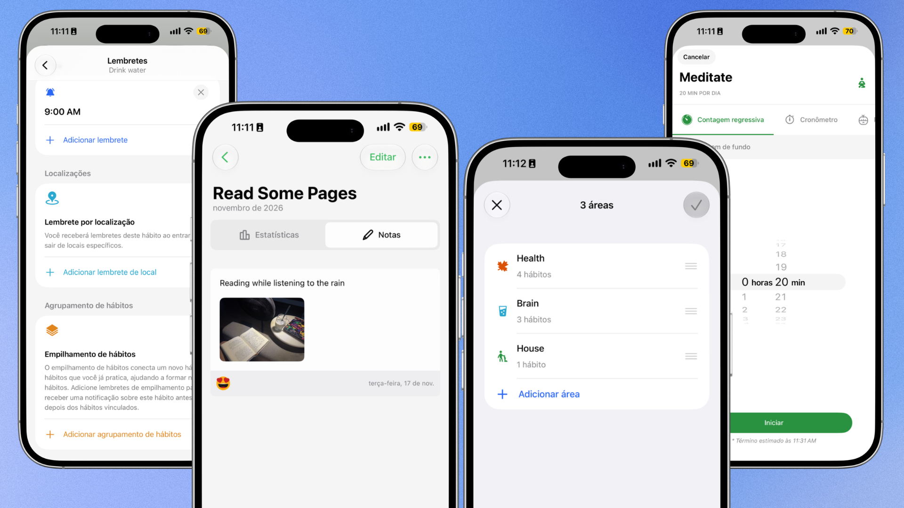
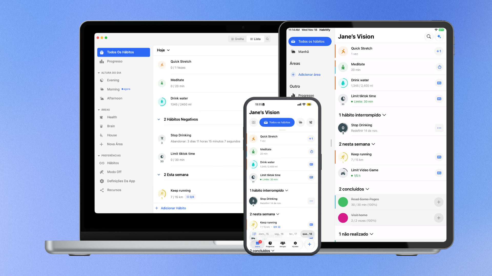

O Habitify é um aplicativo de acompanhamento de hábitos criado em torno de uma ideia simples: mudanças duradouras vêm de ações pequenas e consistentes, acompanhadas com honestidade ao longo do tempo. Em vez de depender apenas da memória ou da força de vontade, o Habitify oferece uma visão diária focada no que precisa ser feito, uma maneira fácil de registrar suas ações e uma imagem clara da sua evolução real — no celular, no computador e na web, sempre sincronizada.

## Acompanhe hábitos bons e ruins

O Habitify oferece suporte a dois tipos de hábito, porque criar algo novo e abandonar algo antigo são jornadas realmente diferentes:

- [Bons hábitos](/pt-BR/good-habits): aquilo que você deseja desenvolver, como se exercitar, ler ou beber mais água. Defina uma meta por dia, semana, mês ou ano, e o Habitify acompanhará sua consistência.
- [Maus Hábitos](/pt-BR/bad-habits): aquilo que você deseja reduzir ou abandonar completamente, como fumar ou passar tempo demais rolando conteúdo negativo. Defina um limite que não deve ser ultrapassado ou comprometa-se a parar totalmente; o Habitify acompanhará seu autocontrole, e não sua produção.

Os dois tipos são registrados da mesma forma — defina o hábito uma vez e faça check-in diariamente — enquanto o aplicativo adapta, nos bastidores, a forma de medir o sucesso de cada um.

## Conjunto de recursos

Depois de dominar o básico, você terá um conjunto completo de ferramentas para organizar seus hábitos e entender _por que_ eles dão certo ou saem do rumo:

- [Áreas](/pt-BR/area): agrupe hábitos relacionados em categorias da vida, como "Saúde" ou "Trabalho", para entender como uma parte inteira da sua vida está evoluindo, e não apenas um hábito isolado.
- [Notas](/pt-BR/note): um pequeno diário vinculado a cada hábito para registrar o contexto — humor e imagens — por trás de um check-in.
- [Timer](/pt-BR/timer): modos Contagem regressiva, Cronômetro e Pomodoro para qualquer hábito medido por tempo.
- [Lembretes](/pt-BR/reminder): baseados em horário, localização ou encadeamento de hábitos, para que o estímulo certo chegue no momento certo.
- [Visualização de progresso](/pt-BR/overall-progress): mapas de calor, pontuações diárias e análises de padrões que mostram sua consistência real ao longo de semanas e meses, não apenas no dia atual.

## Acompanhamento de humor e Reflexão

Acompanhar hábitos é apenas um lado do crescimento pessoal; entender como essas rotinas afetam seu bem-estar mental é o outro.

Por isso, [Reflexão](/pt-BR/reflection) é o espaço do Habitify dedicado à atenção plena: registre seu humor com um emoji, adicione uma nota sobre o dia e veja tudo reunido com o progresso dos seus hábitos.

Juntos, Reflexão e Notas transformam o Habitify de um simples rastreador em um registro verdadeiro da sua jornada, e não apenas das suas marcações.

## Círculo e Desafio

Criar hábitos não precisa ser um esforço solitário — e pode ser mais divertido quando amigos e familiares participam. É aí que entram o Círculo e o Desafio.

Com o [Círculo](/pt-BR/circle), você cria um espaço privado e contínuo com as pessoas que mais importam: compartilham o progresso de vários hábitos, incentivam umas às outras e mantêm a responsabilidade no longo prazo.

Com o [Desafio](/pt-BR/challenge), você participa de um esforço competitivo, com duração definida, em torno de uma única meta compartilhada — com classificação, sequências e pontuação opcional para tornar tudo mais interessante.

Independentemente do formato ideal para o seu grupo, o Habitify transforma o acompanhamento de algo que você faz sozinho em algo que todos constroem juntos.

## Integrações e automação

O Habitify não funciona de forma isolada; ele foi criado para se conectar às ferramentas e aos dispositivos que já fazem parte da sua vida:

- **Sincronização de saúde e condicionamento físico**: Apple Health, Health Connect, Strava e Fitbit permitem que o dispositivo registre os dados automaticamente para você.
- **Sincronização de calendário**: Google Calendar, Outlook Calendar e Apple Calendar colocam seus hábitos ao lado do restante da sua agenda.
- **Acompanhamento do tempo de tela**: Tempo de Uso e RescueTime transformam o uso real dos dispositivos em dados de hábito, tanto para desenvolver hábitos digitais mais saudáveis quanto para reduzir distrações.
- **Plataformas de automação**: Zapier e IFTTT conectam o Habitify a centenas de outros aplicativos e serviços, permitindo que a conclusão de um hábito acione — ou seja acionada por — praticamente qualquer outra ferramenta que você use.
- **Automação integrada**: Atualização de status marca automaticamente hábitos não registrados no horário escolhido; etiquetas NFC transformam objetos físicos em check-ins com um toque; e Atalhos — além da Siri — permitem registrar o progresso por voz sem abrir o aplicativo.

## Comece e evolua conforme sua necessidade

Você não precisa usar tudo de uma vez. A maioria das pessoas começa com alguns hábitos no plano Grátis, adiciona áreas e lembretes conforme a rotina cresce e inclui integrações e automações somente depois de passar para o Pro e saber exatamente o que deseja automatizar.

O Habitify foi desenvolvido para crescer com você, mantendo-se tão simples ou conectado quanto seu acompanhamento de hábitos realmente precisa ser.

## Mantenha o ritmo em todos os lugares

Seus hábitos não devem parar quando você fecha o aplicativo. O Habitify acompanha você no celular, tablet, computador e na web, sincronizando automaticamente para que seu progresso esteja sempre atualizado, não importa onde você faça check-in.

