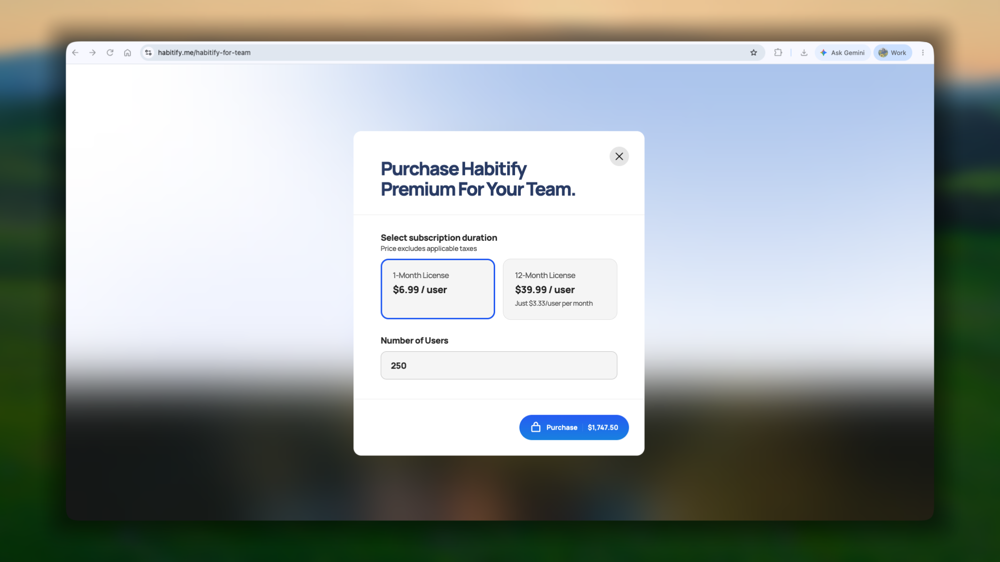
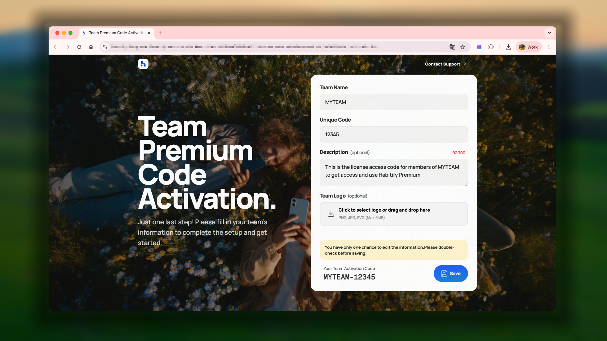

O Habitify for Team facilita a compra e a distribuição em massa do acesso Premium para sua equipe ou organização.

Em vez de cada integrante pagar separadamente, uma pessoa cuida da compra e das licenças e distribui o acesso por meio de um Team Code compartilhado.

## Comprar licenças para a equipe

1. Acesse nossa página de assinaturas para equipes:  [https://habitify.me/habitify-for-team](https://habitify.me/habitify-for-team)
2. Clique em **Upgrade Your Team** na página inicial.
3. Na tela de configuração da compra:
   
   1. Escolha a duração da licença: **1 mês** ou **12 meses**.
   2. Informe o **número de usuários**, ou licenças, correspondente ao número de integrantes da equipe. O mínimo é 30.
   3. Toque em **Purchase [preço total]** para continuar.
4. Confira novamente os detalhes do pedido e toque em **Purchase**.
5. Na _janela de pagamento seguro_, informe:
   - **Seu endereço de e-mail:** ele é essencial, pois enviaremos a fatura e o link de configuração do código de licença para esse endereço.
   - **Seu país:** necessário para cobrança e aplicação das políticas.
   - **Forma de pagamento:** escolha **PayPal** ou cartão de crédito ou débito.

Após a conclusão do pagamento, você receberá um e-mail de confirmação do pedido com o link para a próxima etapa. Abra-o para acessar o link e configurar o código de licença.

## Configurar o código de licença da equipe

Depois da compra, crie o código exclusivo que os integrantes usarão para ativar o Habitify PRO nas próprias contas.

Procure na caixa de entrada um e-mail com o assunto **“Configure Your Habitify License”** e clique no link.

O link abrirá uma página de configuração. Preencha:

- **Team Name** e **Unique Code**: essas informações serão usadas para gerar o código de acesso.
- **Description** (opcional).
- **Team Logo** (opcional).

Quando tudo estiver pronto, toque em **Save**.

Você será redirecionado a uma tela final que confirma a criação do código e fornece um **link de compartilhamento**.

Envie esse link aos integrantes da equipe. Ao abri-lo, eles verão uma página com o nome, o logotipo e o código exclusivo necessário para ativar o acesso Premium.

## Ativar com o código de licença da equipe

Tenha os itens a seguir em mãos:

1. **Uma conta Habitify:** instale o aplicativo e entre na sua conta pessoal. Se ainda não tiver uma conta, crie uma primeiro.
2. **Seu código de licença:** use o código exclusivo fornecido pelo administrador da equipe. Se não o tiver, solicite-o diretamente ao gerente ou administrador.

<Tabs>
  <Tab title="iOS">
    1. Abra o Habitify e acesse **Settings**. _Talvez você precise abrir Progress primeiro para visualizar Settings._
    2. Em _Settings_, localize e toque em **Payment and Billing**.
    3. Em _Payment_, toque em **Enter Code**.
    4. Digite o código e toque em **Redeem**.

    Se a guia Upgrade não aparecer mais na barra de navegação inferior, o acesso PRO foi ativado com sucesso.
  </Tab>
  <Tab title="Android">
    1. Abra o Habitify e acesse **Settings**.
    2. Em _Settings_, vá à seção Payment e toque em **Enter Code**.
    3. Digite o código e toque em **Save**.

    Se a guia Upgrade não aparecer mais na barra de navegação inferior, o acesso PRO foi ativado com sucesso.
  </Tab>
</Tabs>

## **Como funciona a licença de equipe**

Estas são as regras principais:

- **Sem data de validade:** o código de ativação não expira. Você pode comprá-lo agora e distribuí-lo quando a equipe estiver pronta.
- **Um resgate por conta:** cada conta Habitify pode resgatar um código específico apenas uma vez.
- **A duração começa no resgate:** o período de acesso PRO não começa no dia da compra, mas no momento em que o integrante resgata o código no aplicativo.

**Exemplo:** você compra uma licença de equipe de um mês em **1º de julho de 2026**. Se um integrante esperar até **7 de julho de 2026** para resgatar o código e ativar o Premium, ele terá acesso PRO até **7 de agosto de 2026**.

**Habitify Team funciona como uma licença de acesso por tempo limitado, não como uma assinatura, e não é renovado automaticamente.** Ao final do período ativado, a conta do integrante retorna automaticamente à versão gratuita.

Para restaurar o acesso PRO, o administrador precisa comprar um novo código de ativação e fornecê-lo ao integrante, que poderá resgatá-lo para iniciar outro ciclo de acesso.
