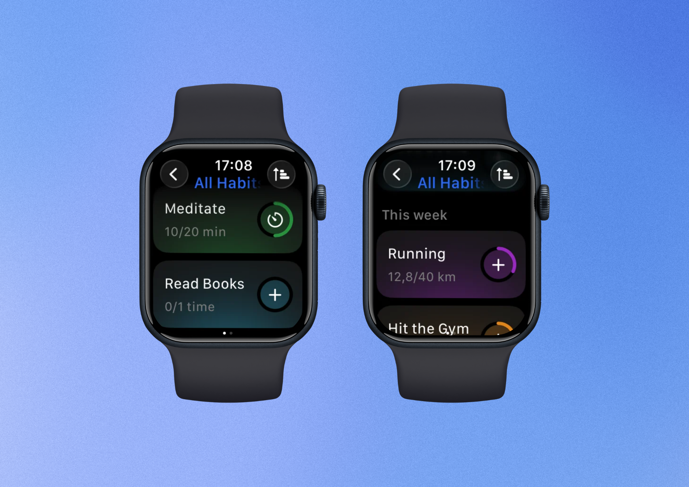

O app Habitify para Apple Watch permite ver seus hábitos, registrar o progresso, usar um Timer e pular ou marcar um hábito como não realizado diretamente do pulso, sem precisar pegar o celular. Ele sincroniza com o app Habitify no iPhone, assim seus hábitos, histórico de check-ins e ajustes já estarão disponíveis quando você o abrir.

Este artigo aborda todos os recursos do app para watchOS.

## Entrar no Habitify pelo Apple Watch

**Antes de começar, confira se:**

- O Habitify está instalado no iPhone e você iniciou uma sessão.
- O Apple Watch **está emparelhado com** esse iPhone.
- Os dois dispositivos **usam o mesmo Apple ID, com as Chaves do iCloud ativadas**. O Apple Watch obtém suas credenciais de acesso do iPhone por meio das Chaves do iCloud.
- O **Bluetooth está ativado** no iPhone.

**Abrir o app pela primeira vez**

1. Instale o Habitify no Apple Watch.
2. **Mantenha o iPhone perto do Apple Watch** e **mantenha o app Habitify aberto** no iPhone.
3. Abra o Habitify no Apple Watch.
4. Aguarde enquanto o app sincroniza com o iPhone. Ele importa seus hábitos, histórico de check-ins e ajustes.

## Ver listas de hábitos no Apple Watch

A primeira tela se chama **Hoje**. Ela mostra três grupos de listas:

1. **Todos os hábitos:** todos os seus hábitos de hoje.
2. **Hora do dia:** uma lista para cada período do dia, como Manhã, Tarde e Noite. O período atual é identificado como **Agora**. Os demais mostram o respectivo intervalo de tempo, por exemplo, 18:00 – 00:00.
3. **Áreas:** uma lista para cada uma das suas áreas personalizadas.

Cada lista mostra quantos hábitos você concluiu em relação ao total de hoje, por exemplo, 0/4.

Toque em uma lista para ver os hábitos que ela contém. Cada lista tem dois modos de visualização: **Hoje** e **Últimos 7 dias**.

###  Visualização Hoje

A visualização Hoje é aberta primeiro. O nome da lista, como **Todos os hábitos**, aparece na parte superior, com um botão de voltar no canto superior esquerdo.

Cada linha mostra o nome do hábito, seu progresso em relação à meta (por exemplo, 10/20 min, 0/1 vez ou 12,8/40 km) e um botão à direita. Um anel ao redor do botão é preenchido conforme você se aproxima da meta.

Os hábitos aparecem na ordem definida no app para iOS, agrupados por tipo de meta e status. Por exemplo, hábitos com meta semanal aparecem sob o título **Esta semana**.

Ao lado de cada hábito há um botão que muda conforme a meta do hábito:

<table>
  <colgroup>
    <col width="241" />
    <col width="149" />
    <col width="345" />
  </colgroup>
  <thead>
    <tr>
      <th>Meta do hábito</th>
      <th>Botão</th>
      <th>O que ele faz</th>
    </tr>
  </thead>
  <tbody>
    <tr>
      <td>Duração (minutos ou horas)</td>
      <td>Timer</td>
      <td>Inicia uma sessão de contagem regressiva</td>
    </tr>
    <tr>
      <td>Unidade “vezes”</td>
      <td>Plus (+)</td>
      <td>Adiciona um valor ao progresso do hábito</td>
    </tr>
    <tr>
      <td>Qualquer outra unidade</td>
      <td>Registrar</td>
      <td>Permite inserir um valor</td>
    </tr>
  </tbody>
</table>

### Visualização Últimos 7 dias

Para acessar a visualização dos últimos 7 dias, deslize para a esquerda na visualização Hoje.

Nessa visualização, você pode ver sua lista de hábitos com o progresso dos últimos 7 dias de cada hábito. Leia a visualização de cima para baixo:

1. Uma linha de letras correspondentes aos dias da semana na parte superior mostra os últimos 7 dias. O dia de hoje é a letra circulada à direita.
2. Abaixo dela, cada hábito mostra o nome e um quadrado por dia, na cor do hábito, alinhados sob as letras dos dias da semana.
3. Um hábito com meta semanal, mensal ou anual mostra uma barra para o período atual em vez de sete quadrados.

Aqui, os hábitos são ordenados independentemente do tipo de meta e do status.

## Ver a visualização de progresso de um hábito

Toque em qualquer hábito para abrir a visualização do progresso. Role para baixo para ver, nesta ordem:

1. **Nome e progresso do hábito:** seu progresso em relação à meta do período atual, por exemplo, 2/3 vezes nesta semana. Um anel à direita mostra o status do hábito. Sua sequência atual aparece como um selo de chama com o número de dias, por exemplo, 0d.
2. **Checklist**, se o hábito tiver uma. Os itens concluídos aparecem marcados e riscados.
3. **Histórico:** o que é exibido depende do tipo de meta do hábito (veja abaixo).
4. **Notas de hoje:** as notas de texto que você adicionou hoje.

#### O que o histórico mostra

<table>
  <colgroup>
    <col width="100" />
    <col width="597" />
  </colgroup>
  <thead>
    <tr>
      <th>Meta do hábito</th>
      <th>Histórico</th>
    </tr>
  </thead>
  <tbody>
    <tr>
      <td>Diária</td>
      <td>**Últimas 4 semanas:** uma grade com uma coluna para cada dia da semana (de S a D) e uma linha para cada uma das últimas 4 semanas. Os quadrados mais claros representam dias em que você concluiu o hábito. Os quadrados mais escuros representam dias em que não o concluiu.</td>
    </tr>
    <tr>
      <td>Semanal</td>
      <td>**Últimas 4 semanas:** uma barra por semana, identificada como Esta semana, Semana passada e depois com intervalos de datas, como 11 de jul. – 18 de jul.</td>
    </tr>
    <tr>
      <td>Mensal</td>
      <td>**Últimos 3 meses:** uma barra por mês, identificada com o mês e o ano.</td>
    </tr>
    <tr>
      <td>Anual</td>
      <td>Sem histórico. A visualização mostra apenas a checklist e as notas.</td>
    </tr>
  </tbody>
</table>

Nas barras, a parte preenchida mostra quanto da meta você concluiu nesse período.

## Registrar o progresso do hábito

### Como registrar o progresso

Há 2 maneiras de registrar o progresso de um hábito no Apple Watch:

- Na **visualização Dia** da sua lista de hábitos, use os botões inteligentes ao lado do hábito.

- Abra a **visualização de progresso do hábito** e toque no botão para registrar um valor no canto inferior direito.

### **Como** pular ou marcar um hábito como não realizado hoje

1. Abra a visualização de progresso do hábito.
2. Toque no botão de **3 pontos**.
3. Escolha **Pular hoje** ou **Marcar como não realizado**.

## Adicionar uma nota ao hábito

1. Abra a visualização de progresso do hábito.
2. Toque no botão de **3 pontos**.
3. Escolha **Nota de texto** e adicione sua nota.

## Usar uma sessão do Timer

### Como iniciar uma sessão

1. Na visualização Hoje, toque no botão de **Timer** ao lado do hábito.
2. Acesse a **Contagem regressiva** padrão: toque nos **minutos** ou **segundos** para selecioná-los e gire a Digital Crown para definir o tempo.
3. Acesse o **Cronômetro**: deslize a tela de Contagem regressiva para a esquerda.
4. Toque em **Iniciar**.

### Controlar uma sessão em andamento

O Apple Watch mostra uma contagem regressiva ao vivo com três controles:

- **Pausar e retomar:** toque no botão de pausa (||) no canto inferior direito. Ele muda para um ícone de reprodução (▶). Toque nele para retomar.
- **Sons de fundo:** toque no ícone de fones de ouvido ao centro para ativar ou desativar os sons ambientes de fundo.
- **Parar e salvar:** toque no **X** no canto superior esquerdo para parar o Timer. O Habitify pergunta se você deseja salvar o tempo decorrido no progresso do hábito daquele dia. Por exemplo, se sua meta for de 30 minutos e você parar aos 15, poderá salvar os 15 minutos ou descartá-los.

## Perguntas frequentes

<AccordionGroup>
  <Accordion title="**Por que meus hábitos não aparecem no Apple Watch?**">
    1. No iPhone, abra o Habitify e puxe a lista de hábitos para baixo a partir do topo para atualizá-la. Depois, abra o Habitify novamente no Apple Watch.
    2. Confira se o Bluetooth está ativado e se o Apple Watch está conectado ao iPhone.
    3. Reinicie o iPhone e o Apple Watch.
  </Accordion>

  <Accordion title="**O app está travado em “Aguardando autenticação”. O que devo fazer?**">
    Isso acontece quando as Chaves do iCloud estão desativadas em um dos dispositivos ou quando o Apple Watch e o iPhone usam Apple IDs diferentes.

    1.  No iPhone, abra **Ajustes**.
    2. Toque em **[seu nome]** e depois em **iCloud**.
    3. Toque em **Senhas** e ative **Sincronizar este iPhone**.
    4. Confirme que o Apple Watch está com uma sessão iniciada no mesmo Apple ID do iPhone. Se os ajustes do watchOS tiverem uma opção de Chaves, confirme que ela está ativada.
    5. Mantenha o iPhone perto do Apple Watch, com o Habitify aberto no iPhone, por 2 a 5 minutos.
    6. Abra o Habitify novamente no Apple Watch.

    Se ele continuar travado, reinicie os dois dispositivos, abra o Habitify primeiro no iPhone e depois no Apple Watch ou reinstale o app no Apple Watch. Se o problema persistir, entre em contato conosco e informe o modelo do iPhone, o modelo do Apple Watch e a versão do watchOS, além de enviar um vídeo curto do problema.
  </Accordion>

  <Accordion title="**Por que não vejo o botão de Timer em um hábito?**">
    O botão de Timer aparece apenas em hábitos com uma meta em minutos ou horas. Ele não aparece em hábitos de sim/não ou hábitos medidos em outras unidades. Confira a meta do hábito no iPhone e confirme que ela usa uma unidade de duração.
  </Accordion>

  <Accordion title="**Por que meus hábitos aparecem de formas diferentes nas visualizações Hoje e Últimos 7 dias?**">
    As duas visualizações mantêm a ordem dos hábitos do app para iOS. A visualização Hoje também agrupa os hábitos por tipo de meta e status. A visualização Últimos 7 dias não faz esse agrupamento, portanto mostra a mesma ordem independentemente do tipo de meta e do status.
  </Accordion>

  <Accordion title="**Quais complicações estão disponíveis para o Habitify?**">
    O Habitify tem três complicações:

    1. **Redonda:** Toque para acompanhar.
    2. **Canto:** Toque para acompanhar.
    3. **Central:** uma complicação retangular que mostra uma destas opções: a lista de hoje, a lista do período atual do dia ou um mapa de blocos do progresso de um hábito.

    As complicações que você pode adicionar dependem dos espaços disponíveis no mostrador do Apple Watch
  </Accordion>

  <Accordion title="**Marquei um hábito como não realizado ou pulado por engano. Como faço para desfazer?**">
    Abra o hábito e toque em **Redefinir** no canto inferior direito da visualização de progresso.
  </Accordion>

  <Accordion title="**Posso ver no Apple Watch todas as notas que já registrei?**">
    Não. O Apple Watch mostra apenas as notas de hoje, em **Notas de hoje**, na visualização de progresso de um hábito. As notas de dias anteriores não são exibidas no Apple Watch.

    Para ler notas mais antigas, use o Habitify no iPhone:

    1. **Notas de um hábito:** no Diário, toque no hábito e abra a aba **Nota**.
    2. **Notas de todos os hábitos:** no Diário, puxe a lista para baixo para abrir Reflexão. Ela mostra suas notas e registros de humor em um só lugar.
  </Accordion>
</AccordionGroup>
