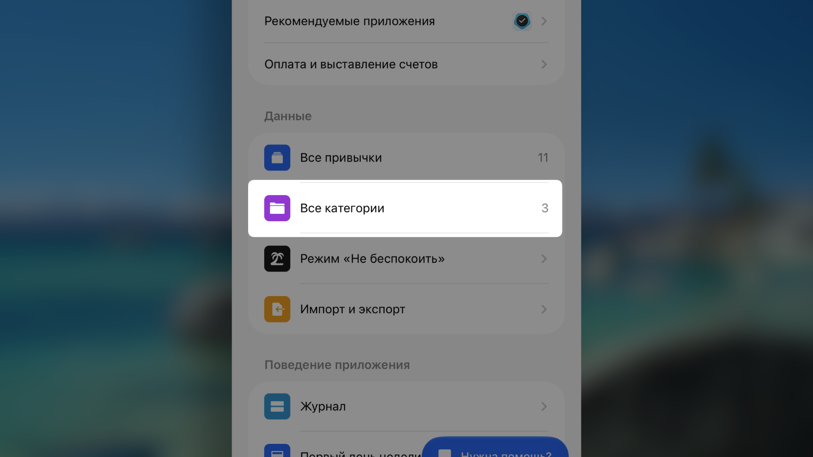
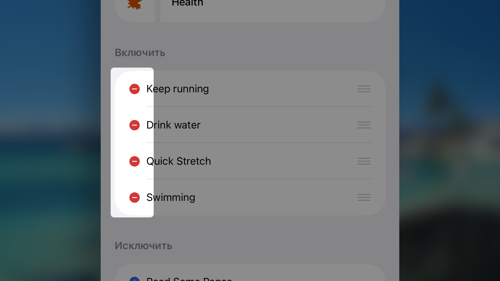
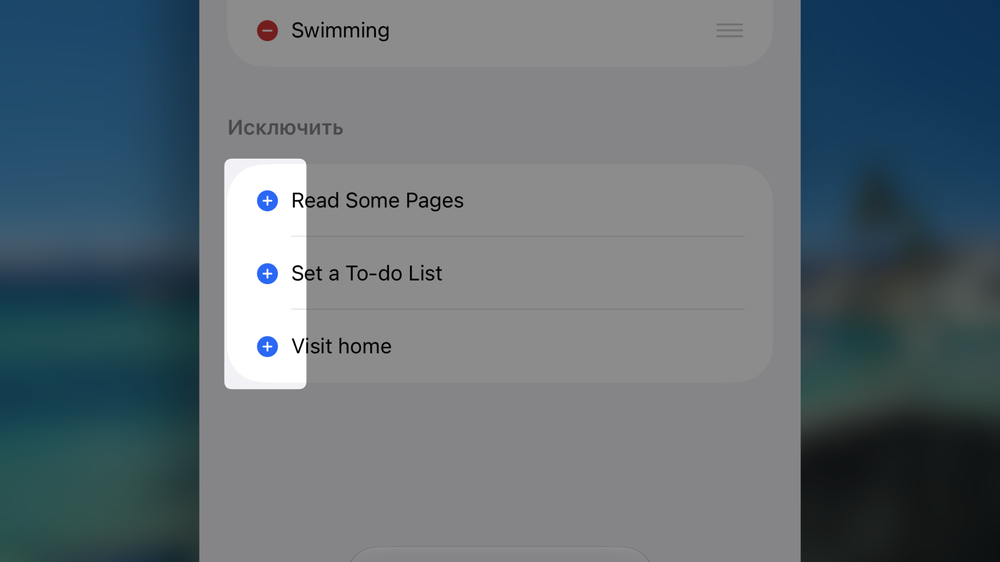
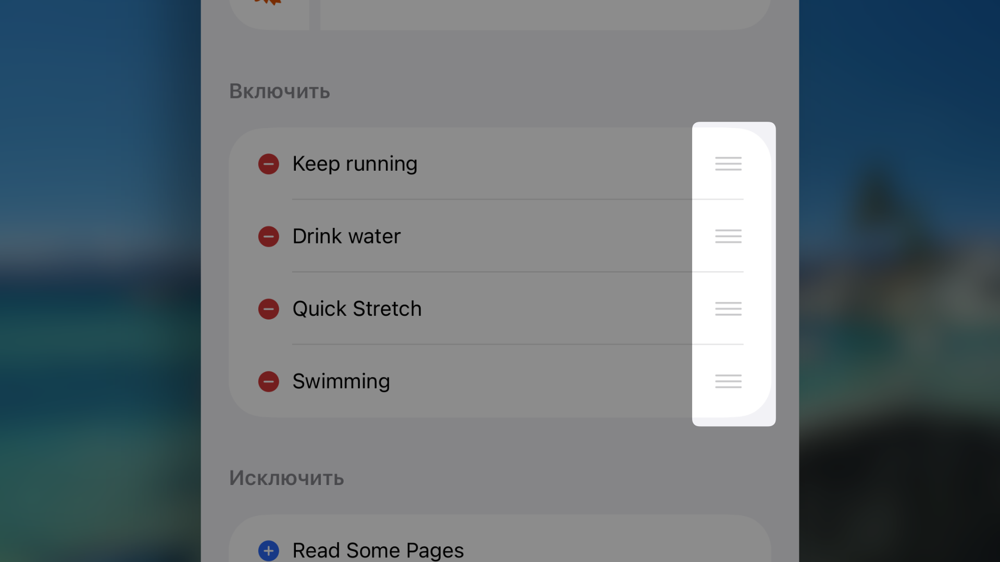
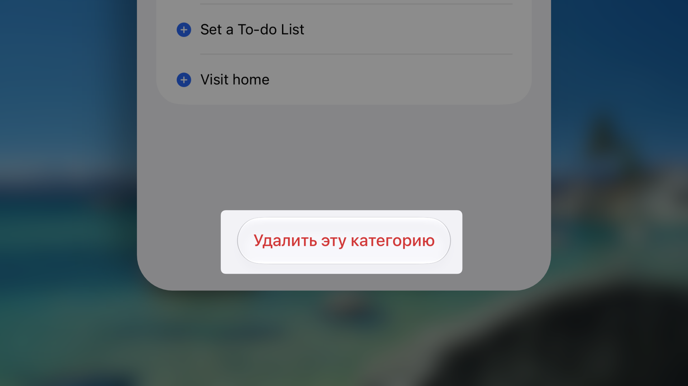
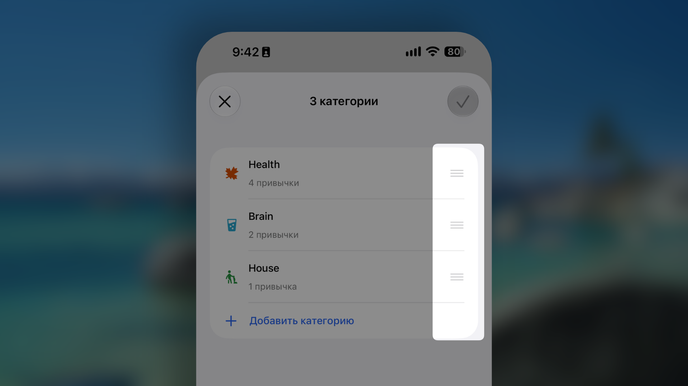
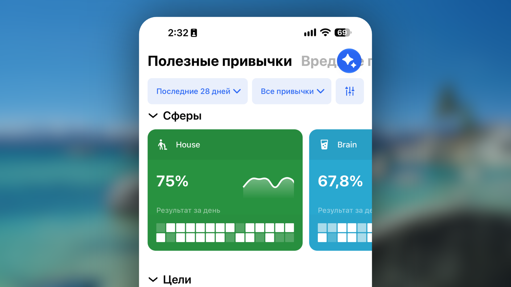
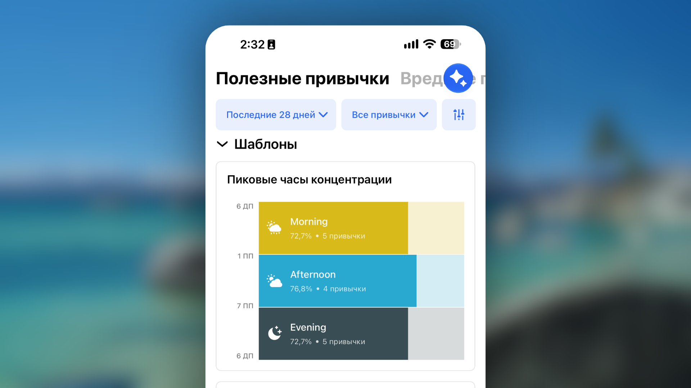
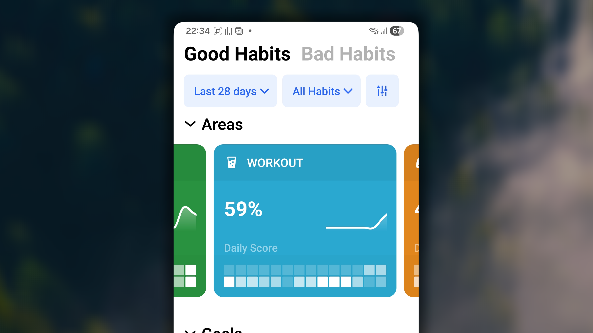
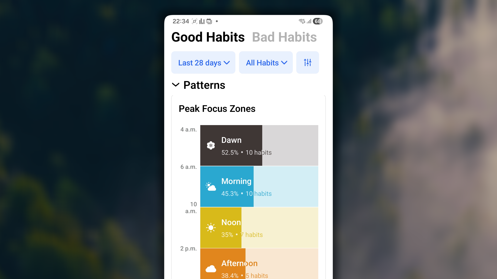

Категория — это группа или папка привычек, которая позволяет организовать отслеживание по разным сторонам жизни, а не хранить все привычки в одном неразделенном списке. Объедините упражнения, питье воды и сон в категории «Здоровье»; глубокую работу и электронную почту — в категории «Работа»; ведение дневника и медитацию — в категории «Осознанность». Выбирайте деление, которое подходит именно вашей жизни.

Категории помогают расставлять приоритеты. Вместо единой Ежедневной оценки сразу для всего вы можете открыть одну категорию и точно увидеть, как обстоят дела в этой части жизни.

<Tabs>
  <Tab title=" iOS">
    ## Создание новой категории

    <iframe src="https://drive.google.com/file/d/1tvk66uyWt5d6rRJoQHpPx_TnZR7C53Kb/preview" width="640" height="360" />

    1. В **Журнале** смахните панель сфер влево до самого конца и нажмите **\+**.
    2. Выберите **Новая папка**.
    3. На экране **Новая папка**:
       1. нажмите значок, выберите новый значок и цвет сферы, затем нажмите ✓, чтобы сохранить выбор;
       2. нажмите поле названия и введите название сферы.
    5. В списке **Исключить** нажмите ⊕ перед названием привычки, чтобы добавить ее в сферу.
    6. Когда всё будет готово, нажмите ✓, чтобы сохранить новую сферу.

    ## Управление пользовательской категорией

    Вы можете свободно менять название и значок пользовательской сферы, управлять входящими в нее привычками и удалять сферу.

    ### Редактирование категории

    1. В приложении Habitify откройте **Настройки**.
    2. Найдите и откройте раздел **Все категории**.
       
    3. В списке сфер нажмите сферу, которую хотите изменить.
    4. На экране сведений о сфере можно:
       1. нажать **значок**, чтобы изменить значок и цвет; нажмите кнопку ✓ в правом верхнем углу, чтобы сохранить выбор;
       2. нажать **поле названия**, чтобы изменить название сферы;
          
       3. в списке **Включить** нажать ⊖ перед названием привычки, чтобы удалить ее из сферы;
          
       4. в списке **Исключить** нажать ⊕ перед названием привычки, чтобы добавить ее в сферу.
          
    5. Нажмите **кнопку ✓** в правом верхнем углу, чтобы сохранить все изменения.

    ### Изменение порядка привычек в категории

    1. В приложении Habitify откройте **Настройки**.
    2. Найдите и откройте раздел **Все категории**.
    3. В списке сфер нажмите сферу, в которой хотите изменить порядок привычек.
    4. В списке **Включить** нажмите и удерживайте кнопку ☰ справа от привычки, затем перетащите ее вверх или вниз.
       
    5. Когда всё будет готово, нажмите кнопку ✓, чтобы сохранить изменения.

    ### Удаление категории

    1. В Habitify откройте **Настройки**.
    2. Найдите и откройте раздел **Все категории**.
    3. В списке сфер нажмите сферу, которую хотите удалить.
    4. Нажмите кнопку **Удалить эту категорию**.
       
    5. На этапе подтверждения нажмите **Удалить**.

    ## Управление порядком категорий

    Вы можете изменять порядок пользовательских сфер на панели сфер в Журнале. Для этого:

    1. В приложении Habitify откройте **Настройки**.
    2. Найдите и откройте раздел **Все категории**.
    3. Нажмите и удерживайте кнопку ☰ справа от сферы, затем перетащите ее вверх или вниз.
       
    4. Нажмите кнопку ✓, чтобы сохранить изменения.

    <Info>
      После сохранения изменения порядка сфер в приложении для iOS или Android немедленно синхронизируются с приложениями для Веб-сайта и компьютера.
    </Info>

    ## Прогресс категории

    Используйте экран «Прогресс», чтобы увидеть, как идут дела в каждой категории. Разделы ниже находятся на вкладке **Полезные привычки**. Они учитывают период, который вы выбрали на экране «Прогресс».

    ### Прогресс пользовательской категории

    На экране «Прогресс» прокрутите до раздела **Сферы**. В нём есть карточка прогресса для каждой из ваших пользовательских категорий. Прокручивайте в сторону, чтобы увидеть каждую карточку.

    

    Каждая карточка — это краткий отчёт только по этой категории. В ней показаны:

    - **Средний дневной балл**
    - **Мини-график тенденции.**
    - **Компактная тепловая карта.**

    Сравнивайте карточки, чтобы понять, идёт ли одна часть вашей жизни хорошо, пока другая требует внимания.

    ### Процент выполнения категории «Время суток»

    У категорий «Время суток» (Утро, День и Вечер) нет карточек в разделе **Категории**. Чтобы увидеть их процент выполнения, используйте **Пиковые зоны концентрации** в разделе **шаблоны**.

    

    Там показан ваш средний процент выполнения для каждого времени суток за выбранный период. Например, если у вас 3 привычки утром, и вы выполняете 2 из них в один день и 1 на следующий, ваш процент выполнения утром составляет 50%.

    ### Весь отчёт по одной категории

    Чтобы увидеть экран «Прогресс» для одной категории, используйте фильтр привычек:

    1. На экране «Прогресс» откройте фильтр привычек.
    2. Выберите пользовательскую категорию или категорию «Время суток», которую хотите посмотреть.

    Отчёт будет включать только привычки из этой категории.
  </Tab>
  <Tab title="🤖 Android">
    ## Создание новой сферы

    <iframe src="https://drive.google.com/file/d/1F_7f_gieW9pIv8yLPskQdST6gSE2ofCn/preview" width="640" height="360" />

    1. В Журнале смахните панель сфер до крайнего левого положения.
    2. Нажмите кнопку +, затем выберите **Новая сфера**.
    3. Нажмите значок, выберите новый значок и цвет сферы. Нажмите **Готово** в правом верхнем углу, чтобы сохранить выбор.
    4. Нажмите поле названия и введите название новой сферы.
    5. В списке **Исключить** нажмите кнопку плюса справа от привычки, чтобы добавить ее в новую сферу.
    6. Когда всё будет готово, нажмите кнопку **Сохранить** в правом верхнем углу, чтобы сохранить новую сферу.

    ## Управление пользовательской сферой

    Вы можете свободно менять название и значок пользовательской сферы, управлять входящими в нее привычками и удалять сферу.

    ### Редактирование сферы

    1. В приложении Habitify откройте **Настройки**.
    2. Найдите и откройте раздел **Управление областью**.
    3. В списке сфер нажмите сферу, которую хотите изменить.
    4. На экране сведений о сфере можно:
       1. нажать значок, чтобы изменить значок и цвет; нажмите «Готово» в правом верхнем углу, чтобы сохранить выбор;
       2. нажать поле названия, чтобы изменить название сферы;
       3. в списке **Включить** нажать кнопку ⛌ справа от привычки, чтобы удалить ее из сферы;
       4. в списке **Исключить** нажать кнопку ╋ справа от привычки, чтобы добавить ее в сферу.
    5. Нажмите кнопку **Сохранить** в правом верхнем углу, чтобы сохранить все изменения.

    ### Изменение порядка привычек в сфере

    1. В приложении Habitify откройте **Настройки**.
    2. Найдите и откройте раздел **Управление областью**.
    3. В списке сфер нажмите сферу, в которой хотите изменить порядок привычек.
    4. В списке Включить нажмите и удерживайте кнопку = слева от привычки, затем перетащите ее вверх или вниз.
    5. Когда всё будет готово, нажмите кнопку **Сохранить**, чтобы сохранить изменения.

    ### Удаление сферы

    1. В Habitify откройте **Настройки**.
    2. Найдите и откройте раздел **Управление областью**.
    3. В списке сфер нажмите сферу, которую хотите удалить.
    4. Прокрутите до самого низа и нажмите **Удалить эту область**.
    5. На этапе подтверждения нажмите **Удалить**.

    ## Управление порядком сфер

    Вы можете изменять порядок пользовательских сфер на панели сфер в Журнале. Для этого:

    1. В приложении Habitify откройте **Настройки**.
    2. Найдите и откройте раздел **Управление областью**.
    3. Нажмите и удерживайте кнопку **=** справа от сферы, затем перетащите ее вверх или вниз.
    4. Нажмите кнопку **Сохранить**, чтобы сохранить изменения.

    <Info>
      После сохранения изменения порядка сфер в приложении для iOS или Android немедленно синхронизируются с приложениями для Веб-сайта и компьютера.
    </Info>

    ## Прогресс категории

    Используйте экран «Прогресс», чтобы увидеть, как идут дела в каждой категории. Разделы ниже находятся на вкладке **Полезные привычки**. Они учитывают период, который вы выбрали на экране «Прогресс».

    ### Прогресс пользовательской категории

    На экране «Прогресс» прокрутите до раздела **сферы**. В нём есть карточка прогресса для каждой из ваших пользовательских категорий. Прокручивайте в сторону, чтобы увидеть каждую карточку.

    

    Каждая карточка — это краткий отчёт только по этой категории. В ней показаны:

    - **Средний дневной балл**
    - **Мини-график тенденции.**
    - **Компактная тепловая карта.**

    Сравнивайте карточки, чтобы понять, идёт ли одна часть вашей жизни хорошо, пока другая требует внимания.

    ### Процент выполнения категории «Время суток»

    У категорий «Время суток» (Утро, День и Вечер) нет карточек в разделе **Категории**. Чтобы увидеть их процент выполнения, используйте **Пиковые зоны фокусаконцентрации** в разделе **шаблоны**.

    

    Там показан ваш средний процент выполнения для каждого времени суток за выбранный период. Например, если у вас 3 привычки утром, и вы выполняете 2 из них в один день и 1 на следующий, ваш процент выполнения утром составляет 50%.

    ### Весь отчёт по одной категории

    Чтобы увидеть экран «Прогресс» для одной категории, используйте фильтр привычек:

    1. На экране «Прогресс» откройте фильтр привычек.
    2. Выберите пользовательскую категорию или категорию «Время суток», которую хотите посмотреть.

    Отчёт будет включать только привычки из этой категории.
  </Tab>
  <Tab title="🖥️ Веб-сайт и компьютер">
    ## Создание новой сферы

    <iframe src="https://drive.google.com/file/d/1-jFIqXsmgOC3dAhdALhaUJw_JrwXUl34/preview" width="640" height="360" />

    1. В приложении откройте раздел Сферы на левой боковой панели.
    2. Нажмите **\+ Новая сфера**.
    3. Введите название новой сферы и нажмите Enter, чтобы сохранить его.
    4. Нажмите значок, затем выберите новый значок и цвет сферы.
    5. Щелкните за пределами элемента, чтобы сохранить изменения.

    ## Управление пользовательской сферой

    Вы можете свободно менять название и значок пользовательской сферы, управлять входящими в нее привычками и удалять сферу.

    ### Изменение значка, цвета и названия сферы

    Чтобы изменить значок и цвет сферы:

    1. На левой боковой панели откройте раздел **Сферы**.
    2. Нажмите значок сферы.
    3. Выберите новый значок и цвет.
    4. Щелкните за пределами элемента, чтобы подтвердить изменения.

    Чтобы изменить название сферы:

    1. На левой боковой панели откройте раздел **Сферы**.
    2. Нажмите сферу, которую хотите изменить.
    3. Нажмите еще раз, чтобы включить редактирование.
    4. Введите новое название.
    5. Нажмите Enter, чтобы сохранить изменение.

    ### Управление привычками в сфере

    Чтобы добавить привычку в сферу:

    1. На левой боковой панели откройте **Настройки \> Привычки**.
    2. Откройте список **Активные**.
    3. Найдите привычку и перетащите ее в нужную сферу.

    Чтобы удалить привычку из сферы:

    1. На левой боковой панели откройте **Настройки \> Привычки**.
    2. Перейдите в раздел **Сферы** и нажмите текущую сферу, в которую входит привычка.
    3. Щелкните привычку правой кнопкой мыши и выберите **Изменить**.
    4. В сведениях о привычке найдите **поле Сфера** и нажмите, чтобы удалить сферу.
    5. Нажмите **Сохранить**.

    ### Удаление сферы

    Чтобы удалить сферу:

    1. На левой боковой панели откройте раздел **Сферы**.
    2. Щелкните правой кнопкой мыши привычку, которую хотите удалить, затем выберите **Удалить**.

    ## Прогресс категории

    Используйте экран «Прогресс», чтобы увидеть, как идут дела в каждой категории. Разделы ниже находятся на вкладке **Полезные привычки**. Они учитывают период, который вы выбрали на экране «Прогресс».

    ### Прогресс пользовательской категории

    На экране «Прогресс» прокрутите до раздела **сферы**. В нём есть карточка прогресса для каждой из ваших пользовательских категорий. Прокручивайте в сторону, чтобы увидеть каждую карточку.

    Каждая карточка — это краткий отчёт только по этой категории. В ней показаны:

    - **Средний дневной балл.**
    - **Мини-график тенденции.**
    - **Компактная тепловая карта.**

    Сравнивайте карточки, чтобы понять, идёт ли одна часть вашей жизни хорошо, пока другая требует внимания.

    ### Процент выполнения категории «Время суток»

    У категорий «Время суток» (Утро, День и Вечер) нет карточек в разделе **сферы**. Чтобы увидеть их процент выполнения, используйте **Пиковые зоны концентрации** в разделе **шаблоны**.

    Там показан ваш средний процент выполнения для каждого времени суток за выбранный период. Например, если у вас 3 привычки утром, и вы выполняете 2 из них в один день и 1 на следующий, ваш процент выполнения утром составляет 50%.

    ### Весь отчёт по одной категории

    Чтобы увидеть экран «Прогресс» для одной категории, используйте фильтр привычек:

    1. На экране «Прогресс» откройте фильтр привычек.
    2. Выберите пользовательскую категорию или категорию «Время суток», которую хотите посмотреть.

    Отчёт будет включать только привычки из этой категории.
  </Tab>
</Tabs>
