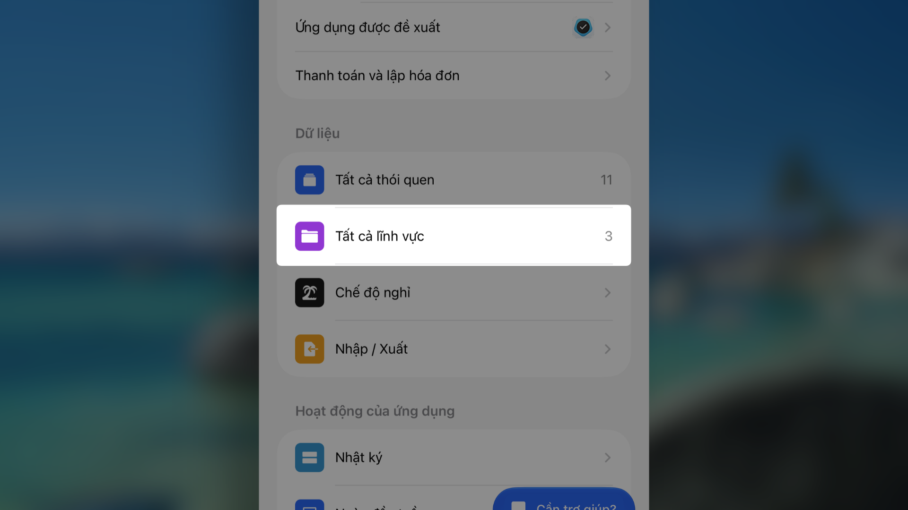
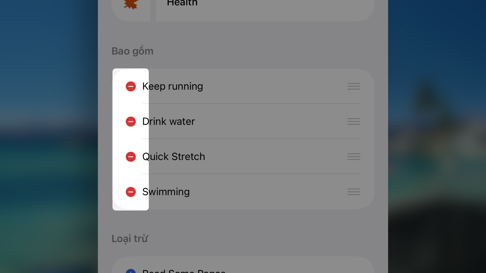
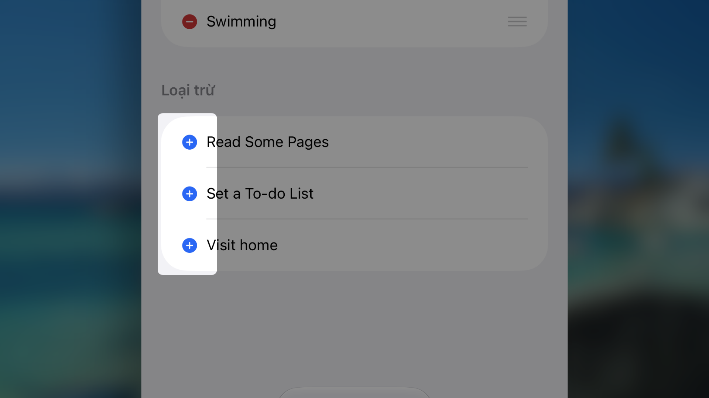
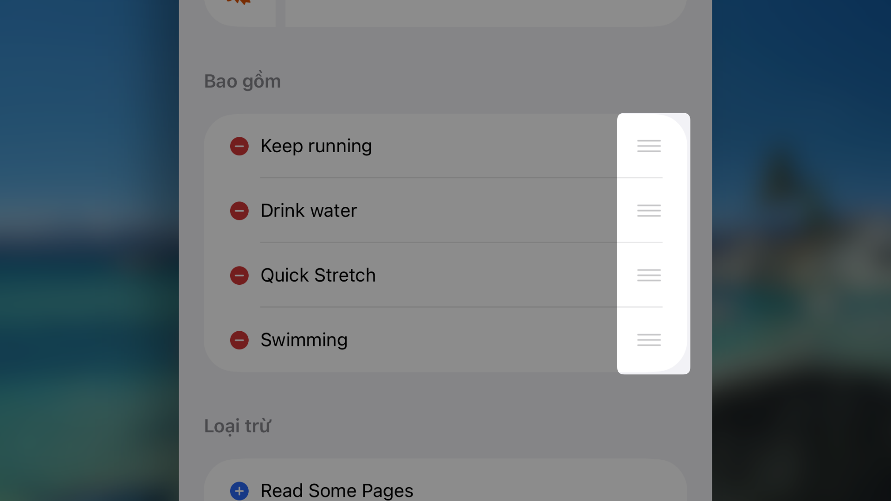
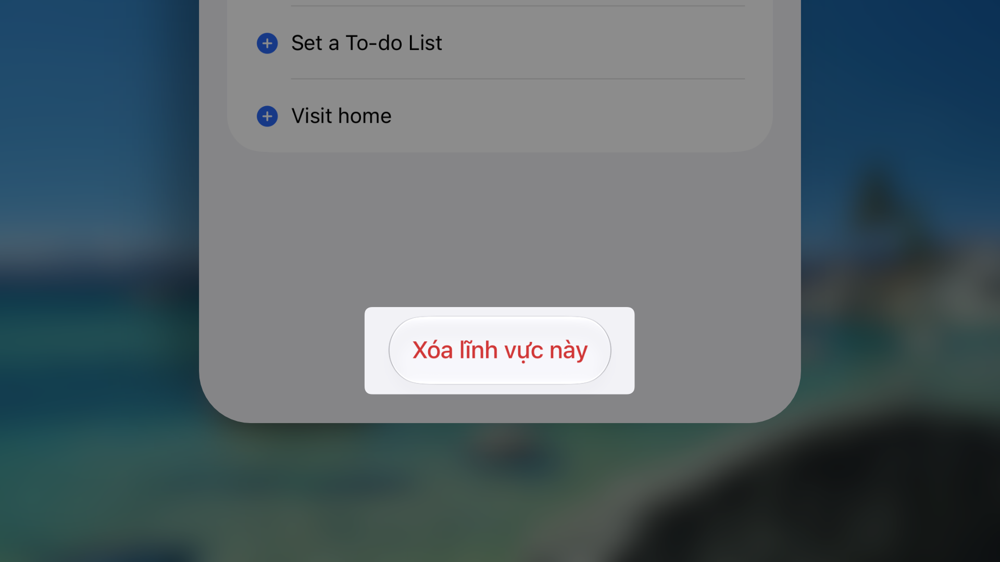
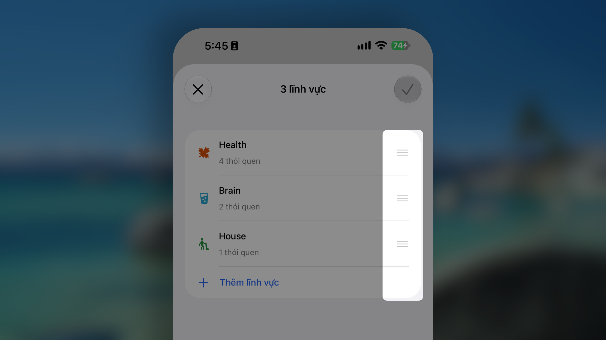
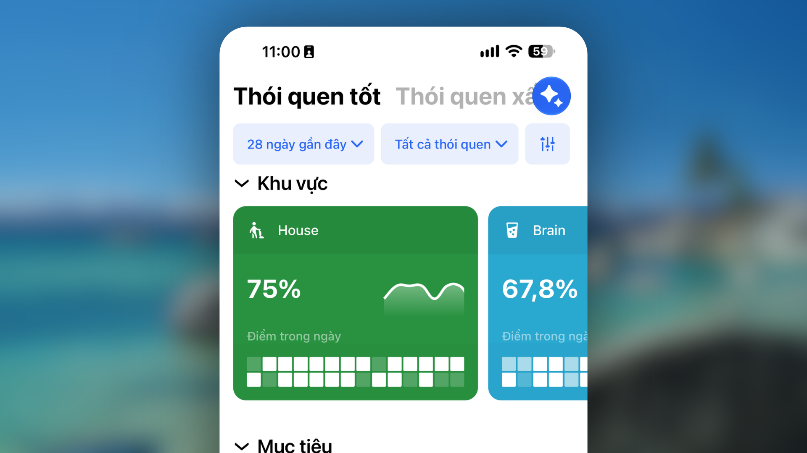
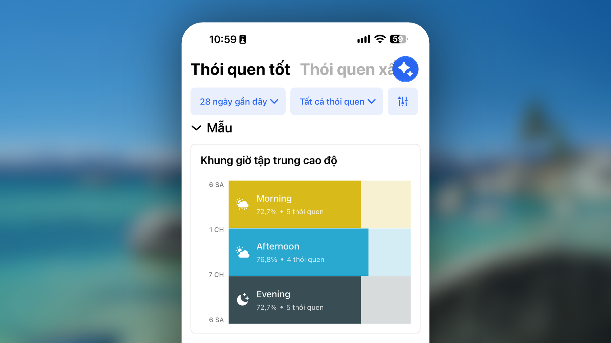
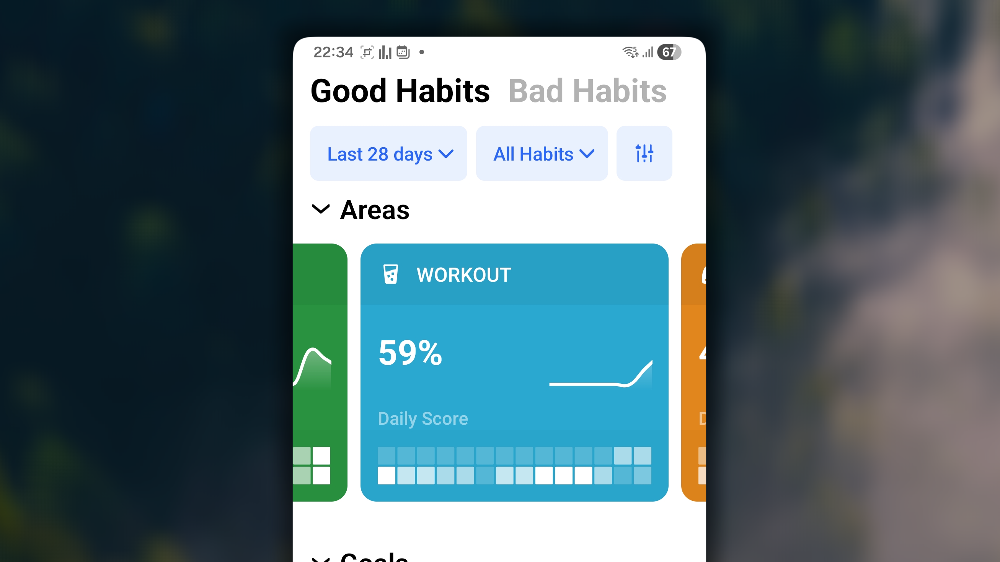
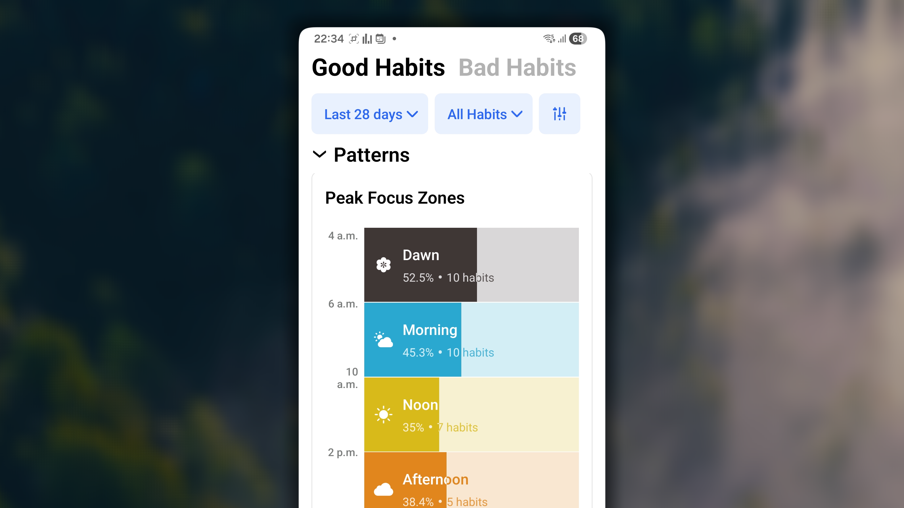

Khu vực là một nhóm hoặc thư mục thói quen, cho phép bạn sắp xếp việc theo dõi theo những phần khác nhau trong cuộc sống thay vì coi mọi thói quen là một danh sách phẳng, không phân biệt. Nhóm thói quen tập thể dục, uống nước và ngủ trong "Sức khỏe"; thói quen làm việc tập trung và xử lý email trong "Công việc"; viết nhật ký và thiền trong "Chánh niệm" — theo đúng cách cuộc sống của bạn được phân chia.

Khu vực giúp bạn xác định ưu tiên. Thay vì chỉ có một Điểm hằng ngày bao quát mọi thứ cùng lúc, bạn có thể tập trung vào một danh mục và biết chính xác phần đó trong cuộc sống đang diễn ra như thế nào.

<Tabs>
  <Tab title=" iOS">
    ## Tạo khu vực mới

    <iframe src="https://drive.google.com/file/d/1tvk66uyWt5d6rRJoQHpPx_TnZR7C53Kb/preview" width="640" height="360" />

    1. Trong **Nhật ký**, vuốt thanh khu vực sang trái đến tận cùng rồi chạm vào **\+**.
    2. Chọn **Lĩnh vực mới**.
    3. Trên màn hình **Lĩnh vực mới**:
       1. chạm vào biểu tượng, chọn biểu tượng và gán màu cho khu vực mới, rồi chạm ✓ để lưu lựa chọn.
       2. Chạm vào trường tên rồi nhập tên khu vực.
    5. Trong danh sách **Loại trừ**, chạm vào ⊕ trước tên thói quen để thêm thói quen vào khu vực.
    6. Sau khi thiết lập xong, chạm vào ✓ để lưu khu vực mới.

    ## Quản lý khu vực tùy chỉnh

    Bạn có thể tự do chỉnh sửa tên và biểu tượng của khu vực tùy chỉnh, quản lý các thói quen trong khu vực và xóa khu vực.

    ### Chỉnh sửa khu vực

    1. Trong ứng dụng Habitify, mở **Cài đặt**.
    2. Tìm và chạm để mở phần **Tất cả lĩnh vực**.
       
    3. Trong danh sách khu vực, chạm vào khu vực bạn muốn thay đổi.
    4. Trên màn hình chi tiết khu vực, bạn có thể:
       1. chạm vào **biểu tượng** để đổi biểu tượng và màu. Chạm vào nút ✓ ở góc trên bên phải để lưu lựa chọn.
       2. chạm vào **trường tên** để đổi tên khu vực.
          
       3. trong danh sách **Bao gồm**, chạm vào ⊖ trước tên thói quen để xóa thói quen khỏi khu vực.
          
       4. trong danh sách **Loại trừ**, chạm vào ⊕ trước tên thói quen để thêm thói quen vào khu vực.
          
    5. Chạm vào **nút ✓** ở góc trên bên phải để lưu tất cả thay đổi.

    ### Chỉnh sửa thứ tự thói quen trong khu vực

    1. Trong ứng dụng Habitify, mở **Cài đặt**.
    2. Tìm và chạm để mở phần **Tất cả lĩnh vực**.
    3. Trong danh sách khu vực, chạm vào khu vực có thứ tự thói quen bạn muốn thay đổi.
    4. Trong danh sách **Bao gồm**, nhấn giữ nút ☰ ở bên phải thói quen rồi kéo lên hoặc xuống để đổi thứ tự.
       
    5. Sau khi thiết lập xong, chạm vào nút ✓ để lưu thay đổi.

    ### Xóa khu vực

    1. Trong Habitify, mở **Cài đặt**.
    2. Tìm và chạm để mở phần **Tất cả lĩnh vực**.
    3. Trong danh sách khu vực, chạm vào khu vực muốn xóa.
    4. Chạm vào nút **Xóa lĩnh vực này**.
       
    5. Ở bước xác nhận, chạm vào **Xóa**.

    ## Quản lý thứ tự khu vực

    Bạn có thể sắp xếp thứ tự các khu vực tùy chỉnh trên thanh khu vực của Nhật ký như sau:

    1. Trong ứng dụng Habitify, mở **Cài đặt**.
    2. Tìm và chạm để mở phần **Tất cả lĩnh vực**.
    3. Nhấn giữ nút ☰ ở bên phải khu vực rồi kéo lên hoặc xuống để đổi thứ tự.
       
    4. Chạm vào nút ✓ để lưu thay đổi.

    <Info>
      Thay đổi thứ tự khu vực từ ứng dụng iOS và Android được đồng bộ ngay với ứng dụng Website & Máy tính sau khi lưu.
    </Info>

    ## Tiến độ của một lĩnh vực

    Dùng màn hình Tiến độ để xem từng lĩnh vực đang diễn ra thế nào. Các phần dưới đây nằm trong tab **Thói quen tốt**. Chúng hiển thị theo khoảng thời gian bạn đã chọn trong màn hình Tiến độ.

    ### Tiến độ của một lĩnh vực tùy chỉnh

    Trong màn hình Tiến độ, cuộn đến phần **Lĩnh vực**. Phần này có một thẻ tiến độ cho mỗi lĩnh vực tùy chỉnh của bạn. Cuộn ngang để xem từng thẻ.

    

    Mỗi thẻ là một báo cáo ngắn chỉ dành cho lĩnh vực đó. Thẻ hiển thị:

    - **Điểm hằng ngày trung bình**
    - **Một đường xu hướng thu nhỏ.**
    - **Một bản đồ nhiệt thu gọn.**

    So sánh các thẻ để xem một phần cuộc sống của bạn có đang tốt trong khi phần khác cần được chú ý hay không.

    ### Tỷ lệ hoàn thành của một lĩnh vực Buổi trong ngày

    Các lĩnh vực Buổi trong ngày (Buổi sáng, Buổi chiều và Buổi tối) không có thẻ trong phần **Lĩnh vực**. Để xem tỷ lệ hoàn thành của chúng, hãy dùng **Khung giờ tập trung cao độ** trong phần **Mẫu hình**.

    

    Phần này hiển thị tỷ lệ hoàn thành trung bình cho từng buổi trong ngày trong khoảng thời gian đã chọn. Ví dụ, nếu bạn có 3 thói quen vào buổi sáng và hoàn thành 2 thói quen trong một ngày rồi 1 thói quen vào ngày tiếp theo, tỷ lệ hoàn thành buổi sáng của bạn là 50%.

    ### Xem toàn bộ báo cáo của một lĩnh vực

    Để xem màn hình Tiến độ cho một lĩnh vực, hãy dùng bộ lọc thói quen:

    1. Trong màn hình **Tiến độ**, mở bộ lọc thói quen.
    2. Chọn **lĩnh vực tùy chỉnh** hoặc **Thời điểm trong ngày** bạn muốn xem.

    Báo cáo khi đó chỉ gồm các thói quen trong lĩnh vực đó.
  </Tab>
  <Tab title="🤖 Android">
    ## Tạo khu vực mới

    <iframe src="https://drive.google.com/file/d/1F_7f_gieW9pIv8yLPskQdST6gSE2ofCn/preview" width="640" height="360" />

    1. Trong Nhật ký, vuốt thanh khu vực sang trái đến tận cùng.
    2. Chạm vào nút \+ rồi chọn **Khu vực mới**.
    3. Chạm vào biểu tượng, chọn một biểu tượng và gán màu cho khu vực mới. Chạm vào **Xong** ở góc trên bên phải để lưu lựa chọn.
    4. Chạm vào trường tên rồi nhập tên khu vực mới.
    5. Trong danh sách **Loại trừ**, chạm vào nút dấu cộng bên phải thói quen để thêm vào khu vực mới.
    6. Sau khi thiết lập xong, chạm vào nút **Lưu** ở góc trên bên phải để lưu khu vực mới.

    ## Quản lý khu vực tùy chỉnh

    Bạn có thể tự do chỉnh sửa tên và biểu tượng của khu vực tùy chỉnh, quản lý các thói quen trong khu vực và xóa khu vực.

    ### Chỉnh sửa khu vực

    1. Trong ứng dụng Habitify, mở **Cài đặt**.
    2. Tìm và chạm để mở phần **Quản lý khu vực**.
    3. Trong danh sách khu vực, chạm vào khu vực bạn muốn thay đổi.
    4. Trên màn hình chi tiết khu vực, bạn có thể:
       1. chạm vào biểu tượng để đổi biểu tượng và màu. Chạm vào **Xong** ở góc trên bên phải để lưu lựa chọn.
       2. chạm vào trường tên để đổi tên khu vực.
       3. trong danh sách **Bao gồm**, chạm vào nút Х bên phải thói quen để xóa khỏi khu vực.
       4. trong danh sách **Loại trừ**, chạm vào nút ╋ bên phải thói quen để thêm vào khu vực.
    5. Chạm vào nút **Lưu** ở góc trên bên phải để lưu tất cả thay đổi.

    ### Chỉnh sửa thứ tự thói quen trong khu vực

    1. Trong ứng dụng Habitify, mở **Cài đặt**.
    2. Tìm và chạm để mở phần **Quản lý khu vực**.
    3. Trong danh sách khu vực, chạm vào khu vực có thứ tự thói quen bạn muốn thay đổi.
    4. Trong danh sách Bao gồm, nhấn giữ nút = ở bên trái thói quen rồi kéo lên hoặc xuống để đổi thứ tự.
    5. Sau khi thiết lập xong, chạm vào nút **Lưu** để lưu thay đổi.

    ### Xóa khu vực

    1. Trong Habitify, mở **Cài đặt**.
    2. Tìm và chạm để mở phần **Quản lý khu vực**.
    3. Trong danh sách khu vực, chạm vào khu vực muốn xóa.
    4. Vuốt xuống cuối rồi chạm vào **Xóa khu vực này**.
    5. Ở bước xác nhận, chạm vào **Xóa**.

    ## Quản lý thứ tự khu vực

    Bạn có thể sắp xếp thứ tự các khu vực tùy chỉnh trên thanh khu vực của Nhật ký như sau:

    1. Trong ứng dụng Habitify, mở **Cài đặt**.
    2. Tìm và chạm để mở phần **Quản lý khu vực**.
    3. Nhấn giữ nút **=** ở bên phải khu vực rồi kéo lên hoặc xuống để đổi thứ tự.
    4. Chạm vào nút **Lưu** để lưu thay đổi.

    <Info>
      Thay đổi thứ tự khu vực từ ứng dụng iOS và Android được đồng bộ ngay với ứng dụng Website & Máy tính sau khi lưu.
    </Info>

    ## Tiến độ của một lĩnh vực

    Dùng màn hình Tiến độ để xem từng lĩnh vực đang diễn ra thế nào. Các phần dưới đây nằm trong tab **Thói quen tốt**. Chúng hiển thị theo khoảng thời gian bạn đã chọn trong màn hình Tiến độ.

    ### Tiến độ của một lĩnh vực tùy chỉnh

    Trong màn hình Tiến độ, cuộn đến phần **Lĩnh vực**. Phần này có một thẻ tiến độ cho mỗi lĩnh vực tùy chỉnh của bạn. Cuộn ngang để xem từng thẻ.

    

    Mỗi thẻ là một báo cáo ngắn chỉ dành cho lĩnh vực đó. Thẻ hiển thị:

    - **Điểm hằng ngày trung bình**
    - **Một đường xu hướng thu nhỏ.**
    - **Một bản đồ nhiệt thu gọn.**

    So sánh các thẻ để xem một phần cuộc sống của bạn có đang tốt trong khi phần khác cần được chú ý hay không.

    ### Tỷ lệ hoàn thành của một lĩnh vực Buổi trong ngày

    Các lĩnh vực Buổi trong ngày (Buổi sáng, Buổi chiều và Buổi tối) không có thẻ trong phần **Lĩnh vực**. Để xem tỷ lệ hoàn thành của chúng, hãy dùng **Khung giờ tập trung cao điểm** trong phần **Mẫu hình**.

    

    Phần này hiển thị tỷ lệ hoàn thành trung bình cho từng buổi trong ngày trong khoảng thời gian đã chọn. Ví dụ, nếu bạn có 3 thói quen vào buổi sáng và hoàn thành 2 thói quen trong một ngày rồi 1 thói quen vào ngày tiếp theo, tỷ lệ hoàn thành buổi sáng của bạn là 50%.

    ### Xem toàn bộ báo cáo của một lĩnh vực

    Để xem màn hình Tiến độ cho một lĩnh vực, hãy dùng bộ lọc thói quen:

    1. Trong màn hình **Tiến độ**, mở bộ lọc thói quen.
    2. Chọn **lĩnh vực tùy chỉnh** hoặc **lĩnh vực Buổi trong ngày** bạn muốn xem.

    Báo cáo khi đó chỉ gồm các thói quen trong lĩnh vực đó.
  </Tab>
  <Tab title="🖥️ Website & Máy tính">
    ## Tạo khu vực mới

    <iframe src="https://drive.google.com/file/d/1-jFIqXsmgOC3dAhdALhaUJw_JrwXUl34/preview" width="640" height="360" />

    1. Trong ứng dụng, đi đến phần Khu vực trên thanh bên trái.
    2. Nhấp vào **\+ Khu vực mới**.
    3. Đặt tên cho khu vực mới rồi nhấn Enter để lưu.
    4. Nhấp vào biểu tượng, chọn biểu tượng mới và gán màu cho khu vực.
    5. Nhấp ra ngoài để lưu thay đổi.

    ## Quản lý khu vực tùy chỉnh

    Bạn có thể tự do chỉnh sửa tên và biểu tượng của khu vực tùy chỉnh, quản lý các thói quen trong khu vực và xóa khu vực.

    ### Chỉnh sửa biểu tượng, màu và tên khu vực

    Để chỉnh sửa biểu tượng và màu:

    1. Trên thanh bên trái, đi đến phần **Khu vực**.
    2. Nhấp vào biểu tượng khu vực.
    3. Chọn biểu tượng và màu mới.
    4. Nhấp ra ngoài để xác nhận thay đổi.

    Để chỉnh sửa tên khu vực:

    1. Trên thanh bên trái, đi đến phần **Khu vực**.
    2. Nhấp để chọn khu vực muốn chỉnh sửa.
    3. Nhấp lần nữa để bật chế độ chỉnh sửa.
    4. Nhập tên mới.
    5. Nhấn Enter để lưu thay đổi.

    ### Quản lý thói quen trong khu vực

    Để thêm một thói quen vào khu vực:

    1. Trên thanh bên trái, mở **Tùy chọn \> Thói quen**.
    2. Mở danh sách **Hoạt động**.
    3. Tìm thói quen rồi kéo vào khu vực mong muốn.

    Để xóa một thói quen khỏi khu vực:

    1. Trên thanh bên trái, mở **Tùy chọn \> Thói quen**.
    2. Đi đến **Khu vực** rồi nhấp vào khu vực hiện chứa thói quen.
    3. Nhấp chuột phải vào thói quen rồi chọn **Chỉnh sửa**.
    4. Trong chi tiết thói quen, đi đến **trường Khu vực** rồi nhấp để xóa khu vực.
    5. Nhấp vào **Lưu**.

    ### Xóa khu vực

    Để xóa một khu vực:

    1. Trên thanh bên trái, đi đến phần **Khu vực**.
    2. Nhấp chuột phải vào khu vực muốn xóa rồi chọn **Xóa**.

    ## Tiến độ của một lĩnh vực

    Dùng màn hình Tiến độ để xem từng lĩnh vực đang diễn ra thế nào. Các phần dưới đây nằm trong tab **Thói quen tốt**. Chúng hiển thị theo khoảng thời gian bạn đã chọn trong màn hình Tiến độ.

    ### Tiến độ của một lĩnh vực tùy chỉnh

    Trong màn hình Tiến độ, cuộn đến phần **Lĩnh vực**. Phần này có một thẻ tiến độ cho mỗi lĩnh vực tùy chỉnh của bạn. Cuộn ngang để xem từng thẻ.

    Mỗi thẻ là một báo cáo ngắn chỉ dành cho lĩnh vực đó. Thẻ hiển thị:

    - **Điểm hằng ngày trung bình**
    - **Một đường xu hướng thu nhỏ.**
    - **Một bản đồ nhiệt thu gọn.**

    So sánh các thẻ để xem một phần cuộc sống của bạn có đang tốt trong khi phần khác cần được chú ý hay không.

    ### Tỷ lệ hoàn thành của một lĩnh vực Buổi trong ngày

    Các lĩnh vực Buổi trong ngày (Buổi sáng, Buổi chiều và Buổi tối) không có thẻ trong phần **Lĩnh vực**. Để xem tỷ lệ hoàn thành của chúng, hãy dùng **Khung giờ tập trung cao điểm** trong phần **Mẫu hình**.

    Phần này hiển thị tỷ lệ hoàn thành trung bình cho từng buổi trong ngày trong khoảng thời gian đã chọn. Ví dụ, nếu bạn có 3 thói quen vào buổi sáng và hoàn thành 2 thói quen trong một ngày rồi 1 thói quen vào ngày tiếp theo, tỷ lệ hoàn thành buổi sáng của bạn là 50%.

    ### Xem toàn bộ báo cáo của một lĩnh vực

    Để xem màn hình Tiến độ cho một lĩnh vực, hãy dùng bộ lọc thói quen:

    1. Trong màn hình **Tiến độ**, mở bộ lọc thói quen.
    2. Chọn **lĩnh vực tùy chỉnh** hoặc **lĩnh vực Buổi trong ngày** bạn muốn xem.

    Báo cáo khi đó chỉ gồm các thói quen trong lĩnh vực đó.
  </Tab>
</Tabs>
