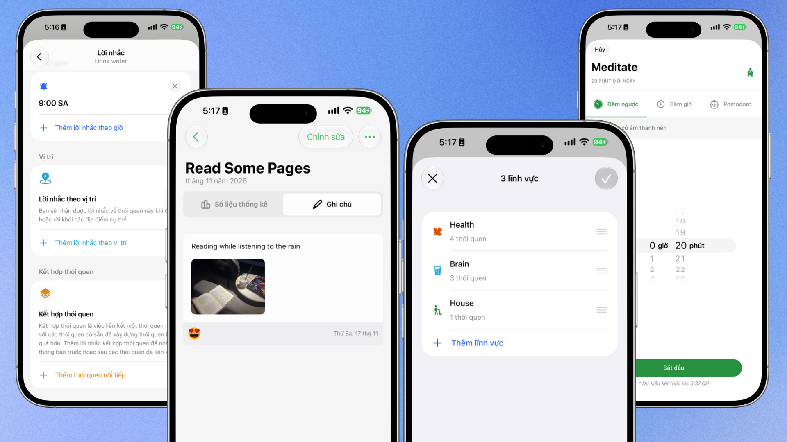
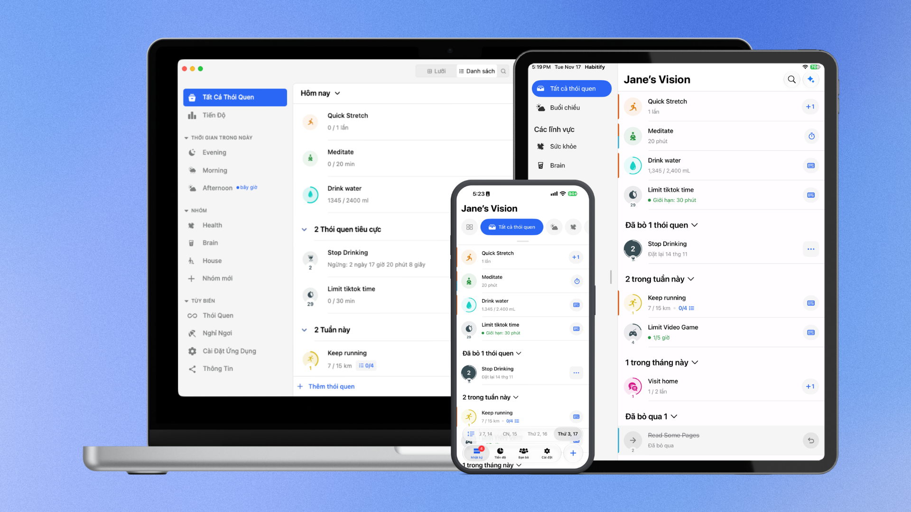

Habitify là ứng dụng theo dõi thói quen được xây dựng dựa trên một ý tưởng đơn giản: thay đổi bền vững đến từ những hành động nhỏ và nhất quán, được theo dõi trung thực theo thời gian. Thay vì chỉ dựa vào trí nhớ hoặc ý chí, Habitify mang đến cho bạn một màn hình hằng ngày tập trung vào những việc cần làm, một cách dễ dàng để ghi nhận và một bức tranh rõ ràng về xu hướng thực tế của bạn — trên điện thoại, máy tính và web, luôn được đồng bộ.

## Theo dõi thói quen tốt và xấu

Habitify hỗ trợ hai loại thói quen vì xây dựng một điều mới và từ bỏ một điều cũ thực sự là hai hành trình khác nhau:

- [Thói quen tốt](/vi/good-habits): những điều bạn muốn xây dựng, chẳng hạn tập thể dục, đọc sách hoặc uống nhiều nước hơn. Đặt mục tiêu theo ngày, tuần, tháng hoặc năm và Habitify sẽ theo dõi mức độ nhất quán của bạn trên hành trình hướng tới mục tiêu.
- [Thói quen xấu](/vi/bad-habits): những điều bạn muốn cắt giảm hoặc từ bỏ hoàn toàn, chẳng hạn hút thuốc hoặc lướt nội dung tiêu cực không ngừng. Đặt một giới hạn không được vượt quá hoặc cam kết từ bỏ hoàn toàn và Habitify sẽ theo dõi khả năng kiềm chế thay vì lượng hoạt động của bạn.

Cả hai loại đều được ghi nhận theo cùng một cách — thiết lập một lần rồi check-in hằng ngày — trong khi ứng dụng âm thầm điều chỉnh cách đo lường thành công ở phía sau cho từng loại.

## Bộ sưu tập tính năng

Sau khi nắm được những điều cơ bản, Habitify cung cấp đầy đủ công cụ để sắp xếp thói quen và hiểu _vì sao_ chúng thành công hoặc chệch hướng:

- [Khu vực](/vi/area): nhóm các thói quen liên quan thành những lĩnh vực trong cuộc sống như "Sức khỏe" hoặc "Công việc", để bạn có thể thấy toàn bộ một phần cuộc sống đang diễn ra như thế nào thay vì chỉ nhìn từng thói quen riêng lẻ.
- [Ghi chú](/vi/note): một cuốn nhật ký nhỏ gắn với từng thói quen, dùng để lưu lại bối cảnh đằng sau mỗi lần check-in như tâm trạng và hình ảnh.
- [Bộ đếm thời gian](/vi/timer): các chế độ Đếm ngược, Bấm giờ và Pomodoro cho mọi thói quen được đo bằng thời gian.
- [Lời nhắc](/vi/reminder): dựa trên thời gian, vị trí hoặc xếp chồng thói quen, để lời nhắc phù hợp đến với bạn đúng lúc.
- [Màn hình Tiến trình](/vi/overall-progress): bản đồ nhiệt, điểm số hằng ngày và thông tin về mẫu hành vi cho thấy mức độ nhất quán thực tế trong nhiều tuần và tháng, không chỉ riêng hôm nay.

## Theo dõi tâm trạng và Suy ngẫm

Theo dõi thói quen chỉ là một mặt của quá trình phát triển bản thân — hiểu được những thói quen đó ảnh hưởng đến sức khỏe tinh thần như thế nào là mặt còn lại.

Vì vậy, [Suy ngẫm](/vi/reflection) là không gian chánh niệm riêng của Habitify: nhanh chóng ghi lại tâm trạng bằng một biểu tượng cảm xúc, thêm ghi chú về ngày của bạn và xem tất cả nội dung đó cùng với tiến trình thói quen.

Khi kết hợp, Suy ngẫm và Ghi chú biến Habitify từ một công cụ theo dõi đơn giản thành bản ghi thực sự về hành trình của bạn, chứ không chỉ là những dấu kiểm.

## Vòng tròn và Thử thách

Xây dựng thói quen không nhất thiết phải là hành trình đơn độc; quá trình này có thể vui hơn khi bạn bè và gia đình cùng tham gia. Đó là lúc Vòng tròn và Thử thách phát huy tác dụng.

Với [Vòng tròn](/vi/circle), bạn tạo một không gian riêng tư, lâu dài cùng những người quan trọng nhất — chia sẻ tiến trình của nhiều thói quen, động viên lẫn nhau và cùng duy trì trách nhiệm trong dài hạn.

Với [Thử thách](/vi/challenge), bạn tham gia một đợt thi đua có giới hạn thời gian nhằm hướng tới một mục tiêu chung duy nhất — đi kèm bảng xếp hạng, chuỗi và tùy chọn tính điểm để duy trì sự hấp dẫn.

Dù hình thức nào phù hợp với nhóm của bạn, Habitify cũng biến việc theo dõi từ một hoạt động cá nhân thành điều mà mọi người cùng nhau xây dựng.

## Tích hợp và tự động hóa

Habitify không hoạt động biệt lập mà được xây dựng để kết nối với các công cụ và thiết bị vốn đã hiện diện trong cuộc sống của bạn:

- **Đồng bộ sức khỏe và thể chất**: Apple Health, Health Connect, Strava và Fitbit cho phép thiết bị tự động ghi nhận thay bạn.
- **Đồng bộ lịch**: Google Calendar, Outlook Calendar và Apple Calendar đưa thói quen của bạn vào ngay bên cạnh phần còn lại của lịch trình.
- **Theo dõi thời gian sử dụng thiết bị**: Thời gian sử dụng và RescueTime chuyển mức sử dụng thiết bị thực tế thành dữ liệu thói quen, giúp bạn vừa xây dựng thói quen dùng thiết bị lành mạnh hơn vừa cắt giảm các hoạt động gây xao nhãng.
- **Nền tảng tự động hóa**: Zapier và IFTTT kết nối Habitify với hàng trăm ứng dụng và dịch vụ khác, để việc hoàn thành một thói quen có thể kích hoạt — hoặc được kích hoạt bởi — gần như mọi công cụ khác mà bạn sử dụng.
- **Tự động hóa tích hợp sẵn**: Cập nhật trạng thái tự động đánh dấu các thói quen chưa được ghi nhận vào thời điểm bạn chọn; thẻ NFC biến đồ vật thành công cụ check-in một chạm; và Phím tắt (cùng Siri) cho phép bạn ghi nhận tiến trình bằng giọng nói mà không cần mở ứng dụng.

## Bắt đầu và phát triển theo nhu cầu

Bạn không cần sử dụng mọi thứ ngay từ đầu. Hầu hết mọi người bắt đầu với một vài thói quen trong gói Miễn phí, thêm khu vực và lời nhắc khi nếp sinh hoạt phát triển, rồi chỉ bổ sung tích hợp và tự động hóa sau khi nâng cấp lên Pro và biết chính xác mình muốn tự động hóa điều gì.

Habitify được xây dựng để mở rộng cùng bạn, đơn giản hoặc kết nối sâu đúng theo nhu cầu theo dõi thói quen thực tế của bạn.

## Luôn duy trì ở mọi nơi

Thói quen của bạn không nên dừng lại ngay khi bạn đóng ứng dụng. Habitify đồng hành cùng bạn trên điện thoại, máy tính bảng, máy tính và web, tự động đồng bộ để tiến trình luôn được cập nhật dù bạn check-in ở đâu.

