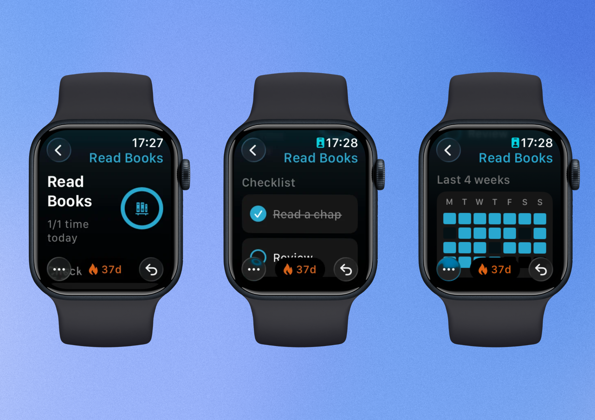

Ứng dụng Habitify dành cho Apple Watch cho phép bạn xem thói quen, ghi nhận tiến trình, sử dụng bộ hẹn giờ, cũng như bỏ qua hoặc đánh dấu một thói quen là chưa đạt ngay trên cổ tay mà không cần lấy điện thoại ra. Ứng dụng đồng bộ với Habitify trên iPhone, nên các thói quen, lịch sử check-in và cài đặt của bạn đã có sẵn khi bạn mở ứng dụng.

Bài viết này trình bày mọi tính năng của ứng dụng watchOS.

## Đăng nhập Habitify trên Apple Watch

**Trước khi bắt đầu, hãy kiểm tra rằng:**

- Habitify đã được cài đặt trên iPhone và bạn đã đăng nhập.
- Apple Watch của bạn **đã được ghép đôi với** iPhone đó.
- Cả hai thiết bị **đều sử dụng cùng một Apple ID và đã bật Chuỗi khóa iCloud**. Apple Watch lấy thông tin đăng nhập từ iPhone thông qua Chuỗi khóa iCloud.
- **Bluetooth đang bật** trên iPhone.

**Mở ứng dụng lần đầu tiên**

1. Cài đặt Habitify trên Apple Watch.
2. **Để iPhone ở gần Apple Watch** và **giữ ứng dụng Habitify mở** trên iPhone.
3. Mở Habitify trên Apple Watch.
4. Chờ trong khi ứng dụng đồng bộ với iPhone. Ứng dụng sẽ tải các thói quen, lịch sử check-in và cài đặt của bạn.

## Xem danh sách thói quen trên Apple Watch

Màn hình đầu tiên có tiêu đề **Hôm nay**. Màn hình này hiển thị ba nhóm danh sách:

1. **Tất cả thói quen:** tất cả thói quen của bạn trong hôm nay.
2. **Thời gian trong ngày:** một danh sách cho mỗi thời gian trong ngày, chẳng hạn như Buổi sáng, Buổi chiều và Buổi tối. Khoảng thời gian hiện tại được đánh dấu **Bây giờ**. Các khoảng thời gian khác hiển thị phạm vi giờ, ví dụ 18:00 – 00:00.
3. **Lĩnh vực:** một danh sách cho mỗi lĩnh vực tùy chỉnh của bạn.

Mỗi danh sách cho biết bạn đã hoàn thành bao nhiêu thói quen trên tổng số thói quen của hôm nay, ví dụ 0/4.

Chạm vào một danh sách để xem các thói quen trong đó. Mỗi danh sách có hai chế độ xem: **Hôm nay** và **7 ngày gần đây**.

###  Chế độ xem Hôm nay

Chế độ xem Hôm nay được mở trước. Tên danh sách, chẳng hạn như **Tất cả thói quen**, nằm ở trên cùng, với nút quay lại ở góc trên bên trái.

Mỗi hàng hiển thị tên thói quen, tiến trình của bạn so với mục tiêu (ví dụ 10/20 phút, 0/1 lần hoặc 12,8/40 km) và một nút ở bên phải. Vòng tròn quanh nút sẽ đầy dần khi bạn tiến gần hơn đến mục tiêu.

Các thói quen xuất hiện theo thứ tự bạn đã đặt trong ứng dụng iOS, được nhóm theo loại mục tiêu và trạng thái. Ví dụ, các thói quen có mục tiêu theo tuần xuất hiện dưới tiêu đề **Tuần này**.

Bên cạnh mỗi thói quen là một nút thay đổi theo mục tiêu của thói quen:

<table>
  <colgroup>
    <col width="241" />
    <col width="149" />
    <col width="345" />
  </colgroup>
  <thead>
    <tr>
      <th>Mục tiêu thói quen</th>
      <th>Nút</th>
      <th>Chức năng</th>
    </tr>
  </thead>
  <tbody>
    <tr>
      <td>Thời lượng (phút hoặc giờ)</td>
      <td>Bộ hẹn giờ</td>
      <td>Bắt đầu một phiên đếm ngược</td>
    </tr>
    <tr>
      <td>Đơn vị “lần”</td>
      <td>Dấu cộng (+)</td>
      <td>Cộng thêm vào tiến trình của thói quen</td>
    </tr>
    <tr>
      <td>Bất kỳ đơn vị nào khác</td>
      <td>Ghi nhận</td>
      <td>Cho phép bạn nhập một giá trị</td>
    </tr>
  </tbody>
</table>

### Chế độ xem 7 ngày gần đây

Để truy cập chế độ xem 7 ngày gần đây, hãy vuốt sang trái từ chế độ xem Hôm nay.

Trong chế độ xem này, bạn có thể xem danh sách thói quen cùng tiến trình của từng thói quen trong 7 ngày gần đây. Đọc chế độ xem từ trên xuống dưới:

1. Một hàng chữ cái đại diện cho các ngày trong tuần ở trên cùng hiển thị 7 ngày gần đây. Hôm nay là chữ cái được khoanh tròn ở bên phải.
2. Bên dưới, mỗi thói quen hiển thị tên và một ô vuông cho mỗi ngày, mang màu của thói quen và được căn thẳng dưới các chữ cái đại diện cho ngày trong tuần.
3. Thói quen có mục tiêu theo tuần, tháng hoặc năm sẽ hiển thị một thanh cho giai đoạn hiện tại thay vì bảy ô vuông.

Tại đây, các thói quen được sắp xếp không phụ thuộc vào loại mục tiêu và trạng thái.

## Xem tiến trình của một thói quen

Chạm vào bất kỳ thói quen nào để mở chế độ xem tiến trình. Cuộn xuống để xem lần lượt:

1. **Tên và tiến trình thói quen:** Tiến trình của bạn so với mục tiêu trong giai đoạn hiện tại, ví dụ 2/3 lần trong tuần này. Một vòng tròn ở bên phải cho biết trạng thái của thói quen. Chuỗi hiện tại của bạn được hiển thị dưới dạng huy hiệu ngọn lửa kèm số ngày, ví dụ 0 ngày.
2. **Danh sách kiểm tra**, nếu thói quen có danh sách này. Các mục đã hoàn thành sẽ được đánh dấu chọn và gạch ngang.
3. **Lịch sử:** Nội dung hiển thị tùy thuộc vào loại mục tiêu của thói quen (xem bên dưới).
4. **Ghi chú hôm nay:** Các ghi chú dạng văn bản mà bạn đã thêm hôm nay.

#### Nội dung hiển thị trong lịch sử

<table>
  <colgroup>
    <col width="100" />
    <col width="597" />
  </colgroup>
  <thead>
    <tr>
      <th>Mục tiêu thói quen</th>
      <th>Lịch sử</th>
    </tr>
  </thead>
  <tbody>
    <tr>
      <td>Hằng ngày</td>
      <td>**4 tuần gần đây:** một lưới có một cột cho mỗi ngày trong tuần (T2 đến CN) và một hàng cho mỗi tuần trong 4 tuần gần đây. Các ô sáng hơn là những ngày bạn đã hoàn thành thói quen. Các ô tối hơn là những ngày bạn chưa hoàn thành.</td>
    </tr>
    <tr>
      <td>Hằng tuần</td>
      <td>**4 tuần gần đây:** mỗi tuần có một thanh, được gắn nhãn Tuần này, Tuần trước, sau đó là các khoảng ngày như 11 Thg 7 – 18 Thg 7.</td>
    </tr>
    <tr>
      <td>Hằng tháng</td>
      <td>**3 tháng gần đây:** mỗi tháng có một thanh, được gắn nhãn bằng tháng và năm.</td>
    </tr>
    <tr>
      <td>Hằng năm</td>
      <td>Không có lịch sử. Chế độ xem chỉ hiển thị danh sách kiểm tra và ghi chú.</td>
    </tr>
  </tbody>
</table>

Trên các thanh, phần được tô cho biết bạn đã hoàn thành bao nhiêu mục tiêu trong giai đoạn đó.

## Ghi nhận tiến trình thói quen

### Cách ghi nhận tiến trình

Có 2 cách để ghi nhận tiến trình cho một thói quen trên Apple Watch:

- Trong **chế độ xem Ngày** của danh sách thói quen, sử dụng các nút thông minh bên cạnh thói quen.

- Mở **chế độ xem tiến trình của thói quen** và chạm vào nút ghi nhận giá trị ở góc dưới bên phải.

### **Cách** bỏ qua hoặc đánh dấu một thói quen là chưa đạt trong hôm nay

1. Mở chế độ xem tiến trình của thói quen.
2. Chạm vào nút **3 chấm**.
3. Chọn **Bỏ qua hôm nay** hoặc **Đánh dấu là chưa đạt**.

## Thêm ghi chú cho thói quen

1. Mở chế độ xem tiến trình của thói quen.
2. Chạm vào nút **3 chấm**.
3. Chọn **Ghi chú văn bản** và thêm ghi chú của bạn.

## Chạy một phiên hẹn giờ

### Cách bắt đầu một phiên

1. Trong chế độ xem Hôm nay, chạm vào nút **bộ hẹn giờ** bên cạnh thói quen.
2. Truy cập chế độ **Đếm ngược** mặc định: chạm vào **phút** hoặc **giây** để chọn, sau đó xoay Digital Crown để đặt thời gian.
3. Truy cập **Bấm giờ**: vuốt sang trái trên màn hình Đếm ngược.
4. Chạm vào **Bắt đầu**.

### Điều khiển một phiên đang chạy

Apple Watch hiển thị đồng hồ đếm ngược trực tiếp với ba nút điều khiển:

- **Tạm dừng và tiếp tục:** Chạm vào nút tạm dừng (||) ở góc dưới bên phải. Nút này chuyển thành biểu tượng phát (▶). Chạm vào đó để tiếp tục.
- **Âm thanh nền:** Chạm vào biểu tượng tai nghe ở giữa để bật hoặc tắt âm thanh môi trường nền.
- **Dừng và lưu:** Chạm vào dấu **X** ở góc trên bên trái để dừng bộ hẹn giờ. Habitify hỏi bạn có muốn lưu thời gian đã trôi qua vào tiến trình của thói quen trong ngày hay không. Ví dụ, nếu mục tiêu là 30 phút và bạn dừng ở phút thứ 15, bạn có thể lưu 15 phút hoặc không lưu khoảng thời gian đó.

## Câu hỏi thường gặp

<AccordionGroup>
  <Accordion title="**Tại sao các thói quen của tôi không hiển thị trên Apple Watch?**">
    1. Trên iPhone, mở Habitify rồi kéo xuống từ đầu danh sách thói quen để làm mới. Sau đó, mở lại Habitify trên Apple Watch.
    2. Kiểm tra xem Bluetooth có đang bật và Apple Watch có đang kết nối với iPhone hay không.
    3. Khởi động lại cả iPhone và Apple Watch.
  </Accordion>

  <Accordion title="**Ứng dụng bị kẹt ở “Đang chờ xác thực”. Tôi nên làm gì?**">
    Điều này xảy ra khi Chuỗi khóa iCloud bị tắt trên một trong hai thiết bị hoặc khi Apple Watch và iPhone sử dụng các Apple ID khác nhau.

    1.  Trên iPhone, mở **Cài đặt**.
    2. Chạm vào **[tên bạn],** sau đó chạm vào **iCloud**.
    3. Chạm vào **Mật khẩu**, sau đó bật **Đồng bộ hóa iPhone này**.
    4. Đảm bảo Apple Watch được đăng nhập bằng cùng Apple ID với iPhone. Nếu cài đặt watchOS của bạn có tùy chọn Chuỗi khóa, hãy đảm bảo tùy chọn đó đang bật.
    5. Để iPhone ở gần Apple Watch và giữ Habitify mở trên iPhone trong 2 đến 5 phút.
    6. Mở lại Habitify trên Apple Watch.

    Nếu ứng dụng vẫn bị kẹt, hãy khởi động lại cả hai thiết bị; mở Habitify trên iPhone trước rồi mở trên Apple Watch; hoặc cài đặt lại ứng dụng trên Apple Watch. Nếu sự cố vẫn tiếp diễn, hãy liên hệ với chúng tôi và cung cấp kiểu máy iPhone, kiểu máy Apple Watch, phiên bản watchOS cùng một video ngắn về sự cố.
  </Accordion>

  <Accordion title="**Tại sao tôi không thấy nút bộ hẹn giờ trên một thói quen?**">
    Nút bộ hẹn giờ chỉ xuất hiện trên các thói quen có mục tiêu tính bằng phút hoặc giờ. Nút này không xuất hiện trên các thói quen có/không hoặc thói quen sử dụng đơn vị khác. Hãy kiểm tra mục tiêu của thói quen trên iPhone và đảm bảo mục tiêu đó sử dụng đơn vị thời lượng.
  </Accordion>

  <Accordion title="**Tại sao các thói quen của tôi trông khác nhau trong chế độ xem Hôm nay và chế độ xem 7 ngày gần đây?**">
    Cả hai chế độ xem đều giữ nguyên thứ tự thói quen từ ứng dụng iOS. Chế độ xem Hôm nay còn nhóm thói quen theo loại mục tiêu và trạng thái. Chế độ xem 7 ngày gần đây thì không, vì vậy chế độ này hiển thị cùng một thứ tự bất kể loại mục tiêu và trạng thái.
  </Accordion>

  <Accordion title="**Habitify có những tổ hợp nào?**">
    Habitify có ba tổ hợp:

    1. **Tròn:** Chạm để theo dõi.
    2. **Góc:** Chạm để theo dõi.
    3. **Giữa:** một tổ hợp hình chữ nhật hiển thị một trong các nội dung sau: danh sách hôm nay, danh sách của thời gian hiện tại trong ngày hoặc bản đồ khối về tiến trình của một thói quen.

    Những tổ hợp bạn có thể thêm phụ thuộc vào các vị trí mà mặt đồng hồ của bạn có
  </Accordion>

  <Accordion title="**Tôi đã đánh dấu nhầm một thói quen là chưa đạt hoặc đã bỏ qua. Làm cách nào để hoàn tác?**">
    Mở thói quen và chạm vào **Đặt lại** ở góc dưới bên phải của chế độ xem tiến trình.
  </Accordion>

  <Accordion title="**Tôi có thể xem tất cả ghi chú mình từng ghi trên Apple Watch không?**">
    Không. Apple Watch chỉ hiển thị ghi chú của hôm nay, trong mục **Ghi chú hôm nay** ở chế độ xem tiến trình của một thói quen. Ghi chú từ những ngày trước không hiển thị trên Apple Watch.

    Để đọc các ghi chú cũ hơn, hãy dùng Habitify trên iPhone:

    1. **Ghi chú cho một thói quen:** Trong Nhật ký, chạm vào thói quen, sau đó mở tab **Ghi chú**.
    2. **Ghi chú trên tất cả thói quen:** Trong Nhật ký, kéo danh sách xuống để mở Suy ngẫm. Mục này hiển thị ghi chú và nhật ký tâm trạng của bạn ở cùng một nơi.
  </Accordion>
</AccordionGroup>
