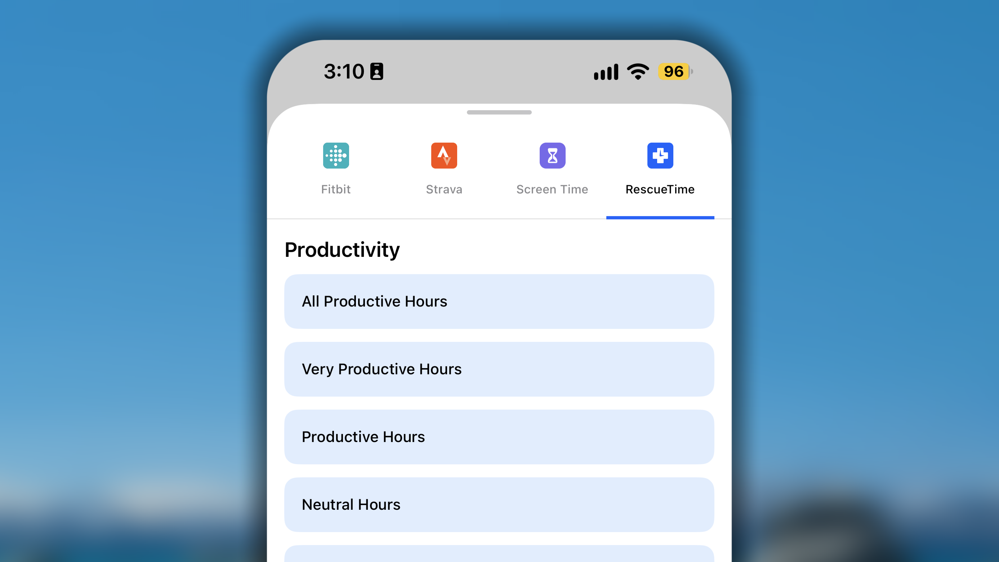
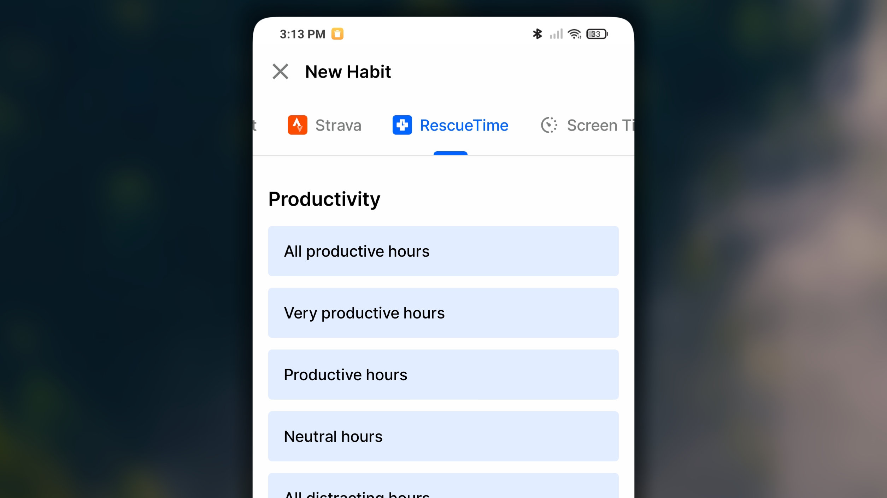

RescueTime theo dõi cách bạn thực sự sử dụng thời gian trên máy tính: bạn dùng ứng dụng nào, truy cập trang web nào và trong bao lâu. Khi kết nối RescueTime với Habitify, bạn không cần ghi nhận thủ công mỗi ngày mình đã dành bao nhiêu thời gian cho một hoạt động như "Làm việc tập trung" hoặc "Lập trình"; RescueTime đã có dữ liệu đó và có thể đưa trực tiếp vào thói quen tương ứng.

## Thêm thói quen được đồng bộ với RescueTime

<Tabs>
  <Tab title=" iOS">
    1. Từ **Nhật ký**, chạm vào + ở góc dưới bên phải.
    2. Chọn **Xây dựng thói quen tốt** hoặc **Bỏ thói quen xấu**.
    3. Ở đầu màn hình tạo thói quen, chuyển sang tab **RescueTime**.
       
    4. Chọn loại dữ liệu bạn muốn theo dõi trong danh sách.
    5. Ở bước tiếp theo, chạm vào **Cho phép truy cập**. Bạn sẽ được chuyển đến trang RescueTime để đăng nhập vào tài khoản dịch vụ và cấp quyền cho Habitify đọc dữ liệu từ RescueTime.
    6. Sau khi cấp quyền, bạn sẽ quay lại Habitify. Cấu hình các chi tiết của thói quen như bình thường.
    7. Sau khi thiết lập xong mọi thứ, chạm vào **✓** để lưu thói quen mới tạo vào danh sách.

    Sau khi được tạo, thói quen liên kết với RescueTime rất dễ nhận biết: một biểu tượng RescueTime nhỏ xuất hiện ngay trên màn hình Nhật ký, giúp bạn phân biệt nhanh với các thói quen được theo dõi thủ công.
  </Tab>
  <Tab title="🤖 Android">
    1. Trong **Nhật ký**, chạm vào **\+** trên thanh ngày ở góc dưới bên phải màn hình.
    2. Chọn **Tạo thói quen tốt mới** hoặc **Phá vỡ thói quen xấu**.
    3. Trong các tab ở đầu màn hình mẫu thói quen, chạm vào **RescueTime**.
       
    4. Chạm để chọn một tùy chọn dữ liệu trong danh sách tất cả hoạt động và loại dữ liệu mà Habitify có thể nhập từ RescueTime.
    5. Trên màn hình tiếp theo, chạm vào **Cho phép truy cập**.
    6. Ở bước tiếp theo, bạn sẽ được chuyển đến trang RescueTime để đăng nhập và cấp quyền cho Habitify đọc dữ liệu từ RescueTime.
    7. Sau khi cấp quyền, bạn quay lại Habitify và chạm vào nút **Tiếp tục**. Sau đó, cấu hình thói quen như bình thường.
    8. Sau khi thiết lập xong mọi thứ, chạm vào nút **Lưu** ở góc trên bên phải.

    Sau khi được tạo, thói quen liên kết với RescueTime rất dễ nhận biết: một biểu tượng RescueTime nhỏ xuất hiện ngay trên màn hình Nhật ký, giúp bạn phân biệt nhanh với các thói quen được theo dõi thủ công.
  </Tab>
</Tabs>

## Cách phân loại thời gian sử dụng thiết bị

Thời gian bạn sử dụng một ứng dụng hoặc trang web được RescueTime phân loại. Habitify đọc dữ liệu cùng nhãn phân loại để xác định dữ liệu nào sẽ được đồng bộ vào tiến trình thói quen trong Habitify.

Bạn có thể quản lý các ứng dụng và trang web trong từng danh mục bằng tài khoản RescueTime. Xem hướng dẫn tại: **[Cách phân loại ứng dụng và trang web](https://help.rescuetime.com/article/74-changing-categories-and-productivity-scores).**

## **Lưu ý quan trọng**

Tính năng tích hợp này có một số cách hoạt động cụ thể do hệ thống RescueTime quy định. Hãy lưu ý những điều sau:

- **Thời gian đồng bộ lần đầu:** Trong lần đầu thiết lập thói quen, quá trình đồng bộ dữ liệu đầu tiên sẽ mất khoảng **10 phút** để hoàn tất.
- **Dữ liệu được đồng bộ cho _ngày hôm trước_:** Đây là giới hạn quan trọng nhất cần hiểu. Hệ thống RescueTime hoàn thiện dữ liệu vào cuối ngày. Vì vậy, dữ liệu RescueTime của ngày 1 chỉ được đồng bộ sang Habitify cho ngày 1 khi bước sang ngày 2.
- **Một tài khoản RescueTime, nhiều tài khoản Habitify:** Bạn **có thể** kết nối một tài khoản RescueTime với nhiều tài khoản Habitify khác nhau nếu muốn.
