Tiến trình của một thói quen là màn hình chi tiết dành cho một thói quen cụ thể, **bạn có thể mở bằng cách chạm vào một thói quen từ Nhật ký hoặc Tiến trình.** Đây là nơi xem toàn bộ lịch sử đằng sau một chuỗi: lịch, biểu đồ hiệu suất và các con số chính xác thể hiện mức độ nhất quán.

Có màn hình tiến trình riêng cho thói quen tốt và thói quen xấu. Bài viết này sẽ hướng dẫn bạn tham quan các màn hình đó.

<Tabs>
  <Tab title="iOS">
    ## Tiến trình của một thói quen tốt

    ### Chuỗi hiện tại

    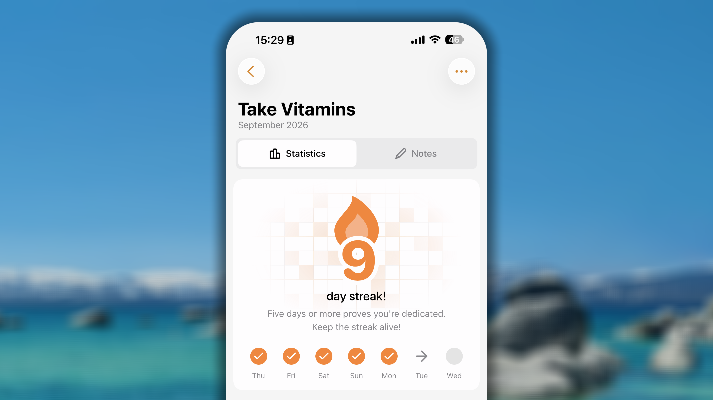

    Điều đầu tiên bạn thấy trong màn hình tiến trình của thói quen tốt là chuỗi hiện tại mà bạn đang duy trì.

    Cách chuỗi tăng khác nhau tùy mục tiêu:

    - **Với thói quen có mục tiêu theo ngày**: chuỗi tăng khi bạn hoàn thành thói quen vào ngày được lên lịch lặp lại. Bên dưới chuỗi là tiến trình 7 ngày gần nhất.
    - **Với thói quen có mục tiêu theo tuần**: chuỗi tăng khi hoàn thành mục tiêu tuần. Bên dưới là tiến trình 7 tuần gần nhất hoặc từ tuần bắt đầu.
    - **Với thói quen có mục tiêu theo tháng**: chuỗi tăng khi hoàn thành mục tiêu tháng. Bên dưới là tiến trình 7 tháng gần nhất hoặc từ tháng bắt đầu.
    - **Với thói quen có mục tiêu theo năm**: chuỗi tăng khi hoàn thành mục tiêu năm. Bên dưới là tiến trình 7 năm gần nhất hoặc từ năm bắt đầu.

    ### **Thanh tiến trình đến Điều kiện kết thúc**

    Nếu thói quen có Điều kiện kết thúc, một thanh theo dõi hành trình đến mục tiêu cuối cùng sẽ xuất hiện trong màn hình Tiến trình của một thói quen.

    Thanh này giúp bạn trực quan theo dõi mình đã đi được bao xa và còn phải nỗ lực bao lâu để đạt mục tiêu lớn.

    ### Các chỉ số cốt lõi

    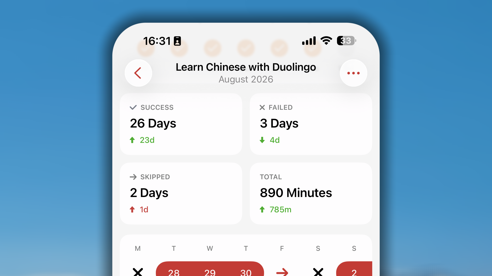

    Có 4 chỉ số:

    - **Thành công**: số ngày đạt mục tiêu thói quen trong tháng.
    - **Chưa đạt**: số ngày bạn đánh dấu thói quen là chưa đạt trong tháng.
    - **Đã bỏ qua**: số ngày bạn đánh dấu thói quen là đã bỏ qua trong tháng.
    - **Tổng**: tổng lượng hoặc số lần đã hoàn thành thói quen trong tháng, với đơn vị khớp mục tiêu (ví dụ: phút).

    Bên dưới mỗi con số, bạn có thể so sánh thành tích với khoảng trước đó (ví dụ: tháng này với tổng tháng trước, năm nay với tổng năm trước).

    <Note>
      **_“Thành công” được tính như thế nào?_**

      - Nếu là thói quen hằng ngày, đây là số ngày bạn hoàn thành mục tiêu.
      - Nếu có mục tiêu theo tuần, khi hoàn thành mục tiêu tuần, kết quả được tính là 7 ngày thành công, trừ số ngày đánh dấu Bỏ qua hoặc Chưa đạt.
      - Nếu có mục tiêu theo tháng, khi hoàn thành mục tiêu tháng, kết quả là tổng số ngày trong tháng, trừ số ngày đánh dấu Bỏ qua hoặc Chưa đạt.
      - Nếu có mục tiêu theo năm, khi hoàn thành mục tiêu năm, kết quả là tổng số ngày trong năm, trừ số ngày đánh dấu Bỏ qua hoặc Chưa đạt.
    </Note>

    ### Tiến trình trên Lịch

    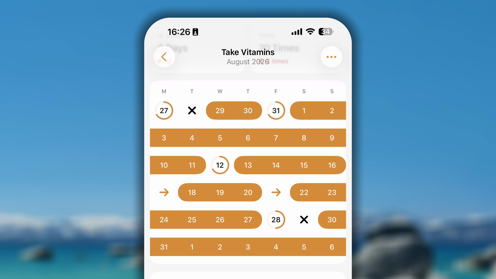

    Lịch trực quan hóa tiến trình trong tháng. Mỗi ngày có ký hiệu khác nhau tùy trạng thái:

    - **Vòng tròn màu đặc**: ngày bạn đánh dấu Hoàn thành hoặc có bất kỳ tiến trình nào với mục tiêu tuần, tháng hay năm.
    - **Vòng tròn chưa hoàn chỉnh**: ngày bạn có một phần tiến trình với mục tiêu theo ngày.
    - **Mũi tên hướng phải**: ngày đánh dấu Đã bỏ qua.
    - **Dấu X màu đen**: ngày đánh dấu Chưa đạt.

    Vuốt lịch sang phải để xem tháng trước và sang trái để xem tháng sau cho đến tháng hiện tại.

    ### Lịch sử chuỗi

    Nếu thói quen có mục tiêu theo ngày, phần này hiển thị mọi chuỗi bạn đã đạt từ chuỗi đầu tiên đến gần nhất.

    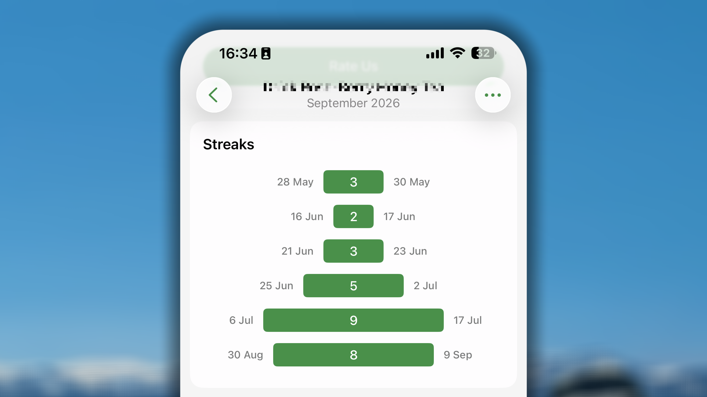

    Nếu có mục tiêu tuần, tháng hoặc năm, phần này hiển thị tỷ lệ hoàn thành của từng tuần, tháng hoặc năm kể từ kỳ bắt đầu.

    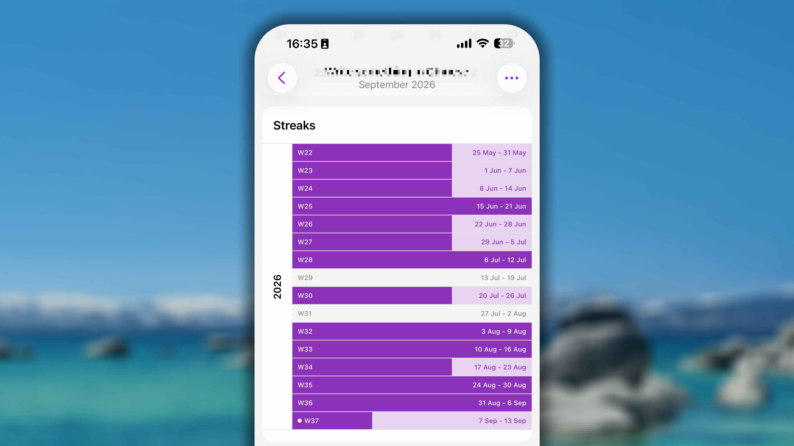

    ### Biểu đồ cột xu hướng

    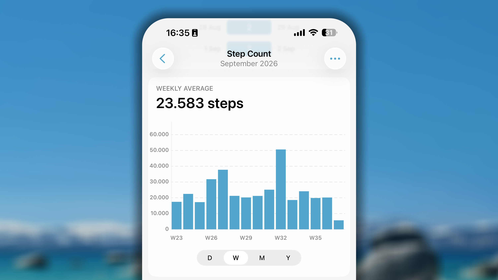

    Biểu đồ cột trực quan hóa hiệu suất theo thời gian. Ở cuối biểu đồ, bạn có thể chuyển giữa **Ngày**, **Tuần**, **Tháng** và **Năm**, từ ảnh chụp hằng ngày đến xu hướng dài hạn.

    Khi chọn một khoảng thời gian, bạn sẽ thấy:

    - **Xu hướng hiệu suất:** Mỗi cột thể hiện tổng thành tích trong kỳ đó (ví dụ: từng ngày trong tuần hoặc từng tháng trong năm).
    - **Chi tiết chính xác:** Chạm và giữ một cột để xem con số cụ thể đạt được trong kỳ.
    - **Mức trung bình:** Biểu đồ tính thành tích trung bình mỗi kỳ kể từ khi bắt đầu thói quen.

    **Đường đứt nét màu đỏ** đại diện cho mục tiêu đã đặt, giúp bạn nhìn ngay kết quả.

    _Ví dụ: Nếu mục tiêu là đi bộ 2.000 mét mỗi ngày, đường đỏ trên biểu đồ ngày nằm ở 2.000 m, giúp nhanh chóng thấy ngày nào đạt hoặc vượt mục tiêu._

    ### Biểu đồ đường nhất quán

    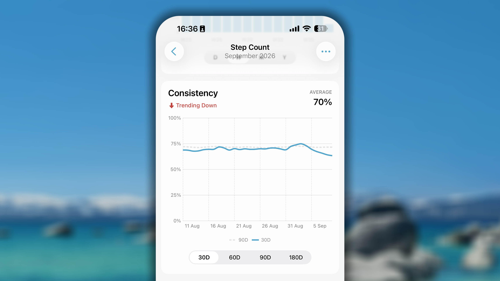

    Với mục tiêu theo ngày, bạn sẽ thấy **Chỉ số nhất quán**. Chỉ số này vượt ra ngoài một chuỗi đơn giản để cung cấp cái nhìn tinh tế hơn trong giai đoạn 30, 60, 90 hoặc 180 ngày.

    Chuỗi là thước đo được-mất hoàn toàn, còn Chỉ số nhất quán ghi nhận **nỗ lực và khả năng phục hồi**. Ngay cả khi làm đứt chuỗi, bạn vẫn có thể duy trì độ nhất quán cao. Đây là cách khoan dung và thực tế hơn để nhìn hành trình cải thiện bản thân dài hạn.

    Ví dụ cách tính:

    <Info>
      **Để dễ hiểu, hãy dùng một giai đoạn 3 ngày.**

      **Ngày 1:** Bạn hoàn thành thói quen.

      - **Giá trị hằng ngày:** 100%
      - **Độ nhất quán Ngày 1:** 100% (trung bình 3 ngày gần nhất nhưng mới chỉ có Ngày 1)

      **Ngày 2:** Bạn hoàn thành một nửa mục tiêu.

      - **Giá trị hằng ngày:** 50%
      - **Độ nhất quán Ngày 2:** (100% [Ngày 1] + 50% [Ngày 2]) / 2 = **75%**

      **Ngày 3:** Bạn chưa đạt thói quen.

      - **Giá trị hằng ngày:** 0%
      - **Độ nhất quán Ngày 3:** (100% [Ngày 1] + 50% [Ngày 2] + 0% [Ngày 3]) / 3 = **50%**

      **Phép tính cuối:** **Độ nhất quán tổng thể** là trung bình của các điểm theo ngày: `(100% + 75% + 50%) / 3 = 75%`
    </Info>

    **Đường đứt nét** trong biểu đồ đại diện cho **hiệu suất trước đây**, giúp thấy xu hướng hiện tại tốt hay kém hơn.

    Giai đoạn so sánh thay đổi theo khoảng ngày:

    - Chế độ **30 ngày** so với trung bình **60 ngày trước**.
    - Chế độ **60 ngày** so với trung bình **120 ngày trước**.
    - Chế độ **90 ngày** so với trung bình **180 ngày trước**.
    - Chế độ **180 ngày** so với trung bình **360 ngày trước**.

    Bạn có thể xác định xu hướng tăng hoặc giảm bằng cách nhìn **đường liền** và mối quan hệ của nó với **đường đứt nét**.

    ## Tiến trình của một thói quen xấu

    ### Chuỗi hiện tại

    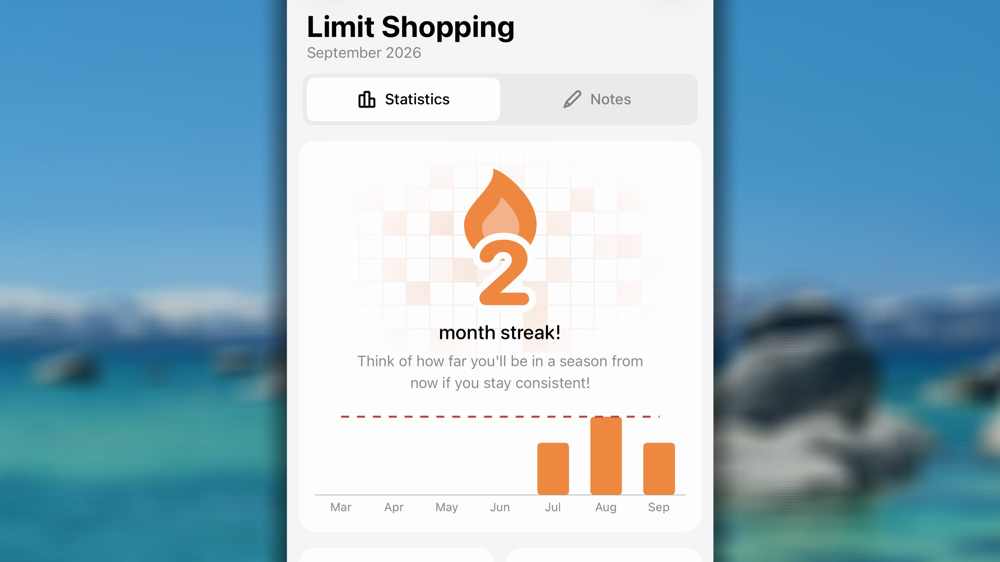

    Điều đầu tiên bạn thấy là chuỗi hiện tại đang duy trì.

    **Với thói quen có mục tiêu giới hạn**, chuỗi tăng tùy mục tiêu:

    - Giới hạn **theo ngày**: Chuỗi tăng khi ngày được đánh dấu thành công.
    - Giới hạn **theo tuần**: Chuỗi tăng khi lượng thực hiện nằm dưới giới hạn tuần.
    - Giới hạn **theo tháng**: Chuỗi tăng khi lượng thực hiện nằm dưới giới hạn tháng.
    - Giới hạn **theo năm**: Chuỗi tăng khi lượng thực hiện nằm dưới giới hạn năm.

    **Với mục tiêu từ bỏ**, chuỗi tăng khi bạn tránh thói quen thành công trong ngày và ngày được đánh dấu thành công.

    ### Các chỉ số cốt lõi

    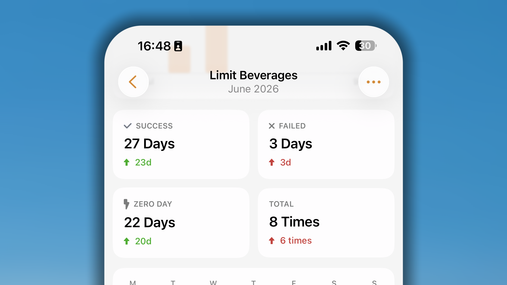

    Báo cáo dạng lưới cung cấp số liệu cụ thể:

    - **Thành công**: Tổng số kỳ trong khoảng đã chọn mà bạn không thực hiện thói quen xấu hoặc duy trì dưới giới hạn.
    - **Chưa đạt**: Tổng số ngày vượt quá giới hạn.
    - **Ngày bằng không (chỉ với mục tiêu Giới hạn)**: Số ngày hoàn toàn không thực hiện thói quen.
    - **Tổng (chỉ với mục tiêu Giới hạn)**: Tổng lượng thực hiện. Ví dụ, nếu đơn vị là "phút", chỉ số hiển thị tổng số phút dành cho thói quen.

    Với mục tiêu giới hạn tuần, tháng hoặc năm, sau khi vượt giới hạn và chưa đạt, ngày hiện tại cùng phần còn lại của kỳ sẽ được tính vào "Chưa đạt".

    ### Tiến trình trên Lịch

    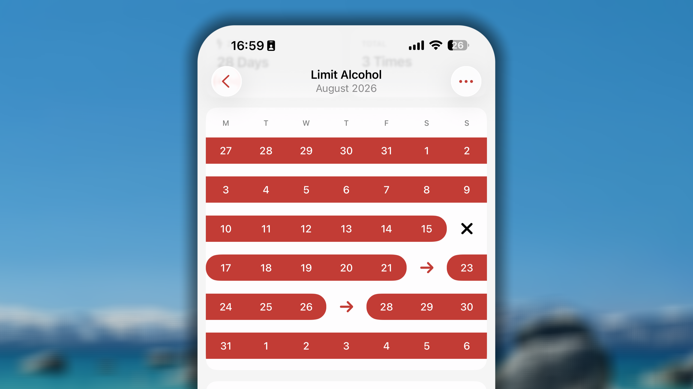

    Màn hình Lịch trực quan hóa tiến trình thói quen trong tháng. Mỗi ngày được đánh dấu bằng một ký hiệu khác nhau tùy theo trạng thái.

    - **Vòng tròn màu đặc**: ngày đánh dấu Thành công.
    - **Mũi tên hướng phải**: ngày đánh dấu Đã bỏ qua.
    - **Dấu X màu đen**: ngày đánh dấu Chưa đạt.

    Vuốt sang phải để xem tháng trước và sang trái để xem tháng sau cho đến tháng hiện tại.

    ### Biểu đồ cột xu hướng

    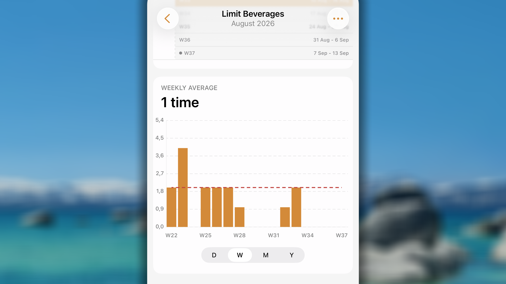

    Biểu đồ cột xu hướng cung cấp thông tin chuyên sâu về hiệu suất theo ngày, tuần, tháng và năm. Biểu đồ cũng hiển thị giá trị tiến trình trung bình của thói quen xấu kể từ khi bạn bắt đầu theo dõi.

    Ngoài ra, chạm vào một cột cụ thể sẽ cho biết lượng chính xác đã thực hiện trong kỳ được chọn (ngày, tuần, tháng hoặc năm).

    ### Lịch sử chuỗi

    Với mục tiêu từ bỏ hoặc giới hạn theo ngày, phần này hiển thị mọi chuỗi từ đầu tiên đến gần nhất.

    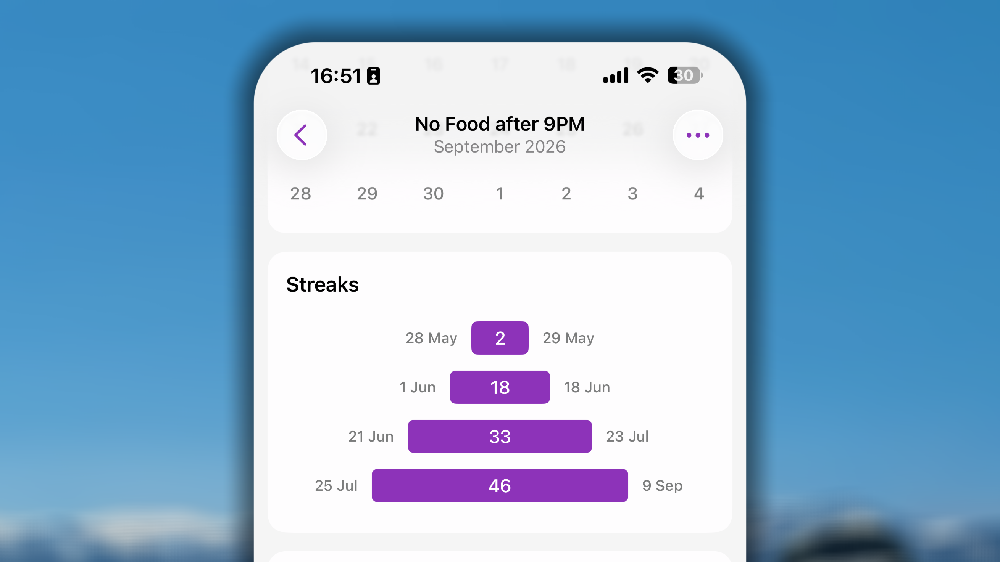

    Với mục tiêu giới hạn tuần, tháng hoặc năm, phần này hiển thị giá trị tiến trình ghi trong từng kỳ kể từ khi bắt đầu.

    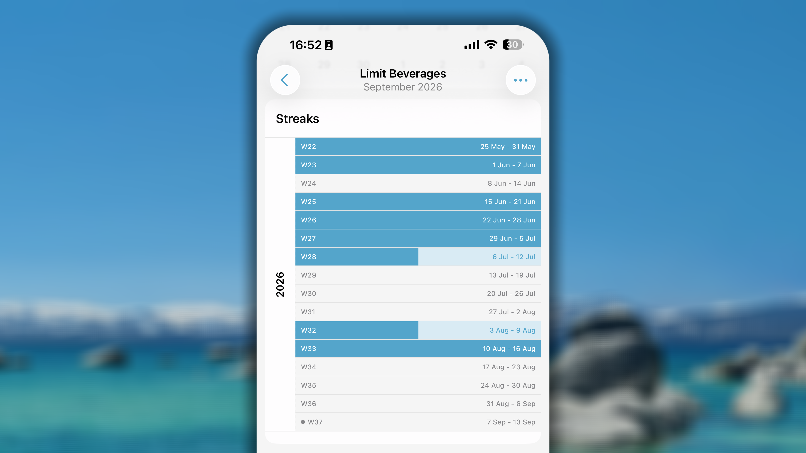

    ## Tiến trình của một thói quen trên iPhone Duo

    Khi iPhone Duo được gập hoặc mở và cầm dọc, màn hình trông giống iPhone tiêu chuẩn.

    **_Dưới đây là video ngắn xem trước trên iPhone Duo:_**

    <iframe src="https://drive.google.com/file/d/1cW7vDzIvVgp8Muk33-xs1V5l7BFRziw3/preview" width="640" height="360" />

    **Sự khác biệt xuất hiện khi mở thiết bị và cầm ngang.** Lịch hiển thị hai tháng cạnh nhau: tháng đã chọn bên phải và tháng trước đó bên trái, giúp so sánh tiến trình gần đây mà không cần chuyển qua lại.

    Các thành phần khác được sắp xếp lại để tận dụng chiều rộng. Thẻ Thành công, Chưa đạt, Đã bỏ qua và Tổng trải ngang phía trên; các phần khác nằm cạnh lịch thay vì xếp bên dưới, giúp thấy nhiều tiến trình hơn trên một màn hình.
  </Tab>
  <Tab title="Android">
    ## Tiến trình của một thói quen tốt

    ### Chuỗi hiện tại

    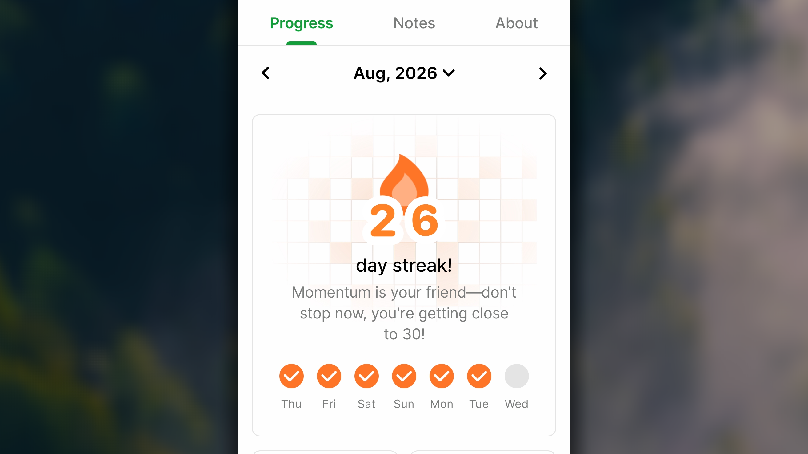

    Điều đầu tiên bạn thấy trong màn hình tiến trình của một thói quen tốt là chuỗi hiện tại mà bạn đang duy trì với thói quen đó.

    Cách chuỗi tăng khác nhau tùy theo mục tiêu của thói quen:

    - **Với thói quen có mục tiêu theo ngày**: chuỗi tăng khi bạn hoàn thành thói quen vào ngày được lên lịch lặp lại. Bên dưới chuỗi, bạn có thể xem tiến trình của 7 ngày gần nhất.
    - **Với thói quen có mục tiêu theo tuần**: chuỗi tăng khi bạn hoàn thành mục tiêu tuần. Bên dưới chuỗi, bạn có thể xem tiến trình của 7 tuần gần nhất hoặc từ tuần bắt đầu.
    - **Với thói quen có mục tiêu theo tháng**: chuỗi tăng khi bạn hoàn thành mục tiêu tháng. Bên dưới chuỗi, bạn có thể xem tiến trình của 7 tháng gần nhất hoặc từ tháng bắt đầu.
    - **Với thói quen có mục tiêu theo năm**: chuỗi tăng khi bạn hoàn thành mục tiêu năm. Bên dưới chuỗi, bạn có thể xem tiến trình của 7 năm gần nhất hoặc từ năm bắt đầu.

    ### **Thanh tiến trình đến Điều kiện kết thúc**

    Nếu thói quen có Điều kiện kết thúc, một thanh tiến trình theo dõi hành trình đến mục tiêu cuối cùng sẽ xuất hiện trong màn hình Tiến trình của một thói quen.

    Thanh tiến trình này giúp bạn theo dõi sát sao, trực quan xem mình đã đi được bao xa và còn phải nỗ lực bao lâu để đạt mục tiêu lớn.

    ### Các chỉ số cốt lõi

    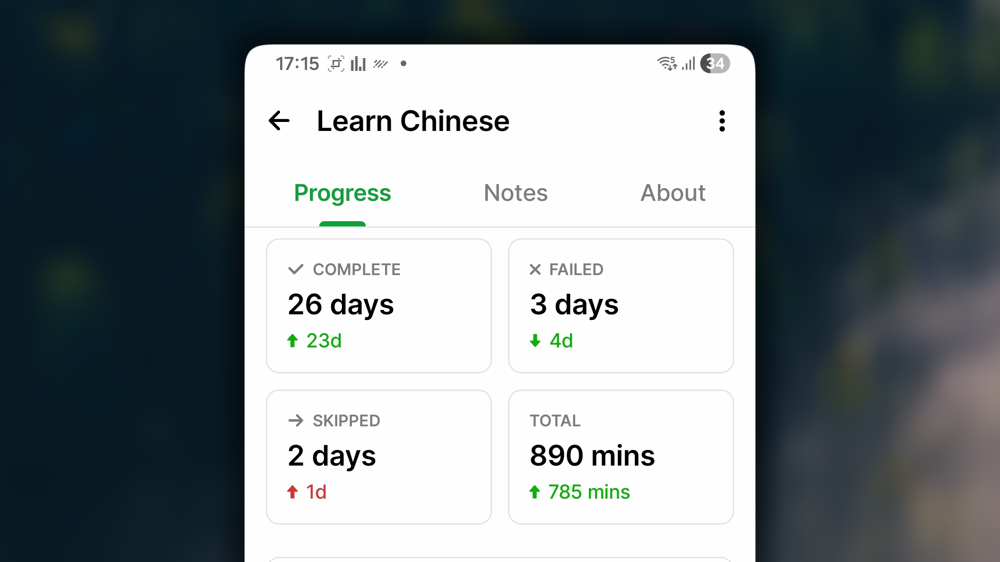

    Có 4 chỉ số:

    - **Thành công**: hiển thị số ngày bạn đạt mục tiêu thói quen trong tháng.
    - **Chưa đạt**: hiển thị số ngày bạn đánh dấu thói quen là chưa đạt trong tháng.
    - **Đã bỏ qua**: cho biết số ngày bạn đánh dấu thói quen là đã bỏ qua trong tháng.
    - **Tổng**: thể hiện tổng lượng hoặc số lần bạn đã hoàn thành thói quen trong tháng, với đơn vị tương ứng với đơn vị mục tiêu (ví dụ: phút).

    Bên dưới mỗi con số quan trọng, bạn có thể so sánh thành tích với khoảng trước đó (ví dụ: tháng này so với tổng của tháng trước, năm nay so với tổng của năm trước).

    <Note>
      **_“Thành công” được tính như thế nào?_**

      - Nếu là thói quen hằng ngày, đây là số ngày bạn hoàn thành mục tiêu.
      - Nếu có mục tiêu theo tuần, khi hoàn thành mục tiêu của một tuần, kết quả được tính là 7 ngày thành công, trừ số ngày bạn đánh dấu Bỏ qua hoặc Chưa đạt.
      - Nếu có mục tiêu theo tháng, khi hoàn thành mục tiêu tháng này, kết quả là tổng số ngày trong tháng, trừ số ngày bạn đánh dấu Bỏ qua hoặc Chưa đạt.
      - Nếu có mục tiêu theo năm, khi hoàn thành mục tiêu tháng này, kết quả là tổng số ngày trong năm, trừ số ngày bạn đánh dấu Bỏ qua hoặc Chưa đạt.
    </Note>

    ### Tiến trình trên Lịch

    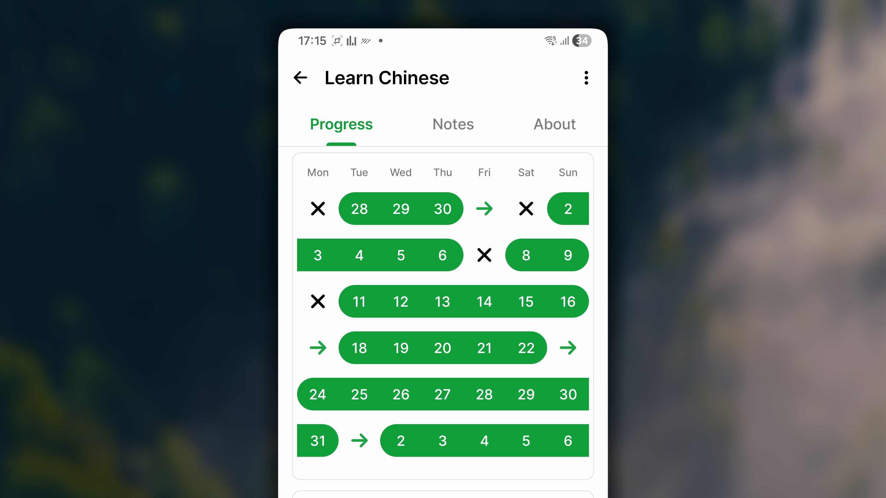

    Lịch trực quan hóa tiến trình thói quen trong tháng. Mỗi ngày được đánh dấu bằng một ký hiệu khác nhau tùy theo trạng thái bạn check-in cho thói quen vào ngày đó:

    - **Vòng tròn màu đặc**: ngày bạn đánh dấu thói quen là Hoàn thành hoặc có bất kỳ tiến trình nào với thói quen có mục tiêu theo tuần, tháng hay năm.
    - **Vòng tròn chưa hoàn chỉnh**: ngày bạn có một phần tiến trình với thói quen có mục tiêu theo ngày.
    - **Mũi tên hướng phải**: ngày bạn đánh dấu thói quen là Đã bỏ qua.
    - **Dấu X màu đen**: ngày bạn đánh dấu thói quen là Chưa đạt.

    Bạn có thể vuốt lịch sang phải để xem tháng trước và sang trái để xem tháng sau cho đến tháng hiện tại.

    ### Biểu đồ cột xu hướng

    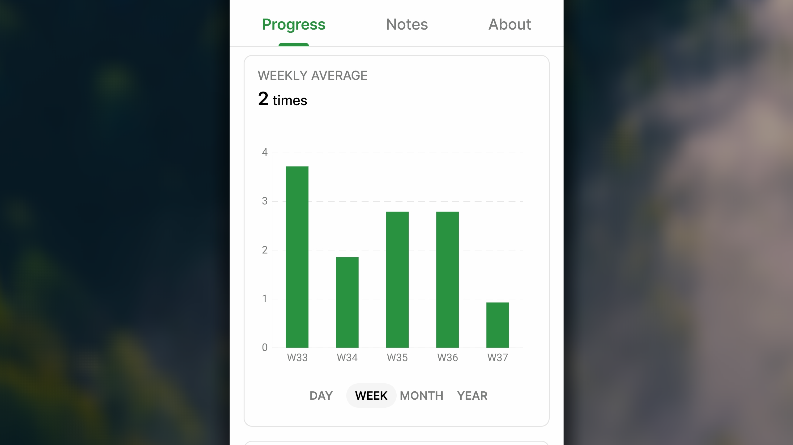

    Biểu đồ cột trực quan hóa hiệu suất thói quen theo thời gian. Ở cuối biểu đồ, bạn có thể chuyển giữa **Ngày**, **Tuần**, **Tháng** và **Năm**. Nhờ đó, bạn có thể xem tiến trình từ ảnh chụp hằng ngày đến xu hướng dài hạn.

    Khi chọn một khoảng thời gian, bạn sẽ thấy:

    - **Xu hướng hiệu suất:** Mỗi cột thể hiện tổng thành tích trong kỳ đó (ví dụ: từng ngày trong tuần hoặc từng tháng trong năm).
    - **Chi tiết chính xác:** Chạm và giữ một cột để xem con số cụ thể bạn đạt được trong kỳ đó.
    - **Mức trung bình:** Biểu đồ cũng tính thành tích trung bình mỗi kỳ kể từ khi bạn bắt đầu thói quen.

    Bạn cũng sẽ thấy một **đường đứt nét màu đỏ** trên biểu đồ. Đường này đại diện cho mục tiêu đã đặt, giúp bạn nhìn ngay kết quả của mình.

    _Ví dụ: Nếu mục tiêu là đi bộ 2.000 mét mỗi ngày, đường đỏ sẽ xuất hiện ở mức 2.000 m trong chế độ xem Ngày. Nhờ đó, bạn có thể nhanh chóng kiểm tra ngày nào đạt hoặc vượt mục tiêu._

    ### Lịch sử chuỗi

    Nếu thói quen có mục tiêu theo ngày, phần này sẽ hiển thị các chuỗi bạn đã đạt được với thói quen, từ chuỗi đầu tiên đến chuỗi gần nhất.

    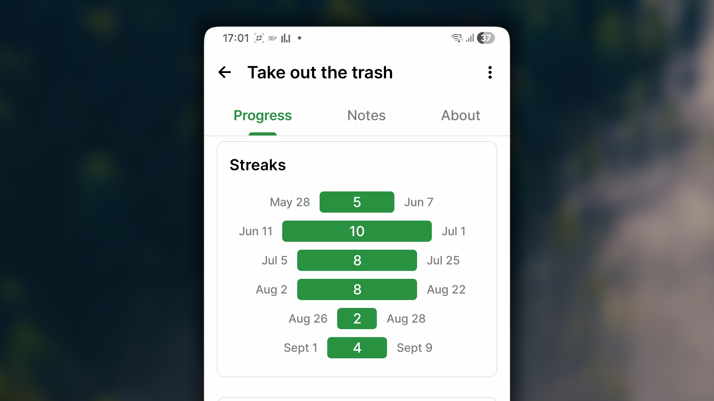

    Nếu thói quen có mục tiêu theo tuần, tháng hoặc năm, phần này sẽ hiển thị tỷ lệ hoàn thành của từng tuần, tháng hoặc năm kể từ kỳ bắt đầu.

    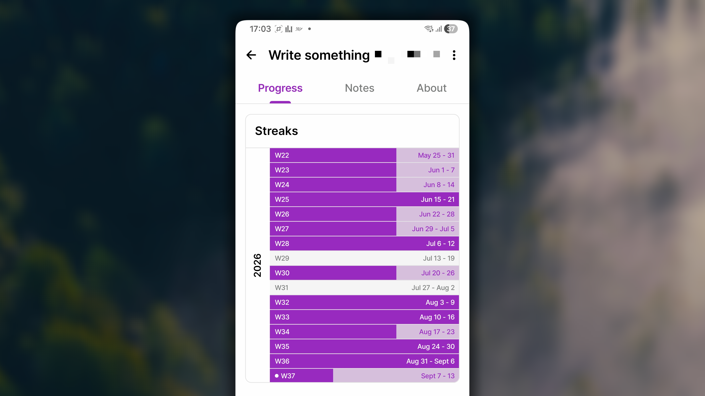

    ### Biểu đồ đường nhất quán

    Với thói quen có mục tiêu theo ngày, bạn sẽ thấy một chỉ số hữu ích gọi là **Chỉ số nhất quán**. Chỉ số này vượt ra ngoài một chuỗi đơn giản để cung cấp cái nhìn tinh tế hơn về hiệu suất trong giai đoạn đã chọn (30, 60, 90 hoặc 180 ngày).

    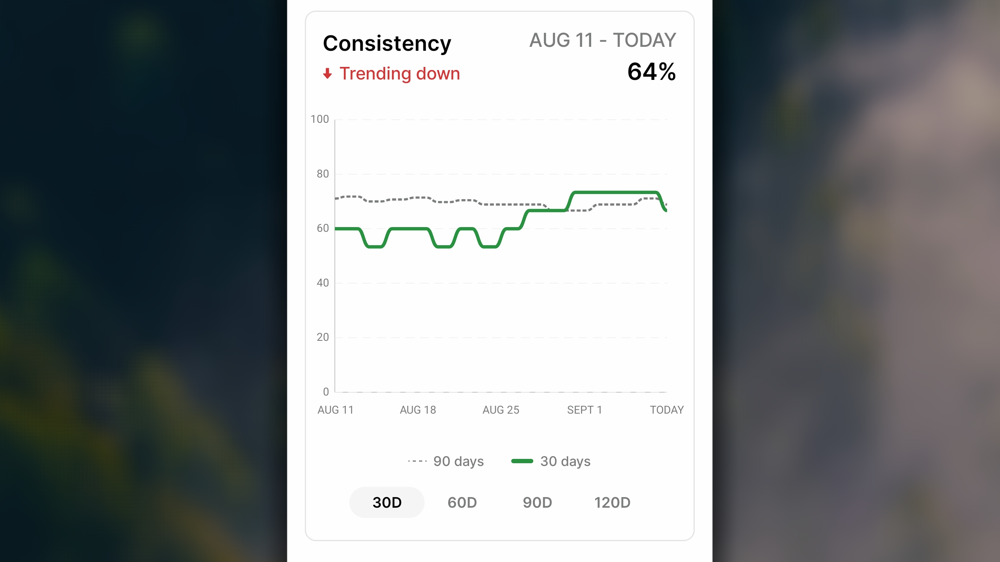

    Chuỗi là thước đo được-mất hoàn toàn, còn Chỉ số nhất quán ghi nhận **nỗ lực và khả năng phục hồi**. Chỉ số cho thấy ngay cả khi làm đứt chuỗi, bạn vẫn có thể duy trì độ nhất quán cao. Đây là cách khoan dung và thực tế hơn để nhìn hành trình cải thiện bản thân dài hạn.

    Dưới đây là ví dụ về cách tính điểm Nhất quán cho thói quen:

    <Info>
      **Để dễ hiểu, hãy dùng một giai đoạn 3 ngày đơn giản cho một thói quen.**

      **Ngày 1:** Bạn hoàn thành thói quen.

      - **Giá trị hằng ngày:** 100%
      - **Độ nhất quán Ngày 1:** 100% (trung bình 3 ngày gần nhất nhưng mới chỉ có Ngày 1)

      **Ngày 2:** Bạn hoàn thành một nửa mục tiêu.

      - **Giá trị hằng ngày:** 50%
      - **Độ nhất quán Ngày 2:** (100% [Ngày 1] + 50% [Ngày 2]) / 2 = **75%**

      **Ngày 3:** Bạn chưa đạt thói quen.

      - **Giá trị hằng ngày:** 0%
      - **Độ nhất quán Ngày 3:** (100% [Ngày 1] + 50% [Ngày 2] + 0% [Ngày 3]) / 3 = **50%**

      **Phép tính cuối:** **Độ nhất quán tổng thể** trong giai đoạn 3 ngày này là trung bình của các điểm Nhất quán hằng ngày: `(100% + 75% + 50%) / 3 = 75%`
    </Info>

    Trong biểu đồ Nhất quán, bạn sẽ thấy một **đường đứt nét**. Đường này đại diện cho **hiệu suất trước đây**, giúp bạn dễ dàng nhận ra xu hướng nhất quán hiện tại tốt hay kém hơn trước.

    Giai đoạn so sánh thay đổi theo khoảng ngày bạn chọn:

    - Khi xem chế độ **30 ngày**, đường đứt nét thể hiện mức trung bình của **60 ngày trước**.
    - Khi xem chế độ **60 ngày**, đường đứt nét thể hiện mức trung bình của **120 ngày trước**.
    - Khi xem chế độ **90 ngày**, đường đứt nét thể hiện mức trung bình của **180 ngày trước**.
    - Khi xem chế độ **120 ngày**, đường đứt nét thể hiện mức trung bình của **240 ngày trước**.

    Bạn có thể xác định độ nhất quán đang tăng hay giảm bằng cách nhìn vào hai yếu tố chính trong biểu đồ: **đường liền** và mối quan hệ của nó với **đường đứt nét**.

    ## Tiến trình của một thói quen xấu

    ### Chuỗi hiện tại

    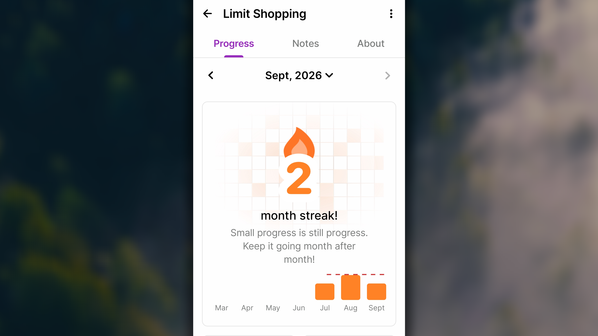

    Điều đầu tiên bạn thấy trong màn hình tiến trình của một thói quen xấu là chuỗi hiện tại mà bạn đang duy trì với thói quen đó.

    **Với thói quen có mục tiêu giới hạn**, cách tăng chuỗi hiện tại tùy thuộc vào mục tiêu:

    - Giới hạn **theo ngày**: Chuỗi tăng khi một ngày được đánh dấu là thành công.
    - Giới hạn **theo tuần**, **theo tháng** hoặc **theo năm**: Chuỗi tăng khi lượng thực hiện nằm dưới giới hạn của tuần, tháng hoặc năm hiện tại.

    **Với thói quen có mục tiêu từ bỏ**, chuỗi tăng khi bạn tránh được thói quen trong ngày hiện tại và ngày đó được đánh dấu là thành công.

    ### Các chỉ số cốt lõi

    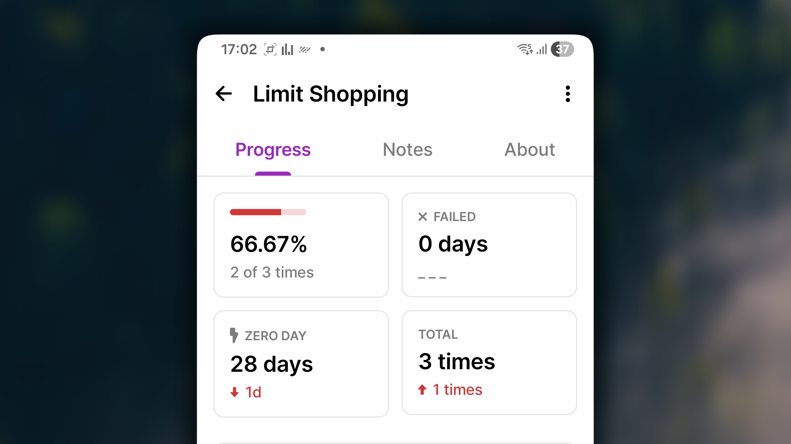

    Báo cáo dạng lưới cung cấp chi tiết về tiến trình, trong đó bạn có thể xem các con số cụ thể thể hiện thành tích và sự phát triển:

    - **Tỷ lệ tiến trình**: Tỷ lệ phần trăm giá trị tiến trình bạn đã ghi so với giới hạn.
    - **Chưa đạt**: Tổng số ngày chưa đạt trong khoảng thời gian đã chọn mà lượng thực hiện thói quen vượt quá giới hạn.
    - **Ngày bằng không (chỉ với mục tiêu Giới hạn)**: Số ngày bạn hoàn toàn không thực hiện thói quen.
    - **Tổng (chỉ với mục tiêu Giới hạn)**: Tổng lượng cho biết mức độ bạn thực hiện thói quen xấu. Ví dụ, nếu đơn vị mục tiêu là "phút", chỉ số Tổng sẽ hiển thị tổng số phút bạn dành cho thói quen.

    Với thói quen xấu có mục tiêu giới hạn theo tuần, tháng hoặc năm, sau khi vượt giới hạn và chưa đạt thói quen, ngày hiện tại cùng phần còn lại của kỳ hiện tại sẽ được tính vào "Chưa đạt".

    ### Tiến trình trên Lịch

    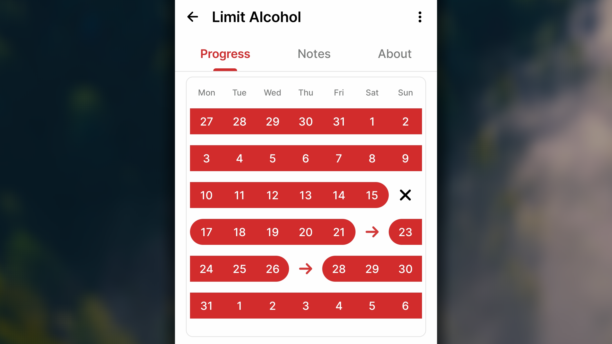

    Màn hình Lịch trực quan hóa tiến trình thói quen trong tháng. Mỗi ngày được đánh dấu bằng một ký hiệu khác nhau tùy theo trạng thái.

    - **Vòng tròn màu đặc**: ngày bạn đánh dấu thói quen là Thành công.
    - **Mũi tên hướng phải**: ngày bạn đánh dấu thói quen là Đã bỏ qua.
    - **Dấu X màu đen**: ngày bạn đánh dấu thói quen là Chưa đạt.

    Bạn có thể vuốt lịch sang phải để xem tháng trước và sang trái để xem tháng sau cho đến tháng hiện tại.

    ### Biểu đồ cột xu hướng

    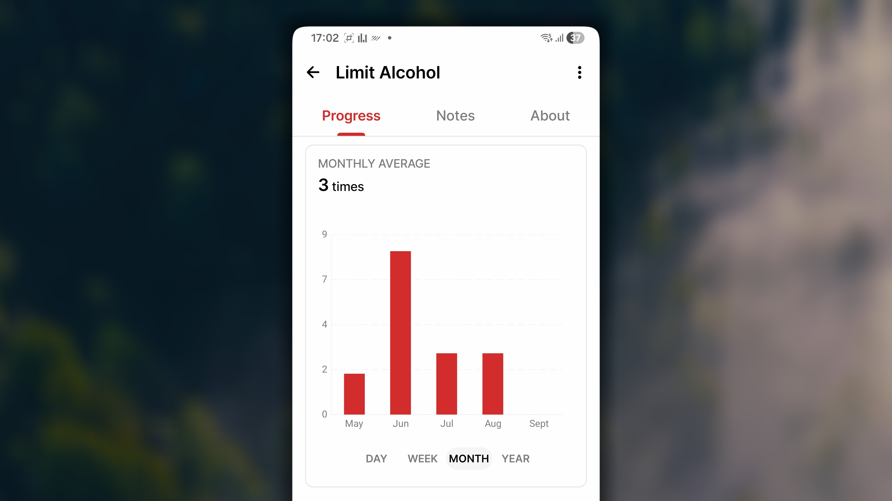

    Biểu đồ xu hướng cung cấp thông tin chuyên sâu về hiệu suất theo ngày, tuần, tháng và năm. Biểu đồ cũng hiển thị giá trị tiến trình trung bình của thói quen xấu kể từ khi bạn bắt đầu theo dõi.

    Ngoài ra, chạm vào một cột cụ thể sẽ cho biết lượng chính xác đã thực hiện trong kỳ được chọn (ngày, tuần, tháng hoặc năm).

    ### Lịch sử chuỗi

    Nếu thói quen có mục tiêu từ bỏ hoặc giới hạn theo ngày, phần này sẽ hiển thị các chuỗi bạn đã đạt được với thói quen, từ chuỗi đầu tiên đến chuỗi gần nhất.

    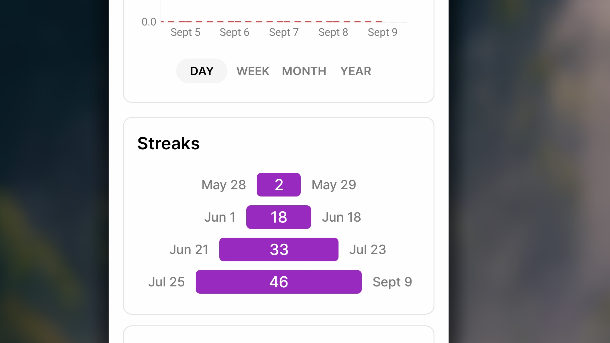

    Nếu thói quen có mục tiêu giới hạn theo tuần, tháng hoặc năm, phần này sẽ hiển thị tiến trình được ghi trong từng tuần, tháng hoặc năm kể từ kỳ bắt đầu.

    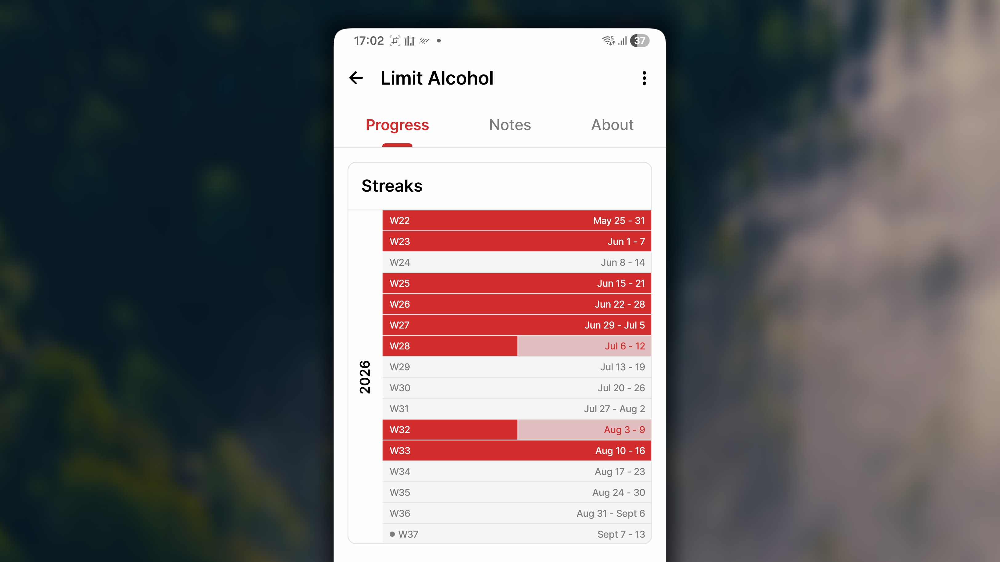
  </Tab>
  <Tab title="Website & Máy tính">
    ## Tiến trình của một thói quen tốt

    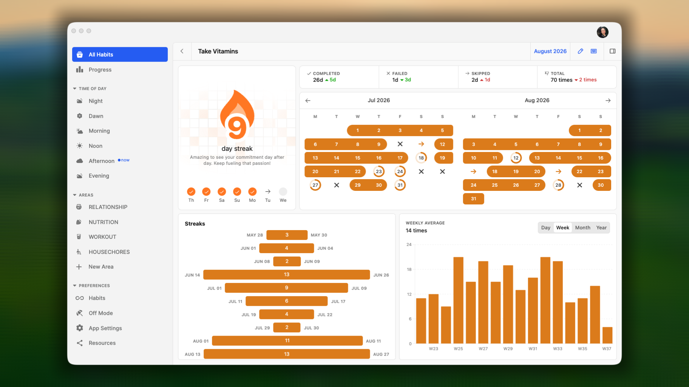

    Trong màn hình tiến trình của một thói quen tốt, khi đọc từ trên xuống dưới, từ trái sang phải, bạn sẽ thấy:

    - Chuỗi hiện tại của thói quen
    - Các chỉ số chính của tháng đang xem
    - Lịch tháng hiện tại và tháng trước nằm cạnh nhau
    - Toàn bộ lịch sử của mọi chuỗi bạn đã xây dựng với thói quen này
    - Biểu đồ cột thể hiện xu hướng thành tích theo ngày, tuần, tháng hoặc năm

    ### Chuỗi hiện tại

    Điều đầu tiên ở bên trái màn hình tiến trình của một thói quen tốt là chuỗi hiện tại mà bạn đang duy trì với thói quen đó.

    Cách chuỗi tăng khác nhau tùy theo mục tiêu của thói quen:

    - **Với thói quen có mục tiêu theo ngày**: chuỗi tăng khi bạn hoàn thành thói quen vào ngày được lên lịch lặp lại. Bên dưới chuỗi, bạn có thể xem tiến trình của 7 ngày gần nhất.
    - **Với thói quen có mục tiêu theo tuần**: chuỗi tăng khi bạn hoàn thành mục tiêu tuần. Bên dưới chuỗi, bạn có thể xem tiến trình của 7 tuần gần nhất hoặc từ tuần bắt đầu.
    - **Với thói quen có mục tiêu theo tháng**: chuỗi tăng khi bạn hoàn thành mục tiêu tháng. Bên dưới chuỗi, bạn có thể xem tiến trình của 7 tháng gần nhất hoặc từ tháng bắt đầu.
    - **Với thói quen có mục tiêu theo năm**: chuỗi tăng khi bạn hoàn thành mục tiêu năm. Bên dưới chuỗi, bạn có thể xem tiến trình của 7 năm gần nhất hoặc từ năm bắt đầu.

    ### **Thanh tiến trình đến Điều kiện kết thúc**

    Nếu thói quen có Điều kiện kết thúc, một thanh tiến trình theo dõi hành trình đến mục tiêu cuối cùng sẽ xuất hiện trong màn hình Tiến trình của một thói quen.

    Thanh tiến trình này giúp bạn theo dõi sát sao, trực quan xem mình đã đi được bao xa và còn phải nỗ lực bao lâu để đạt mục tiêu lớn.

    ### Các chỉ số cốt lõi

    Có 4 chỉ số:

    - **Thành công**: hiển thị số ngày bạn đạt mục tiêu thói quen trong tháng.
    - **Chưa đạt**: hiển thị số ngày bạn đánh dấu thói quen là chưa đạt trong tháng.
    - **Đã bỏ qua**: cho biết số ngày bạn đánh dấu thói quen là đã bỏ qua trong tháng.
    - **Tổng**: thể hiện tổng lượng hoặc số lần bạn đã hoàn thành thói quen trong tháng, với đơn vị tương ứng với đơn vị mục tiêu (ví dụ: phút).

    Bên dưới mỗi con số quan trọng, bạn có thể so sánh thành tích với khoảng trước đó (ví dụ: tháng này so với tổng của tháng trước, năm nay so với tổng của năm trước).

    <Note>
      **_“Thành công” được tính như thế nào?_**

      - Nếu là thói quen hằng ngày, đây là số ngày bạn hoàn thành mục tiêu.
      - Nếu có mục tiêu theo tuần, khi hoàn thành mục tiêu của một tuần, kết quả được tính là 7 ngày thành công, trừ số ngày bạn đánh dấu Bỏ qua hoặc Chưa đạt.
      - Nếu có mục tiêu theo tháng, khi hoàn thành mục tiêu tháng này, kết quả là tổng số ngày trong tháng, trừ số ngày bạn đánh dấu Bỏ qua hoặc Chưa đạt.
      - Nếu có mục tiêu theo năm, khi hoàn thành mục tiêu tháng này, kết quả là tổng số ngày trong năm, trừ số ngày bạn đánh dấu Bỏ qua hoặc Chưa đạt.
    </Note>

    ### Tiến trình trên Lịch

    Lịch trực quan hóa tiến trình thói quen trong hai tháng liên tiếp, với tháng đang xem ở bên trái. Mỗi ngày được đánh dấu bằng một ký hiệu khác nhau tùy theo trạng thái bạn check-in cho thói quen vào ngày đó:

    - **Vòng tròn màu đặc**: ngày bạn đánh dấu thói quen là Hoàn thành hoặc có bất kỳ tiến trình nào với thói quen có mục tiêu theo tuần, tháng hay năm.
    - **Vòng tròn chưa hoàn chỉnh**: ngày bạn có một phần tiến trình với thói quen có mục tiêu theo ngày.
    - **Mũi tên hướng phải**: ngày bạn đánh dấu thói quen là Đã bỏ qua.
    - **Dấu X màu đen**: ngày bạn đánh dấu thói quen là Chưa đạt.

    ### Lịch sử chuỗi

    Nếu thói quen có mục tiêu theo ngày, phần này sẽ hiển thị các chuỗi bạn đã đạt được với thói quen, từ chuỗi đầu tiên đến chuỗi gần nhất.

    Nếu thói quen có mục tiêu theo tuần, tháng hoặc năm, phần này sẽ hiển thị tỷ lệ hoàn thành của từng tuần, tháng hoặc năm kể từ kỳ bắt đầu.

    ### Biểu đồ cột xu hướng

    Biểu đồ cột trực quan hóa hiệu suất thói quen theo thời gian. Ở cuối biểu đồ, bạn có thể chuyển giữa **Ngày**, **Tuần**, **Tháng** và **Năm**. Nhờ đó, bạn có thể xem tiến trình từ ảnh chụp hằng ngày đến xu hướng dài hạn.

    Khi chọn một khoảng thời gian, bạn sẽ thấy:

    - **Xu hướng hiệu suất:** Mỗi cột thể hiện tổng thành tích trong kỳ đó (ví dụ: từng ngày trong tuần hoặc từng tháng trong năm).
    - **Chi tiết chính xác:** Chạm và giữ một cột để xem con số cụ thể bạn đạt được trong kỳ đó.
    - **Mức trung bình:** Biểu đồ cũng tính thành tích trung bình mỗi kỳ kể từ khi bạn bắt đầu thói quen.

    Bạn cũng sẽ thấy một **đường đứt nét màu đỏ** trên biểu đồ. Đường này đại diện cho mục tiêu đã đặt, giúp bạn nhìn ngay kết quả của mình.

    _Ví dụ: Nếu mục tiêu là đi bộ 2.000 mét mỗi ngày, đường đỏ trên biểu đồ Ngày sẽ nằm ở mức 2.000 m. Nhờ đó, bạn có thể nhanh chóng kiểm tra ngày nào đạt hoặc vượt mục tiêu._

    ## Tiến trình của một thói quen xấu

    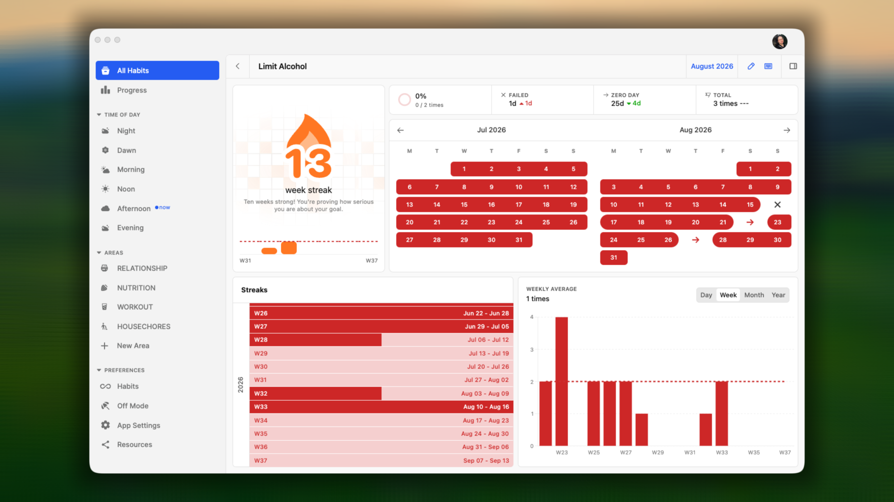

    Trong màn hình tiến trình của một thói quen xấu, khi đọc từ trên xuống dưới, từ trái sang phải, bạn sẽ thấy:

    - Chuỗi hiện tại của thói quen
    - Các chỉ số chính của tháng đang xem
    - Lịch tháng hiện tại và tháng trước nằm cạnh nhau
    - Toàn bộ lịch sử của mọi chuỗi bạn đã xây dựng với thói quen này
    - Biểu đồ cột thể hiện xu hướng kiềm chế theo ngày, tuần, tháng hoặc năm

    ### Chuỗi hiện tại

    Điều đầu tiên bạn thấy trong màn hình tiến trình của một thói quen xấu là chuỗi hiện tại mà bạn đang duy trì với thói quen đó.

    **Với thói quen có mục tiêu giới hạn**, cách tăng chuỗi hiện tại tùy thuộc vào mục tiêu:

    - Giới hạn **theo ngày**: Chuỗi tăng khi một ngày được đánh dấu là thành công.
    - Giới hạn **theo tuần**: Chuỗi tăng khi lượng thực hiện nằm dưới giới hạn tuần.
    - Giới hạn **theo tháng**: Chuỗi tăng khi lượng thực hiện nằm dưới giới hạn tháng.
    - Giới hạn **theo năm**: Chuỗi tăng khi lượng thực hiện nằm dưới giới hạn năm.

    **Với thói quen có mục tiêu từ bỏ**, chuỗi tăng khi bạn tránh được thói quen trong ngày hiện tại và ngày đó được đánh dấu là thành công.

    ### Các chỉ số cốt lõi

    Báo cáo dạng lưới cung cấp chi tiết về tiến trình, trong đó bạn có thể xem các con số cụ thể thể hiện thành tích và sự phát triển:

    - **Thành công**: Tổng số kỳ trong khoảng thời gian đã chọn mà bạn thành công không thực hiện thói quen xấu hoặc duy trì dưới giới hạn.
    - **Chưa đạt**: Tổng số ngày chưa đạt trong khoảng thời gian đã chọn mà lượng thực hiện thói quen vượt quá giới hạn.
    - **Ngày bằng không (chỉ với mục tiêu Giới hạn)**: Số ngày bạn hoàn toàn không thực hiện thói quen.
    - **Tổng (chỉ với mục tiêu Giới hạn)**: Tổng lượng cho biết mức độ bạn thực hiện thói quen xấu. Ví dụ, nếu đơn vị mục tiêu là "phút", chỉ số Tổng sẽ hiển thị tổng số phút bạn dành cho thói quen.

    Với thói quen xấu có mục tiêu giới hạn theo tuần, tháng hoặc năm, sau khi vượt giới hạn và chưa đạt thói quen, ngày hiện tại cùng phần còn lại của kỳ hiện tại sẽ được tính vào "Chưa đạt".

    ### Tiến trình trên Lịch

    Màn hình Lịch trực quan hóa tiến trình thói quen trong tháng. Mỗi ngày được đánh dấu bằng một ký hiệu khác nhau tùy theo trạng thái.

    - **Vòng tròn màu đặc**: ngày bạn đánh dấu thói quen là Thành công.
    - **Mũi tên hướng phải**: ngày bạn đánh dấu thói quen là Đã bỏ qua.
    - **Dấu X màu đen**: ngày bạn đánh dấu thói quen là Chưa đạt.

    Bạn có thể vuốt lịch sang phải để xem tháng trước và sang trái để xem tháng sau cho đến tháng hiện tại.

    ### Biểu đồ cột xu hướng

    Biểu đồ xu hướng cung cấp thông tin chuyên sâu về hiệu suất theo ngày, tuần, tháng và năm. Biểu đồ cũng hiển thị giá trị tiến trình trung bình của thói quen xấu kể từ khi bạn bắt đầu theo dõi.

    Ngoài ra, chạm vào một cột cụ thể sẽ cho biết lượng chính xác đã thực hiện trong kỳ được chọn (ngày, tuần, tháng hoặc năm).

    ### Lịch sử chuỗi

    Nếu thói quen có mục tiêu từ bỏ hoặc giới hạn theo ngày, phần này sẽ hiển thị các chuỗi bạn đã đạt được với thói quen, từ chuỗi đầu tiên đến chuỗi gần nhất.

    Nếu thói quen có mục tiêu giới hạn theo tuần, tháng hoặc năm, phần này sẽ hiển thị giá trị tiến trình được ghi trong từng tuần, tháng hoặc năm kể từ kỳ bắt đầu.
  </Tab>
</Tabs>
