Các tiện ích của Habitify cung cấp cái nhìn nhanh nhưng đầy đủ về tiến trình thói quen ngay trên **màn hình chính**, vì vậy bạn không cần mở ứng dụng chỉ để kiểm tra tình hình.

Tiện ích Habitify hướng đến việc hiển thị nhanh mà vẫn đầy đủ tiến trình thói quen ngay trên màn hình chính và màn hình khóa.

Bài viết này giới thiệu tất cả tiện ích hiện có của Habitify.

## Các loại tiện ích

<Tabs>
  <Tab title=" iOS">
    ## Tiện ích màn hình chính

    ### **Chuỗi duy trì**

    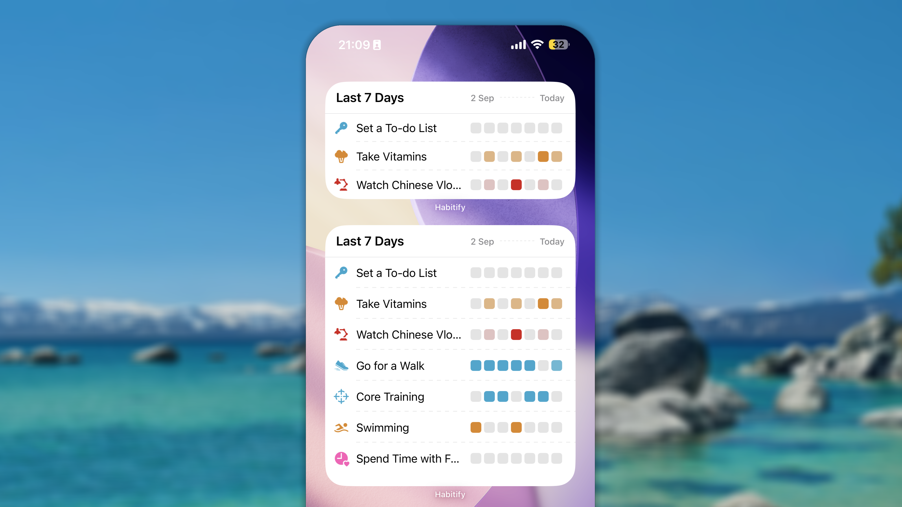

    Tiện ích Chuỗi duy trì hiển thị danh sách thói quen, trong đó tiến trình của mỗi thói quen được thể hiện bằng bản đồ nhiệt.

    Các khoảng ngày có thể chọn gồm: _7 ngày qua_, _14 ngày qua_, _21 ngày qua_, _30 ngày qua_, _Tuần này_ và _Tháng này_.

    Đối với danh sách hiển thị, bạn có thể chọn Tất cả thói quen, Thời điểm hiện tại trong ngày hoặc một khu vực tùy chỉnh.

    Tiện ích có 3 kích thước:

    - Kích thước Nhỏ hiển thị tối đa 3 thói quen.
    - Kích thước Vừa hiển thị tối đa 3 thói quen.
    - Kích thước Lớn hiển thị tối đa 8 thói quen.

    ### Chuỗi hiện tại

    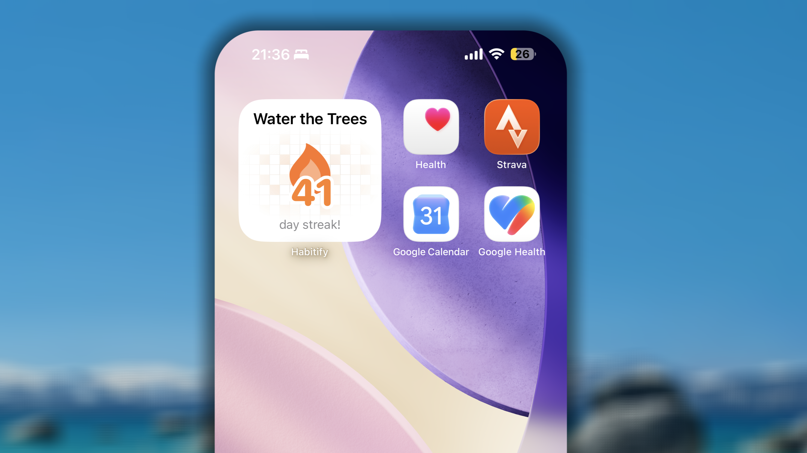

    Tiện ích này được thiết kế hoàn toàn để tạo động lực. Tiện ích hiển thị số chuỗi hiện tại của bất kỳ thói quen tốt nào bạn chọn.

    Việc nhìn thấy chuỗi phát triển ngay trên màn hình chính là lời nhắc mạnh mẽ về cam kết của bạn.

    Tiện ích chỉ có kích thước Nhỏ.

    ### Lưới nhất quán

    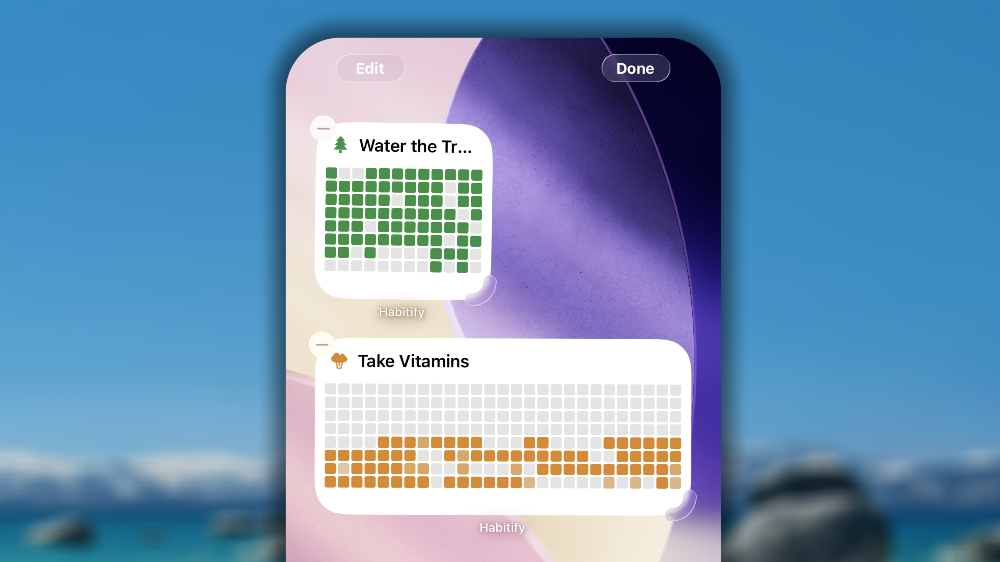

    Tiện ích Lưới nhất quán được thiết kế để hiển thị bản đồ nhiệt tiến trình của một thói quen tốt.

    Tiện ích có 2 kích thước:

    - Tiện ích kích thước Nhỏ hiển thị tiến trình trong 96 ngày qua.
    - Tiện ích kích thước Vừa hiển thị tiến trình trong 216 ngày qua.

    ### **Thói quen hôm nay**

    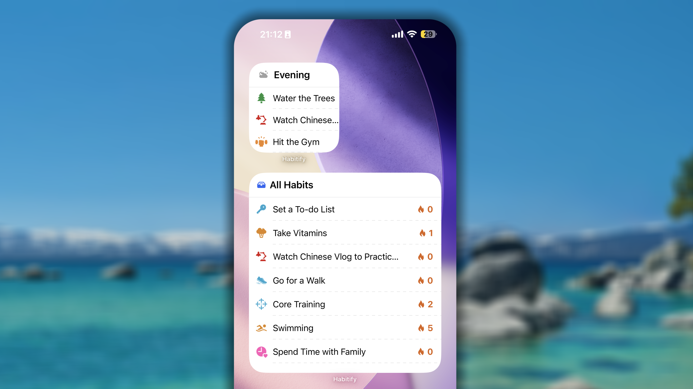

    Tiện ích Hôm nay hiển thị danh sách những thói quen tốt được đặt lặp lại trong ngày hiện tại theo bố cục gọn. Bạn có thể cấu hình tiện ích để hiển thị Tất cả thói quen, các thói quen trong Thời điểm hiện tại trong ngày hoặc các thói quen thuộc một khu vực tùy chỉnh. Chuỗi hiện tại xuất hiện bên cạnh mỗi thói quen.

    Trên tiện ích này, thói quen được sắp xếp theo thứ tự tùy chỉnh mà bạn đã đặt trong Cài đặt → Tất cả thói quen.

    Tiện ích có 3 kích thước:

    - Kích thước Nhỏ hiển thị tối đa 3 thói quen.
    - Kích thước Vừa hiển thị tối đa 3 thói quen.
    - Kích thước Lớn hiển thị tối đa 8 thói quen.

    ### Chạm để theo dõi

    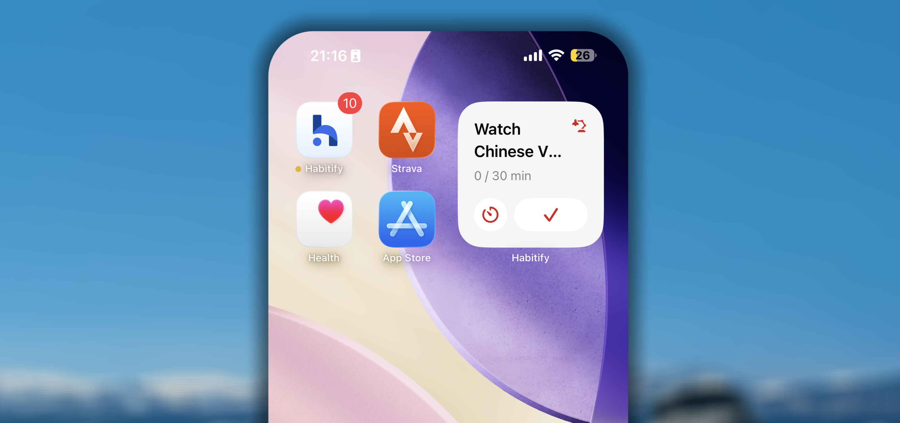

    Tiện ích Chạm để theo dõi cho phép bạn cập nhật trạng thái thói quen ngay trên màn hình chính. Tiện ích có 2 nút mà bạn có thể cấu hình để đánh dấu Hoàn thành, Đã bỏ qua hoặc Chưa đạt, hoặc dùng để bắt đầu một phiên Hẹn giờ.

    Tiện ích chỉ có kích thước Nhỏ.

    ### Số ngày kể từ

    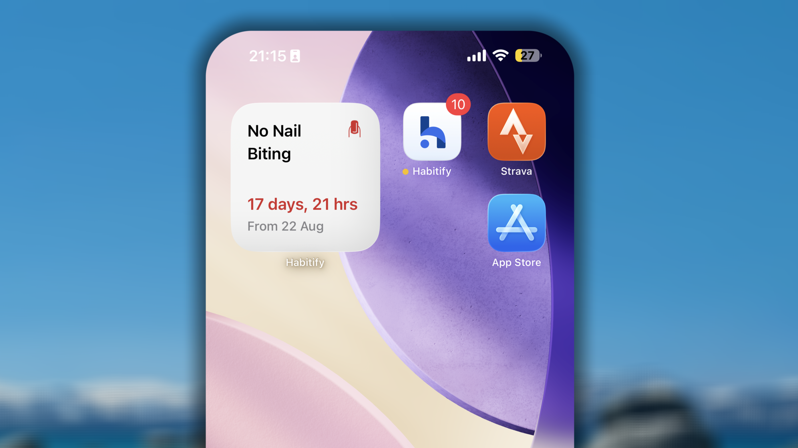

    Tiện ích Số ngày kể từ giúp bạn theo dõi một thói quen xấu có mục tiêu từ bỏ ngay trên màn hình chính. Tiện ích không có nút check-in hoặc ghi tiến trình vì tất nhiên chúng tôi không khuyến khích hành động đó.

    Trên tiện ích, bạn có thể xem chuỗi hiện tại đạt được khi tránh xa thói quen xấu.

    Tiện ích chỉ có kích thước Nhỏ.

    ### Tiến trình mục tiêu

    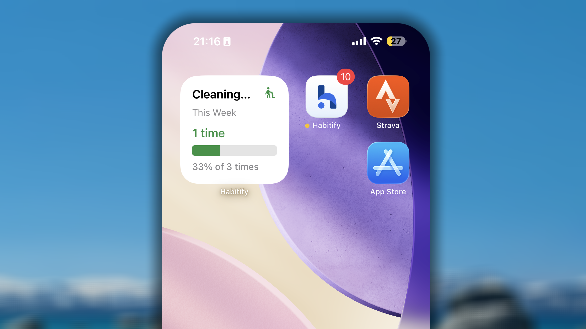

    Tiện ích Tiến trình mục tiêu hiển thị thanh tiến trình của một thói quen tốt có mục tiêu theo tuần, tháng hoặc năm.

    Tiện ích chỉ có kích thước Nhỏ.

    ### Theo dõi giới hạn

    Tiện ích Theo dõi giới hạn thể hiện thanh tiến trình của thói quen xấu có mục tiêu giới hạn. Ở giữa thanh tiến trình có một đường dọc màu đỏ đánh dấu giới hạn bạn không nên vượt quá. Khi vượt giới hạn, phần giá trị vượt quá sẽ được hiển thị màu đỏ.

    Tiện ích chỉ có kích thước Nhỏ.

    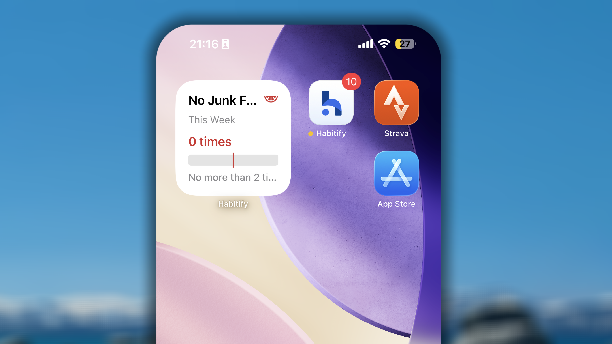

    ## Tiện ích màn hình khóa

    Kể từ iOS 16, Apple hỗ trợ tiện ích trực tiếp trên Màn hình khóa. Habitify cung cấp một nhóm tiện ích được thiết kế riêng cho không gian này (Thói quen hôm nay, Lưới nhất quán và Chạm để theo dõi), giúp bạn xem tiến trình thói quen ngay cả trước khi mở khóa điện thoại.

    **Cách thêm Tiện ích màn hình khóa:**

    1. Chạm và giữ Màn hình khóa cho đến khi nút **Tùy chỉnh** xuất hiện.
    2. Chạm vào **Tùy chỉnh**.
    3. Chọn **Màn hình khóa**.
    4. Chạm vào khu vực tiện ích trên Màn hình khóa để mở thư viện tiện ích.
    5. Tìm **Habitify** trong danh sách rồi chọn tiện ích muốn thêm.
    6. Chạm ra ngoài màn hình tùy chỉnh để lưu thay đổi.

    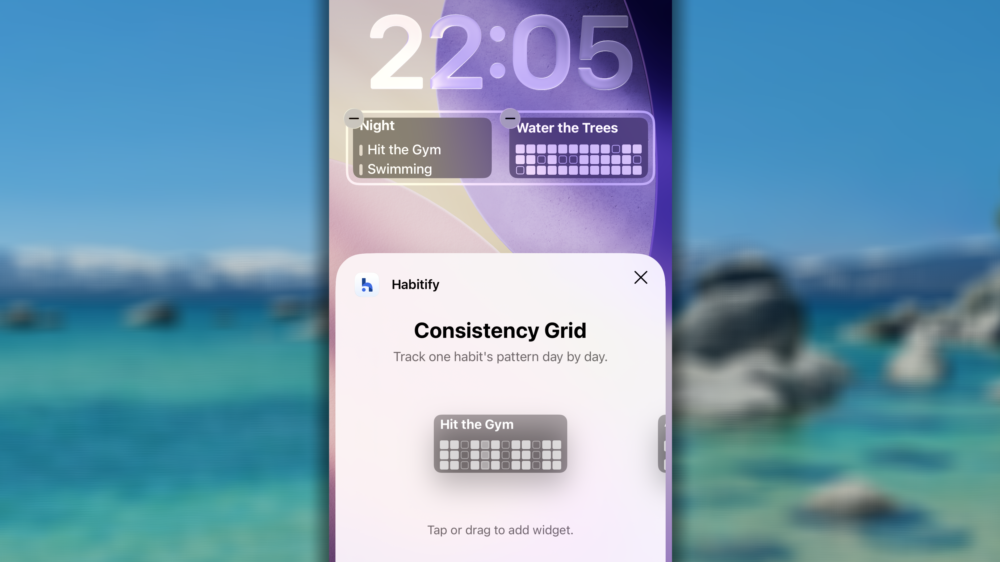

    ## Check-in bằng tiện ích

    Khi bạn chạm vào một thói quen trên tiện ích, **ứng dụng sẽ mở màn hình Nhật ký và làm nổi bật thói quen đó.** Điều này giúp bạn dễ dàng tìm đến thói quen trong danh sách và check-in tiến trình.

    Riêng đối với tiện ích **Chạm để theo dõi**:

    - Khi chạm vào nút Hoàn thành, Bỏ qua hoặc Chưa đạt, lần check-in sẽ được xử lý và lưu ngay trên màn hình chính.
    - Khi chạm vào Hẹn giờ, ứng dụng sẽ mở và đưa bạn thẳng đến Bộ đếm thời gian.

    ## Thay đổi kích thước tiện ích: Khả năng và giới hạn

    iOS của Apple có thiết kế màn hình chính chặt chẽ hơn. Bạn không thể tự do thay đổi kích thước tiện ích bằng cách kéo các góc. Thay vào đó, khả năng "đổi kích thước" chỉ giới hạn ở các kích thước tiêu chuẩn được xác định trước.

    ### **Cách thay đổi kích thước**

    Nếu dùng loại tiện ích có nhiều kích thước, bạn có thể dễ dàng chuyển đổi theo các bước:

    1. Nhấn giữ tiện ích.
    2. Nếu kích thước đó có sẵn, bạn có thể chọn từ menu ngữ cảnh xuất hiện.

    ### **Giới hạn**

    Với các tiện ích chỉ được thiết kế ở một kích thước, bạn có thể đổi chúng thành biểu tượng ứng dụng. Tuy nhiên, sau đó bạn không thể đổi trở lại mà phải thêm lại từ thư viện tiện ích.

    ## Câu hỏi thường gặp

    <Accordion title="**Không tìm thấy tiện ích Habitify, tôi nên làm gì?**">
      Trước tiên, hãy bảo đảm thiết bị đã cài phiên bản Habitify mới nhất. Để kiểm tra bản cập nhật:

      - Mở **App Store**.
      - Chạm vào biểu tượng hồ sơ ở góc trên bên phải.
      - Cuộn xuống để xem Habitify có bản cập nhật hay không.
      - Nếu có, chạm vào **Cập nhật**.

      Tiếp theo, hãy bảo đảm không có giới hạn nào ngăn tiện ích xuất hiện:

      - Mở **Cài đặt**.
      - Đi đến **Thời gian sử dụng** → **Giới hạn nội dung & quyền riêng tư**.
      - Bảo đảm tiện ích được cho phép.

      Đôi khi chỉ cần khởi động lại là có thể giải quyết vấn đề:

      - Nhấn giữ nút nguồn cho đến khi thanh trượt xuất hiện.
      - Trượt để tắt nguồn.
      - Sau khi thiết bị tắt, nhấn giữ nút nguồn lần nữa cho đến khi thấy logo Apple.

      Nếu tiện ích vẫn không xuất hiện, hãy thử cài đặt lại ứng dụng:

      - Nhấn giữ biểu tượng ứng dụng Habitify rồi chọn **Xóa ứng dụng**.
      - Mở **App Store** và cài đặt lại Habitify.
    </Accordion>

    <Accordion title="**Tiện ích không cập nhật thay đổi của thói quen, tôi nên làm gì?**">
      Sau đây là những nguyên nhân chính gây chậm trễ:

      - **Tối ưu hóa pin quá mạnh:** Đây là nguyên nhân hàng đầu. Để kéo dài thời lượng pin cả ngày, hệ điều hành điện thoại (cả iOS và Android) chủ động giới hạn tần suất các tiến trình nền như tiện ích có thể "thức dậy" để yêu cầu dữ liệu mới. Hệ thống có thể trì hoãn cập nhật vài phút hoặc lâu hơn.

      - **Tiện ích là tiến trình riêng:** Tiện ích là một ứng dụng nhỏ trên màn hình chính. Nó cần giao tiếp với ứng dụng Habitify chính để lấy thông tin mới nhất. Nếu ứng dụng chính bị hệ điều hành buộc ngủ (đặc biệt phổ biến trên Android), tiện ích không thể lấy dữ liệu mới và sẽ hiển thị thông tin gần nhất đã có.

      Trước khi đi sâu vào cài đặt riêng của thiết bị, hãy thử các bước đơn giản sau để giải quyết phần lớn sự cố tiện ích trên mọi nền tảng.

      1. **Mở ứng dụng Habitify:** Bước đầu tiên đơn giản nhất là mở ứng dụng Habitify chính và để ở màn hình trước trong 30–60 giây. Việc này thường buộc tiện ích đồng bộ dữ liệu mới nhất.
      2. **Xóa rồi thêm lại tiện ích:** Nếu không hiệu quả, hãy xóa tiện ích khỏi màn hình chính rồi thêm lại. Việc này buộc tiện ích tải lại toàn bộ cấu hình.
      3. **Khởi động lại thiết bị:** Khởi động lại hoàn toàn điện thoại có thể xóa các lỗi hệ thống tạm thời đang ảnh hưởng đến tiện ích.

      Tiện ích iOS được cập nhật theo lịch do hệ thống quản lý. Nếu bộ nhớ đệm đã cũ, bạn có thể buộc làm mới.

      - **Chỉnh sửa tiện ích:** Nhấn giữ tiện ích Habitify rồi chạm vào **Sửa tiện ích**. Thử chuyển nguồn dữ liệu (ví dụ từ "Tất cả thói quen" sang một "Khu vực" rồi chuyển lại) hoặc chọn lại thói quen cụ thể trong danh sách. Hành động này thường buộc dữ liệu tiện ích tải lại.
      - **Bật Làm mới ứng dụng trong nền:** Bảo đảm iOS có thể cập nhật tiện ích trong nền. Đi đến **Cài đặt → Cài đặt chung → Làm mới ứng dụng trong nền** trên iPhone, bảo đảm cài đặt được bật và nút gạt cho Habitify đang bật.
    </Accordion>

    <Accordion title="**Tại sao thói quen xấu không xuất hiện trên một số tiện ích?**">
      Thói quen xấu không được hỗ trợ trên tiện ích Thói quen hôm nay và Chuỗi duy trì. Lý do chính của thiết kế này là giữ cho danh sách việc cần làm hằng ngày tập trung và tạo động lực.

      1. **"Danh sách hôm nay" dành cho hành động.** Tiện ích được thiết kế như danh sách kiểm tra hằng ngày, nhắc bạn về những hành động tích cực cần **thực hiện**. Đưa một thói quen xấu như "Không hút thuốc" vào danh sách những việc _cần làm_ có thể phản tác dụng. Mục tiêu là tránh và quên thói quen xấu, không phải được nhắc đến nó bên cạnh các tác vụ tích cực.
      2. **"Chuỗi duy trì" dùng để tôn vinh thành công.** Mục đích của tiện ích là tạo một chuỗi thành tích trực quan, thỏa mãn. Với thói quen xấu, thành công đạt được bằng cách _không hành động_ hoặc _tránh_. Nếu đưa thói quen xấu vào đây, tiện ích chỉ hiển thị một chuỗi ô trống hoặc chưa đạt ("X"), không tạo nhiều động lực khi nhìn thấy trên màn hình chính mỗi ngày.

      Bằng cách tập trung các tiện ích này vào thói quen tốt, chúng tôi hướng đến một bảng điều khiển tích cực và thiên về hành động hơn cho ngày của bạn.
    </Accordion>

    <Accordion title="**Tại sao tiện ích Habitify biến mất khi iPhone bị khóa?**">
      Đây không phải lỗi mà là tính năng bảo mật của iOS. Theo mặc định, iOS ẩn toàn bộ nội dung tiện ích khi điện thoại bị khóa để bảo vệ thông tin nhạy cảm khỏi bị xem khi chưa xác thực.

      Nếu muốn thói quen Habitify luôn hiển thị trên màn hình khóa, bạn có thể thay đổi cài đặt:

      1. Mở **Cài đặt** trên iPhone.
      2. Cuộn xuống và chạm vào **Face ID & Mật mã** (hoặc **Touch ID & Mật mã**, tùy mẫu iPhone).
      3. Nhập mật mã màn hình.
      4. Cuộn xuống phần **Cho phép truy cập khi bị khóa**.
      5. **BẬT** tùy chọn **Tiện ích màn hình khóa** (trên phiên bản iOS cũ, tùy chọn có thể mang tên **Chế độ xem Hôm nay và Tìm kiếm**).
    </Accordion>

     
  </Tab>
  <Tab title="🤖 Android">
    ## Tiện ích màn hình chính

    ### **Lưới nhất quán**

    Tiện ích Lưới nhất quán được thiết kế để thể hiện bản đồ nhiệt tiến trình của một thói quen tốt. Lượng lịch sử hiển thị phụ thuộc vào kích thước bạn đặt trên màn hình chính.

    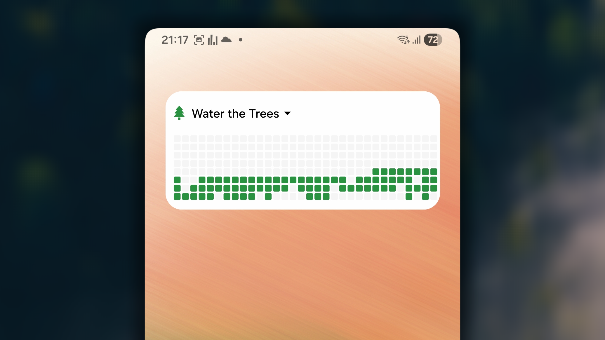

    ### **Số ngày kể từ**

    Tiện ích Số ngày kể từ giúp bạn theo dõi một thói quen xấu có mục tiêu từ bỏ ngay trên màn hình chính. Tiện ích không có nút check-in hoặc ghi tiến trình vì tất nhiên chúng tôi không khuyến khích hành động đó.

    Trên tiện ích, bạn có thể xem chuỗi hiện tại đạt được khi tránh xa thói quen xấu.

    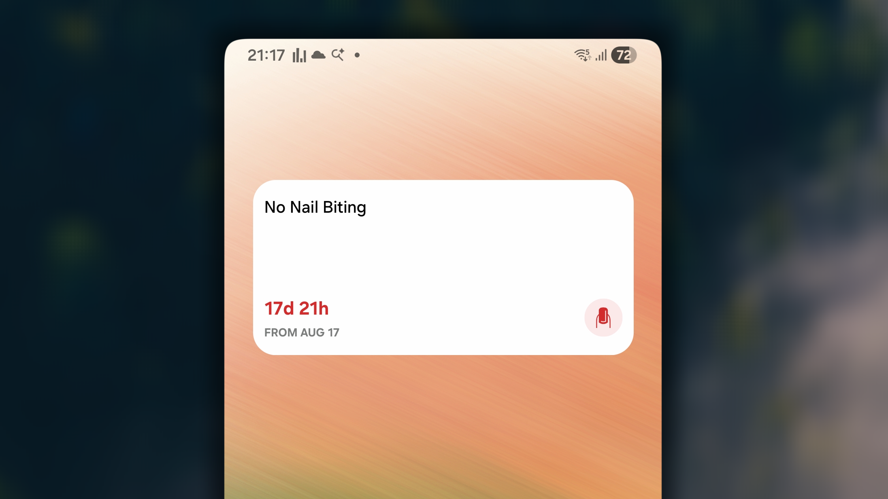

    ### **Theo dõi mục tiêu**

    Tiện ích Theo dõi mục tiêu giúp bạn theo dõi thói quen có mục tiêu theo tuần, tháng hoặc năm, bất kể đó là thói quen tốt hay thói quen xấu (cần giới hạn).

    - Với thói quen tốt, tiện ích hiển thị thanh tiến trình đạt mục tiêu.

    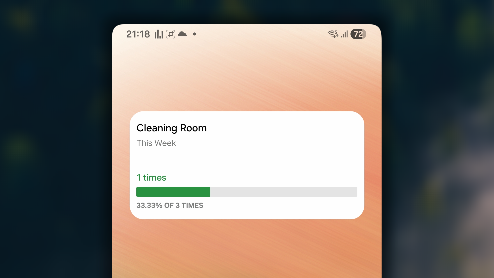

    - Với thói quen xấu cần giới hạn, tiện ích hiển thị thanh tiến trình so với giới hạn, với một đường dọc màu đỏ ở giữa đánh dấu mức không nên vượt quá. Khi vượt giới hạn, giá trị vượt quá được hiển thị màu đỏ.

    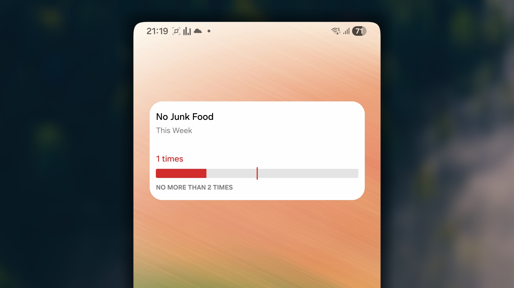

    ### Chuỗi hiện tại

    Tiện ích này được thiết kế hoàn toàn để tạo động lực. Tiện ích hiển thị số chuỗi hiện tại của bất kỳ thói quen nào bạn chọn.

    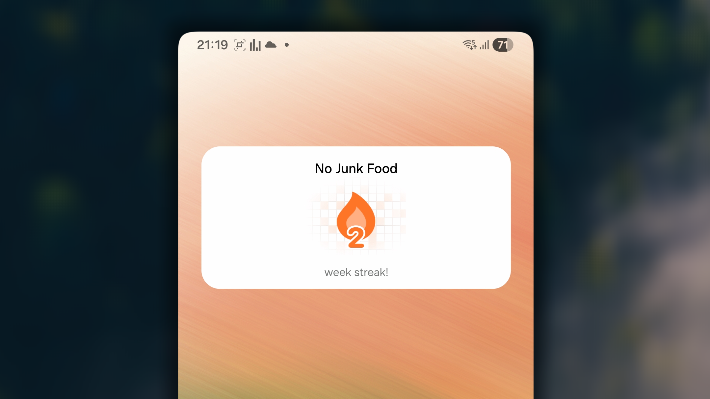

    ### Thói quen hôm nay

    Tiện ích Hôm nay hiển thị danh sách những thói quen tốt được đặt lặp lại trong ngày hiện tại theo bố cục gọn. Bạn có thể cấu hình tiện ích để hiển thị tất cả thói quen hoặc danh sách thói quen của một khu vực. Chuỗi hiện tại xuất hiện bên cạnh mỗi thói quen.

    Trên tiện ích, thói quen được sắp xếp theo cách bạn sắp xếp trên màn hình Nhật ký trong ứng dụng.

    Khi một thói quen hoàn thành:

    - chuỗi của thói quen được cập nhật.
    - thói quen chuyển xuống cuối danh sách, ưu tiên những thói quen chưa hoàn thành.

    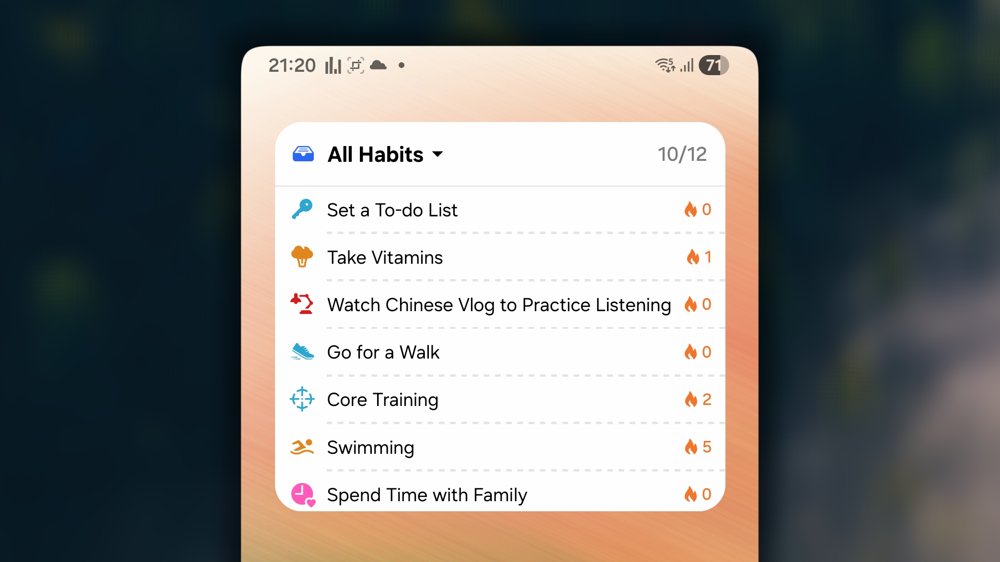

    ## Check-in bằng tiện ích

    Khi chạm vào một thói quen trên tiện ích, ứng dụng sẽ mở màn hình Nhật ký và cuộn đến thói quen đó. Điều này giúp bạn dễ dàng tìm đến thói quen trong danh sách và check-in tiến trình.

    ## **Thay đổi kích thước tiện ích: Khả năng và giới hạn**

    Hệ điều hành Android được thiết kế rất linh hoạt, cho phép người dùng tự do thay đổi kích thước hầu hết tiện ích sau khi đặt.

    ### **Cách thay đổi kích thước**

    1. Đặt một tiện ích Habitify trên màn hình chính.
    2. Nhấn giữ tiện ích cho đến khi các tay nắm đổi kích thước (chấm hoặc đường ở cạnh) xuất hiện.
    3. Kéo tay nắm để mở rộng hoặc thu nhỏ đến kích thước mong muốn.
    4. Nội dung tiện ích tự động điều chỉnh cho vừa kích thước mới.

    ### **Giới hạn**

    Giới hạn chính trên Android có thể đến từ trình khởi chạy của thiết bị cụ thể. Một số nhà sản xuất có thể xử lý việc đổi kích thước hơi khác nhau.

    ## Câu hỏi thường gặp

    <Accordion title="**Tiện ích không cập nhật tiến trình thói quen, tôi nên làm gì?**">
      Trước khi đi sâu vào cài đặt riêng của thiết bị, hãy thử các bước đơn giản sau để giải quyết phần lớn sự cố tiện ích trên mọi nền tảng.

      1. **Mở ứng dụng Habitify:** Bước đầu tiên đơn giản nhất là mở ứng dụng Habitify chính và để ở màn hình trước trong 30–60 giây. Việc này thường buộc tiện ích đồng bộ dữ liệu mới nhất.
      2. **Xóa rồi thêm lại tiện ích:** Nếu không hiệu quả, hãy xóa tiện ích khỏi màn hình chính rồi thêm lại. Việc này buộc tiện ích tải lại toàn bộ cấu hình.
      3. **Khởi động lại thiết bị:** Khởi động lại hoàn toàn điện thoại có thể xóa các lỗi hệ thống tạm thời đang ảnh hưởng đến tiện ích.

      Sự cố tiện ích trên Android gần như luôn do cài đặt tối ưu hóa pin quá mạnh, ngăn ứng dụng chạy trong nền.

      - **Đặt pin thành Không hạn chế**: Đây là bước quan trọng nhất. Đi đến **Cài đặt** → **Ứng dụng** → **Habitify** → **Pin** trên điện thoại rồi đổi thành **Không hạn chế**.
      - **Khóa ứng dụng trong màn hình Gần đây (đặc biệt với Xiaomi/OnePlus/Oppo):** Mở màn hình "Ứng dụng gần đây". Nhấn giữ bản xem trước Habitify rồi chạm vào biểu tượng Khóa. Thao tác này yêu cầu hệ thống ưu tiên Habitify và không tự động tắt ứng dụng.
      - **Kiểm tra quyền Tự khởi động:** Trong cài đặt điện thoại, tìm trình quản lý **Tự khởi động** hoặc **Khởi động** và bảo đảm Habitify được bật.
    </Accordion>

    <Accordion title="**Tại sao thói quen xấu không xuất hiện trong một số tiện ích?**">
      Thói quen xấu không được hỗ trợ trên tiện ích Thói quen hôm nay. Lý do chính của thiết kế này là giữ cho danh sách việc cần làm hằng ngày tập trung và tạo động lực.

      1. **"Danh sách hôm nay" dành cho hành động.** Tiện ích được thiết kế như danh sách kiểm tra hằng ngày, nhắc bạn về những hành động tích cực cần **thực hiện**. Đưa một thói quen xấu như "Không hút thuốc" vào danh sách những việc _cần làm_ có thể phản tác dụng. Mục tiêu là tránh và quên thói quen xấu, không phải được nhắc đến nó bên cạnh các tác vụ tích cực.
      2. **"Chuỗi tiến trình" dùng để tôn vinh thành công.** Mục đích của tiện ích là tạo một chuỗi thành tích trực quan, thỏa mãn. Với thói quen xấu, thành công đạt được bằng cách _không hành động_ hoặc _tránh_. Nếu đưa thói quen xấu vào đây, tiện ích chỉ hiển thị một chuỗi ô trống hoặc chưa đạt ("X"), không tạo nhiều động lực khi nhìn thấy trên màn hình chính mỗi ngày.

      Bằng cách tập trung các tiện ích này vào thói quen tốt, chúng tôi hướng đến một bảng điều khiển tích cực và thiên về hành động hơn cho ngày của bạn.
    </Accordion>
  </Tab>
</Tabs>
